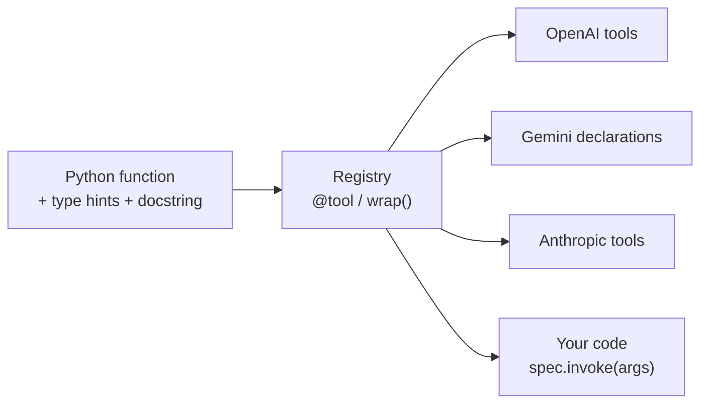
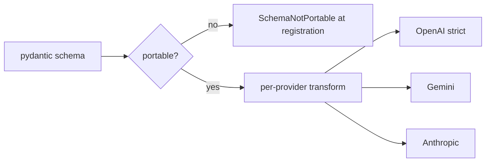

# agent_adapter — Plan 1: Skeleton + Core Tools Implementation Plan

> **For agentic workers:** REQUIRED SUB-SKILL: Use superpowers:subagent-driven-development (recommended) or superpowers:executing-plans to implement this plan task-by-task. Steps use checkbox (`- [ ]`) syntax for tracking.

**Goal:** A pip-installable `agent_adapter` package where any Python function becomes a validated, portable tool that renders correctly for OpenAI, Gemini and Anthropic.

**Architecture:** `core/` builds a `ToolSpec` (pydantic args model + policy) from a function signature and docstring; `Registry` holds specs and rejects non-portable schemas; `schema/` checks and rewrites JSON schemas per provider; `integrations/` turns specs into provider tool formats as plain dicts (no SDK needed). Covers spec phases 0 and 1.

**Tech Stack:** Python 3.11+ (dev on 3.12), pydantic 2, hatchling, pytest + pytest-asyncio, ruff, mypy, MkDocs Material + mkdocstrings.

**Spec:** `docs/superpowers/specs/2026-10-29-agentic-adapter-design.md` (§3, §4.1–4.4, §5, §13 renderers, §16, §17)

## Global Constraints

- Python `>=3.11`; develop with `py -3.12`.
- Runtime dependency: `pydantic>=2.7,<3` only. Everything else is an extra.
- No LiteLLM. Nothing imports `app` (the branch is orphan; enforced by test).
- `agent_adapter.core` and `agent_adapter.schema` never import `agent_adapter.integrations`, nor `openai`, `google`, `anthropic`, `langchain`, `langchain_core`, `langgraph`, `mcp` (AST boundary test).
- Absolute imports only.
- Docstrings: one line; add `Args`/`Raises` only for non-obvious public API. No change-history comments.
- All errors subclass `AdapterError`; never swallow an exception.
- Licence: proprietary, internal use only.
- Commits: Conventional Commits, ending with `Co-Authored-By: Claude Opus 5.5 (1M context) <noreply@anthropic.com>`.
- Run every command from the worktree root: `.claude/worktrees/agent-adapter`. Shell examples are bash (Git Bash); the venv interpreter is `.venv/Scripts/python`.

## File Structure

| File | Responsibility |
|---|---|
| `pyproject.toml` | Packaging, extras, pytest/ruff/mypy config |
| `.gitignore`, `.gitattributes`, `README.md` | Repo hygiene, LF endings, one-page intro |
| `agent_adapter/__init__.py` | Public API re-exports, `__version__`, default registry |
| `agent_adapter/py.typed` | PEP 561 marker |
| `agent_adapter/core/_docstring.py` | Google-style docstring → description + param text |
| `agent_adapter/core/errors.py` | `AdapterError` hierarchy |
| `agent_adapter/core/context.py` | `ToolContext` |
| `agent_adapter/core/tool.py` | `ToolSpec`, `build_spec`, arg validation, `invoke` |
| `agent_adapter/core/registry.py` | `Registry`: `tool`, `wrap`, `add`, `get`, `subset`, `catalogue` |
| `agent_adapter/schema/portable.py` | `check_portable(schema) -> list[str]` |
| `agent_adapter/schema/transforms.py` | `inline_refs`, `to_plain`, `to_openai_parameters`, `to_gemini_parameters`, `to_anthropic_input_schema` |
| `agent_adapter/integrations/{openai,gemini,anthropic}.py` | Provider tool renderers |
| `tests/…` | Mirrors the package; `test_boundaries.py`, `test_examples.py` |
| `examples/quickstart.py` | Runnable quickstart, executed by tests |
| `mkdocs.yml`, `docs/…` | Documentation site |

---

### Task 1: Package skeleton, dev environment, boundary test

**Files:**
- Create: `pyproject.toml`, `.gitignore`, `.gitattributes`, `README.md`
- Create: `agent_adapter/__init__.py`, `agent_adapter/py.typed`, `agent_adapter/core/__init__.py`, `agent_adapter/schema/__init__.py`, `agent_adapter/integrations/__init__.py`
- Create: `tests/__init__.py`, `tests/test_package.py`, `tests/test_boundaries.py`
- Modify: `docs/superpowers/specs/2026-10-29-agentic-adapter-design.md` (§3 "Import contracts" line)

**Interfaces:**
- Produces: importable `agent_adapter` with `__version__ = "0.1.0"`; empty `core`, `schema`, `integrations` subpackages; a dev venv at `.venv`.

- [ ] **Step 1: Write repo files**

`pyproject.toml`:
```toml
[build-system]
requires = ["hatchling>=1.25"]
build-backend = "hatchling.build"

[project]
name = "agent-adapter"
dynamic = ["version"]
description = "Framework-independent tools, parallel execution and flows for LLM agents."
readme = "README.md"
requires-python = ">=3.11"
license = { text = "Proprietary - internal use only" }
dependencies = ["pydantic>=2.7,<3"]

[project.optional-dependencies]
gemini = ["google-genai>=1.0"]
dev = ["pytest>=8", "pytest-asyncio>=0.24", "ruff>=0.6", "mypy>=1.11"]
docs = ["mkdocs-material>=9.5", "mkdocstrings[python]>=0.26"]

[tool.hatch.version]
path = "agent_adapter/__init__.py"

[tool.hatch.build.targets.wheel]
packages = ["agent_adapter"]

[tool.pytest.ini_options]
asyncio_mode = "auto"
testpaths = ["tests"]

[tool.ruff]
line-length = 100
target-version = "py311"

[tool.ruff.lint]
select = ["E", "F", "I", "B", "UP", "SIM", "RUF"]

[tool.mypy]
python_version = "3.11"
strict = true
packages = ["agent_adapter"]
plugins = ["pydantic.mypy"]
```

`.gitignore`:
```
.venv/
__pycache__/
*.py[cod]
.pytest_cache/
.mypy_cache/
.ruff_cache/
*.egg-info/
build/
dist/
site/
.coverage
```

`.gitattributes`:
```
* text=auto eol=lf
```

`README.md`:
```markdown
# agent_adapter

Define a tool once as a plain Python function. Use it from OpenAI, Gemini,
Anthropic, LangGraph, ADK, MCP or plain code.

Internal use only. Docs: `mkdocs serve` (see `docs/`).
```

`agent_adapter/__init__.py`:
```python
"""agent_adapter: framework-independent tools, parallel execution and flows for LLM agents."""

__version__ = "0.1.0"
```

`agent_adapter/py.typed`: empty file.

`agent_adapter/core/__init__.py`:
```python
"""Tool definitions, registry, context and errors. Depends only on pydantic."""
```

`agent_adapter/schema/__init__.py`:
```python
"""Portable JSON-schema checks and per-provider rewrites."""
```

`agent_adapter/integrations/__init__.py`:
```python
"""Renderers and bridges for model APIs and agent frameworks."""
```

`tests/__init__.py`: empty file.

- [ ] **Step 2: Create the venv and install**

Run:
```bash
py -3.12 -m venv .venv
.venv/Scripts/python -m pip install --upgrade pip
.venv/Scripts/python -m pip install -e ".[dev,docs,gemini]"
```
Expected: ends with `Successfully installed ... agent-adapter-0.1.0 ...`.

- [ ] **Step 3: Write the failing tests**

`tests/test_package.py`:
```python
import agent_adapter


def test_package_exposes_version():
    assert agent_adapter.__version__ == "0.1.0"
```

`tests/test_boundaries.py`:
```python
"""Core layers must not import frameworks, provider SDKs, the host app, or integrations."""

import ast
from pathlib import Path

PACKAGE = Path(__file__).resolve().parents[1] / "agent_adapter"
CORE_LAYERS = ("core", "schema")
FORBIDDEN_ROOTS = {
    "openai", "google", "anthropic", "langchain", "langchain_core", "langgraph", "mcp", "app",
}
FORBIDDEN_PREFIX = "agent_adapter.integrations"


def _imports(path: Path) -> list[tuple[str, int]]:
    tree = ast.parse(path.read_text(encoding="utf-8"))
    found: list[tuple[str, int]] = []
    for node in ast.walk(tree):
        if isinstance(node, ast.Import):
            found += [(alias.name, 0) for alias in node.names]
        elif isinstance(node, ast.ImportFrom):
            found.append((node.module or "", node.level))
    return found


def _core_files() -> list[Path]:
    return [p for layer in CORE_LAYERS for p in (PACKAGE / layer).rglob("*.py")]


def test_core_layers_exist():
    assert _core_files()


def test_core_layers_import_nothing_forbidden():
    offenders = [
        f"{path.relative_to(PACKAGE)}: {name or '.'} (level {level})"
        for path in _core_files()
        for name, level in _imports(path)
        if level > 0
        or name.split(".")[0] in FORBIDDEN_ROOTS
        or name.startswith(FORBIDDEN_PREFIX)
    ]
    assert offenders == []
```

- [ ] **Step 4: Run tests**

Run: `.venv/Scripts/python -m pytest -v`
Expected: 3 passed. (The skeleton already satisfies them; they guard every later task.)

- [ ] **Step 5: Lint and type-check**

Run: `.venv/Scripts/python -m ruff check . && .venv/Scripts/python -m ruff format --check . && .venv/Scripts/python -m mypy`
Expected: `All checks passed!`, formatting clean (run `ruff format .` if not), `Success: no issues found`.

- [ ] **Step 6: Align the spec with the boundary mechanism**

In `docs/superpowers/specs/2026-10-29-agentic-adapter-design.md` §3, replace
`**Import contracts** (enforced by \`import-linter\` in CI):`
with
`**Import contracts** (enforced by an AST boundary test, \`tests/test_boundaries.py\`):`

- [ ] **Step 7: Commit**

```bash
git add pyproject.toml .gitignore .gitattributes README.md agent_adapter tests docs/superpowers/specs
git commit -m "chore: scaffold agent_adapter package with boundary test

Co-Authored-By: Claude Opus 5.5 (1M context) <noreply@anthropic.com>"
```

---

### Task 2: Docstring parser

**Files:**
- Create: `agent_adapter/core/_docstring.py`
- Test: `tests/core/__init__.py` (empty), `tests/core/test_docstring.py`

**Interfaces:**
- Produces: `parse_docstring(doc: str | None) -> tuple[str, dict[str, str]]` — `(description, {param_name: text})`; description excludes `Args`/`Returns`/`Raises`/… sections.

- [ ] **Step 1: Write the failing test**

`tests/core/test_docstring.py`:
```python
from agent_adapter.core._docstring import parse_docstring


def test_parse_docstring_splits_description_and_args():
    doc = """Search articles.

    Longer explanation.

    Args:
        query: The search text.
        top_k (int): How many hits
            to return.

    Returns:
        A list of hits.
    """
    description, params = parse_docstring(doc)
    assert description == "Search articles.\n\nLonger explanation."
    assert params == {"query": "The search text.", "top_k": "How many hits to return."}


def test_parse_docstring_none_is_empty():
    assert parse_docstring(None) == ("", {})


def test_parse_docstring_without_sections_is_all_description():
    assert parse_docstring("Just a summary.") == ("Just a summary.", {})


def test_parse_docstring_ignores_raises_section():
    doc = "Do it.\n\nRaises:\n    ValueError: bad input.\n"
    assert parse_docstring(doc) == ("Do it.", {})
```

- [ ] **Step 2: Run test to verify it fails**

Run: `.venv/Scripts/python -m pytest tests/core/test_docstring.py -v`
Expected: FAIL — `ModuleNotFoundError: No module named 'agent_adapter.core._docstring'`

- [ ] **Step 3: Implement**

`agent_adapter/core/_docstring.py`:
```python
"""Parse Google-style docstrings into a description and per-parameter text."""

from __future__ import annotations

import inspect
import re

_SECTION_RE = re.compile(
    r"^(Args|Arguments|Parameters|Returns|Return|Raises|Yields|Examples?|Notes?|Attributes):\s*$"
)
_PARAM_RE = re.compile(r"^\*{0,2}(\w+)\s*(?:\([^)]*\))?\s*:\s*(.*)$")
_ARG_SECTIONS = frozenset({"Args", "Arguments", "Parameters"})


def parse_docstring(doc: str | None) -> tuple[str, dict[str, str]]:
    """Return (description, {param: text}) from a Google-style docstring."""
    if not doc:
        return "", {}
    description: list[str] = []
    params: dict[str, str] = {}
    section: str | None = None
    current: str | None = None
    param_indent: int | None = None
    for line in inspect.cleandoc(doc).splitlines():
        header = None if line.startswith((" ", "\t")) else _SECTION_RE.match(line.strip())
        if header:
            section, current, param_indent = header.group(1), None, None
            continue
        if section is None:
            description.append(line.rstrip())
            continue
        if section not in _ARG_SECTIONS or not line.strip():
            continue
        indent = len(line) - len(line.lstrip())
        match = _PARAM_RE.match(line.strip())
        if match and (param_indent is None or indent <= param_indent):
            param_indent = indent
            current = match.group(1)
            params[current] = match.group(2).strip()
        elif current is not None:
            params[current] = f"{params[current]} {line.strip()}".strip()
    return "\n".join(description).strip(), params
```

- [ ] **Step 4: Run tests**

Run: `.venv/Scripts/python -m pytest tests/core/test_docstring.py -v`
Expected: 4 passed.

- [ ] **Step 5: Commit**

```bash
git add agent_adapter/core/_docstring.py tests/core
git commit -m "feat(core): parse Google-style docstrings for tool descriptions

Co-Authored-By: Claude Opus 5.5 (1M context) <noreply@anthropic.com>"
```

---

### Task 3: Errors, ToolContext, ToolSpec and `build_spec`

**Files:**
- Create: `agent_adapter/core/errors.py`, `agent_adapter/core/context.py`, `agent_adapter/core/tool.py`
- Test: `tests/core/test_errors.py`, `tests/core/test_build_spec.py`

**Interfaces:**
- Consumes: `parse_docstring` (Task 2).
- Produces:
  - Errors: `AdapterError`, `ToolDefinitionError`, `DuplicateTool`, `ToolNotFound`, `ToolArgsInvalid(tool: str, errors: list[Any])` (attrs `.tool`, `.errors`), `SchemaNotPortable(problems: list[str], tool: str | None = None)` (attrs `.problems`, `.tool`).
  - `ToolContext(run_id: str = "", call_id: str = "", state: Mapping[str, Any] = {}, extras: dict[str, Any] = {})`.
  - `ToolSpec` frozen dataclass: `name, description, args_model, func, context_param, fixed, rename (LLM name -> Python name), result, kind="tool", tags=frozenset(), parallel_safe=False, once_per_run=False, confirm=False, timeout=None, retries=0, cache_ttl=None, prompt_hint=None, portable=True`; method `json_schema() -> dict[str, Any]`.
  - `build_spec(func, *, name=None, description=None, fixed=None, hide=(), rename=None, result=None, **policy) -> ToolSpec` where `rename` maps Python name -> LLM name.

- [ ] **Step 1: Write the failing tests**

`tests/core/test_errors.py`:
```python
from agent_adapter.core.errors import (
    AdapterError,
    DuplicateTool,
    SchemaNotPortable,
    ToolArgsInvalid,
    ToolDefinitionError,
    ToolNotFound,
)


def test_errors_share_adapter_error_base():
    for cls in (ToolDefinitionError, DuplicateTool, ToolNotFound):
        assert issubclass(cls, AdapterError)
    assert isinstance(ToolArgsInvalid("t", []), AdapterError)
    assert isinstance(SchemaNotPortable(["x"]), AdapterError)


def test_schema_not_portable_message_names_tool_and_problems():
    err = SchemaNotPortable(["$.a: open map (dict) is not portable"], tool="search")
    assert "tool 'search'" in str(err) and "open map" in str(err)
    assert err.problems == ["$.a: open map (dict) is not portable"]
```

`tests/core/test_build_spec.py`:
```python
from __future__ import annotations

import pytest
from pydantic import BaseModel

from agent_adapter.core.context import ToolContext
from agent_adapter.core.errors import ToolDefinitionError
from agent_adapter.core.tool import build_spec


class Filter(BaseModel):
    court: str = "sc"


async def search(
    query: str, top_k: int = 8, flt: Filter | None = None, ctx: ToolContext | None = None
) -> list[str]:
    """Search articles.

    Args:
        query: The search text.
        top_k: How many hits.
    """
    return []


class Service:
    def lookup(self, section: str) -> str:
        """Look up a section."""
        return section


def test_build_spec_uses_name_docstring_and_signature():
    spec = build_spec(search)
    schema = spec.json_schema()
    assert spec.name == "search"
    assert spec.description == "Search articles."
    assert schema["required"] == ["query"]
    assert set(schema["properties"]) == {"query", "top_k", "flt"}
    assert schema["properties"]["query"]["description"] == "The search text."
    assert schema["properties"]["top_k"]["default"] == 8
    assert spec.context_param == "ctx"


def test_build_spec_explicit_name_and_description_win():
    spec = build_spec(search, name="find", description="Find things.")
    assert (spec.name, spec.description) == ("find", "Find things.")


def test_build_spec_without_description_raises():
    async def nodoc(x: int) -> int:
        return x

    with pytest.raises(ToolDefinitionError, match="description"):
        build_spec(nodoc)


def test_build_spec_rejects_var_args():
    def many(*items: str) -> None:
        """Doc."""

    with pytest.raises(ToolDefinitionError, match=r"\*args"):
        build_spec(many)


def test_build_spec_rejects_missing_annotation():
    def untyped(x) -> None:
        """Doc."""

    with pytest.raises(ToolDefinitionError, match="annotation"):
        build_spec(untyped)


def test_build_spec_rejects_invalid_name():
    with pytest.raises(ToolDefinitionError, match="invalid tool name"):
        build_spec(search, name="bad-name!")


def test_build_spec_fixed_and_hidden_params_leave_schema():
    spec = build_spec(search, fixed={"top_k": 3}, hide=["flt"])
    assert set(spec.json_schema()["properties"]) == {"query"}
    assert spec.fixed == {"top_k": 3}


def test_build_spec_hidden_param_without_default_raises():
    with pytest.raises(ToolDefinitionError, match="needs a default"):
        build_spec(search, hide=["query"])


def test_build_spec_unknown_param_in_options_raises():
    with pytest.raises(ToolDefinitionError, match="unknown parameters"):
        build_spec(search, fixed={"nope": 1})


def test_build_spec_rename_changes_llm_facing_name():
    spec = build_spec(search, rename={"query": "text"})
    assert "text" in spec.json_schema()["properties"]
    assert spec.rename == {"text": "query"}


def test_build_spec_stores_policy_options():
    spec = build_spec(search, kind="retrieval", tags=["dt"], parallel_safe=True, timeout=5.0)
    assert (spec.kind, spec.tags, spec.parallel_safe, spec.timeout) == (
        "retrieval",
        frozenset({"dt"}),
        True,
        5.0,
    )


def test_build_spec_unknown_policy_option_raises():
    with pytest.raises(ToolDefinitionError, match="unknown option"):
        build_spec(search, colour="red")


def test_build_spec_bound_method_drops_self():
    spec = build_spec(Service().lookup)
    assert spec.name == "lookup"
    assert set(spec.json_schema()["properties"]) == {"section"}
```

- [ ] **Step 2: Run tests to verify they fail**

Run: `.venv/Scripts/python -m pytest tests/core -v`
Expected: FAIL — `ModuleNotFoundError: No module named 'agent_adapter.core.errors'`

- [ ] **Step 3: Implement errors and context**

`agent_adapter/core/errors.py`:
```python
"""Error types raised by agent_adapter; all subclass AdapterError."""

from __future__ import annotations

from typing import Any


class AdapterError(Exception):
    """Base class for every error raised by agent_adapter."""


class ToolDefinitionError(AdapterError):
    """A function cannot be turned into a tool."""


class DuplicateTool(AdapterError):
    """A tool with this name is already registered."""


class ToolNotFound(AdapterError):
    """No tool is registered under the requested name."""


class ToolArgsInvalid(AdapterError):
    """Arguments supplied for a tool failed validation."""

    def __init__(self, tool: str, errors: list[Any]) -> None:
        self.tool = tool
        self.errors = errors
        super().__init__(f"invalid arguments for tool {tool!r}: {errors}")


class SchemaNotPortable(AdapterError):
    """A schema uses features that some providers reject."""

    def __init__(self, problems: list[str], tool: str | None = None) -> None:
        self.problems = problems
        self.tool = tool
        where = f" for tool {tool!r}" if tool else ""
        super().__init__(f"schema{where} is not portable: " + "; ".join(problems))
```

`agent_adapter/core/context.py`:
```python
"""Per-call context injected into tools and hidden from the LLM."""

from __future__ import annotations

from collections.abc import Mapping
from dataclasses import dataclass, field
from typing import Any


@dataclass
class ToolContext:
    """Run-scoped data a tool may read; never part of the tool's schema."""

    run_id: str = ""
    call_id: str = ""
    state: Mapping[str, Any] = field(default_factory=dict)
    extras: dict[str, Any] = field(default_factory=dict)
```

- [ ] **Step 4: Implement ToolSpec and build_spec**

`agent_adapter/core/tool.py`:
```python
"""ToolSpec: a callable plus everything needed to expose it as an LLM tool."""

from __future__ import annotations

import functools
import inspect
import re
import types
import typing
from collections.abc import Callable, Iterable, Mapping
from dataclasses import dataclass, field
from typing import Any, Union

from pydantic import BaseModel, ConfigDict, Field, create_model

from agent_adapter.core._docstring import parse_docstring
from agent_adapter.core.context import ToolContext
from agent_adapter.core.errors import ToolDefinitionError

# Intersection of the OpenAI, Gemini and Anthropic tool-name rules.
_NAME_RE = re.compile(r"^[A-Za-z_][A-Za-z0-9_]{0,63}$")
_POLICY_OPTIONS = frozenset(
    {
        "kind",
        "tags",
        "parallel_safe",
        "once_per_run",
        "confirm",
        "timeout",
        "retries",
        "cache_ttl",
        "prompt_hint",
        "portable",
    }
)

ConfirmRule = bool | Callable[..., Any]


@dataclass(frozen=True)
class ToolSpec:
    """A registered tool: callable, argument model and execution policy."""

    name: str
    description: str
    args_model: type[BaseModel]
    func: Callable[..., Any] = field(repr=False)
    context_param: str | None = None
    fixed: Mapping[str, Any] = field(default_factory=dict)
    rename: Mapping[str, str] = field(default_factory=dict)  # LLM-facing name -> Python name
    result: Callable[[Any], Any] | None = field(default=None, repr=False)
    kind: str = "tool"
    tags: frozenset[str] = frozenset()
    parallel_safe: bool = False
    once_per_run: bool = False
    confirm: ConfirmRule = False
    timeout: float | None = None
    retries: int = 0
    cache_ttl: float | None = None
    prompt_hint: str | None = None
    portable: bool = True

    def json_schema(self) -> dict[str, Any]:
        """Provider-neutral JSON schema of the arguments the LLM supplies."""
        return self.args_model.model_json_schema()


def build_spec(
    func: Callable[..., Any],
    *,
    name: str | None = None,
    description: str | None = None,
    fixed: Mapping[str, Any] | None = None,
    hide: Iterable[str] = (),
    rename: Mapping[str, str] | None = None,
    result: Callable[[Any], Any] | None = None,
    **policy: Any,
) -> ToolSpec:
    """Build a ToolSpec from a function's signature and docstring.

    Args:
        rename: Python parameter name -> name the LLM sees.
        **policy: Execution options such as `kind`, `tags`, `parallel_safe`, `timeout`.

    Raises:
        ToolDefinitionError: the function cannot be exposed as a tool.
    """
    tool_name = name or getattr(func, "__name__", "")
    if not _NAME_RE.match(tool_name):
        raise ToolDefinitionError(
            f"invalid tool name {tool_name!r}: use letters, digits and '_' (max 64)"
        )
    unknown_options = set(policy) - _POLICY_OPTIONS
    if unknown_options:
        raise ToolDefinitionError(f"tool {tool_name!r}: unknown option(s) {sorted(unknown_options)}")
    if "tags" in policy:
        policy["tags"] = frozenset(policy["tags"])

    doc_description, param_docs = parse_docstring(inspect.getdoc(func))
    tool_description = (description or doc_description).strip()
    if not tool_description:
        raise ToolDefinitionError(f"tool {tool_name!r} needs a description or a docstring")

    fixed_values = dict(fixed or {})
    hidden = set(hide)
    renamed = dict(rename or {})
    signature = inspect.signature(func)
    unknown_params = (set(fixed_values) | hidden | set(renamed)) - set(signature.parameters)
    if unknown_params:
        raise ToolDefinitionError(f"tool {tool_name!r}: unknown parameters {sorted(unknown_params)}")

    hints = _type_hints(func, tool_name)
    fields: dict[str, Any] = {}
    llm_to_python: dict[str, str] = {}
    context_param: str | None = None
    for param in signature.parameters.values():
        annotation = hints.get(param.name, param.annotation)
        if param.kind in (param.VAR_POSITIONAL, param.VAR_KEYWORD):
            raise ToolDefinitionError(f"tool {tool_name!r}: *args/**kwargs are not supported")
        if param.kind is param.POSITIONAL_ONLY:
            raise ToolDefinitionError(
                f"tool {tool_name!r}: positional-only parameter {param.name!r} is not supported"
            )
        if _is_context(annotation):
            context_param = param.name
            continue
        if param.name in fixed_values:
            continue
        if param.name in hidden:
            if param.default is param.empty:
                raise ToolDefinitionError(
                    f"tool {tool_name!r}: hidden parameter {param.name!r} needs a default"
                )
            continue
        if annotation is param.empty:
            raise ToolDefinitionError(
                f"tool {tool_name!r}: parameter {param.name!r} needs a type annotation"
            )
        llm_name = renamed.get(param.name, param.name)
        default = ... if param.default is param.empty else param.default
        fields[llm_name] = (annotation, Field(default, description=param_docs.get(param.name)))
        if llm_name != param.name:
            llm_to_python[llm_name] = param.name

    args_model = create_model(
        _model_name(tool_name), __config__=ConfigDict(extra="forbid"), **fields
    )
    return ToolSpec(
        name=tool_name,
        description=tool_description,
        args_model=args_model,
        func=func,
        context_param=context_param,
        fixed=fixed_values,
        rename=llm_to_python,
        result=result,
        **policy,
    )


def _type_hints(func: Callable[..., Any], tool_name: str) -> dict[str, Any]:
    target: Any = func
    while isinstance(target, functools.partial):
        target = target.func
    if not (inspect.isfunction(target) or inspect.ismethod(target)):
        target = getattr(type(target), "__call__", target)
    try:
        return typing.get_type_hints(target, include_extras=True)
    except (NameError, TypeError) as exc:
        raise ToolDefinitionError(
            f"tool {tool_name!r}: cannot resolve type hints ({exc})"
        ) from exc


def _is_context(annotation: Any) -> bool:
    if annotation is ToolContext:
        return True
    if typing.get_origin(annotation) in (Union, types.UnionType):
        return ToolContext in typing.get_args(annotation)
    return False


def _model_name(tool_name: str) -> str:
    return "".join(part.capitalize() for part in tool_name.split("_") if part) + "Args"
```

- [ ] **Step 5: Run tests**

Run: `.venv/Scripts/python -m pytest tests/core -v`
Expected: all passed (4 docstring + 2 errors + 13 build_spec).

- [ ] **Step 6: Lint, type-check, commit**

Run: `.venv/Scripts/python -m ruff check . && .venv/Scripts/python -m ruff format --check . && .venv/Scripts/python -m mypy`
Expected: clean.
```bash
git add agent_adapter/core tests/core
git commit -m "feat(core): build ToolSpec from function signature and docstring

Co-Authored-By: Claude Opus 5.5 (1M context) <noreply@anthropic.com>"
```

---

### Task 4: Argument validation and `ToolSpec.invoke`

**Files:**
- Modify: `agent_adapter/core/tool.py` (imports; add two methods to `ToolSpec`; add helpers at end)
- Test: `tests/core/test_invoke.py`

**Interfaces:**
- Consumes: `ToolSpec`, `build_spec`, `ToolContext`, `ToolArgsInvalid` (Task 3).
- Produces:
  - `ToolSpec.validate_args(args: Mapping[str, Any] | None) -> BaseModel` — raises `ToolArgsInvalid`; `None` for an optional field whose type does not accept `None` is dropped so the default applies (strict-mode providers send `null`).
  - `async ToolSpec.invoke(args: Mapping[str, Any] | None = None, ctx: ToolContext | None = None) -> Any` — sync functions run in `asyncio.to_thread`; nested models are passed as model instances; `fixed` values merged; renamed args mapped back; `result` applied.

- [ ] **Step 1: Write the failing test**

`tests/core/test_invoke.py`:
```python
import threading

import pytest
from pydantic import BaseModel

from agent_adapter.core.context import ToolContext
from agent_adapter.core.errors import ToolArgsInvalid
from agent_adapter.core.tool import build_spec


class Filter(BaseModel):
    court: str = "sc"
    year: int | None = 2020


async def search(query: str, top_k: int = 8, flt: Filter | None = None) -> dict:
    """Search."""
    return {"query": query, "top_k": top_k, "flt": flt}


async def test_invoke_async_function_with_coerced_args():
    result = await build_spec(search).invoke({"query": "80C", "top_k": "3"})
    assert result == {"query": "80C", "top_k": 3, "flt": None}


async def test_invoke_sync_function_runs_in_worker_thread():
    def where(x: int) -> int:
        """Return the current thread id."""
        return threading.get_ident()

    assert await build_spec(where).invoke({"x": 1}) != threading.get_ident()


async def test_invoke_missing_required_arg_raises():
    with pytest.raises(ToolArgsInvalid) as info:
        await build_spec(search).invoke({"top_k": 1})
    assert info.value.tool == "search"


async def test_invoke_unknown_arg_raises():
    with pytest.raises(ToolArgsInvalid):
        await build_spec(search).invoke({"query": "q", "colour": "red"})


async def test_invoke_merges_fixed_and_maps_renamed_args():
    spec = build_spec(search, fixed={"top_k": 2}, rename={"query": "text"})
    assert await spec.invoke({"text": "q"}) == {"query": "q", "top_k": 2, "flt": None}


async def test_invoke_injects_given_or_default_context():
    async def who(ctx: ToolContext) -> str:
        """Return the run id."""
        return ctx.run_id

    spec = build_spec(who)
    assert await spec.invoke({}, ToolContext(run_id="r1")) == "r1"
    assert await spec.invoke({}) == ""


async def test_invoke_applies_result_transform():
    spec = build_spec(search, result=lambda r: r["query"].upper())
    assert await spec.invoke({"query": "q"}) == "Q"


async def test_invoke_turns_strict_mode_nulls_into_defaults():
    out = await build_spec(search).invoke(
        {"query": "q", "top_k": None, "flt": {"court": None, "year": None}}
    )
    assert out["top_k"] == 8
    assert out["flt"] == Filter(court="sc", year=None)


async def test_invoke_passes_nested_models_as_instances():
    out = await build_spec(search).invoke({"query": "q", "flt": {"court": "hc"}})
    assert isinstance(out["flt"], Filter)
    assert out["flt"].court == "hc"


async def test_invoke_does_not_mutate_caller_args():
    args = {"query": "q", "top_k": None}
    await build_spec(search).invoke(args)
    assert args == {"query": "q", "top_k": None}
```

- [ ] **Step 2: Run test to verify it fails**

Run: `.venv/Scripts/python -m pytest tests/core/test_invoke.py -v`
Expected: FAIL — `AttributeError: 'ToolSpec' object has no attribute 'invoke'`

- [ ] **Step 3: Implement**

In `agent_adapter/core/tool.py`, replace the import block (from `import functools` through `from agent_adapter.core.errors import ToolDefinitionError`) with:
```python
import asyncio
import copy
import functools
import inspect
import re
import types
import typing
from collections.abc import Callable, Iterable, Mapping
from dataclasses import dataclass, field
from typing import Any, TypeGuard, Union

from pydantic import BaseModel, ConfigDict, Field, ValidationError, create_model

from agent_adapter.core._docstring import parse_docstring
from agent_adapter.core.context import ToolContext
from agent_adapter.core.errors import ToolArgsInvalid, ToolDefinitionError
```

Inside `class ToolSpec`, after `json_schema`, add:
```python
    def validate_args(self, args: Mapping[str, Any] | None) -> BaseModel:
        """Validate LLM-supplied arguments against the tool's model.

        Raises:
            ToolArgsInvalid: arguments are missing, unknown or the wrong type.
        """
        data = copy.deepcopy(dict(args or {}))
        _drop_strict_nulls(self.args_model, data)
        try:
            return self.args_model.model_validate(data)
        except ValidationError as exc:
            raise ToolArgsInvalid(self.name, exc.errors(include_url=False)) from exc

    async def invoke(
        self, args: Mapping[str, Any] | None = None, ctx: ToolContext | None = None
    ) -> Any:
        """Validate args, call the function (sync ones in a worker thread), apply `result`."""
        validated = self.validate_args(args)
        kwargs = {
            self.rename.get(name, name): getattr(validated, name)
            for name in type(validated).model_fields
        }
        kwargs.update(self.fixed)
        if self.context_param is not None:
            kwargs[self.context_param] = ctx if ctx is not None else ToolContext()
        if inspect.iscoroutinefunction(self.func):
            value = await self.func(**kwargs)
        else:
            value = await asyncio.to_thread(self.func, **kwargs)
            if inspect.isawaitable(value):
                value = await value
        return self.result(value) if self.result is not None else value
```

At the end of the file, add:
```python
def _drop_strict_nulls(model: type[BaseModel], data: dict[str, Any]) -> None:
    """Strict-mode providers send null for every optional field; let the default apply."""
    for name, info in model.model_fields.items():
        if name not in data:
            continue
        value = data[name]
        if value is None:
            if not info.is_required() and not _accepts_none(info.annotation):
                del data[name]
            continue
        inner = _strip_optional(info.annotation)
        if isinstance(value, dict) and _is_model(inner):
            _drop_strict_nulls(inner, value)
        elif isinstance(value, list) and typing.get_origin(inner) is list:
            item_args = typing.get_args(inner)
            item = _strip_optional(item_args[0]) if item_args else None
            if _is_model(item):
                for entry in value:
                    if isinstance(entry, dict):
                        _drop_strict_nulls(item, entry)


def _accepts_none(annotation: Any) -> bool:
    if annotation is Any or annotation is None or annotation is type(None):
        return True
    if typing.get_origin(annotation) in (Union, types.UnionType):
        return any(_accepts_none(arg) for arg in typing.get_args(annotation))
    return False


def _strip_optional(annotation: Any) -> Any:
    if typing.get_origin(annotation) in (Union, types.UnionType):
        rest = [arg for arg in typing.get_args(annotation) if arg is not type(None)]
        if len(rest) == 1:
            return rest[0]
    return annotation


def _is_model(annotation: Any) -> TypeGuard[type[BaseModel]]:
    return inspect.isclass(annotation) and issubclass(annotation, BaseModel)
```

- [ ] **Step 4: Run tests**

Run: `.venv/Scripts/python -m pytest tests/core -v`
Expected: all passed (including 10 new invoke tests).

- [ ] **Step 5: Lint, type-check, commit**

Run: `.venv/Scripts/python -m ruff check . && .venv/Scripts/python -m ruff format --check . && .venv/Scripts/python -m mypy`
```bash
git add agent_adapter/core/tool.py tests/core/test_invoke.py
git commit -m "feat(core): validate tool args and invoke sync or async tools

Co-Authored-By: Claude Opus 5.5 (1M context) <noreply@anthropic.com>"
```

---

### Task 5: Portable-schema check

**Files:**
- Create: `agent_adapter/schema/portable.py`
- Test: `tests/schema/__init__.py` (empty), `tests/schema/test_portable.py`

**Interfaces:**
- Produces: `check_portable(schema: dict[str, Any]) -> list[str]` — empty list means portable. Each problem is `"<path>: <reason>"` where reason contains one of: `root must be an object`, `open map (dict)`, `untyped value (Any)`, `tuple`, `union of several types`, `recursive model`, `enum values must be strings`, `regex pattern`, `format '<x>'`, `list without an item type`, `unresolvable $ref`.

- [ ] **Step 1: Write the failing test**

`tests/schema/test_portable.py`:
```python
from __future__ import annotations

from datetime import date, datetime
from enum import Enum
from typing import Annotated, Any, Literal

from pydantic import BaseModel, ConfigDict, Field, create_model

from agent_adapter.schema.portable import check_portable


class Court(str, Enum):
    SC = "sc"
    HC = "hc"


class Filter(BaseModel):
    court: Court = Court.SC
    year: int | None = None


class Good(BaseModel):
    model_config = ConfigDict(extra="forbid")
    query: str = Field(description="Text.")
    top_k: int = Field(8, ge=1, le=50)
    mode: Literal["fast", "deep"] = "fast"
    tag: Literal["x"] = "x"
    flt: Filter | None = None
    many: list[Filter] = Field(default_factory=list)
    when: datetime | None = None


class TreeNode(BaseModel):
    children: list[TreeNode] = Field(default_factory=list)


def problems_for(**fields: Any) -> str:
    model = create_model("M", **{name: (annotation, ...) for name, annotation in fields.items()})
    return " | ".join(check_portable(model.model_json_schema()))


def test_portable_schema_has_no_problems():
    assert check_portable(Good.model_json_schema()) == []


def test_root_must_be_object():
    assert "root must be an object" in check_portable({"type": "string"})[0]


def test_dict_is_rejected():
    assert "open map (dict)" in problems_for(options=dict[str, int])


def test_any_is_rejected():
    assert "untyped value (Any)" in problems_for(value=Any)


def test_tuple_is_rejected():
    assert "tuple" in problems_for(pair=tuple[int, str])


def test_multi_type_union_is_rejected():
    assert "union of several types" in problems_for(value=int | str)


def test_recursive_model_is_rejected():
    assert "recursive model" in problems_for(tree=TreeNode)


def test_non_string_enum_is_rejected():
    assert "enum values must be strings" in problems_for(level=Literal[1, 2])


def test_pattern_is_rejected():
    assert "regex pattern" in problems_for(code=Annotated[str, Field(pattern=r"^\d+$")])


def test_date_format_is_rejected_but_datetime_allowed():
    assert "format 'date'" in problems_for(day=date)
    assert problems_for(at=datetime) == ""
```

- [ ] **Step 2: Run test to verify it fails**

Run: `.venv/Scripts/python -m pytest tests/schema -v`
Expected: FAIL — `ModuleNotFoundError: No module named 'agent_adapter.schema.portable'`

- [ ] **Step 3: Implement**

`agent_adapter/schema/portable.py`:
```python
"""Check a JSON schema against the subset every supported provider accepts."""

from __future__ import annotations

from typing import Any

_REJECTED_KEYWORDS = {
    "pattern": "regex pattern",
    "patternProperties": "patternProperties",
    "minLength": "minLength",
    "maxLength": "maxLength",
    "prefixItems": "tuple",
    "oneOf": "oneOf union",
    "discriminator": "discriminated union",
    "uniqueItems": "uniqueItems",
    "minProperties": "minProperties",
    "maxProperties": "maxProperties",
}
_ALLOWED_FORMATS = frozenset({"date-time"})


def check_portable(schema: dict[str, Any]) -> list[str]:
    """Return the portability problems in `schema`; an empty list means portable."""
    problems: list[str] = []
    if schema.get("type") != "object":
        problems.append("$: root must be an object")
    _walk(schema, "$", schema.get("$defs", {}), problems, ())
    return problems


def _walk(
    node: dict[str, Any],
    path: str,
    defs: dict[str, Any],
    problems: list[str],
    stack: tuple[str, ...],
) -> None:
    ref = node.get("$ref")
    if ref is not None:
        name = ref.rsplit("/", 1)[-1]
        if not ref.startswith("#/$defs/") or name not in defs:
            problems.append(f"{path}: unresolvable $ref {ref}")
        elif name in stack:
            problems.append(f"{path}: recursive model {name} is not portable")
        else:
            _walk(defs[name], path, defs, problems, (*stack, name))
        return

    for keyword, label in _REJECTED_KEYWORDS.items():
        if keyword in node:
            problems.append(f"{path}: {label} is not portable")
    fmt = node.get("format")
    if fmt is not None and fmt not in _ALLOWED_FORMATS:
        problems.append(f"{path}: format {fmt!r} is not portable")
    if "enum" in node and not all(isinstance(v, str) for v in node["enum"]):
        problems.append(f"{path}: enum values must be strings")
    if "const" in node and not isinstance(node["const"], str):
        problems.append(f"{path}: enum values must be strings")

    if "anyOf" in node:
        branches = node["anyOf"]
        if len([b for b in branches if b.get("type") != "null"]) > 1:
            problems.append(f"{path}: union of several types is not portable")
        for i, branch in enumerate(branches):
            _walk(branch, f"{path}|{i}", defs, problems, stack)
        return
    if "allOf" in node:
        for i, part in enumerate(node["allOf"]):
            _walk(part, f"{path}&{i}", defs, problems, stack)
        return

    kind = node.get("type")
    if kind is None:
        if "enum" not in node and "const" not in node:
            problems.append(f"{path}: untyped value (Any) is not portable")
        return
    if isinstance(kind, list):
        problems.append(f"{path}: multiple types {kind} are not portable")
        return
    if kind == "object":
        extra = node.get("additionalProperties")
        if extra is True or isinstance(extra, dict):
            problems.append(f"{path}: open map (dict) is not portable")
        for name, sub in node.get("properties", {}).items():
            _walk(sub, f"{path}.{name}", defs, problems, stack)
    elif kind == "array":
        items = node.get("items")
        if isinstance(items, dict):
            _walk(items, f"{path}[]", defs, problems, stack)
        else:
            problems.append(f"{path}: list without an item type is not portable")
```

- [ ] **Step 4: Run tests**

Run: `.venv/Scripts/python -m pytest tests/schema -v`
Expected: 10 passed.

- [ ] **Step 5: Lint, type-check, commit**

Run: `.venv/Scripts/python -m ruff check . && .venv/Scripts/python -m ruff format --check . && .venv/Scripts/python -m mypy`
```bash
git add agent_adapter/schema/portable.py tests/schema
git commit -m "feat(schema): reject tool schemas that some providers cannot accept

Co-Authored-By: Claude Opus 5.5 (1M context) <noreply@anthropic.com>"
```

---

### Task 6: Per-provider schema transforms

**Files:**
- Create: `agent_adapter/schema/transforms.py`
- Test: `tests/schema/test_transforms.py`

**Interfaces:**
- Consumes: `SchemaNotPortable` (Task 3).
- Produces:
  - `inline_refs(schema) -> dict` — `$ref` replaced by definitions (siblings kept), `$defs` dropped, single-item `allOf` flattened; raises `SchemaNotPortable` on recursion or unknown `$ref`.
  - `to_plain(schema) -> dict` — `inline_refs` + drop `title` keywords + `const` → `enum`.
  - `to_openai_parameters(schema, *, strict: bool = True) -> dict` — strict: every object gets `additionalProperties: false`, all properties required, optional ones made nullable (`anyOf [..., null]`, description on the wrapper), `default` removed.
  - `to_gemini_parameters(schema) -> dict` — `to_plain` keeping only Gemini-supported keywords.
  - `to_anthropic_input_schema(schema) -> dict` — `to_plain`.

- [ ] **Step 1: Write the failing test**

`tests/schema/test_transforms.py`:
```python
import json
from enum import Enum

import pytest
from pydantic import BaseModel, ConfigDict, Field

from agent_adapter.core.errors import SchemaNotPortable
from agent_adapter.schema.transforms import (
    inline_refs,
    to_anthropic_input_schema,
    to_gemini_parameters,
    to_openai_parameters,
    to_plain,
)


class Court(str, Enum):
    SC = "sc"
    HC = "hc"


class Filter(BaseModel):
    court: Court = Court.SC
    year: int | None = None


class SearchArgs(BaseModel):
    model_config = ConfigDict(extra="forbid")
    query: str = Field(description="The search text.")
    top_k: int = 8
    flt: Filter | None = None


SCHEMA = SearchArgs.model_json_schema()


def test_inline_refs_removes_defs_and_keeps_siblings():
    out = inline_refs(SCHEMA)
    assert "$defs" not in json.dumps(out) and "$ref" not in json.dumps(out)
    court = out["properties"]["flt"]["anyOf"][0]["properties"]["court"]
    assert court == {"enum": ["sc", "hc"], "title": "Court", "type": "string", "default": "sc"}


def test_inline_refs_flattens_single_all_of():
    schema = {
        "type": "object",
        "properties": {"a": {"allOf": [{"$ref": "#/$defs/X"}], "description": "d"}},
        "$defs": {"X": {"type": "string"}},
    }
    assert inline_refs(schema)["properties"]["a"] == {"type": "string", "description": "d"}


def test_inline_refs_rejects_recursion():
    schema = {
        "type": "object",
        "properties": {"n": {"$ref": "#/$defs/N"}},
        "$defs": {"N": {"type": "object", "properties": {"n": {"$ref": "#/$defs/N"}}}},
    }
    with pytest.raises(SchemaNotPortable, match="recursive"):
        inline_refs(schema)


def test_to_plain_drops_title_keyword_but_not_a_property_named_title():
    schema = {
        "type": "object",
        "title": "T",
        "properties": {"title": {"const": "x", "type": "string", "title": "Title"}},
    }
    assert to_plain(schema) == {
        "type": "object",
        "properties": {"title": {"enum": ["x"], "type": "string"}},
    }


def test_openai_strict_requires_all_and_makes_optional_nullable():
    assert to_openai_parameters(SCHEMA) == {
        "type": "object",
        "additionalProperties": False,
        "required": ["query", "top_k", "flt"],
        "properties": {
            "query": {"description": "The search text.", "type": "string"},
            "top_k": {"anyOf": [{"type": "integer"}, {"type": "null"}]},
            "flt": {
                "anyOf": [
                    {
                        "type": "object",
                        "additionalProperties": False,
                        "required": ["court", "year"],
                        "properties": {
                            "court": {
                                "anyOf": [{"enum": ["sc", "hc"], "type": "string"}, {"type": "null"}]
                            },
                            "year": {"anyOf": [{"type": "integer"}, {"type": "null"}]},
                        },
                    },
                    {"type": "null"},
                ]
            },
        },
    }


def test_openai_strict_moves_description_to_nullable_wrapper():
    schema = {"type": "object", "properties": {"n": {"type": "integer", "description": "How many."}}}
    assert to_openai_parameters(schema)["properties"]["n"] == {
        "description": "How many.",
        "anyOf": [{"type": "integer"}, {"type": "null"}],
    }


def test_openai_non_strict_is_plain():
    assert to_openai_parameters(SCHEMA, strict=False) == to_plain(SCHEMA)


def test_gemini_keeps_only_supported_keywords():
    assert to_gemini_parameters(SCHEMA) == {
        "type": "object",
        "additionalProperties": False,
        "required": ["query"],
        "properties": {
            "query": {"description": "The search text.", "type": "string"},
            "top_k": {"type": "integer"},
            "flt": {
                "anyOf": [
                    {
                        "type": "object",
                        "properties": {
                            "court": {"enum": ["sc", "hc"], "type": "string"},
                            "year": {"anyOf": [{"type": "integer"}, {"type": "null"}]},
                        },
                    },
                    {"type": "null"},
                ]
            },
        },
    }


def test_anthropic_keeps_defaults():
    out = to_anthropic_input_schema(SCHEMA)
    assert out == to_plain(SCHEMA)
    assert out["properties"]["top_k"] == {"default": 8, "type": "integer"}
```

- [ ] **Step 2: Run test to verify it fails**

Run: `.venv/Scripts/python -m pytest tests/schema/test_transforms.py -v`
Expected: FAIL — `ModuleNotFoundError: No module named 'agent_adapter.schema.transforms'`

- [ ] **Step 3: Implement**

`agent_adapter/schema/transforms.py`:
```python
"""Per-provider rewrites of a portable JSON schema."""

from __future__ import annotations

from collections.abc import Callable
from typing import Any

from agent_adapter.core.errors import SchemaNotPortable

_GEMINI_KEYWORDS = frozenset(
    {
        "type",
        "description",
        "properties",
        "required",
        "enum",
        "format",
        "minimum",
        "maximum",
        "items",
        "minItems",
        "maxItems",
        "anyOf",
        "additionalProperties",
        "nullable",
    }
)

NodeFn = Callable[[dict[str, Any]], dict[str, Any]]


def inline_refs(schema: dict[str, Any]) -> dict[str, Any]:
    """Replace every local $ref with its definition and drop $defs.

    Raises:
        SchemaNotPortable: a $ref is recursive or points nowhere.
    """
    defs: dict[str, Any] = schema.get("$defs", {})

    def resolve(node: Any, stack: tuple[str, ...]) -> Any:
        if isinstance(node, list):
            return [resolve(item, stack) for item in node]
        if not isinstance(node, dict):
            return node
        if "$ref" in node:
            name = node["$ref"].rsplit("/", 1)[-1]
            if name in stack:
                raise SchemaNotPortable([f"recursive $ref {name!r} cannot be inlined"])
            if name not in defs:
                raise SchemaNotPortable([f"unresolvable $ref {node['$ref']!r}"])
            target = resolve(defs[name], (*stack, name))
            siblings = {k: resolve(v, stack) for k, v in node.items() if k != "$ref"}
            return {**target, **siblings}
        out = {k: resolve(v, stack) for k, v in node.items() if k != "$defs"}
        all_of = out.get("allOf")
        if isinstance(all_of, list) and len(all_of) == 1 and isinstance(all_of[0], dict):
            del out["allOf"]
            out = {**all_of[0], **out}
        return out

    result: dict[str, Any] = resolve(schema, ())
    return result


def to_plain(schema: dict[str, Any]) -> dict[str, Any]:
    """Inline refs, drop `title` keywords, turn `const` into a one-value `enum`."""
    return _map_nodes(inline_refs(schema), _plain_node)


def to_openai_parameters(schema: dict[str, Any], *, strict: bool = True) -> dict[str, Any]:
    """Parameters for OpenAI tools; strict mode requires every field and forbids extras."""
    plain = to_plain(schema)
    return _map_nodes(plain, _strict_node) if strict else plain


def to_gemini_parameters(schema: dict[str, Any]) -> dict[str, Any]:
    """`parameters_json_schema` for Gemini, keeping only keywords Gemini accepts."""
    return _map_nodes(to_plain(schema), _gemini_node)


def to_anthropic_input_schema(schema: dict[str, Any]) -> dict[str, Any]:
    """`input_schema` for Anthropic tools."""
    return to_plain(schema)


def _map_nodes(node: dict[str, Any], fn: NodeFn) -> dict[str, Any]:
    """Apply `fn` to every schema node; property names are never treated as keywords."""
    out = fn(dict(node))
    if isinstance(out.get("properties"), dict):
        out["properties"] = {k: _map_nodes(v, fn) for k, v in out["properties"].items()}
    for key in ("items", "additionalProperties"):
        if isinstance(out.get(key), dict):
            out[key] = _map_nodes(out[key], fn)
    for key in ("anyOf", "allOf"):
        if isinstance(out.get(key), list):
            out[key] = [_map_nodes(v, fn) for v in out[key]]
    return out


def _plain_node(node: dict[str, Any]) -> dict[str, Any]:
    node.pop("title", None)
    if "const" in node:
        node["enum"] = [node.pop("const")]
    return node


def _strict_node(node: dict[str, Any]) -> dict[str, Any]:
    node.pop("default", None)
    if node.get("type") != "object":
        return node
    props = dict(node.get("properties", {}))
    required = set(node.get("required", []))
    for name, sub in props.items():
        if name not in required and not _is_nullable(sub):
            inner = {k: v for k, v in sub.items() if k != "description"}
            wrapper: dict[str, Any] = {"anyOf": [inner, {"type": "null"}]}
            if "description" in sub:
                wrapper["description"] = sub["description"]
            props[name] = wrapper
    node["properties"] = props
    node["required"] = list(props)
    node["additionalProperties"] = False
    return node


def _gemini_node(node: dict[str, Any]) -> dict[str, Any]:
    return {k: v for k, v in node.items() if k in _GEMINI_KEYWORDS}


def _is_nullable(node: dict[str, Any]) -> bool:
    kind = node.get("type")
    if kind == "null" or (isinstance(kind, list) and "null" in kind):
        return True
    return any(branch.get("type") == "null" for branch in node.get("anyOf", []))
```

- [ ] **Step 4: Run tests**

Run: `.venv/Scripts/python -m pytest tests/schema -v`
Expected: all passed (10 portable + 9 transforms).

- [ ] **Step 5: Lint, type-check, commit**

Run: `.venv/Scripts/python -m ruff check . && .venv/Scripts/python -m ruff format --check . && .venv/Scripts/python -m mypy`
```bash
git add agent_adapter/schema/transforms.py tests/schema/test_transforms.py
git commit -m "feat(schema): rewrite tool schemas for OpenAI strict, Gemini and Anthropic

Co-Authored-By: Claude Opus 5.5 (1M context) <noreply@anthropic.com>"
```

---

### Task 7: Registry and public API

**Files:**
- Create: `agent_adapter/core/registry.py`
- Modify: `agent_adapter/__init__.py` (full replacement below)
- Test: `tests/core/test_registry.py`

**Interfaces:**
- Consumes: `build_spec`, `ToolSpec` (Tasks 3–4), `check_portable` (Task 5), errors (Task 3).
- Produces:
  - `Registry()` with: `tool` (decorator, bare `@reg.tool` or `@reg.tool(**options)`; returns the function unchanged; plain functions get attribute `__agent_tool__` = spec), `wrap(func, **options) -> ToolSpec`, `add(spec) -> ToolSpec` (raises `DuplicateTool`, `SchemaNotPortable`), `get(name) -> ToolSpec` (raises `ToolNotFound`), `__contains__`, `__iter__` (specs, registration order), `__len__`, `names() -> list[str]`, `subset(*, names=None, tags=None, kinds=None) -> Registry`, `catalogue() -> str`.
  - Package exports: `Registry`, `ToolSpec`, `ToolContext`, `build_spec`, errors, `default_registry`, `tool`, `wrap`, `__version__`.

- [ ] **Step 1: Write the failing test**

`tests/core/test_registry.py`:
```python
import pytest

import agent_adapter
from agent_adapter import Registry
from agent_adapter.core.errors import DuplicateTool, SchemaNotPortable, ToolNotFound


def make_registry() -> Registry:
    reg = Registry()

    @reg.tool(kind="retrieval", tags=["dt"], prompt_hint="Statute questions.")
    async def sections(query: str, top_k: int = 5) -> list[str]:
        """Fetch sections.

        Args:
            query: What to look for.
        """
        return [query] * top_k

    def legacy_news(text: str, limit: int) -> list[str]:
        """Fetch news."""
        return [text] * limit

    reg.wrap(legacy_news, name="news", fixed={"limit": 1}, tags=["idt"])
    return reg


def test_decorator_registers_and_returns_function_unchanged():
    reg = Registry()

    @reg.tool
    async def ping(x: int) -> int:
        """Echo."""
        return x

    assert "ping" in reg
    assert ping.__agent_tool__ is reg.get("ping")


async def test_decorated_function_is_still_directly_callable():
    reg = Registry()

    @reg.tool
    async def double(x: int) -> int:
        """Double."""
        return x * 2

    assert await double(4) == 8


def test_wrap_registers_existing_function_without_fixed_args_in_schema():
    assert set(make_registry().get("news").json_schema()["properties"]) == {"text"}


async def test_wrapped_tool_invokes_original_function():
    assert await make_registry().get("news").invoke({"text": "gst"}) == ["gst"]


def test_duplicate_name_raises():
    reg = make_registry()

    def sections(q: str) -> str:
        """Duplicate."""
        return q

    with pytest.raises(DuplicateTool):
        reg.wrap(sections)


def test_get_unknown_tool_lists_known_names():
    with pytest.raises(ToolNotFound, match="news"):
        make_registry().get("nope")


def test_non_portable_signature_is_rejected_at_registration():
    def bad(options: dict[str, int]) -> None:
        """Bad."""

    with pytest.raises(SchemaNotPortable, match="open map"):
        Registry().wrap(bad)


def test_portable_false_skips_the_check():
    def bad(options: dict[str, int]) -> None:
        """Bad."""

    reg = Registry()
    reg.wrap(bad, portable=False)
    assert "bad" in reg


def test_iteration_length_and_names_follow_registration_order():
    reg = make_registry()
    assert len(reg) == 2
    assert reg.names() == ["sections", "news"]
    assert [spec.name for spec in reg] == ["sections", "news"]


def test_subset_filters_by_tags_and_kinds():
    reg = make_registry()
    assert reg.subset(tags=["dt"]).names() == ["sections"]
    assert reg.subset(kinds=["tool"]).names() == ["news"]
    assert reg.subset(names=["news"]).names() == ["news"]


def test_subset_unknown_name_raises():
    with pytest.raises(ToolNotFound):
        make_registry().subset(names=["ghost"])


def test_catalogue_lists_tools_hints_and_arguments():
    text = make_registry().catalogue()
    assert "### sections\nFetch sections." in text
    assert "When to use: Statute questions." in text
    assert "- `query` (required): What to look for." in text
    assert "- `top_k` (optional)" in text
    assert "### news" in text


def test_package_level_tool_uses_default_registry():
    @agent_adapter.tool(name="pkg_level_echo")
    async def echo(x: int) -> int:
        """Echo."""
        return x

    assert "pkg_level_echo" in agent_adapter.default_registry
```

- [ ] **Step 2: Run test to verify it fails**

Run: `.venv/Scripts/python -m pytest tests/core/test_registry.py -v`
Expected: FAIL — `ImportError: cannot import name 'Registry' from 'agent_adapter'`

- [ ] **Step 3: Implement the registry**

`agent_adapter/core/registry.py`:
```python
"""Registry: the one place an app defines the tools it exposes."""

from __future__ import annotations

import inspect
import logging
from collections.abc import Callable, Iterable, Iterator
from typing import Any, TypeVar, overload

from agent_adapter.core.errors import DuplicateTool, SchemaNotPortable, ToolNotFound
from agent_adapter.core.tool import ToolSpec, build_spec
from agent_adapter.schema.portable import check_portable

logger = logging.getLogger(__name__)

F = TypeVar("F", bound=Callable[..., Any])
SPEC_ATTR = "__agent_tool__"


class Registry:
    """Holds ToolSpecs by name; executors and exports read from here."""

    def __init__(self) -> None:
        self._tools: dict[str, ToolSpec] = {}

    @overload
    def tool(self, func: F, /) -> F: ...

    @overload
    def tool(self, func: None = None, /, **options: Any) -> Callable[[F], F]: ...

    def tool(self, func: F | None = None, /, **options: Any) -> F | Callable[[F], F]:
        """Decorator: register a function as a tool and return it unchanged."""

        def register(target: F) -> F:
            spec = self.add(build_spec(target, **options))
            if inspect.isfunction(target):
                setattr(target, SPEC_ATTR, spec)
            return target

        return register(func) if func is not None else register

    def wrap(self, func: Callable[..., Any], **options: Any) -> ToolSpec:
        """Register existing code as a tool without editing it."""
        return self.add(build_spec(func, **options))

    def add(self, spec: ToolSpec) -> ToolSpec:
        """Register a spec after checking its name and schema portability.

        Raises:
            DuplicateTool: the name is taken.
            SchemaNotPortable: the schema would fail on some provider.
        """
        if spec.name in self._tools:
            raise DuplicateTool(f"tool {spec.name!r} is already registered")
        if spec.portable:
            problems = check_portable(spec.json_schema())
            if problems:
                raise SchemaNotPortable(problems, tool=spec.name)
        self._tools[spec.name] = spec
        logger.debug("registered tool %s (kind=%s)", spec.name, spec.kind)
        return spec

    def get(self, name: str) -> ToolSpec:
        """Return the spec for `name`.

        Raises:
            ToolNotFound: no tool has that name.
        """
        try:
            return self._tools[name]
        except KeyError:
            raise ToolNotFound(f"no tool named {name!r}; known: {sorted(self._tools)}") from None

    def __contains__(self, name: object) -> bool:
        return name in self._tools

    def __iter__(self) -> Iterator[ToolSpec]:
        return iter(self._tools.values())

    def __len__(self) -> int:
        return len(self._tools)

    def names(self) -> list[str]:
        """Tool names in registration order."""
        return list(self._tools)

    def subset(
        self,
        *,
        names: Iterable[str] | None = None,
        tags: Iterable[str] | None = None,
        kinds: Iterable[str] | None = None,
    ) -> Registry:
        """A new registry holding only tools that match every given filter.

        Raises:
            ToolNotFound: a requested name is not registered.
        """
        wanted_names = set(names) if names is not None else None
        wanted_tags = set(tags) if tags is not None else None
        wanted_kinds = set(kinds) if kinds is not None else None
        if wanted_names:
            missing = wanted_names - set(self._tools)
            if missing:
                raise ToolNotFound(f"no tools named {sorted(missing)}")
        sub = Registry()
        for spec in self:
            if wanted_names is not None and spec.name not in wanted_names:
                continue
            if wanted_tags is not None and not spec.tags & wanted_tags:
                continue
            if wanted_kinds is not None and spec.kind not in wanted_kinds:
                continue
            sub._tools[spec.name] = spec
        return sub

    def catalogue(self) -> str:
        """Markdown tool list for planner prompts, generated so it never drifts from code."""
        blocks: list[str] = []
        for spec in self:
            schema = spec.json_schema()
            required = set(schema.get("required", []))
            lines = [f"### {spec.name}", spec.description]
            if spec.prompt_hint:
                lines.append(f"When to use: {spec.prompt_hint}")
            properties = schema.get("properties", {})
            if properties:
                lines.append("Arguments:")
                for arg, prop in properties.items():
                    flag = "required" if arg in required else "optional"
                    text = prop.get("description")
                    lines.append(f"- `{arg}` ({flag})" + (f": {text}" if text else ""))
            blocks.append("\n".join(lines))
        return "\n\n".join(blocks)
```

- [ ] **Step 4: Replace the package `__init__`**

`agent_adapter/__init__.py`:
```python
"""agent_adapter: framework-independent tools, parallel execution and flows for LLM agents."""

from agent_adapter.core.context import ToolContext
from agent_adapter.core.errors import (
    AdapterError,
    DuplicateTool,
    SchemaNotPortable,
    ToolArgsInvalid,
    ToolDefinitionError,
    ToolNotFound,
)
from agent_adapter.core.registry import Registry
from agent_adapter.core.tool import ToolSpec, build_spec

__version__ = "0.1.0"

default_registry = Registry()
tool = default_registry.tool
wrap = default_registry.wrap

__all__ = [
    "AdapterError",
    "DuplicateTool",
    "Registry",
    "SchemaNotPortable",
    "ToolArgsInvalid",
    "ToolContext",
    "ToolDefinitionError",
    "ToolNotFound",
    "ToolSpec",
    "__version__",
    "build_spec",
    "default_registry",
    "tool",
    "wrap",
]
```

- [ ] **Step 5: Run all tests**

Run: `.venv/Scripts/python -m pytest -v`
Expected: all passed (boundary test still green — `core.registry` imports `schema`, which is allowed).

- [ ] **Step 6: Lint, type-check, commit**

Run: `.venv/Scripts/python -m ruff check . && .venv/Scripts/python -m ruff format --check . && .venv/Scripts/python -m mypy`
```bash
git add agent_adapter/__init__.py agent_adapter/core/registry.py tests/core/test_registry.py
git commit -m "feat(core): add Registry with @tool, wrap(), subset and prompt catalogue

Co-Authored-By: Claude Opus 5.5 (1M context) <noreply@anthropic.com>"
```

---

### Task 8: OpenAI, Gemini and Anthropic renderers

**Files:**
- Create: `agent_adapter/integrations/openai.py`, `agent_adapter/integrations/gemini.py`, `agent_adapter/integrations/anthropic.py`
- Test: `tests/integrations/__init__.py` (empty), `tests/integrations/test_renderers.py`

**Interfaces:**
- Consumes: `Registry`, `ToolSpec` (Task 7); transforms (Task 6).
- Produces:
  - `openai.chat_tool(spec, *, strict=True) -> dict`, `openai.chat_tools(registry, *, strict=True) -> list[dict]`, `openai.responses_tool(spec, *, strict=True) -> dict`, `openai.responses_tools(registry, *, strict=True) -> list[dict]`.
  - `gemini.function_declaration(spec) -> dict` (`name`, `description`, `parameters_json_schema`), `gemini.function_declarations(registry) -> list[dict]`, `gemini.genai_tool(registry) -> google.genai.types.Tool` (needs extra `gemini`).
  - `anthropic.anthropic_tool(spec) -> dict` (`name`, `description`, `input_schema`), `anthropic.anthropic_tools(registry) -> list[dict]`.

- [ ] **Step 1: Write the failing test**

`tests/integrations/test_renderers.py`:
```python
import pytest

from agent_adapter import Registry
from agent_adapter.integrations import anthropic, gemini, openai

SECTION = {"type": "string", "description": "Section number, e.g. 80C."}


def registry() -> Registry:
    reg = Registry()

    @reg.tool
    async def lookup(section: str, year: int = 2025) -> str:
        """Look up a section.

        Args:
            section: Section number, e.g. 80C.
        """
        return section

    return reg


def test_openai_chat_tool_is_strict_function():
    assert openai.chat_tools(registry()) == [
        {
            "type": "function",
            "function": {
                "name": "lookup",
                "description": "Look up a section.",
                "strict": True,
                "parameters": {
                    "type": "object",
                    "additionalProperties": False,
                    "required": ["section", "year"],
                    "properties": {
                        "section": SECTION,
                        "year": {"anyOf": [{"type": "integer"}, {"type": "null"}]},
                    },
                },
            },
        }
    ]


def test_openai_non_strict_keeps_defaults_and_optional_fields():
    params = openai.chat_tool(registry().get("lookup"), strict=False)["function"]["parameters"]
    assert params["required"] == ["section"]
    assert params["properties"]["year"] == {"type": "integer", "default": 2025}


def test_openai_responses_tool_is_flat():
    tool = openai.responses_tools(registry())[0]
    assert tool["type"] == "function"
    assert tool["name"] == "lookup"
    assert tool["strict"] is True
    assert "function" not in tool


def test_gemini_function_declaration_uses_json_schema():
    assert gemini.function_declarations(registry()) == [
        {
            "name": "lookup",
            "description": "Look up a section.",
            "parameters_json_schema": {
                "type": "object",
                "additionalProperties": False,
                "required": ["section"],
                "properties": {"section": SECTION, "year": {"type": "integer"}},
            },
        }
    ]


def test_gemini_genai_tool_builds_sdk_object():
    pytest.importorskip("google.genai")
    tool = gemini.genai_tool(registry())
    assert tool.function_declarations[0].name == "lookup"


def test_anthropic_tool_uses_input_schema_with_defaults():
    tool = anthropic.anthropic_tools(registry())[0]
    assert tool["name"] == "lookup"
    assert tool["description"] == "Look up a section."
    assert tool["input_schema"]["properties"]["year"] == {"type": "integer", "default": 2025}
```

- [ ] **Step 2: Run test to verify it fails**

Run: `.venv/Scripts/python -m pytest tests/integrations -v`
Expected: FAIL — `ImportError: cannot import name 'anthropic' from 'agent_adapter.integrations'`

- [ ] **Step 3: Implement**

`agent_adapter/integrations/openai.py`:
```python
"""Render tools for the OpenAI Chat Completions and Responses APIs as plain dicts."""

from __future__ import annotations

from typing import Any

from agent_adapter.core.registry import Registry
from agent_adapter.core.tool import ToolSpec
from agent_adapter.schema.transforms import to_openai_parameters


def chat_tool(spec: ToolSpec, *, strict: bool = True) -> dict[str, Any]:
    """One tool in Chat Completions format."""
    return {
        "type": "function",
        "function": {
            "name": spec.name,
            "description": spec.description,
            "parameters": to_openai_parameters(spec.json_schema(), strict=strict),
            "strict": strict,
        },
    }


def chat_tools(registry: Registry, *, strict: bool = True) -> list[dict[str, Any]]:
    """Every registry tool in Chat Completions format."""
    return [chat_tool(spec, strict=strict) for spec in registry]


def responses_tool(spec: ToolSpec, *, strict: bool = True) -> dict[str, Any]:
    """One tool in Responses API format (flat, no `function` wrapper)."""
    return {
        "type": "function",
        "name": spec.name,
        "description": spec.description,
        "parameters": to_openai_parameters(spec.json_schema(), strict=strict),
        "strict": strict,
    }


def responses_tools(registry: Registry, *, strict: bool = True) -> list[dict[str, Any]]:
    """Every registry tool in Responses API format."""
    return [responses_tool(spec, strict=strict) for spec in registry]
```

`agent_adapter/integrations/gemini.py`:
```python
"""Render tools as Gemini function declarations."""

from __future__ import annotations

from typing import Any

from agent_adapter.core.registry import Registry
from agent_adapter.core.tool import ToolSpec
from agent_adapter.schema.transforms import to_gemini_parameters


def function_declaration(spec: ToolSpec) -> dict[str, Any]:
    """One tool as a Gemini function declaration dict."""
    return {
        "name": spec.name,
        "description": spec.description,
        "parameters_json_schema": to_gemini_parameters(spec.json_schema()),
    }


def function_declarations(registry: Registry) -> list[dict[str, Any]]:
    """Every registry tool as a Gemini function declaration dict."""
    return [function_declaration(spec) for spec in registry]


def genai_tool(registry: Registry) -> Any:
    """A `google.genai.types.Tool` holding every registry tool.

    Raises:
        ImportError: google-genai is not installed (`pip install 'agent-adapter[gemini]'`).
    """
    try:
        from google.genai import types
    except ImportError as exc:
        raise ImportError(
            "genai_tool needs google-genai: pip install 'agent-adapter[gemini]'"
        ) from exc
    return types.Tool(
        function_declarations=[
            types.FunctionDeclaration(**decl) for decl in function_declarations(registry)
        ]
    )
```

`agent_adapter/integrations/anthropic.py`:
```python
"""Render tools for the Anthropic Messages API as plain dicts."""

from __future__ import annotations

from typing import Any

from agent_adapter.core.registry import Registry
from agent_adapter.core.tool import ToolSpec
from agent_adapter.schema.transforms import to_anthropic_input_schema


def anthropic_tool(spec: ToolSpec) -> dict[str, Any]:
    """One tool in Anthropic Messages format."""
    return {
        "name": spec.name,
        "description": spec.description,
        "input_schema": to_anthropic_input_schema(spec.json_schema()),
    }


def anthropic_tools(registry: Registry) -> list[dict[str, Any]]:
    """Every registry tool in Anthropic Messages format."""
    return [anthropic_tool(spec) for spec in registry]
```

- [ ] **Step 4: Run all tests**

Run: `.venv/Scripts/python -m pytest -v`
Expected: all passed (6 renderer tests; the genai one runs because the `gemini` extra is installed).

- [ ] **Step 5: Lint, type-check, commit**

Run: `.venv/Scripts/python -m ruff check . && .venv/Scripts/python -m ruff format --check . && .venv/Scripts/python -m mypy`
```bash
git add agent_adapter/integrations tests/integrations
git commit -m "feat(integrations): render tools for OpenAI, Gemini and Anthropic

Co-Authored-By: Claude Opus 5.5 (1M context) <noreply@anthropic.com>"
```

---

### Task 9: Documentation site, runnable quickstart, full check

**Files:**
- Create: `mkdocs.yml`, `docs/index.md`, `docs/get-started/quickstart.md`, `docs/concepts/tools.md`, `docs/concepts/schemas.md`, `docs/integrations/openai.md`, `docs/integrations/gemini.md`, `docs/integrations/anthropic.md`, `docs/reference.md`
- Create: `examples/quickstart.py`
- Test: `tests/test_examples.py`

**Interfaces:**
- Consumes: everything above.
- Produces: `mkdocs build --strict` passes; `examples/quickstart.py` runs and is exercised by tests.

- [ ] **Step 1: Write the failing test**

`tests/test_examples.py`:
```python
import runpy
from pathlib import Path

EXAMPLES = Path(__file__).resolve().parents[1] / "examples"


def test_quickstart_runs(capsys):
    runpy.run_path(str(EXAMPLES / "quickstart.py"), run_name="__main__")
    out = capsys.readouterr().out
    assert "Section 80C (2025)" in out
    assert '"name": "duty_rate"' in out
    assert "18.0" in out
```

- [ ] **Step 2: Run test to verify it fails**

Run: `.venv/Scripts/python -m pytest tests/test_examples.py -v`
Expected: FAIL — `FileNotFoundError` for `examples/quickstart.py`

- [ ] **Step 3: Write the example**

`examples/quickstart.py`:
```python
"""Quickstart: define tools once, render them for OpenAI and Gemini, call them."""

import asyncio
import json

from agent_adapter import Registry, ToolContext
from agent_adapter.integrations import gemini, openai

registry = Registry()


@registry.tool(kind="retrieval", parallel_safe=True)
async def lookup_section(section: str, year: int = 2025, ctx: ToolContext | None = None) -> str:
    """Return the text of a statute section.

    Args:
        section: Section number, e.g. 80C.
        year: Act vintage.
    """
    return f"Section {section} ({year})"


def legacy_rate(item: str, country: str) -> float:
    """Return the duty rate for an item."""
    return 18.0


registry.wrap(legacy_rate, name="duty_rate", fixed={"country": "IN"})


async def main() -> None:
    print(json.dumps(openai.chat_tools(registry), indent=2))
    print(json.dumps(gemini.function_declarations(registry), indent=2))
    print(await registry.get("lookup_section").invoke({"section": "80C"}))
    print(await registry.get("duty_rate").invoke({"item": "steel"}))


if __name__ == "__main__":
    asyncio.run(main())
```

- [ ] **Step 4: Run test**

Run: `.venv/Scripts/python -m pytest tests/test_examples.py -v`
Expected: PASS.

- [ ] **Step 5: Write the docs site**

`mkdocs.yml`:
```yaml
site_name: agent_adapter
site_description: Framework-independent tools, parallel execution and flows for LLM agents.
exclude_docs: |
  superpowers/
theme:
  name: material
  features:
    - navigation.sections
    - content.code.copy
markdown_extensions:
  - admonition
  - tables
  - toc:
      permalink: true
  - pymdownx.highlight
  - pymdownx.snippets:
      base_path: ["."]
      check_paths: true
  - pymdownx.superfences:
      custom_fences:
        - name: mermaid
          class: mermaid
          format: !!python/name:pymdownx.superfences.fence_code_format
plugins:
  - search
  - mkdocstrings:
      handlers:
        python:
          options:
            docstring_style: google
            show_source: false
nav:
  - Home: index.md
  - Get started:
      - Quickstart: get-started/quickstart.md
  - Concepts:
      - Tools and the registry: concepts/tools.md
      - Schemas: concepts/schemas.md
  - Integrations:
      - OpenAI: integrations/openai.md
      - Gemini: integrations/gemini.md
      - Anthropic: integrations/anthropic.md
  - API reference: reference.md
```

`docs/index.md`:
````markdown
# agent_adapter

Write a tool once, as a plain Python function. Use it from any model API or agent
framework, or from plain code.



## Why

- **One definition.** The schema comes from the signature. The planner's tool list comes
  from the registry. Nothing is hand-synced.
- **Portable.** A signature some provider would reject fails at startup, not mid-request.
- **Existing code works as-is.** `wrap()` turns a function into a tool without editing it.
- **No framework lock-in.** The core depends only on pydantic.

## Status

| Area | State |
|---|---|
| Tools, registry, schemas | available |
| OpenAI, Gemini, Anthropic renderers | available |
| Parallel executor, flows, HITL, cost, cache | planned |
| LangGraph, ADK, LangChain, MCP and others | planned |

Start with the [Quickstart](get-started/quickstart.md).
````

`docs/get-started/quickstart.md`:
````markdown
# Quickstart

## Install

```bash
pip install -e ".[gemini]"      # from the repo root; `gemini` is optional
```

## Define, render, call

This is `examples/quickstart.py`. It runs in the test suite, so it stays correct.

```python
--8<-- "examples/quickstart.py"
```

What happens:

1. `@registry.tool` reads the signature and docstring and builds the schema.
   `ctx: ToolContext` is injected at call time and hidden from the LLM.
2. `registry.wrap(legacy_rate, fixed={"country": "IN"})` exposes existing code;
   `country` is bound, so the LLM never sees it.
3. `openai.chat_tools(...)` and `gemini.function_declarations(...)` render the same tools
   for each provider.
4. `spec.invoke(args)` validates the model's arguments and calls the function. Sync
   functions run in a worker thread.

## Run it

```bash
python examples/quickstart.py
```
````

`docs/concepts/tools.md`:
````markdown
# Tools and the registry

A **tool** is a function plus the metadata an LLM needs to call it. A **registry** holds
tools by name. Executors and exports read from the registry.

## Two ways in, same result

| | `@registry.tool` | `registry.wrap(func)` |
|---|---|---|
| Use for | code you own | code you cannot or will not edit |
| Where options live | on the decorator | at the call site |
| Function afterwards | unchanged, still callable | unchanged |

```python
@registry.tool(kind="retrieval", parallel_safe=True, timeout=20)
async def search(query: str, top_k: int = 8) -> list[str]:
    """Search articles."""

registry.wrap(legacy.get_sections, name="get_sections", fixed={"year": 2025})
```

## Where the schema comes from

| Source | Becomes |
|---|---|
| function name | tool name (`[A-Za-z_][A-Za-z0-9_]*`, max 64) |
| docstring summary | tool description |
| `Args:` section | per-argument descriptions |
| type hints | argument types |
| defaults | optional arguments |

Not allowed: `*args`, `**kwargs`, positional-only parameters, unannotated parameters.

## Shaping what the LLM sees

| Option | Effect |
|---|---|
| `fixed={"year": 2025}` | bound value, hidden from the LLM |
| `hide=["debug"]` | hidden; the default applies (must have one) |
| `rename={"section_list": "sections"}` | LLM sees `sections`; your function gets `section_list` |
| `result=to_hits` | transforms the return value |
| `description="..."` / `name="..."` | override docstring / function name |

## Policy options

`kind`, `tags`, `parallel_safe`, `once_per_run`, `confirm`, `timeout`, `retries`,
`cache_ttl`, `prompt_hint`, `portable`. They are stored on the `ToolSpec` now; the executor
(next release) enforces them.

## Context

A parameter annotated `ToolContext` is injected at call time and never appears in the
schema. It carries `run_id`, `call_id`, `state` and framework `extras`.

## Calling a tool

```python
result = await registry.get("search").invoke({"query": "80C"}, ctx)
```

- Arguments are validated; failures raise `ToolArgsInvalid`.
- Unknown arguments are rejected.
- `null` for an optional field whose type does not allow `None` is treated as "use the
  default". Strict-mode providers send `null` for every optional field.

## Prompt catalogue

`registry.catalogue()` renders a Markdown tool list for planner prompts. It is generated
from the code, so it cannot drift.

## Errors

| Error | When |
|---|---|
| `ToolDefinitionError` | the function cannot become a tool |
| `DuplicateTool` | name already registered |
| `SchemaNotPortable` | a provider would reject the schema |
| `ToolNotFound` | unknown name |
| `ToolArgsInvalid` | the model's arguments fail validation |

All subclass `AdapterError`.
````

`docs/concepts/schemas.md`:
````markdown
# Schemas

Each tool has one JSON schema, built by pydantic. Each provider gets a rewritten copy.



## The portable subset

| Allowed | Rejected |
|---|---|
| `str`, `int`, `float`, `bool` | `dict[str, T]` (open maps) |
| `Literal` / `Enum` of strings | unions of several types (`int \| str`) |
| `list[T]` | tuples |
| nested `BaseModel` | recursive models |
| `T \| None` | `Any` |
| `Field(description=, ge=, le=)` | `pattern`, `min/max_length`, formats other than `date-time` |

Need something outside the subset? Pass `portable=False` and test that tool on each
provider you use.

## What each provider gets

| Rewrite | OpenAI strict | Gemini | Anthropic |
|---|---|---|---|
| `$ref` inlined, `title` dropped | yes | yes | yes |
| every field required, optional made nullable | yes | no | no |
| `additionalProperties: false` everywhere | yes | as given | as given |
| `default` removed | yes | yes | kept |
| unsupported keywords dropped | no | yes | no |

Validation always happens on our side, with the tool's own pydantic model, so a dropped
keyword never weakens checking.
````

`docs/integrations/openai.md`:
````markdown
# OpenAI

No SDK import needed: renderers return plain dicts.

```python
from agent_adapter.integrations import openai

tools = openai.chat_tools(registry)          # Chat Completions
tools = openai.responses_tools(registry)     # Responses API (flat shape)
tools = openai.chat_tools(registry, strict=False)
```

Strict mode (default) makes every field required and optional ones nullable. When the
model sends `null`, `invoke` applies your default.

```python
call = response.choices[0].message.tool_calls[0]
result = await registry.get(call.function.name).invoke(json.loads(call.function.arguments))
```
````

`docs/integrations/gemini.md`:
````markdown
# Gemini

```python
from agent_adapter.integrations import gemini

decls = gemini.function_declarations(registry)   # plain dicts
tool = gemini.genai_tool(registry)               # google.genai types.Tool
```

`genai_tool` needs the extra: `pip install "agent-adapter[gemini]"`.

The schema goes in `parameters_json_schema`. Keywords Gemini does not accept are dropped;
your pydantic model still validates the call.

```python
call = response.function_calls[0]
result = await registry.get(call.name).invoke(call.args)
```
````

`docs/integrations/anthropic.md`:
````markdown
# Anthropic

```python
from agent_adapter.integrations import anthropic

tools = anthropic.anthropic_tools(registry)   # [{"name", "description", "input_schema"}]
```

```python
block = next(b for b in message.content if b.type == "tool_use")
result = await registry.get(block.name).invoke(block.input)
```
````

`docs/reference.md`:
```markdown
# API reference

::: agent_adapter.core.registry

::: agent_adapter.core.tool

::: agent_adapter.core.context

::: agent_adapter.core.errors

::: agent_adapter.schema.portable

::: agent_adapter.schema.transforms

::: agent_adapter.integrations.openai

::: agent_adapter.integrations.gemini

::: agent_adapter.integrations.anthropic
```

- [ ] **Step 6: Build the docs**

Run: `.venv/Scripts/python -m mkdocs build --strict`
Expected: `INFO - Documentation built in ...` with no warnings. Fix any warning before continuing.

- [ ] **Step 7: Full check**

Run:
```bash
.venv/Scripts/python -m pytest -v
.venv/Scripts/python -m ruff check .
.venv/Scripts/python -m ruff format --check .
.venv/Scripts/python -m mypy
```
Expected: all tests pass; ruff and mypy clean.

- [ ] **Step 8: Commit**

```bash
git add mkdocs.yml docs examples tests/test_examples.py
git commit -m "docs: add documentation site and tested quickstart

Co-Authored-By: Claude Opus 5.5 (1M context) <noreply@anthropic.com>"
```

---

## Later plans (not in this plan)

| Plan | Spec phases | Builds |
|---|---|---|
| 2 | 2 | Executor: `run`, `run_many`, `run_plan`, `parallel`, `as_completed`; retry/timeout; hooks; approval port; `run_sync` |
| 3 | 3 | Cost ledger, cache layer, model ports, `FallbackModel`, `run_tool_loop` |
| 4 | 4 | Flow spec + local runner |
| 5 | 5 | LangGraph integration and `compile(flow)` |
| 6 | 6 | ADK integration and `compile(flow)` |
| 7–8 | 7–8 | LangChain, MCP, OpenAI Agents SDK, OpenAPI, Pydantic AI, LlamaIndex, CrewAI, `Integration` protocol |
| 9 | 9 | Docs completion, tutorials |
| 10 | 10 | Optimiser (after harness2 source review) |
