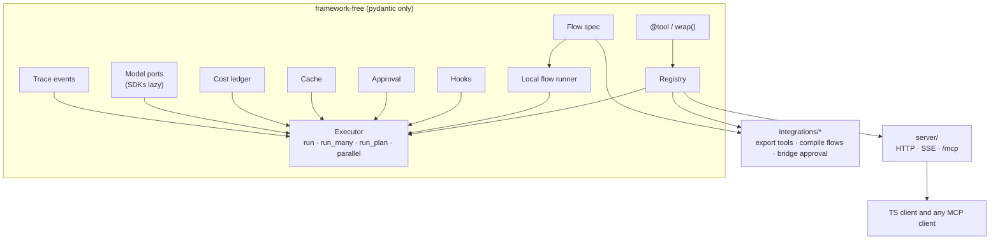
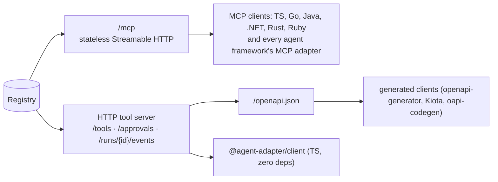

# Agentic Adapter — Design Spec

**Status:** approved for build (rev 2) · **Date:** 2026-10-29 · **Repo:** standalone git, branch `main`
**Package:** `agent_adapter` (distribution `agent-adapter`) · **Python:** ≥ 3.11 (needs `asyncio.TaskGroup` / `asyncio.timeout`), developed on 3.12 · **Core dependency:** `pydantic>=2.12,<3`

This is the single authoritative spec. Exact module paths, signatures, payloads and the
work-package plan live in the companion
[interface contract](2026-10-29-interface-contract.md); where the two differ on a
signature, the contract wins and this spec is corrected in the same change.

**Rev 2 (2026-10-29)** folds in the research reports R1 (harness2 → optimiser), R2
(LangGraph / LangChain / ADK), R3 (MCP 2.x, OpenAI Agents SDK, Pydantic AI, LlamaIndex,
CrewAI, OpenAPI, entry points, nox), R4 (models, cost, cache, OTel) and R5 (more
frameworks, cross-language).

**Every feature in this spec ships.** Nothing is "Unscheduled": each item maps to a work
package in the contract, and the release is done when every row of `docs/features.md`
reads Available.

---

## 1. Goal

A small, framework-independent Python SDK that lets any codebase:

1. Turn plain functions into **tools** once, and use them from **any** agent framework, model API, MCP, or plain code.
2. Run tools and LLM calls with **fan-out / fan-in**, dependency waves, and **graph flows**, with retry, timeout, cache, approval (HITL) and cost tracking built in.
3. Make agent systems **cheaper** (caching, dedupe, cost visibility) and **faster** (parallelism) without changing models or prompts.
4. Serve the same tools to **any backend in any language**: MCP (stateless Streamable HTTP) as the universal export, plus an HTTP tool server and a zero-dependency TypeScript client for the cases MCP cannot carry (Python-side approval, cost, run events).

First consumer: the Taxmann agentic pipeline (LangGraph). Integration into that codebase happens later, on a separate branch and spec.

### Non-goals

- Not a model gateway. **No LiteLLM.** Providers are called through their own SDKs, or through a function the host app supplies.
- Not a replacement for LangGraph / ADK checkpointing or deployment. The adapter compiles *to* them.
- No prompt library, no retrieval/vector-DB code, no domain logic.
- No auto-deploying optimisation. The optimiser (§15) only proposes.
- No multimodal message content in the model ports (text and tool calls only).

### Decided

| Decision | Choice |
|---|---|
| Location | Standalone repo, branch `main`, top-level package |
| Tool registry | Our own (not LangChain `@tool`); LangChain is an export target |
| Model access | Native OpenAI, Gemini and Anthropic SDKs, or a host-supplied callable. No LiteLLM |
| ADK runtime | Not a dependency. ADK is an export/compile target |
| Cross-language | MCP stateless Streamable HTTP (`mcp>=2.3`) is the universal export; `server` extra (Starlette) adds approval, cost and events; TS client under `clients/typescript/` |
| Importers | Functions in each integration (`import_mcp(registry, …)`), so core never imports a framework |
| File-size cap | 500 lines per file (CLAUDE.md); split at ~400 |
| Scope | Every feature ships; no Unscheduled items |

---

## 2. Principles

- **Core depends only on `pydantic>=2.12,<3`.** The floor is 2.12 (not 2.13): the suite passes on 2.12.5, it is the floor of `mcp`, `openai-agents`, `pydantic-ai` and `google-adk`, and it makes `crewai>=1.15` installable. Core tests run on the floor and on the latest pydantic. Every framework or SDK is an optional extra, imported lazily.
- **Async-first**, with a sync facade (`run_sync`) for sync backends.
- **One definition, many targets.** A tool, a flow, an approval rule is written once.
- **Policy applies everywhere.** A tool exported to any framework runs through an `Executor`, so timeout, retry, hooks, cache, approval and ledger behave the same in every target.
- **Portable by construction.** Tool schemas are checked against a cross-provider subset at registration, so a bad signature fails at startup, not mid-request.
- **Never swallow control flow.** `CancelledError` and framework signals (LangGraph `GraphBubbleUp`) always propagate; never retried.
- **Errors are typed and logged** with context before they propagate.
- **Loop-bound clients are created per event loop**, never as module globals (§14).

---

## 3. Package layout

```
agent_adapter/
  core/          errors, types, messages, ports, context (base layer);
                 tool, registry, imported (spec_from_schema)
  schema/        portable (subset check), transforms (per-target), models (JSON schema -> pydantic)
  runtime/       sync (run_sync), loop_local, current (current_context), ids
  hooks/         base (Hook, invocations), builtin (logging, budget, guardrail, rate limit)
  approval/      builtin (auto, callback, deferred), store
  exec/          executor, pipeline, plan, parallel, retry, guards, control, tool_loop
  flow/          spec, state (merge rules), graph (validated IR), runner
  cost/          prices (+ default table JSON), ledger, sinks, summary
  cache/         memory, redis, codec, keys, tool_cache, llm_cache, layout, providers/
  models/        openai, gemini, anthropic, callable, fallback, instrument, errors map,
                 usage (normalisers)
  tracing/       events (catalogue), sinks, semconv, otel
  integrations/  base (Integration protocol), discovery (entry points), openai, gemini,
                 anthropic, langchain, langgraph, adk, mcp, openai_agents, pydantic_ai,
                 llamaindex, crewai, openapi, agent_framework, agno, dspy, strands,
                 haystack, claude_agent, smolagents, autogen, semantic_kernel
  server/        service, problems, auth, events, openapi, asgi, wsgi, __main__
  optimiser/     model, surface, evidence, prompts, propose, probe, compose, loop,
                 lessons, report, hosts, __main__
clients/typescript/   @agent-adapter/client (zero dependencies)
docs/                 documentation site (§16)
tests/                mirrors the package
examples/             runnable, one per integration
```



**Import contracts** are enforced by an AST test (`tests/test_boundaries.py`); the exact
package DAG and rule list are in contract §2. In short:

- The **base layer** (`core.errors`, `core.types`, `core.messages`, `core.ports`, `core.context`) imports only the standard library, pydantic and each other.
- `schema` imports only the base layer. `core.registry` and `core.imported` are the only `core` modules that import `schema`.
- Framework-free packages (`core`, `schema`, `runtime`, `hooks`, `approval`, `exec`, `flow`, `cost`, `cache`, `models`, `tracing`, `optimiser`) never import a framework or SDK at module level, never import `integrations` or `server`, and use no dynamic imports.
- Optional-dependency modules (`integrations/*`, `models/{openai,gemini,anthropic}`, `cache/redis`, `tracing/otel`, `server/{asgi,wsgi,__main__}`) import their SDK lazily (inside functions or under `TYPE_CHECKING`).
- `optimiser` never imports `integrations` or `server`.

---

## 4. Tools

### 4.1 Two ways in, same result

Both create a `ToolSpec` in a registry. The executor and every export treat them identically.

```python
from agent_adapter import Registry, ToolContext

registry = Registry()          # module-level `@tool` uses a default registry

@registry.tool(kind="retrieval", parallel_safe=True, cache_ttl=600, timeout=20)
async def search_articles(query: str, top_k: int = 8, ctx: ToolContext = None) -> list[Hit]:
    """Search articles for a query."""
```

```python
# Existing code you do not own or do not want to edit
registry.wrap(
    legacy.get_sections_content,
    name="get_sections",
    description="Full text of statute sections",
    fixed={"year": 2025},          # bound, hidden from the LLM
    result=to_hits,                # adapt the return shape
    parallel_safe=True,
)
```

`wrap()` also supports: renaming params, hiding params, exposing one function as several
tools with different `fixed` values, wrapping **sync** functions (run via
`asyncio.to_thread`, contextvars preserved), and an **`args_model=` escape hatch**: a
hand-written pydantic model replaces the signature-derived one (its fields must match the
LLM-facing parameters), usually paired with `portable=False` and `targets=` (§4.2).

Tools that exist only as a JSON schema plus a callable (MCP, OpenAPI, LangChain dict
schemas) are built with `spec_from_schema(name, description, input_schema, func)`. The
spec keeps the raw schema in `input_schema`, and `json_schema()` returns it verbatim, so
nested remote schemas reach the LLM unchanged. Validation uses a loose `args_model`
generated from it: top-level properties, required names and primitive types are checked and
unknown arguments are rejected; nested objects, arrays and unions are accepted as JSON
values and left to the remote side. Portability is checked on the raw schema: with
`portable=None` (the default for imported tools) a schema that fails the portable subset is
registered with `portable=False` and a `DEBUG` log instead of raising; `portable=True`
makes it strict. Renderers use `json_schema()` as for any tool; the OpenAI renderers render
a non-portable imported tool with `strict: false`. Tools built by `build_spec` keep their
0.1.0 behaviour.

### 4.2 `ToolSpec` fields

| Field | Meaning |
|---|---|
| `name`, `description` | From function name and docstring unless overridden |
| `args_model` | Pydantic model built from the signature (or given via `args_model=`) |
| `func` | The callable that runs (function, bound method, partial or callable object) |
| `context_param` | Name of the `ToolContext` parameter, or `None` |
| `fixed` | Bound values, hidden from the LLM (`fixed=` plus `functools.partial` keyword bindings) |
| `result` | Optional transform applied to the return value |
| `llm_to_python` | LLM-facing argument name → Python parameter name (from `rename=`, which maps Python → LLM) |
| `returns` | Resolved return annotation; `None` when absent or `-> None` |
| `result_schema()` | JSON schema of `returns` via `TypeAdapter`; `None` when `returns` is unset, a `result` transform is set, or pydantic cannot describe the type (informational, never fails registration) |
| `kind` | Free tag, e.g. `retrieval`, `reasoning`, `action` |
| `tags` | Free set, for filtering exports (`registry.subset(tags=…)`) |
| `parallel_safe` | May run concurrently with other calls of the same run (§6) |
| `once_per_run` | Executor rejects a second call in the same run (`RunLimitExceeded`) |
| `confirm` | `bool` or `(call, ctx) -> bool \| Awaitable[bool]`; triggers the approval port |
| `timeout`, `retries`, `cache_ttl` | Per-tool execution policy; `retries` is the number of extra attempts |
| `cache_scope` | `"run"` (default), `"thread"` or `"global"`: who may share a cached result |
| `targets` | `None` (all) or a set of target names; exporters skip a tool not meant for them |
| `prompt_hint` | Optional "when to use" text, rendered into catalogues |
| `portable` | `False` skips the portability check at registration |
| `input_schema` | Raw JSON schema of an imported tool; `json_schema()` returns it when set; `None` for `build_spec` tools |
| `output_schema` | Raw result schema of an imported tool; `result_schema()` returns it when set |
| `effects` | `None`, `"read_only"`, `"additive"` or `"destructive"`: what the tool does to the world; drives MCP annotations and HTTP catalogues |
| `idempotent` | `None` or `bool`: repeating the call with the same args has no further effect (MCP `idempotent_hint`) |

Policy values are type-checked by `build_spec` (`ToolDefinitionError` on a bad value). `ToolSpec` compares and hashes by identity.

### 4.3 `ToolContext`

Injected into a parameter annotated `ToolContext` (hidden from the schema). Carries
`run_id`, `call_id`, `thread_id`, `state` (a read-mostly mapping the host provides),
`extras` (framework-native context, e.g. ADK `ToolContext`, LangGraph config, the HTTP
`principal`), `ledger` (record paid-API costs), `cache` (a `CachePort`), `sink` and
`emit(type, **data)` (custom trace events), and `approval` (a decision already granted by
the host framework, so the executor does not ask twice). New fields have defaults, so
existing positional construction keeps working.

### 4.4 Errors

`AdapterError` → `ToolDefinitionError`, `DuplicateTool`, `MissingDependency` (also an
`ImportError`), `ToolNotFound`, `ToolArgsInvalid` (JSON-safe `errors`, no input values),
`ToolUsageError` (host code called a tool incorrectly; also a `TypeError`), `ToolError`
(tool code reports a model-visible failure), `ToolTimeout` (also a `TimeoutError`),
`ToolFailed` (wraps cause), `RunLimitExceeded`, `GuardrailBlocked`, `ApprovalDenied`,
`ApprovalPending`, `ApprovalNotFound`, `ApprovalAlreadyDecided`, `BudgetExceeded`,
`SchemaNotPortable`, `PlanInvalid`, `FlowError` (→ `FlowDefinitionError` →
`FlowCompileError`; `FlowLoopExceeded`), `ModelError` (→ `ModelRateLimited`,
`ModelUnavailable`, `ModelTimeout`, `ModelAuthError`, `ModelBadRequest`,
`ModelContentFiltered`, `ModelOutputInvalid`), `ConfigError` (also a `ValueError`),
`IntegrationError`, `AuthError` (→ `Unauthorized`, `Forbidden`), `OptimiserError`.

Every class carries a stable kebab-case `kind` (e.g. `tool-args-invalid`) used in
`ToolResult.error`, HTTP problem types and trace events.

### 4.5 Importers (tools from elsewhere into the registry)

| Source | API |
|---|---|
| MCP server | `await import_mcp(registry, client, prefix=…)` (`integrations.mcp`; the host keeps the `mcp.Client` open) |
| LangChain tools | `import_langchain(registry, tools)` (`integrations.langchain`) |
| OpenAPI spec | `import_openapi(registry, spec, base_url=…, auth=…)` (`integrations.openapi`) |

Each returns the new `ToolSpec`s; imported tools run through the executor like any other.
So the adapter both **exports to** and **imports from** other ecosystems.

---

## 5. Schemas — one definition, every provider

**Portable subset** (checked at registration; violations raise `SchemaNotPortable`):

- Allowed: `str`, `int`, `float`, `bool`, `Literal`/`Enum` of strings, `list[T]`, nested `BaseModel`, `T | None`, `Field(description=…, ge=, le=)`.
- Rejected: `dict[str, T]`, multi-type unions, tuples, recursive models, `Any`, discriminated unions, `pattern`/most `format`, min/max length.

**Per-target transforms** (applied by each integration, never by the user):

| Transform | OpenAI strict / Agents SDK | Gemini / ADK | Anthropic / MCP |
|---|---|---|---|
| Inline `$defs`/`$ref`, flatten single-item `allOf` | yes | yes | yes |
| Drop `title`, `const` → one-value `enum` | yes | yes | yes |
| All required, optional → `T \| None` | yes | no | no |
| `additionalProperties: false` on every object | yes | as given | as given |
| Drop `default` | yes; appended to the description as `Default: <json>.` | yes; appended to the description | no (kept) |
| Drop keywords the provider does not accept | no | yes | no |
| Root `type: object` | yes | yes | yes |

Also rejected by the portable subset: `allOf` with several items, and a `type` list other than `["X", "null"]` (a list with no non-null type has its own message).

Incoming args are always validated by our own `args_model`. In strict mode `null` means "use the default": a `null` for any non-required field whose declared default is not `None` is dropped before validation (at any depth, following aliases), so the default applies; a field whose default is `None` keeps the `null`. To let the model pass `None` deliberately, make `None` the default. Snapshot tests pin the rendered schema per target.

Frameworks that take a JSON schema directly (Agent Framework, Agno, Haystack, Strands,
Claude Agent SDK, MCP) get the neutral or Anthropic-shaped schema; those that take a
pydantic model (LangChain, LlamaIndex, CrewAI, AutoGen) get `args_model`.

---

## 6. Execution — fan-out, fan-in, waves

| API | Use for |
|---|---|
| `await ex.run(name, args, ctx)` | One call; returns the value or raises |
| `await ex.run_call(call, ctx)` | One call; returns a `ToolResult` (never raises except control flow) |
| `await ex.run_many(calls, concurrency=8)` | Independent batch, in parallel; results returned in input order (fan-out + fan-in) |
| `await ex.run_plan(steps)` | Steps with `depends_on=[ids]`; independent ones run together in waves; DAG checked for cycles before running (`PlanInvalid`) |
| `await ex.parallel(*factories, concurrency=…)` | Non-tool work in parallel (e.g. several LLM calls), with the same timeout/retry/cancellation |
| `async for r in ex.as_completed(calls)` | Stream results as they finish |

**Failure policy** per batch: `on_error="collect"` (default — failed calls return
`ToolResult(status="error", error=…)`, others continue) or `"fail_fast"` (cancel siblings,
raise). Implemented with `asyncio.TaskGroup` and a semaphore. `ApprovalPending` inside a
collecting batch becomes a `status="pending"` result; `CancelledError` and registered
framework signals always propagate.

**Per call:** run guards → validate args → `before_tool` hooks → approval if `confirm`
(skipped when `ctx.approval` is already set) → cache lookup → timeout + retry (exponential
backoff, jitter; never on control flow, `ToolArgsInvalid`, `ToolError` or approval
signals) → `after_tool` hooks → ledger entry → cache store. Events are emitted at each step.

**Run-scoped guards:** `once_per_run`, max calls per run, max concurrency per `kind`, and
`parallel_safe`: a call whose tool is not parallel-safe takes the run's exclusive lock, so
nothing else in that run runs at the same time; parallel-safe calls share the lock.

---

## 7. Graph flows

A **portable flow spec**: written once, run by the adapter's local runner, or compiled to LangGraph or ADK.

```python
from agent_adapter.flow import Flow, Map, Join, Route, Merge

class ResearchState(BaseModel):
    question: str
    plan_steps: list[dict] = []
    evidence: Annotated[list[Hit], Merge.keyed(by="source_id")] = []
    needs_more: bool = False

flow = (
  Flow("research", state=ResearchState)
  .node("classify", classify)                                    # any async fn / sync fn
  .node("retrieve", Map("plan_steps", tool_from="tool", into="evidence"), concurrency=8)
  .node("merge", Join(["retrieve"]))                             # fan-in
  .node("reason", reason)
  .node("approve", approve_step, pause=True)                     # HITL
  .edge("classify", "retrieve")
  .edge("retrieve", "merge").edge("merge", "reason")
  .route("reason", Route(lambda s: "retrieve" if s.needs_more else "approve",
                         targets=["retrieve", "approve"]),
         max_loops=3, on_exhausted="approve")
  .end("approve")
)
```

| Concept | Local runner | LangGraph | ADK 2.x `Workflow` |
|---|---|---|---|
| Static parallel branches | same superstep | multiple edges | tuple edge |
| `Map` (same node per item) | `run_many` | `Send(node, item)` per item | `parallel_worker=True`, `max_parallel_workers` |
| `Join` | deferred until no other node is pending | `defer=True` node | `JoinNode` |
| `Route` | callable | `add_conditional_edges` | `Event(route=…)`, `RoutingMap` |
| Loop with cap | counter | conditional edge + counter in state | route back + counter in `ctx.state` |
| `pause=True` (HITL) | approval port | `interrupt()` + `Command(resume=)` | `require_confirmation` / resumability |
| Node retry/timeout | executor policy | `RetryPolicy`, `timeout=` | `RetryConfig`, `timeout` |
| Concurrency cap | semaphore | `max_concurrency` config | `max_concurrency` |

**State merges are keyed, not appended.** Flow state fields declare a merge rule
(`Merge.replace` (default), `Merge.keyed(by="source_id")`, `Merge.append`, `Merge.sum`).
Parallel branches writing the same key are idempotent — this prevents the duplicate-evidence
class of bugs. Two parallel writers of a `replace` field with different values are an error,
as in LangGraph.

Every cycle must pass through a `Route` with `max_loops`; the runner also stops at
`max_steps` supersteps. The local runner has no persistence; it returns a checkpoint on
pause that can be resumed in-process. Durable pause/resume comes from the compiled target
(LangGraph checkpointer, ADK resumability). Compilers are `compile_flow(flow, …)` in
`integrations.langgraph` and `integrations.adk`; parity tests run the same flow on all three.

---

## 8. Hooks (middleware)

Hooks subclass `Hook`, whose methods are all optional no-ops: `before_tool`, `after_tool`,
`on_tool_error`, `before_llm`, `after_llm`, `on_llm_error`, `before_node`, `after_node`,
`on_node_error`. A `before_*` or `on_*_error` hook may **short-circuit** by returning
`ShortCircuit(value)` (skip the call, or recover from the error); an `after_*` hook may
return a replacement. Hooks run in registration order; errors in hooks are logged and re-raised.

Hooks may expose `config()` / `config_schema()` / `with_config()` so the optimiser can
propose configuration changes it can validate.

Built-ins: `LoggingHook` (structured, redacts secrets), `BudgetHook(max_usd, on_exceed="warn"|"stop")`, `GuardrailHook(check)`, `RateLimitHook(per_kind)`.

---

## 9. Approval (HITL)

`ApprovalPort.request(ApprovalRequest) -> ApprovalDecision(approved, edited_args, reason)`;
a port may instead raise `ApprovalPending` (decision arrives later).

| Bridge | Mechanism |
|---|---|
| Local / plain code | `CallbackApproval(fn)`, `AutoApprove`, `AutoDeny` |
| Out-of-band (HTTP server, queues) | `DeferredApproval(store)`: raises `ApprovalPending`, resumes from the `ApprovalStore` by `(run_id, call_id)` |
| LangGraph | `LangGraphApproval`: `interrupt({...})`; resume with `Command(resume=decision)`. Node re-runs on resume, so pre-interrupt side effects are idempotent (ledger keyed by entry id) |
| ADK | `check_require_confirmation` + `tool_context.tool_confirmation` (payload may edit args) |
| OpenAI Agents SDK | `needs_approval` callable; `RunState.approve()/reject()` |
| Pydantic AI | `requires_approval` / `ApprovalRequired` / `DeferredToolRequests` |
| Agent Framework, Agno, Haystack, Strands, Claude Agent SDK | native approval mode / hook mapped from `confirm` |

When a framework's native gate approves a call, the integration sets `ctx.approval`, and the
executor does not ask the port again. Approval may **edit args**; edited args are validated again.

| Target | Where `edited_args` lives |
|---|---|
| Local, HTTP server, MCP (via the server's approval endpoints) | `ApprovalDecision.edited_args`, applied by the executor |
| LangGraph | the resume value is the decision; the re-run node applies it |
| Pydantic AI | `ToolApproved(override_args=…)` (native) |
| ADK | `ToolConfirmation.payload` |
| Claude Agent SDK | `PermissionResultAllow(updated_input=…)` (native) |
| OpenAI Agents SDK | no native edit: the edit travels in the one-use token `resolve_interruptions` issues, and the executor applies `edited_args` |
| Agent Framework, Agno, Haystack, Strands, Semantic Kernel | approve / deny only; edits are not supported and the docs say so |
| LlamaIndex, CrewAI, DSPy, smolagents, AutoGen | no gate of their own: the executor's port decides and the executor applies `edited_args` |

---

## 10. Cost ledger

Every LLM call, tool call and paid-API call records a `LedgerEntry`: `run_id`, `call_id`,
`entry_id` (idempotency key), `kind` (`llm`/`tool`/`api`), `stage`, `provider`, `model`,
`input_tokens` (billable, uncached), `cached_input_tokens`, `cache_write_input_tokens`,
`output_tokens` (incl. reasoning), `reasoning_tokens`, `units` (e.g. rerank docs),
`cost_usd`, `latency_ms`, start/end times, `ok`, `cache_hit`, `attempts`.

- `models/usage.py` normalises OpenAI Chat (`prompt_tokens_details.cached_tokens`, `cache_write_tokens`), OpenAI Responses (`input_tokens_details.cached_tokens`, `cache_write_tokens`), Gemini (`prompt_token_count` minus `cached_content_token_count`; output = candidates + thoughts), Anthropic (`cache_read_input_tokens`, `cache_creation_input_tokens` with 5m/1h split) and Voyage. All fields optional; accepts SDK objects and plain dicts.
- `prices.py` is a versioned, overridable table (`Prices.load(dict|path)`, `Prices.default()`), with prompt-size tiers (Gemini Pro), dated periods (promotions), cache-write prices per TTL, cache storage per token-hour, and per-model capability flags. No prices hard-coded in call sites. Unknown models log a `WARNING` and record `cost_usd=None`. Model ids resolve by exact name, alias, then longest prefix.
- Current lines (October 2026): OpenAI `gpt-4.1`, `gpt-5`, `gpt-5.1`…`gpt-5.6`; Gemini `gemini-2.5-*`, `gemini-3.1-pro-preview`, `gemini-3.8-flash`, `gemini-4-argon` (`gemini-3-pro-preview` was shut down 2026-03-09 and is not aliased).
- Sinks: in-memory, callback, JSON-lines file; host apps add a DB sink.
- `ledger.summary(run_id)` → cost per stage, prompt-cache hit rate, response- and tool-cache hit rates, parallelism achieved.
- Entries are idempotent on `(run_id, entry_id)`, so a node re-run on resume does not double-count.

---

## 11. Cache

`CachePort` (async get/set/delete of bytes with TTL) — `MemoryCache`, `RedisCache`
(optional extra; client created per event loop; backend errors logged as misses, never
failing a call). Values are JSON in a versioned envelope, never pickle.

| Layer | Key | Saves |
|---|---|---|
| Tool-result cache | tool name + canonical args + `cache_scope` (run / thread / global) | repeated retrievals, paid reranks |
| LLM response cache | provider + model + canonical messages + tools + schema + params + plug-in options | regenerate, edits, repeated questions, eval re-runs, optimiser probes |
| Prompt layout | `PromptLayout(static=…, dynamic=…)` keeps a stable prefix | makes provider prefix caching hit |
| Provider cache plug-ins | see below | discounted repeated prefixes |

| Plug-in | Sets | Applies to |
|---|---|---|
| `OpenAIPromptCache(key, retention)` | `prompt_cache_key`, `prompt_cache_retention` (`in_memory` / `24h`) | gpt-4.1, gpt-5 … 5.5 (24h only where listed) |
| `OpenAIPromptCacheV2(mode, ttl)` | `prompt_cache_options{mode, ttl}` (`30m` / `12h`, cache writes billed) | gpt-5.6+ |
| `GeminiExplicitCache(ttl)` | `caches.create` → `cached_content` | 2.5 / 3.x above the minimum size; **not Gemini 4 Argon or later, which support implicit caching only** |
| `GeminiImplicitCache()` | nothing; relies on `PromptLayout` | all 2.5+ |
| `AnthropicPromptCache(ttl)` | `cache_control` (`5m` / `1h`) on system, tools or last block | current Claude models |

Plug-ins only set what the model's capability flags allow; when a provider changes its
caching, only that plug-in and the capability table change.

---

## 12. Model ports

`LLMPort.generate(LLMRequest) -> LLMResponse` and `LLMPort.stream(request)` (text and
tool-call deltas, then the full response). A request has messages, tool definitions,
output schema, sampling params and a ledger `stage`; a response has text, tool calls,
parsed output, normalised usage, finish reason and the assistant message to append.

| Port | Notes |
|---|---|
| `OpenAIModel` | `openai>=3.41` (uses `httpx2`); Chat Completions and Responses; strict tools; streaming |
| `GeminiModel` | `google-genai>=2.30`; `parameters_json_schema`, `response_json_schema`; thinking config; echoes `thought_signature` parts |
| `AnthropicModel` | `anthropic>=2.3` (uses `httpx2`); tools, structured output, streaming |
| `CallableModel(fn)` | Wraps a host function (e.g. an existing `call_llm_model`) so host routing, fallback and stats stay untouched |
| `FallbackModel([a, b])` | Ordered fallback on `ModelRateLimited`, `ModelUnavailable`, `ModelTimeout` only; each hop logged at `WARNING` |
| `InstrumentedModel(model, …)` | Adds hooks, LLM response cache, ledger and events around any port; `executor.model(m)` builds one |

SDK exceptions are mapped to the `ModelError` hierarchy with `provider`, `model`,
`status_code` and the cause kept. Ports create SDK clients lazily per event loop unless the
host passes its own client.

`run_tool_loop(model, registry, messages, max_steps=8)` — a minimal tool-calling loop for
apps that want one without a framework; tool calls run through the executor (`run_many`).

---

## 13. Integrations

Each integration is one module plus one extra (`pip install agent-adapter[langgraph]`).
Each must pass the shared **contract test kit** that runs a real tool through that
framework. Every exported tool runs through an `Executor` (the caller's, or a default one).

| Target | Exports | Also |
|---|---|---|
| OpenAI (Chat / Responses) | tool dicts, strict schemas | — |
| Gemini (`google-genai`) | `FunctionDeclaration`s; AFC proxy callables | — |
| Anthropic | `input_schema` tools | — |
| **LangGraph** | executor tool node; `Send`-based fan-out; `defer` join; reducers from merge rules; `LangGraphApproval` | `compile_flow(flow) -> StateGraph` |
| LangChain | `StructuredTool`s | importer |
| **Google ADK 2.x** | `BaseTool` subclass per spec; confirmation bridge | `compile_flow(flow) -> Workflow` |
| OpenAI Agents SDK | `FunctionTool`s with `needs_approval` | interruption resolver |
| **MCP** | low-level `Server`; stateless Streamable HTTP ASGI app | client importer |
| Pydantic AI | `Tool.from_schema` | approval bridge, deferred-request resolver |
| LlamaIndex | `FunctionTool` with `fn_schema` | — |
| CrewAI | `BaseTool` subclasses (sync bridge) | — |
| OpenAPI | — | importer |
| Microsoft Agent Framework | `FunctionTool(input_model=<schema>)`, `approval_mode` | — |
| Agno | `Function(parameters=…)`, `requires_confirmation` | — |
| Strands | `AgentTool` subclass | `BeforeToolCallEvent` approval hook |
| DSPy | `dspy.Tool(args=, arg_types=)` | — |
| Haystack | `Tool(parameters=, function=, async_function=)` | `ConfirmationHook` bridge |
| Claude Agent SDK | in-process SDK MCP server | `can_use_tool` bridge |
| smolagents | `Tool` subclass factory (sync bridge) | — |
| AutoGen 0.7 (maintenance mode) | `BaseTool` subclass | — |
| Semantic Kernel (maintenance mode; pins `pydantic<2.14`) | `KernelFunction`s / plugin | auto-invocation filter bridge |

Order of value (R5): Agent Framework, genai AFC, Agno, Strands, DSPy, Haystack, Claude
Agent SDK, smolagents, AutoGen, Semantic Kernel. All ship; heavy or conflicting ones are
tested in isolated nox sessions.

**Third-party integrations:** a documented `Integration` protocol (`name`, `export_tool`,
`bind_context`, `bind_approval`; optional `compile_flow`) plus Python entry points (group
`agent_adapter.integrations`), so a new framework can be supported **without changing the
adapter**. Built-in integrations register through the same entry points; a plugin that fails
to load is logged and skipped.

### 13a. Cross-language surfaces



1. **MCP is the universal export.** `mcp>=2.3,<3` (v2 API: low-level `Server(on_list_tools=…, on_call_tool=…)`, `mcp.Client`; never the v1 `FastMCP` names), spec 2026-07-28: stateless Streamable HTTP with JSON responses by default (no session id, trivially load-balanced). Tool annotations come from `ToolSpec.effects` / `idempotent` / `confirm` (`read_only_hint`, `destructive_hint`, `idempotent_hint`); `outputSchema` is the result schema, wrapped under `result` when it is not an object. Server-side approval returns an error result that names the approval id, decided through the HTTP server.
2. **`server` extra (Starlette ≥ 1.0)** for what MCP cannot carry: Python-side approval with arg editing, the cost ledger, run events as SSE, and provider-shaped catalogues (`?shape=openai|anthropic|gemini`). Errors are RFC 9457 `application/problem+json`. Pluggable `authenticate` / `authorize` hooks (deny by default unless `allow_anonymous=True`), `ApprovalStore` and `EventStream` with in-memory defaults. Idempotency via the `Idempotency-Key` header. The MCP app mounts at `/mcp` in the same server. Runs belong to the principal that started them: call ids are derived from (principal, idempotency key), and only the run owner or a principal with the approver scope may decide its approvals (security-sensitive; flagged for human review in the contract §15.5).
3. **`server-wsgi` extra** wraps the ASGI app with `a2wsgi` for Django/Flask under WSGI; SSE needs ASGI.
4. **`/openapi.json`** (OpenAPI 3.1): one `invoke_<tool>` operation per tool with its own request and result schema.
5. **TypeScript client** `@agent-adapter/client` in `clients/typescript/`: zero runtime dependencies (`fetch`, `ReadableStream`), Node ≥ 20, ESM + CJS; `listTools`, `invoke`, `decide`, `events`, `cost`, and adapters for the Vercel AI SDK and similar tool shapes.

---

## 14. Backends

| Backend | How |
|---|---|
| FastAPI / any ASGI | `await` directly; or mount `server.create_app(registry)` |
| Django | async views; `async_to_sync` under WSGI; or the `server-wsgi` app beside Django |
| Flask | `run_sync()`; or mount the `server-wsgi` app with `DispatcherMiddleware` |
| Celery / RQ | `run_sync()` inside the task |
| Scripts / notebooks | `asyncio.run`; `run_sync()` falls back to a worker thread when a loop is already running (no `nest_asyncio`) |
| Any language | MCP at `/mcp`, the HTTP tool server, or the TS client (§13a) |

Blocking sync tools run via `asyncio.to_thread` (contextvars copied). Ledger/trace state is
passed as mutable objects, never relied on via child-task contextvar writes.
`asyncio.run` gives each `run_sync` call a fresh loop, so SDK clients (`httpx2` inside
OpenAI/Anthropic, genai's `httpx`, `redis.asyncio`) are created per loop through
`LoopLocal`, never as module globals.

### 14a. Tracing

Every step emits an `Event` (`tool.started`, `tool.finished`, `llm.finished`,
`approval.requested`, `node.paused`, …; catalogue in the contract) to an `EventSink`.
Sinks: in-memory log, logging, callback, fan-out, the server's SSE stream, and `OTelSink`
(optional `otel` extra, `opentelemetry-api` only). `OTelSink` follows the GenAI semantic
conventions (status Development): span `"{gen_ai.operation.name} {gen_ai.request.model}"`
(`chat` for OpenAI/Anthropic, `generate_content` for Gemini), `execute_tool {name}` for
tools, `gen_ai.provider.name` (not the deprecated `gen_ai.system`), usage attributes
including cache read/creation tokens, and `error.type`. Message content is off by default.
All attribute and metric names live in one module (`tracing/semconv.py`) so renames are a
one-file change.

---

## 15. Optimiser (harness2-style)

[google-research/harness2](https://github.com/google-research/harness2) (Apache-2.0; paper
arXiv 2610.14224) improves agents by editing the harness (system prompt, guardrails,
memory, tool guidance, subagents, skills, scripts, plugins) via **Propose → Probe →
Compose**, without touching model weights. It is a research framework (Linux, drives
coding CLIs), not a library we import. The source review (R1) is folded in here.

**What we take (the method).** A harness is a flat tree of path → text; a proposal edits
some paths and inherits the rest ("omitted is inherited"); two proposer roles work in
parallel (procedure and knowledge); every candidate is probed on real runs; a composer
merges what helped; the final harness is probed once more before it is chosen; a lessons
store carries transferable cues to later runs; invalid proposals get one retry with the
validation errors fed back, then fall back to the parent.

**Where we differ.**

| harness2 | agent_adapter |
|---|---|
| Edits files with an agentic CLI | Structured-output call through any `LLMPort`; returns `{path, content}` edits |
| Signal = trajectory contrast only | Contrast **plus** an optional host judge score per eval case; the proposer does not see scores by default |
| One task, k replicates | N eval cases, one run each; the LLM response cache makes unchanged runs free |
| Blind LLM selection | Judge-ranked selection; blind selection only when there is no judge |
| Output = adopted harness | Output = `harness.patch` + `report.md` + `result.json`, **never applied** |

**Our surface (virtual tree):** `tool/<name>/description`, `tool/<name>/prompt_hint`,
`hook/<name>/config.json`, `prompt/system`, `prompt/layout/<section>`,
`flow/<flow>/<node>/prompt`. Hosts provide a `Host` (surface, caps, validate, cases, run,
judge, domain); `RegistryHost` and `FlowHost` cover the common cases.

**Loop.** Probe base over N cases → propose `proc1..k` and `know1..k` → probe 2k candidates
→ compose `agg1..k` (greedy admission of edits that improved scores without losing a
delivered case and were actually exercised; conflicts by highest gain or one LLM merge) →
probe k finals → choose the best final that beats base, else KEEP_BASE → reflect into
`lessons.json`. Sequential mode iterates the same steps against a checkpoint. Budget
identity: `(1 + 3k) × N` case runs and `2k` proposer calls (retries counted per candidate;
merge, reflection and selection calls counted separately). `Budget(max_usd, max_case_runs, max_wall_s)` stops early and still
writes a partial report. CLI: `python -m agent_adapter.optimiser --host mod:fn …`.

**Licence.** We re-implement the method; we never copy harness2 code, prompt text, surface
tables or docstrings (prompts are copyrighted expression). Our prompts are written fresh.
`docs/optimiser.md` cites the paper as inspiration. If any snippet were ever copied, that
file would need the Apache header and a `THIRD_PARTY_NOTICES` entry — so we do not copy.

---

## 16. Documentation (SDK-grade)

Site built with **MkDocs Material + mkdocstrings** (API reference generated from docstrings), modelled on LangGraph/ADK docs. Mermaid for every flow.

```
docs/
  index.md                     what it is, 60-second example
  get-started/                 install, quickstart, first tool, first flow
  concepts/                    tools, registry, context, executor, flows,
                               hooks, approval, cost, cache, models, tracing
  how-to/                      wrap legacy code, parallel retrieval, HITL,
                               budgets, caching, sync backends, testing tools
  integrations/                one page per target (§13), each with a runnable example
  cross-language/              MCP from other languages, HTTP server, TS client, OpenAPI
  backends/                    FastAPI, Flask, Django, Celery, scripts
  tutorials/                   build a research agent end to end; migrate an
                               existing LangGraph agent
  optimiser.md                 the loop, the surface, the CLI
  reference/                   auto-generated API
  contributing/                writing an integration, release process
  changelog.md
```

Rules: short sentences, one diagram beats three paragraphs, every code block is tested (doctest or `examples/` run by the test suite), docs change in the same commit as code.

---

## 17. Quality

- `pytest` + `pytest-asyncio`; tests mirror the package; `filterwarnings = error`.
- Offline only: recorded provider fixtures and mock transports (`httpx2.MockTransport` for OpenAI/Anthropic, `httpx.MockTransport` for Gemini); no network, no keys.
- Concurrency tests: ordering, `fail_fast` cancellation, timeouts, `GraphBubbleUp`/`CancelledError` pass-through, idempotent ledger on resume.
- Schema snapshot tests per target.
- Contract tests per integration via the shared kit, marked `contract` and skipped when the extra is not installed. Every extra runs alone in its own `nox` session (proves lazy imports and `MissingDependency` paths). CrewAI (pins `pydantic<2.13`, `mcp<2`, `openai<3`), LlamaIndex, DSPy, Strands, Claude Agent SDK and Semantic Kernel can never share an environment with the rest; core never imports them.
- Core tests run in two sessions: pydantic floor (2.12.x) and latest.
- `ruff`, `mypy --strict` on the whole package, AST import contracts, coverage ≥ 90 %.
- Windows: pip installs of some extras exceed `MAX_PATH`; enable long paths or use a short `subst` drive / short nox env dir.
- Semantic versioning; `CHANGELOG.md`.

---

## 18. Delivery

Phases 0–1 are done (release 0.1.0). Everything else is delivered as **work packages in
waves** defined in the contract (§21): Wave 0 foundation; Wave A executor, hooks/approval,
cost/tracing, cache, models, integration kit; Wave B LLM pipeline, flows, and the
tool-export integrations and MCP; Wave C HTTP server, TS client, LangGraph, ADK,
optimiser; Wave D documentation completion and hardening. Each wave ends with a merge step
that applies shared-file edits and runs every gate. Release 1.0.0 when every feature row
is Available.

Adoption in the Taxmann agentic pipeline is a **separate branch and spec**, after LangGraph
lands.

---

## 19. Risks

| Risk | Mitigation |
|---|---|
| Framework APIs move (ADK labs, MCP v2, LangGraph betas) | Thin integrations, contract tests per version, pinned extras ranges |
| Portable subset too strict for some tools | `wrap(..., args_model=…)` escape hatch with `targets=` per-target opt-out |
| Flow compile semantics differ across targets | Parity tests: same flow, same inputs, same outputs on local / LangGraph / ADK |
| Approval resume re-runs nodes | Idempotent ledger (`entry_id`) and cache keyed by call |
| Scope creep into an orchestration framework | Flow spec stays declarative; durability always delegated to the target |
| `httpx2` in OpenAI/Anthropic SDKs, `httpx` in genai | Separate mock transports per provider; loop-bound clients per loop |
| OTel GenAI conventions still "Development" | Names isolated in `tracing/semconv.py` |
| Semantic Kernel pins `pydantic<2.14`; CrewAI pins `pydantic<2.13`, `mcp<2`, `openai<3`; heavy deps (DSPy, Strands, Claude SDK, LlamaIndex) | Core floor `pydantic>=2.12`; not in `all`; isolated nox sessions; documented |
| Pricing changes and promotions | Dated periods in the versioned table; unknown model → `None`, never a guess |

---

## 20. Resolved questions (2026-10-29)

1. Package name — `agent_adapter` (distribution `agent-adapter`).
2. Licence — Apache-2.0.
3. Minimum Python — 3.11.
4. Importers are integration functions, not `Registry` methods (keeps core framework-free).
5. Flow compilers are named `compile_flow`.
6. The optimiser proposer does not see judge scores by default (`show_scores_to_proposer=False`); the composer always does.
7. Lessons are one JSON file per team (`lessons.json`); no lessons port.
8. HTTP `decide` with `approved=false` returns 200 `{status: "denied"}`; the original invoker learns of it through events or `GET /approvals/{id}`.
9. Core floor is `pydantic>=2.12,<3` (was `>=2.13`); a nox session runs core tests on 2.12.x.
10. Imported tools carry their raw schema (`ToolSpec.input_schema` / `output_schema`); validation is loose; portability is auto-detected.
11. MCP annotations come from explicit `ToolSpec.effects` and `idempotent`, not from `kind` or tags.
