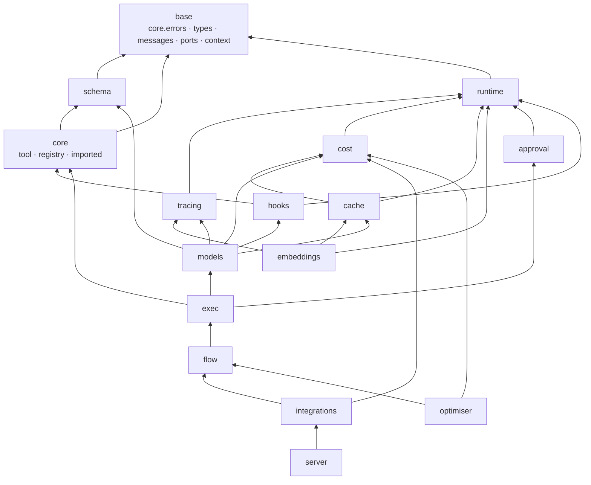
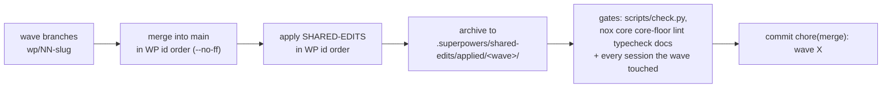

# agent_adapter — Interface Contract

**Status:** binding for all plan writers and implementers · **Date:** 2026-10-29
**Spec:** [design spec rev 2](2026-10-29-agentic-adapter-design.md) · **Research:** `.superpowers/research/R1`–`R5`

This document fixes every module path, public signature, payload, import rule and work
package for the remaining build. Plans and code follow it exactly. A plan that needs a
different signature changes this document first (one commit, `docs(contract): …`), then
the code. Where the spec and this contract disagree on a signature, this contract wins and
the spec is corrected in the same commit.

**Rev 2 (2026-10-29)** applies the independent review (`.superpowers/build/contract-review.md`,
B1–B8, I1–I17 and all minor items).

> **Rev 2 changes affecting WP01** (WP01 is already in progress; each change is small and
> WP01 is not split):
>
> 1. **B4** — M0 shared edits write *every* nox session of §18.2 and *every* built-in entry
>    point of §4.6 (discovery skips modules that do not exist yet).
> 2. **B6** — `LoopLocal.get()` is thread-safe (`threading.Lock`); it is also used for
>    per-loop asyncio primitives. Exit-gate test: two concurrent `run_sync` calls from two threads.
> 3. **B7** — `LedgerPort.total_usd` and `LedgerPort.entries` gain keyword `thread_id: str | None = None`
>    (and `RecordingLedger` in `tests/fakes/sinks.py` implements it).
> 4. **I1** — `LedgerEntry` gains `cache_write_by_ttl: dict[str, int] = {}`; `from_usage` copies it.
> 5. **I3** — boundary rules: `cache` and `models` may import `cost` (§2.2). Caps-only price
>    entries are a WP04 matter (no WP01 change).
> 6. **I4** — `ToolSpec.call` for a spec with `input_schema` calls `func` with
>    `validated.model_dump(exclude_unset=True, by_alias=True)` minus `None` values whose
>    property schema does not allow null (§4.3). `build_spec` tools unchanged.
> 7. **I5** — loose models use `ConfigDict(extra=…, validate_by_name=True, validate_by_alias=True)` (§4.4).
> 8. **I16** — new fake `tests/fakes/approval.py`: `ScriptedApproval`, `RecordingApproval` (§20.2).
> 9. **§3.1 minor** — `AdapterError` keeps no `__init__`; only new classes define constructors.
> 10. **`_version.py` minor** — new leaf module `agent_adapter/_version.py` holding `__version__`;
>     `agent_adapter/__init__.py` re-exports it and hatch reads it (shared edits at M0); the
>     boundary test treats `_version` as importable from every package.
> 11. **Strict-downgrade minor** — one rule in both places: strict is downgraded only when
>     `input_schema` is set and `portable` is `False`. `ToolSpec.tool_def` changes from
>     `strict and self.portable` to that rule (§4.1, §4.6).
> 12. **§10.4 minor** — `ToolResultCache.get/set` annotate `scope` as
>     `Literal["run", "thread", "global"]` (typing only).
> 13. **§0 minor** — `tests/test_boundaries.py` may be rewritten by WP01 (exempt from "0.1.0
>     suite unchanged").
>
> B5 (run-id semantics) needs no WP01 change: it is an executor rule (§8.2, §8.3).

**Rev 3 (2026-10-29, MA merge of Wave A)** folds in the behaviour the Wave A reviews ruled on:
WP02 §8.3 / §8.4 (guards commit on execution, re-entry identity, nested lock / `per_kind`
skips, stable `run_plan` call ids); WP03 §5, §6.2, §7.1–§7.3 (one `evaluate_confirm`, atomic
`create` / test-and-set `consume`, approval records bound to a canonical args digest);
WP04 §9.1, §9.2, §9.4, §12.2, §12.3 (snapshot-suffix price resolution, caps-only family
keys, ledger and span rules); WP06 §9.3 (OpenAI input = prompt − cached − cache_write, §23 #2
settled) and §11.1 (every SDK error typed). MA integration: the control-flow registry moves
to the base layer (`core/control.py`, §2.1, §8.6) so approval and hooks honour registered
types; hook dispatch logs expected policy outcomes at `WARNING` (§6.1).

**Rev 4 (2026-10-30, MB merge of Wave B)** folds in the Wave B rulings: WP08 §11.3, §11.4,
§12.3 (instrumented-call ids, nested billing, tool-loop validation and resume); WP09 §3.1,
§7.1, §8.3, §13.2–§13.5, §14.4, §20.4, §20.5 (`ApprovalPending.arguments`, resume answers,
replay journal, sealed checkpoints); WP10 §8.3 (`current_attempt`) and the gemini /
langchain / openapi rows; WP11 the MCP row and ids; WP12 §2.1, §7.2, §7.3, §7.5 (two-phase
`PreparedApproval`, `ask_each`), §14.4; WP13a §7.4 (adapter-issued one-use tokens), §14.4;
WP13b §14.4. MB integration: `ask_each` turns an `ApprovalPending` from `consume` into a
denial (§7.5); `node_model(ctx)` binds `executor.model(model)` (§13.4); every port-only row
of §14.4 supports edits (the executor applies `edited_args`).

**Rev 5 (2026-10-30, MC merge of Wave C)** folds in the Wave C rulings: WP14 §15.1, §15.3,
§15.4 (`IdempotencyStore` with Memory / Redis leases, decide-time re-authorisation, REST
hardening kinds 408 / 415 / 421 / 429 / 503, the bind-host rule, nested and elsewhere-parked
approvals, `runtime.ids.scoped_id`); WP19 §16 (additive client API) and the §18.2 `ts`
command; WP17 §17.4, §17.5 (`case_timeout_s`, `allow_safety_tuning`, exit 3); WP16 and WP15
§13.5, §14.4 (`resolve_confirmations` without `run_id`, `LangGraphApproval(key=)`,
`one_use`, `compile_flow(checkpoint_key=)`, the several-gates rule) and the `langgraph>=1.2.15`
floor (§18.1). MC integration: the semi-public seams `flow/visit` and `exec/integration`
(§2.1, rule R10); the executor logs a failing tool's exception type at `ERROR` and its text
only at `DEBUG` (§8.3); the ADK no-token fallback consumes the stored record by approval id
(§14.4); a `one_use` node fails closed when it would pause after a call it cannot replay.

**Rev 6 (2026-10-30, Wave D integration)** folds in the security-review fixes: C1 and M2, the
OpenAI Agents and Pydantic AI rows of §14.4 use one-use tokens only (`ApprovalOverrides`
removed); M1, a pre-approval covers one call, and I4, edited arguments re-run `before_tool`
(§6, §8.3); M3, failures are logged by type above `DEBUG` (§6.1); I2 and the loopback guard
for MCP (§14.4 MCP specifics); I1, I3, M5 and the `non-local-client` kind (§15.1, §15.4,
§15.5); `as_completed` returns an `AsyncGenerator` (§8); the durable `SQLiteApprovalStore` and
`RedisApprovalStore` (§7.3). Re-review: N1, a custom MCP `principal=` is not auth (§14.4 MCP
specifics); m1, the call holds its pre-approval and the tool body never sees it (§6, §8.3);
m2 and m3, Pydantic AI tokens bound to the paused `ToolCallPart`, at most 256 per resolve
(§14.4); m6 and m7, the store prefix rule, `0600` SQLite files and eviction WARNINGs (§7.3).
Final review: tools exported with `executor=None` read the default executor at each call,
`compile_flow` once at compile (§8.2, §14.4); `__all__` in every integration module (§14.2);
`run_plan(registry=)` (§8.2); `MemoryApprovalStore` refuses non-JSON `edited_args` like the
durable stores (§7.3); `all` leaves out `dspy`, and `server` includes `mcp` (§18.1).
Independence (the user defines the model, embedder and prices; the adapter wraps them):
the lazy 49-name top level, `agent_adapter.errors` and public homes for every port (§2.4,
§3.4); the `embeddings` package with its DAG row (§2.1, §2.2), events and OTel spans (§12.1,
§12.3) and envelope kind `embedding` (§10.2); `runtime.current.resolve_context` (§5);
`CallableModel` runs a sync `fn` in a thread and checks usage keys (§11.1); price patterns,
`free`, `per_call`, `per_second`, `Prices.empty()` and `cost(seconds=, attempts=)` (§9.1,
§9.2); `WsgiApp.close()` cancels request tasks before the lifespan ends, waits a bounded time,
and later requests get a 503 problem (§15.1).

**Rev 6, Wave D build note (2026-10-30, int3).** The top level grows to 55 names:
`CallableModel`, `FallbackModel`, `configure`, `call`, `acall` and `attach` (§2.4).
`Executor()` resolves names in the default registry, `Executor.run` takes the `@tool`
function, `SyncTwins` add `run_sync` / `run_call_sync` / `run_many_sync` / `resume_sync`, and
`Executor.resume` decides through the port's own store, then reruns the call (§8; §14.4 holds:
no shortcut sets `ctx.approval`). New leaf packages `handlers` (queues, serverless; may import
`base`, `runtime`, `approval`, `exec`) and `cli` (the `agent-adapter` command; may import
`base`, `integrations`; R8 allows `cli/doctor.py` for `importlib.metadata`); no other package
imports either (§2.1, §2.2). `runtime.LoopRunner` is one warm loop for sync code; handlers
use a shared one by default (§5). New stores `SQLAlchemyApprovalStore` (ODM: `sqlalchemy`) and
`DynamoDBApprovalStore` (no third-party import) (§7.3). New integrations `a2a`, `ag_ui`,
`camel`, `ag2` with their R6 roots, and MCP tasks and OAuth (§14.4). `GET /readyz` and
`server.Readiness` (§15.2). Decided: `create_app` does **not** mount A2A at `/a2a`; a host
mounts `a2a_app` beside it with its own authenticator, so the §15.5 surface stays as reviewed.
Open: the `/readyz` entry in `/openapi.json` (owner of `server/openapi.py`). The versioning
policy in `docs/guides/versioning.md` is approved (2026-10-30): semver, deprecation for at least
one minor, fixes for the latest minor and for the previous minor until 3 months after the next
ships.

---

## Contents

0. [Rules of use](#0-rules-of-use)
1. [Conventions](#1-conventions)
2. [Module map, dependency DAG and import rules](#2-module-map-dependency-dag-and-import-rules)
3. [Base layer](#3-base-layer)
4. [Core and schema changes](#4-core-and-schema-changes)
5. [Runtime](#5-runtime)
6. [Hooks](#6-hooks)
7. [Approval](#7-approval)
8. [Executor](#8-executor)
9. [Cost ledger and prices](#9-cost-ledger-and-prices)
10. [Cache](#10-cache)
11. [Models](#11-models)
12. [Tracing](#12-tracing)
13. [Flows](#13-flows)
14. [Integrations](#14-integrations)
15. [HTTP tool server](#15-http-tool-server)
16. [TypeScript client](#16-typescript-client)
17. [Optimiser](#17-optimiser)
18. [Extras, versions and nox sessions](#18-extras-versions-and-nox-sessions)
19. [Shared files and the merge protocol](#19-shared-files-and-the-merge-protocol)
20. [Test strategy](#20-test-strategy)
21. [Work packages and waves](#21-work-packages-and-waves)
22. [Feature → work package map](#22-feature--work-package-map)
23. [Open decisions](#23-open-decisions)

---

## 0. Rules of use

- **Backward compatibility.** Every name exported by 0.1.0 (`ToolSpec`, `build_spec`,
  `Registry`, `ToolContext`, the errors, the renderers, `schema.transforms`,
  `schema.portable`) keeps its signature and behaviour. New fields have defaults and are
  appended after existing ones. The 0.1.0 test suite must pass unchanged at every merge,
  with two exemptions: `tests/test_boundaries.py` (rewritten by WP01 for §2.3) and the
  version assert in `tests/test_package.py` (updated by WP18 for 1.0.0).
- **Signatures here are normative.** Names, parameter order, keyword-only markers,
  defaults, return types and raised errors. Private helpers (`_x`) are free.
- **"Internals per R*n*"** means the implementer follows that research section for how,
  not for what; the public shape is fixed here.
- **One owner per file per wave.** A file is created or edited by exactly one work
  package in a wave (§21). Shared files are never edited by a work package (§19).

---

## 1. Conventions

| Topic | Rule |
|---|---|
| Python | ≥ 3.11; `from __future__ import annotations` in every module; absolute imports only |
| Async | Every I/O API is `async`. Sync facades only via `runtime.run_sync` |
| Value types | Crossing a serialisation boundary (cache, HTTP, ledger file, optimiser result): pydantic `BaseModel` with `model_config = ConfigDict(frozen=True)`. Runtime-only (holds callables or exceptions): `@dataclass(frozen=True)` |
| Units | Durations in seconds as `float`; latencies in `latency_ms: float`; wall-clock times as epoch `float` seconds (`time.time()`); money in USD `float` |
| Ids | `runtime.ids.new_id(prefix)` → `prefix + uuid4().hex`. Prefixes: `run_`, `call_`, `apr_`, `evt_`, `opt_` |
| Logging | `logging.getLogger(__name__)`; never `print`; never log secrets, raw arguments of `confirm` tools, or message content above `DEBUG` |
| Errors | Only classes from §3.1; log with context before re-raising or wrapping; never swallow `BaseException` |
| Docstrings | One line (CLAUDE.md §15); `Raises:` only for non-obvious public APIs |
| File size | ≤ 500 lines; split at ~400 by responsibility |
| Tests | Mirror the package: `tests/<package>/test_<module>.py`; offline only |
| Docs | Every new package gets a `docs/` page ≤ 150 lines with a mermaid diagram, in the same change |
| Commits | Conventional Commits, ending with the harness `Co-Authored-By` trailer |

Reserved names: `ToolContext.extras` keys starting `aa.`; flow state field `aa_loop_counts`;
event types outside the `custom.` namespace; cache key namespace `aa`.

---

## 2. Module map, dependency DAG and import rules

### 2.1 Packages

| Package (DAG key) | Modules | Responsibility |
|---|---|---|
| `_version` | `agent_adapter/_version.py` | Leaf: `__version__` only; imports nothing; importable from every package |
| `base` | `core/errors`, `core/types`, `core/messages`, `core/ports`, `core/context`, `core/control` | Errors, value types, LLM message types, port protocols, `ToolContext`, control-flow registry |
| `schema` | `schema/portable`, `schema/transforms`, `schema/models` | Portable-subset check, per-target rewrites, JSON schema → loose pydantic model |
| `core` | `core/tool`, `core/registry`, `core/imported`, `core/_*` (incl. `core/_attempt`: the `Attempt` ContextVar) | `ToolSpec`, `build_spec`, `Registry`, `spec_from_schema` |
| `runtime` | `runtime/sync`, `runtime/loop_local`, `runtime/current`, `runtime/ids` | `run_sync`, per-loop clients, current context, ids |
| `tracing` | `tracing/events`, `tracing/sinks`, `tracing/semconv`, `tracing/otel`* | Event catalogue, sinks, OTel sink |
| `cost` | `cost/prices`, `cost/ledger`, `cost/sinks`, `cost/summary` | Price table, ledger, sinks, summary |
| `cache` | `cache/keys`, `cache/codec`, `cache/memory`, `cache/redis`*, `cache/tool_cache`, `cache/llm_cache`, `cache/layout`, `cache/providers/*` | Cache port impls, keys, envelopes, prompt layout, provider plug-ins |
| `approval` | `approval/builtin`, `approval/deferred`, `approval/store`, `approval/batch` | Approval ports, store and batch asking |
| `embeddings` | `embeddings/port`, `embeddings/callable`, `embeddings/cache`, `embeddings/_record` | `EmbeddingPort`, `CallableEmbedder`, per-text embedding cache, ledger entries and events |
| `facade` | `agent_adapter/errors.py` | Re-exports the whole error hierarchy and `ErrorInfo`; may import only `base` |
| `hooks` | `hooks/base`, `hooks/dispatch`, `hooks/builtin/*` | Hook base class, dispatch, built-ins |
| `models` | `models/_convert`, `models/errors`, `models/usage`, `models/openai`*, `models/gemini`*, `models/anthropic`*, `models/callable`, `models/fallback`, `models/instrument` | Model ports, usage normalisers, instrumentation |
| `exec` | `exec/executor`, `exec/pipeline`, `exec/plan`, `exec/parallel`, `exec/retry`, `exec/guards`, `exec/control`, `exec/defaults`, `exec/tool_loop`, `exec/args` (`dump_args`), `exec/_approve`, `exec/_resume`, `exec/_journal`, `exec/_canon`, `exec/_batches`, `exec/_settings`, `exec/_call_steps`, `exec/_sugar`, `exec/_sync_twins`, `exec/integration` (seam) | Executor, the tool loop, flow resume answers and replay journals |
| `flow` | `flow/spec`, `flow/actions`, `flow/state`, `flow/graph`, `flow/runner`, `flow/_*`, `flow/visit` (seam) | Flow builder, merge rules, IR, local runner |
| `integrations` | `integrations/base`, `integrations/discovery`, one module (or sub-package) per target* | Framework bridges |
| `server` | `server/service`, `server/problems`, `server/auth`, `server/events`, `server/idempotency`, `server/openapi`, `server/_*`, `server/asgi`*, `server/wsgi`*, `server/__main__`* | HTTP tool server |
| `optimiser` | `optimiser/*` (§17), `optimiser/__main__` | Offline harness optimiser |
| `handlers` | `handlers/envelope`, `handlers/consume`, `handlers/serverless` | Leaf: queue and serverless entry points (rev 6) |
| `cli` | `cli/main`, `cli/scaffold`, `cli/doctor`, `cli/pipindex`, `cli/findings`, `cli/__main__` | Leaf: the `agent-adapter` command (rev 6) |

\* Optional-dependency module (ODM): imports its third-party package lazily (§2.3 R6).

**Seams (rev 5).** `exec/integration` and `flow/visit` re-export, under stable names with
one-line docstrings, the executor and flow internals the flow compilers and bridges use
(`run_node`, `NodeEnv`, gate requests, routes, withdraw, seals, journals, resume answers,
`approval_store`, `settle_own`, `gather_unwrapped`, …). They are semi-public: documented,
not in their package's `__all__`; `integrations`, `server` and `optimiser` import flow and
exec internals only through them (R10). `integrations/_native_gate.plan_call` is the shared
per-call planner of the native-approval bridges and ADK.

### 2.2 Dependency DAG



Arrows read "imports". Allowed imports per package (transitive edges are **not** implied;
this table is the rule; every package may also import `_version`):

| From | May import (package keys) |
|---|---|
| `base` | `base` |
| `schema` | `base`, `schema` |
| `core` | `base`, `core`; `schema` only from `core/registry` and `core/imported` |
| `runtime` | `base`, `runtime` |
| `tracing` | `base`, `runtime`, `tracing` |
| `cost` | `base`, `runtime`, `cost` |
| `cache` | `base`, `runtime`, `cost`, `cache` |
| `embeddings` | `base`, `runtime`, `tracing`, `cache`, `embeddings` |
| `approval` | `base`, `runtime`, `tracing`, `approval` |
| `hooks` | `base`, `core`, `runtime`, `tracing`, `hooks` |
| `models` | `base`, `schema`, `runtime`, `hooks`, `cache`, `cost`, `tracing`, `models` |
| `exec` | `base`, `core`, `runtime`, `hooks`, `approval`, `cache`, `tracing`, `models`, `exec` |
| `flow` | `base`, `core`, `runtime`, `hooks`, `approval`, `tracing`, `exec`, `flow` |
| `integrations` | everything except `server`, `optimiser` |
| `server` | everything except `optimiser` |
| `optimiser` | `base`, `schema`, `core`, `runtime`, `hooks`, `cache`, `cost`, `tracing`, `models`, `exec`, `flow`, `optimiser` (never `integrations`, `server`) |
| `handlers` | `base`, `runtime`, `approval`, `exec`, `handlers` (no package imports `handlers`) |
| `cli` | `base`, `integrations`, `cli` (no package imports `cli`) |

`agent_adapter/__init__.py` is outside the DAG; it re-exports (§2.4).

### 2.3 Import rules (enforced by `tests/test_boundaries.py`)

WP01 rewrites the boundary test to enforce all rules below. Each rule keeps a detector
self-test like the existing ones.

| Rule | Statement | Scope |
|---|---|---|
| R1 | Absolute imports only | whole package (exists) |
| R2 | Base layer imports only stdlib, `pydantic`, `typing_extensions` and base modules | `base` |
| R3 | `schema` imports only base modules from the package | `schema` (exists, extended) |
| R4 | Only `core/registry.py` and `core/imported.py` import `schema` from `core` | `core` (exists, extended) |
| R5 | Package imports follow the §2.2 table, checked per imported name | every module |
| R6 | ODMs import third-party roots only lazily (function body or `TYPE_CHECKING`); the allowed lazy roots per ODM are listed in `ODM_ROOTS` in the test | ODMs (§2.1 \*) |
| R7 | Non-ODM modules import no third-party root other than `pydantic`, `typing_extensions` | every non-ODM module |
| R8 | No dynamic imports (`importlib`, `__import__`) | every module except `integrations/discovery.py` (entry points), `integrations/base.py` (`require()` uses `importlib.util.find_spec`), `server/__main__.py` (`--registry mod:attr`), `optimiser/__main__.py` (`--host mod:fn`) and `cli/doctor.py` (`importlib.metadata`) |
| R9 | `FORBIDDEN_ROOTS` never appear in a non-ODM module, even lazily. The set = every root in `ODM_ROOTS` and §14.4 (`openai`, `anthropic`, `google`, `httpx`, `httpx2`, `redis`, `opentelemetry`, `starlette`, `uvicorn`, `anyio`, `a2wsgi`, `yaml`, `langchain`, `langchain_core`, `langgraph`, `mcp`, `agents`, `pydantic_ai`, `llama_index`, `crewai`, `agent_framework`, `agno`, `dspy`, `strands`, `haystack`, `claude_agent_sdk`, `smolagents`, `autogen_core`, `autogen_agentchat`, `semantic_kernel`) plus `app` (the host) | every non-ODM module |
| R10 | `integrations`, `server` and `optimiser` never import a private module (`flow._*`, `exec._*`) or a `_`-prefixed name of `flow` or `exec`; they use the seams `flow.visit` and `exec.integration` | `integrations`, `server`, `optimiser` |

`ODM_ROOTS` (complete list; WP01 writes it):

| ODM | Lazy roots |
|---|---|
| `models/openai.py` | `openai`, `httpx2` |
| `models/gemini.py` | `google`, `httpx` |
| `models/anthropic.py` | `anthropic`, `httpx2` |
| `cache/redis.py` | `redis` |
| `tracing/otel.py` | `opentelemetry` |
| `server/asgi.py`, `server/__main__.py` | `starlette`, `uvicorn`, `anyio` |
| `server/wsgi.py` | `a2wsgi`, `starlette` |
| `integrations/*` | the module's own framework roots (table in §14.4) plus `httpx`, `httpx2`, `anyio` |

### 2.4 Top-level exports (`agent_adapter/__init__.py`, final state, rev 6)

`agent_adapter.__all__` is exactly these 55 names, loaded lazily (PEP 562 `__getattr__` /
`__dir__`; a `TYPE_CHECKING` block imports each for type checkers). `import agent_adapter`
loads only `agent_adapter` and `agent_adapter._version`.

| Group | Names |
|---|---|
| Tools | `Registry`, `tool`, `wrap`, `default_registry`, `ToolSpec`, `build_spec`, `spec_from_schema`, `ToolContext`, `ToolCall`, `ToolResult`, `Usage` |
| Running | `Executor`, `RunLimits`, `Step`, `run_tool_loop`, `run_sync`, `set_default_executor`, `configure`, `call`, `acall`, `attach` |
| Approval | `AutoApprove`, `AutoDeny`, `CallbackApproval`, `DeferredApproval`, `ApprovalRequest`, `ApprovalDecision`, `Decision`, `MemoryApprovalStore`, `SQLiteApprovalStore`, `RedisApprovalStore` |
| Hooks, cost, cache | `Hook`, `LoggingHook`, `GuardrailHook`, `BudgetHook`, `RateLimitHook`, `Ledger`, `LedgerEntry`, `Prices`, `MemoryCache` |
| Flows | `Flow`, `FlowRunner` |
| Model messages | `LLMRequest`, `LLMResponse`, `Message`, `ToolDef`, `Event` |
| Your own model | `CallableModel`, `FallbackModel` |
| Errors | `AdapterError`, `ToolError`, `ApprovalDenied`, `ApprovalPending`, `MissingDependency` |
| Meta | `__version__` |

Every error and `ErrorInfo` are in `agent_adapter.errors`; `ShortCircuit` is in
`agent_adapter.hooks`. A pre-1.0 top-level name that moved raises `AttributeError` (or
`ImportError` for `from agent_adapter import X`) naming its new home. Everything else is
imported from its subpackage (`agent_adapter.flow`, `.cost`, `.cache`, `.models`,
`.embeddings`, `.tracing`, `.approval`, `.hooks`, `.integrations.<x>`, `.server`,
`.optimiser`). The §3.4 ports have these public homes (re-exports, listed in `__all__`):
`LLMPort`, `PromptCachePlugin` and `ModelCaps` in `agent_adapter.models`; `CachePort` in
`.cache`; `LedgerPort` in `.cost`; `EventSink` in `.tracing`; `ApprovalPort` in
`.approval`. `agent_adapter.server` also exports `is_invoker`. Examples and docs import
only these paths, never `agent_adapter.core.*` or a private module.

---

## 3. Base layer

### 3.1 Errors (`core/errors.py`)

Every class gets two class attributes: `kind: ClassVar[str]` (stable kebab-case id used in
`ErrorInfo`, HTTP problem types and events) and `retryable: ClassVar[bool]` (default
`False`). Existing constructors are unchanged; `AdapterError` keeps no `__init__` (it
inherits `Exception`'s), and only the new classes below define constructors.

| Class | Bases | `kind` | `retryable` | Constructor (keyword-only after `*`) | Attributes |
|---|---|---|---|---|---|
| `AdapterError` | `Exception` | `internal-error` | False | inherited (no `__init__`) | — |
| `ToolDefinitionError` | `AdapterError` | `tool-definition-invalid` | | unchanged | |
| `DuplicateTool` | `AdapterError` | `duplicate-tool` | | unchanged | |
| `SchemaNotPortable` | `AdapterError` | `schema-not-portable` | | unchanged | `problems`, `tool` |
| `ToolNotFound` | `AdapterError` | `tool-not-found` | | unchanged | |
| `ToolArgsInvalid` | `AdapterError` | `tool-args-invalid` | | unchanged | `tool`, `errors` |
| `ToolUsageError` | `AdapterError`, `TypeError` | `tool-usage-error` | | unchanged | |
| `MissingDependency` | `AdapterError`, `ImportError` | `missing-dependency` | | unchanged | |
| `ToolError` | `AdapterError` | `tool-error` | | `(message, *, tool="", details=None)` | `tool`, `details: dict` — raised by tool code; message is model-visible |
| `ToolTimeout` | `AdapterError`, `TimeoutError` | `tool-timeout` | **True** | `(tool, timeout, *, call_id="")` | `tool`, `timeout`, `call_id` |
| `ToolFailed` | `AdapterError` | `tool-failed` | | `(tool, *, call_id="", attempts=1)`; raised `from` the cause | `tool`, `call_id`, `attempts`, property `cause_type: str` (FQN of `__cause__`) |
| `RunLimitExceeded` | `AdapterError` | `run-limit-exceeded` | | `(tool, limit, *, run_id="")`; `limit` ∈ `"once_per_run"`, `"max_calls"` | `tool`, `limit`, `run_id` |
| `GuardrailBlocked` | `AdapterError` | `guardrail-blocked` | | `(reason, *, tool="", stage="args")`; `stage` ∈ `args`, `result`, `llm_request`, `llm_response` | |
| `ApprovalDenied` | `AdapterError` | `approval-denied` | | `(tool, *, call_id="", reason="")` | |
| `ApprovalPending` | `AdapterError` | `approval-pending` | | `(approval_id, *, tool="", run_id="", call_id="", arguments=None)` | `arguments` (see below) |
| `ApprovalNotFound` | `AdapterError` | `approval-not-found` | | `(approval_id)` | |
| `ApprovalAlreadyDecided` | `AdapterError` | `approval-already-decided` | | `(approval_id, *, status)` | |
| `BudgetExceeded` | `AdapterError` | `budget-exceeded` | | `(limit_usd, spent_usd, *, scope="run", run_id="")` | |
| `PlanInvalid` | `AdapterError` | `plan-invalid` | | `(problems: list[str])` | `problems` |
| `FlowError` | `AdapterError` | `flow-error` | | `(message, *, flow="", node="")` | |
| `FlowDefinitionError` | `FlowError` | `flow-definition-invalid` | | `(problems, *, flow="")` | `problems` |
| `FlowCompileError` | `FlowDefinitionError` | `flow-compile-failed` | | `(target, problems, *, flow="")` | `target` |
| `FlowLoopExceeded` | `FlowError` | `flow-loop-exceeded` | | `(flow, node, limit)` | |
| `ModelError` | `AdapterError` | `model-error` | | `(message, *, provider, model="", status_code=None, retry_after=None, request_id="")` | same names |
| `ModelRateLimited` | `ModelError` | `model-rate-limited` | **True** | as `ModelError` | |
| `ModelUnavailable` | `ModelError` | `model-unavailable` | **True** | | covers 5xx, overload, connection errors |
| `ModelTimeout` | `ModelError` | `model-timeout` | **True** | | |
| `ModelAuthError` | `ModelError` | `model-auth-failed` | | | |
| `ModelBadRequest` | `ModelError` | `model-bad-request` | | | |
| `ModelContentFiltered` | `ModelError` | `model-content-filtered` | | | |
| `ModelOutputInvalid` | `ModelError` | `model-output-invalid` | | | |
| `ConfigError` | `AdapterError`, `ValueError` | `config-invalid` | | `(message)` | |
| `IntegrationError` | `AdapterError` | `integration-error` | | `(message, *, integration="")` | |
| `AuthError` | `AdapterError` | `auth-error` | | `(message="")` | |
| `Unauthorized` | `AuthError` | `unauthorized` | | | |
| `Forbidden` | `AuthError` | `forbidden` | | | |
| `OptimiserError` | `AdapterError` | `optimiser-error` | | `(message)` | |

`ApprovalPending.arguments`: the requested LLM-facing arguments (JSON mode); never part of
the message, the repr or the pickled state (an unpickled copy has `arguments=None`). The
executor fills tool, run_id, call_id and arguments from its request when the port leaves
them out. Pickling and `copy.deepcopy` also drop any `_aa_*` attribute (process-local
bookkeeping); a pending `ApprovalPending` / `ToolResult` from a store-backed port pickles
and deep-copies.

**Retry rule** (used by the executor, `parallel`, `FallbackModel`): an exception is
retryable when it is not control flow (§8.6) and either is not an `AdapterError`, or is an
`AdapterError` whose class has `retryable = True`.

### 3.2 Value types (`core/types.py`)

```python
JSONValue = Any  # documentation alias: JSON-serialisable value

class ToolCall(BaseModel):                      # frozen
    name: str
    arguments: dict[str, Any] = {}
    id: str = ""                                # provider call id; executor fills a new id when ""

class ErrorInfo(BaseModel):                     # frozen; JSON-safe, no input values
    kind: str                                   # §3.1 kind, or "dependency-failed"
    message: str
    exception: str = ""                         # FQN of the exception class
    retryable: bool = False
    details: dict[str, Any] = {}
    @classmethod
    def from_exception(cls, exc: BaseException) -> ErrorInfo: ...
    # message: str(exc) for AdapterError; for other exceptions only the class name
    # details: ToolArgsInvalid.errors, ApprovalPending.approval_id, ToolFailed.cause_type

ToolStatus = Literal["ok", "error", "pending"]

@dataclass(frozen=True)
class ToolResult:
    call_id: str
    name: str
    status: ToolStatus
    value: Any = None
    error: ErrorInfo | None = None
    exception: BaseException | None = field(default=None, repr=False, compare=False)
    attempts: int = 0                           # 0 when cached or short-circuited
    cached: bool = False
    latency_ms: float = 0.0
    @property
    def ok(self) -> bool: ...                   # status == "ok"
    def unwrap(self) -> Any: ...                # value, or raise `exception` (or ToolFailed)
    def to_dict(self) -> dict[str, Any]: ...    # JSON-safe: call_id, name, status, value, error, attempts, cached, latency_ms

@dataclass(frozen=True)
class Event:
    type: str                                   # §12.1 catalogue, or "custom.<name>"
    run_id: str = ""
    call_id: str = ""
    parent_id: str = ""
    ts: float = field(default_factory=time.time)
    data: Mapping[str, Any] = field(default_factory=dict)
    def to_dict(self) -> dict[str, Any]: ...

class Usage(BaseModel):                         # frozen; all counts >= 0
    input_tokens: int = 0                       # billable, excludes cached and cache-write
    cached_input_tokens: int = 0
    cache_write_input_tokens: int = 0
    cache_write_by_ttl: dict[str, int] = {}     # e.g. {"5m": 1200, "1h": 0}
    output_tokens: int = 0                      # includes reasoning
    reasoning_tokens: int = 0                   # informational
    units: float = 0.0                          # non-token billing units
    def __add__(self, other: Usage) -> Usage: ...
    @property
    def prompt_tokens(self) -> int: ...         # input + cached + cache_write

LedgerKind = Literal["llm", "tool", "api"]

class LedgerEntry(BaseModel):                   # frozen
    run_id: str
    call_id: str
    entry_id: str = ""                          # idempotency key; validator sets call_id when ""
    kind: LedgerKind
    stage: str = ""
    provider: str = ""
    model: str = ""
    input_tokens: int = 0
    cached_input_tokens: int = 0
    cache_write_input_tokens: int = 0
    cache_write_by_ttl: dict[str, int] = {}     # rev 2 (I1)
    output_tokens: int = 0
    reasoning_tokens: int = 0
    units: float = 0.0
    cost_usd: float | None = None               # None: unknown price (ledger fills when it can)
    latency_ms: float = 0.0
    started_at: float = 0.0
    ended_at: float = 0.0
    ok: bool = True
    error_kind: str = ""
    cache_hit: bool = False
    attempts: int = 1
    thread_id: str = ""
    price_version: str = ""
    metadata: dict[str, str] = {}
    @classmethod
    def from_usage(cls, usage: Usage, **fields: Any) -> LedgerEntry: ...

class ApprovalRequest(BaseModel):               # frozen
    approval_id: str
    run_id: str
    call_id: str
    tool: str                                   # tool name, or "node:<flow>.<node>" for flow pauses
    arguments: dict[str, Any] = {}              # LLM-facing names, JSON mode
    kind: Literal["tool", "node"] = "tool"
    hint: str = ""
    metadata: dict[str, Any] = {}
    created_at: float = 0.0

class ApprovalDecision(BaseModel):              # frozen
    approved: bool
    edited_args: dict[str, Any] | None = None
    reason: str = ""
    decided_by: str = ""
    decided_at: float = 0.0

Decision = ApprovalDecision

class ModelCaps(BaseModel):                     # frozen; capability flags per model
    prompt_cache_key: bool = False              # OpenAI prompt_cache_key
    prompt_cache_retention_24h: bool = False
    prompt_cache_options: bool = False          # OpenAI gpt-5.6+ prompt_cache_options
    explicit_cache: bool = False                # Gemini caches.create
    cache_control: bool = False                 # Anthropic cache_control
    min_cache_tokens: int = 1024
    structured_output: bool = True
    reasoning: bool = False
```

`core/types.py` must not import `core/errors.py` (duck-typed `kind`/`retryable` via
`getattr`), so the base layer has no internal cycle.

### 3.3 LLM message types (`core/messages.py`)

```python
Role = Literal["system", "user", "assistant", "tool"]
FinishReason = Literal["stop", "length", "tool_calls", "content_filter", "error", "other"]

class ProviderRaw(BaseModel):                   # frozen; opaque items echoed back to the same provider
    provider: str                               # "openai" | "gemini" | "anthropic" | ...
    api: str = ""                               # "chat" | "responses" | ""
    items: list[dict[str, Any]] = []            # e.g. Gemini parts with thought_signature, Responses reasoning items

class Message(BaseModel):                       # frozen
    role: Role
    content: str = ""
    tool_calls: tuple[ToolCall, ...] = ()       # assistant only
    tool_call_id: str = ""                      # tool only
    name: str = ""                              # tool only: tool name (Gemini needs it)
    raw: ProviderRaw | None = None              # ignored by other providers
    cache_breakpoint: bool = False              # hint for Anthropic cache_control / OpenAI v2 breakpoints

class ToolDef(BaseModel):                       # frozen; provider-neutral tool for model ports
    name: str
    description: str
    parameters: dict[str, Any]                  # neutral JSON schema (ToolSpec.json_schema())
    strict: bool = True                         # ports render strict only when True

class OutputSchema(BaseModel):                  # frozen
    name: str
    json_schema: dict[str, Any]                 # neutral; ports apply provider transforms
    strict: bool = True

class LLMRequest(BaseModel):                    # frozen
    messages: tuple[Message, ...]
    model: str | None = None                    # None: the port's configured model
    tools: tuple[ToolDef, ...] = ()
    tool_choice: Literal["auto", "none", "required"] | str = "auto"   # str = one tool name
    parallel_tool_calls: bool | None = None
    output_schema: OutputSchema | None = None
    temperature: float | None = None
    top_p: float | None = None
    max_output_tokens: int | None = None
    seed: int | None = None
    stop: tuple[str, ...] = ()
    reasoning: Literal["minimal", "low", "medium", "high"] | None = None
    stream: bool = False
    stage: str = ""                             # ledger stage label
    response_cache: bool = True                 # allow the LLM response cache
    extra: dict[str, Any] = {}                  # provider kwargs merged last; part of the cache key
    metadata: dict[str, str] = {}               # not sent, not in the cache key; "call_id" sets the ledger entry id

class LLMResponse(BaseModel):                   # frozen
    provider: str
    model: str                                  # response model id
    id: str = ""
    text: str = ""
    tool_calls: tuple[ToolCall, ...] = ()
    parsed: Any = None                          # JSON value when output_schema was set
    finish_reason: FinishReason = "stop"
    raw_finish_reason: str = ""
    usage: Usage = Usage()
    message: Message                            # assistant message to append to history
    latency_ms: float = 0.0
    cached: bool = False                        # served from the LLM response cache
    def parse(self, model: type[M]) -> M: ...   # ModelContentFiltered if finish_reason=="content_filter"; ModelOutputInvalid on validation failure

class TextDelta(BaseModel):     type: Literal["text"] = "text"; text: str
class ToolCallDelta(BaseModel): type: Literal["tool_call"] = "tool_call"; index: int; id: str = ""; name: str = ""; arguments_delta: str = ""
class StreamDone(BaseModel):    type: Literal["done"] = "done"; response: LLMResponse
StreamEvent = TextDelta | ToolCallDelta | StreamDone
```

### 3.4 Ports (`core/ports.py`)

All are `typing.Protocol`s (`@runtime_checkable`). Host code imports them from their
public homes (§2.4), not from `core.ports`.

```python
class CachePort(Protocol):
    async def get(self, key: str) -> bytes | None: ...
    async def set(self, key: str, value: bytes, ttl: float | None = None) -> None: ...
    async def delete(self, key: str) -> None: ...

class LedgerPort(Protocol):
    def record(self, entry: LedgerEntry) -> None: ...                  # idempotent on (run_id, entry_id); never raises
    def total_usd(self, run_id: str | None = None, *, thread_id: str | None = None) -> float: ...   # unknown costs count as 0
    def entries(self, run_id: str | None = None, *, thread_id: str | None = None) -> list[LedgerEntry]: ...
    # both filters apply when both are given; neither = everything

class EventSink(Protocol):
    def emit(self, event: Event) -> None: ...                          # sync, non-blocking, never raises

class ApprovalPort(Protocol):
    async def request(self, request: ApprovalRequest) -> ApprovalDecision: ...   # may raise ApprovalPending

class LLMPort(Protocol):
    provider: str
    model: str
    async def generate(self, request: LLMRequest) -> LLMResponse: ...  # raises ModelError subclasses
    def stream(self, request: LLMRequest) -> AsyncIterator[StreamEvent]: ...    # an async generator (`async def` + `yield`); last item is StreamDone
    def cache_key_fields(self) -> dict[str, Any]: ...                  # extra LLM-cache key material

CapabilityLookup = Callable[[str], ModelCaps]

class PromptCachePlugin(Protocol):
    name: str
    providers: frozenset[str]                                          # providers it applies to
    def key_fields(self) -> dict[str, Any]: ...
    async def apply(self, request: LLMRequest, kwargs: dict[str, Any], *, model: str, client: Any) -> dict[str, Any]: ...
```

Implementations of `CachePort` must not raise on backend failure (log `WARNING`, act as a
miss); callers still guard (§10.4).

### 3.5 `ToolContext` (`core/context.py`)

```python
@dataclass
class ToolContext:
    run_id: str = ""
    call_id: str = ""
    state: Mapping[str, Any] = field(default_factory=dict)
    extras: dict[str, Any] = field(default_factory=dict)
    thread_id: str = ""
    ledger: LedgerPort | None = None
    cache: CachePort | None = None
    sink: EventSink | None = None
    approval: ApprovalDecision | None = (
        None  # pre-approval for the one call run/run_spec/run_call is given (§8.3); never seen by the tool body
    )

    def emit(self, type: str, /, **data: Any) -> None: ...
    # no-op without a sink; event type "custom.<type>" unless it already starts with "custom."
    def child(self, *, call_id: str, **changes: Any) -> ToolContext: ...

    # dataclasses.replace with a shallow copy of extras; `approval` is NOT inherited unless passed
```

Field order above is fixed (the first four are 0.1.0 positional fields).

---

## 4. Core and schema changes

### 4.1 `ToolSpec` (`core/tool.py`) — fields appended

| Field | Type | Default | Meaning |
|---|---|---|---|
| `cache_scope` | `Literal["run", "thread", "global"]` | `"run"` | Who shares a cached result |
| `targets` | `frozenset[str] \| None` | `None` | Target names this tool is exported to; `None` = all |
| `input_schema` | `Mapping[str, Any] \| None` | `None` | Raw JSON schema (imported tools) |
| `output_schema` | `Mapping[str, Any] \| None` | `None` | Raw result schema (imported tools) |
| `effects` | `Literal["read_only", "additive", "destructive"] \| None` | `None` | What the tool does to the world |
| `idempotent` | `bool \| None` | `None` | Repeating the same call has no further effect |

Behaviour changes (all additive):

- `json_schema()` returns a deep copy of `input_schema` when it is set, else the
  `args_model` schema (unchanged).
- `result_schema()` returns a deep copy of `output_schema` when set, else unchanged.
- New method `tool_def(self, *, strict: bool = True) -> ToolDef`:
  `ToolDef(name, description, parameters=self.json_schema(), strict=strict and not (self.input_schema is not None and not self.portable))`
  — the one strict-downgrade rule, also used by §4.6.
- `call()` on a spec with `input_schema` passes `validated.model_dump(exclude_unset=True,
  by_alias=True)` minus keys whose value is `None` and whose property schema does not allow
  null (plus the context parameter); `build_spec` specs keep the 0.1.0 mapping.
- `_policy.validate_policy` accepts `cache_scope` (one of the three), `targets` (a non-empty
  str or iterable of non-empty str → `frozenset`), `effects` (one of the three or `None`),
  `idempotent` (`bool` or `None`). `portable` stays `bool` for `build_spec`.

### 4.2 `build_spec(..., args_model=None)` — escape hatch

`build_spec(func, *, name=None, description=None, fixed=None, hide=(), rename=None, result=None, args_model: type[BaseModel] | None = None, **policy)`.

When `args_model` is given: it must be a `BaseModel` subclass with `model_config["extra"] == "forbid"`
and no aliases; its field names must equal the LLM-facing names the signature would produce
(after `fixed`, `hide`, `rename` and the context parameter are removed). Otherwise
`ToolDefinitionError` naming the missing and extra fields. Descriptions come from the model.
Everything else (call mapping, strict nulls, portability check at `registry.add`) is unchanged.
Parameter annotations are still required on the function (the signature checks are
unchanged); the model's field types are what validation uses.

### 4.3 `spec_from_schema` (`core/imported.py`)

```python
def spec_from_schema(
    name: str,
    description: str,
    input_schema: Mapping[str, Any],
    func: Callable[..., Any],
    *,
    output_schema: Mapping[str, Any] | None = None,
    portable: bool | None = None,
    context_param: str | None = None,
    **policy: Any,
) -> ToolSpec: ...
```

- `name` checked by `NAME_RE`; `description` must be non-empty (importers pass
  `description or name`). `input_schema` must have `type: "object"` (or `properties`) at
  the root; else `ToolDefinitionError`.
- `args_model = schema.models.model_from_json_schema(f"{Camel(name)}Args", input_schema)`;
  `input_schema` and `output_schema` are stored as deep copies.
- `func` is called with keyword arguments named exactly as the **schema properties**
  (non-identifier names included, via `**dict`): `validated.model_dump(exclude_unset=True,
  by_alias=True)`, minus keys whose value is `None` while their property schema does not
  allow null, plus `context_param=ctx` when set. Unset optional arguments are not sent, so
  the remote side applies its own defaults.
- Portability: `problems = check_portable(input_schema)`. `portable=None` → `portable =
  not problems` (a `DEBUG` log lists the problems); `portable=True` keeps the registration
  check strict (`registry.add` raises `SchemaNotPortable`); `portable=False` skips it.
- Policy options as for `build_spec`.

### 4.4 `model_from_json_schema` (`schema/models.py`)

`model_from_json_schema(name: str, schema: Mapping[str, Any]) -> type[BaseModel]` builds a
**loose** model:

| Property schema | Field type |
|---|---|
| `type: string` with string `enum` | `Literal[...]` |
| `string` / `integer` / `number` / `boolean` | `str` / `int` / `float` / `bool` |
| `type: [X, "null"]` or `anyOf: [X, {type: null}]` with X primitive | `X \| None` |
| `array` | `list[Any]` |
| `object` | `dict[str, Any]` |
| anything else (`anyOf`, `oneOf`, `allOf`, `$ref`, no type) | `Any` |

Required properties are required; others default to the schema `default` or `None`.
`description` is kept. Property names that are not identifiers, start with `_`, or clash
with `BaseModel` attributes become sanitised field names (`[^0-9A-Za-z_]` → `_`, prefix
`p_` when needed) with `alias=<original>`; the model config is
`ConfigDict(extra="forbid", validate_by_name=True, validate_by_alias=True)` (`extra="allow"`
when the root sets `additionalProperties` to anything but `false`), so exporters that pass
field names (LangChain, LlamaIndex, CrewAI, AutoGen) and callers that pass property names
both validate. Raises `ToolDefinitionError` for a
non-object root. Lives in `schema` (imports only `base` + pydantic).

### 4.5 `Registry` additions (`core/registry.py`)

```python
def add_many(self, specs: Iterable[ToolSpec]) -> list[ToolSpec]: ...
# all-or-nothing: checks every name and schema first; DuplicateTool / SchemaNotPortable leave the registry unchanged
def for_target(self, target: str) -> Registry: ...
# a new registry with the specs whose `targets` is None or contains `target`
```

### 4.6 Renderers (`integrations/openai.py`, `gemini.py`, `anthropic.py`)

- `chat_tools`, `responses_tools`, `function_declarations`, `genai_tool`, `anthropic_tools`
  render `registry.for_target(T)` where `T` is `"openai"`, `"gemini"`, `"anthropic"`.
- The single-spec functions raise `ToolUsageError` when `spec.targets` excludes their target.
- OpenAI renderers apply the §4.1 downgrade rule: a spec with `input_schema` set and
  `portable=False` renders with `strict: False` regardless of the `strict` argument.
  `build_spec` tools are unchanged.
- Every exporter renders `registry.for_target(<its name>)`: integrations through
  `IntegrationBase.export_tools`, the MCP server `for_target("mcp")`, the HTTP catalogue
  and invoke routes `for_target("http")` (a tool excluded from `http` is a 404 there).

Canonical target names (also the entry-point names, §14.2): `openai`, `gemini`,
`anthropic`, `langchain`, `langgraph`, `adk`, `mcp`, `openai_agents`, `pydantic_ai`,
`llamaindex`, `crewai`, `openapi`, `agent_framework`, `agno`, `dspy`, `strands`,
`haystack`, `claude_agent`, `smolagents`, `autogen`, `semantic_kernel`, `http`.
`targets=` accepts any non-empty string (third-party targets).

---

## 5. Runtime

```python
# runtime/sync.py
def run_sync(work: Awaitable[T] | Callable[[], Awaitable[T]], *, timeout: float | None = None) -> T: ...
```
No running loop in this thread → `asyncio.run`. A running loop → run `asyncio.run` in a
one-shot worker thread with `contextvars.copy_context()`; wait up to `timeout`
(`TimeoutError` on expiry). Before the loop closes, `LoopLocal.aclose_all()` runs for that
loop. Never uses `nest_asyncio`.

```python
# runtime/loop_local.py
class LoopLocal(Generic[T]):
    def __init__(self, factory: Callable[[], T], *, close: Callable[[T], Awaitable[None]] | None = None) -> None: ...
    def get(self) -> T: ...                        # instance for the running loop; ToolUsageError outside a loop
    async def aclose(self) -> None: ...            # close this loop's instance
    @classmethod
    async def aclose_all(cls) -> None: ...         # close every LoopLocal instance bound to the running loop
```
Instances are stored in a `weakref.WeakKeyDictionary` keyed by the loop; `get()` is
thread-safe (a `threading.Lock` guards creation), because two `run_sync` calls may run
loops in two threads at once. Besides SDK clients, `LoopLocal` holds every asyncio
primitive (`Lock`, `Semaphore`, `Event`, `Condition`) that an object shared across loops
needs: the executor's run locks and `MemoryEventStream`. Plain counters and state shared
across loops use a `threading.Lock` (`MemoryApprovalStore`, `RateLimitHook`).

```python
# runtime/current.py
def current_context() -> ToolContext | None: ...
@contextmanager
def use_context(ctx: ToolContext) -> Iterator[ToolContext]: ...
def resolve_context(bound: ToolContext | None) -> ToolContext:
    ...  # bound, else current, else a fresh
    # run_/call_ id; an empty run id gets one
```
A `ContextVar`; the executor sets it around each tool call, the flow runner around each
node. Readers in child tasks see the parent's value; nothing relies on writes propagating up.

```python
# runtime/ids.py
def new_id(prefix: str = "") -> str: ...
```

---

## 6. Hooks

### 6.1 Base (`hooks/base.py`, `hooks/dispatch.py`)

```python
@dataclass(frozen=True)
class ShortCircuit:
    value: Any

@dataclass(frozen=True)
class ToolInvocation:
    spec: ToolSpec
    call: ToolCall                  # validated arguments (LLM-facing names, JSON mode)
    ctx: ToolContext

@dataclass(frozen=True)
class LLMInvocation:
    request: LLMRequest
    provider: str
    model: str
    ctx: ToolContext

@dataclass(frozen=True)
class NodeInvocation:
    flow: str
    node: str
    state: BaseModel
    ctx: ToolContext

class Hook:
    name: ClassVar[str] = ""        # "" -> class name
    async def before_tool(self, inv: ToolInvocation) -> ShortCircuit | None: return None
    async def after_tool(self, inv: ToolInvocation, result: ToolResult) -> ToolResult | None: return None
    async def on_tool_error(self, inv: ToolInvocation, error: BaseException) -> ShortCircuit | None: return None
    async def before_llm(self, inv: LLMInvocation) -> ShortCircuit | None: return None    # ShortCircuit.value: LLMResponse
    async def after_llm(self, inv: LLMInvocation, response: LLMResponse) -> LLMResponse | None: return None
    async def on_llm_error(self, inv: LLMInvocation, error: BaseException) -> ShortCircuit | None: return None
    async def before_node(self, inv: NodeInvocation) -> ShortCircuit | None: return None  # ShortCircuit.value: update mapping
    async def after_node(self, inv: NodeInvocation, update: Mapping[str, Any] | None) -> Mapping[str, Any] | None: return None
    async def on_node_error(self, inv: NodeInvocation, error: BaseException) -> ShortCircuit | None: return None
    def config(self) -> dict[str, Any]: return {}
    @classmethod
    def config_schema(cls) -> dict[str, Any] | None: return None
    def with_config(self, config: Mapping[str, Any]) -> Hook: ...   # default raises ToolUsageError

# hooks/dispatch.py
async def run_before(hooks: Sequence[Hook], method: str, inv: Any) -> ShortCircuit | None: ...
async def run_after(hooks: Sequence[Hook], method: str, inv: Any, value: Any) -> Any: ...
async def run_on_error(hooks: Sequence[Hook], method: str, inv: Any, error: BaseException) -> ShortCircuit | None: ...
```

Dispatch rules: registration order for every phase; the first `ShortCircuit` wins and stops
the phase; `after_*` threads the value through each hook (a `None` return keeps it). A hook
that raises is re-raised unchanged and logged with the hook name: an expected policy outcome
(`BudgetExceeded`, `GuardrailBlocked`, `ApprovalDenied`, `ApprovalPending`,
`RunLimitExceeded`) at `WARNING` without a traceback, any other error at `ERROR` with its
exception type only (the traceback and message at `DEBUG`), control flow (§8.6) not at all.

### 6.2 Built-ins (`hooks/builtin/`)

| Class | Constructor | Behaviour |
|---|---|---|
| `LoggingHook` | `(*, logger=None, level=logging.INFO, redact: Iterable[str] = DEFAULT_REDACT)` | One structured line per tool/LLM/node start, finish, error; values of keys matching `redact` (case-insensitive substrings: `key`, `token`, `secret`, `password`, `authorization`, `cookie`) become `"***"`; arguments of `confirm` tools are never logged |
| `BudgetHook` | `(max_usd: float, *, on_exceed: Literal["warn", "stop"] = "stop", scope: Literal["run", "thread", "global"] = "run")` | `before_tool` / `before_llm`: reads `ctx.ledger.total_usd(ctx.run_id)` for `run`, `total_usd(thread_id=ctx.thread_id)` for `thread` (empty `thread_id` → treated as `run`), `total_usd()` for `global`; at or over the limit: `stop` raises `BudgetExceeded`, `warn` logs once per run and emits `budget.warning`. No ledger → no-op with one `WARNING`. `config()` / `config_schema()` implemented |
| `GuardrailHook` | `(check: Callable[[str, Any], bool \| str \| Awaitable[bool \| str]], *, on: Iterable[Literal["args", "result", "llm_request", "llm_response"]] = ("args",))` | `check(stage, payload)`: `True` passes, `False` or a reason string raises `GuardrailBlocked(reason, stage=…)` |
| `RateLimitHook` | `(per_kind: Mapping[str, Rate], *, clock=time.monotonic, sleep=asyncio.sleep)` with `Rate(calls: int, per: float)` | GCRA token bucket per tool `kind` (and `"llm"` for model calls), process-wide: each caller books a slot under a `threading.Lock` and sleeps in its own loop (no asyncio primitive is shared across loops); a cancelled wait releases its slot only when it is the latest booking; waits, never fails |

---

## 7. Approval

### 7.1 Confirm rule

`ToolSpec.confirm` is `bool` or `Callable[[ToolCall, ToolContext], bool | Awaitable[bool]]`.
The executor evaluates it after `before_tool` hooks with the validated call. An exception in
the rule is logged and re-raised (not retried).

`approval.evaluate_confirm(rule, call, ctx) -> bool` is the one implementation (strict:
a non-bool result → `ToolUsageError`; `ApprovalPending` / `GraphBubbleUp` pass through
without an `ERROR` log); the executor delegates to it.

Step 5 consults a flow resume answer before the port. Only the flow runner makes one
(module-private factory in `exec._resume`; direct construction raises `ToolUsageError`) and
installs it for one node visit (`_visit_scope`, private to flow internals), closing it when
the visit ends; the executor honours only `type(answer) is ResumeAnswer`. An entry answers
once, and only a request with the same `run_id`, the same `tool`, the same `request_digest`
(original arguments) and, for `Call` / `Map` calls, the same call id; any other request asks
the port.

### 7.2 Built-in ports (`approval/builtin.py`, `approval/deferred.py`)

| Class | Constructor | `request()` |
|---|---|---|
| `AutoApprove` | `(*, reason="auto")` | `ApprovalDecision(approved=True, reason=…, decided_by="auto")` |
| `AutoDeny` | `(*, reason="denied by policy")` | `approved=False` |
| `CallbackApproval` | `(fn: Callable[[ApprovalRequest], ApprovalDecision \| bool \| Awaitable[ApprovalDecision \| bool]])` | `bool` results become decisions |
| `DeferredApproval` | `(store: ApprovalStore)` | see below |

`DeferredApproval.request(req)`: `rec = await store.find(req.run_id, req.call_id)`.
No record → `rec = await store.create(req)` (atomic per call: a racer's open record comes
back). `request_digest(req)` is computed first; non-JSON arguments → `ToolUsageError`
before any store call. `request_digest(rec.request) != request_digest(req)` (the call id
was reused with another kind, tool or original arguments; a stored digest is never
trusted) → `WARNING` (tool, call id; no arguments), raise
`ToolUsageError("call id reused with different tool/arguments")` and leave the record
untouched (fails closed; an approval never covers other arguments). `rec` pending → raise `ApprovalPending(rec.approval_id, …)` (repeat requests get
the same id). `rec` decided → `await store.consume(id)`: `True` → return the decision;
`False` (a concurrent resume used it) → `WARNING`, raise `ApprovalDenied(tool,
call_id=…, reason="approval already used by a concurrent request")` (fails closed).
`edited_args` of the decision still apply (they are what runs); the match is against the
original requested arguments. `DeferredApproval` emits no events: the executor is the
single emitter of `approval.requested` / `approval.decided` (§12.1).

`DeferredApproval` also implements `PreparedApproval` (§7.5):
`prepare(request) -> ApprovalRecord` runs the same find-or-create and `request_digest`
check as `request` but never consumes (advisory: act only on what `consume` returns);
`consume(record, request) -> ApprovalDecision` trusts neither argument: it re-reads
`store.get(record.approval_id)`, checks `request` against the stored request
(`request_digest` and run/call ids; another run, call, tool or arguments → `WARNING` with ids
only and `ToolUsageError`, nothing consumed); stored record undecided
→ `ApprovalPending` (nothing consumed); stored decision ≠ `record.decision` → `WARNING` and
`ApprovalDenied(reason="decision changed since it was prepared")`; then
`store.consume(id)` true → the stored decision, false → `WARNING` and
`ApprovalDenied(reason=CONCURRENT_USE)` (fails closed; the call is never looked up by call id
again, so no new record is created). `request(r)` =
`consume(await prepare(r), r)`. Callers rebuild requests identically on every pass (same
run id, call id, tool, arguments).

### 7.3 Store (`approval/store.py`)

```python
def request_digest(request: ApprovalRequest) -> str: ...


# SHA-256 hex of json.dumps({"kind", "tool", "arguments"}, sort_keys=True, separators=(",", ":"),
# ensure_ascii=False, allow_nan=False).encode("utf-8", "surrogatepass"); original arguments only.
# JSON values only (dict with str keys, list, str, int, finite float, bool, None); anything
# else (bytes, tuple, set, objects, non-str keys) → ToolUsageError (fail closed).

MAX_JSON_DEPTH = 256  # nesting of lists/objects in approval arguments (the arguments object = 1)


# the request_digest JSON rule for any value; ToolUsageError (also nesting > MAX_JSON_DEPTH)
def check_json(value: Any) -> None: ...


class ApprovalRecord(BaseModel):  # frozen
    request: ApprovalRequest
    status: Literal["pending", "approved", "denied"]
    decision: ApprovalDecision | None = None
    consumed: bool = False
    args_digest: str = ""  # always request_digest(request); a disagreeing value → ToolUsageError
    # model_copy(update={"request"/"args_digest": ...}) re-validates, so the digest stays bound

    @property
    def approval_id(self) -> str: ...


class ApprovalStore(Protocol):  # create and consume are atomic
    async def create(self, request: ApprovalRequest) -> ApprovalRecord: ...
    # stores a pending record; if the (run_id, call_id) pair already has an unconsumed record,
    # returns it unchanged and stores nothing; a taken approval_id on another pair → ToolUsageError
    async def get(self, approval_id: str) -> ApprovalRecord: ...  # ApprovalNotFound
    async def find(
        self, run_id: str, call_id: str
    ) -> ApprovalRecord | None: ...  # the unconsumed record
    async def decide(
        self, approval_id: str, decision: ApprovalDecision
    ) -> ApprovalRecord: ...  # ApprovalNotFound, ApprovalAlreadyDecided; edited_args not plain JSON → ToolUsageError (every store, before any write)
    async def consume(self, approval_id: str) -> bool: ...
    # test-and-set: True only for the caller that flips consumed on a DECIDED record; False if
    # already consumed or still pending (a pending record is never consumed); ApprovalNotFound
    async def list(
        self, *, run_id: str | None = None, status: str | None = None, limit: int = 100
    ) -> builtins.list[
        ApprovalRecord
    ]: ...  # newest first; `builtins.list`: the method shadows `list`


class MemoryApprovalStore:  # implements ApprovalStore; threading.Lock-guarded (safe across loops)
    def __init__(self, *, max_records: int = 10_000) -> None: ...  # evicts oldest consumed first


class SQLiteApprovalStore:  # approval/sqlite_store.py; WAL file, BEGIN IMMEDIATE, schema v1
    def __init__(
        self, path: str | os.PathLike[str], *, max_records: int = 10_000, timeout: float = 5.0
    ) -> None: ...


class RedisApprovalStore:  # approval/redis_store.py; LoopLocal clients, Lua scripts
    def __init__(
        self,
        client_factory: Callable[[], Any],
        *,
        prefix: str = "aa:approval:",
        ttl_s: float | None = 604800.0,
    ) -> None: ...
    async def aclose(self) -> None: ...


class ApprovalStoreCorrupt(
    AdapterError
): ...  # approval/persist.py; kind internal-error; a row that fails validation or disagrees with its columns
```

Database stores: a partial unique index on `(run_id, call_id) WHERE NOT consumed` and an
`args_digest` column (stores may also refuse a mismatching `create`; `DeferredApproval`
compares `request_digest` of the stored request either way, and a row whose digest
disagrees with its request fails validation);
`create` = `INSERT … ON CONFLICT DO NOTHING` then `SELECT` the unconsumed row; `consume` =
`UPDATE … SET consumed = true WHERE approval_id = $1 AND NOT consumed
AND status <> 'pending' RETURNING …`.
`MemoryApprovalStore` evicts the earliest consumed record, then the oldest decided, then
the oldest pending (`WARNING`), each in O(1). `SQLiteApprovalStore` evicts in the same order past
`max_records`; `RedisApprovalStore` expires each record `ttl_s` after creation (`None`: never).
`RedisApprovalStore` requires a non-empty `prefix` ending in `:` (`ConfigError`).
`SQLiteApprovalStore` creates a new database file `0600`. Every store logs a `WARNING` when
eviction drops a pending or a decided, unconsumed record.

`request_digest` and `check_json` check iteratively: arguments nested deeper than
`MAX_JSON_DEPTH` raise `ToolUsageError("approval arguments nested too deeply …")`, never
`RecursionError` (so does `ApprovalRecord` validation).
Every store's `find` returns only the unconsumed record of the pair (MB verified this for
`MemoryApprovalStore`; any other store must honour it too).

### 7.4 Framework bridges

Owned by the integration packages (§14.4). A framework signal may only **add** a gate,
never remove one. For a call whose `confirm` rule says yes, a bridge sets `ctx.approval`
only from a one-use token the adapter itself issued after its own approval port approved,
bound to the run (or the gate's scope), the native call id, the tool and
`request_digest` of the validated arguments, and taken atomically; a call with no native
call id is denied. Without such a token the executor asks its own port (a port without a
store is asked twice, never zero times). `edited_args` support per target is fixed in
spec §9.

### 7.5 Batches (`approval/batch.py`)

```python
@runtime_checkable
class PreparedApproval(Protocol):
    async def prepare(self, request: ApprovalRequest) -> ApprovalRecord: ...
    async def consume(self, record: ApprovalRecord, request: ApprovalRequest) -> ApprovalDecision: ...

async def ask_each(
    port: ApprovalPort,
    requests: Sequence[ApprovalRequest],
    *,
    vet: Callable[[ApprovalRequest, ApprovalDecision], None] | None = None,
) -> list[ApprovalDecision]: ...
```

`ask_each` is two-phase when `isinstance(port, PreparedApproval)`: `prepare` every request;
the first undecided record → `ApprovalPending` for it (nothing consumed); `vet` every
decision (its exception propagates, nothing consumed); then `consume` exactly the phase-1
records in order (`ApprovalDenied` from `consume` → a denial decision, `decided_by="agent_adapter"`;
an `ApprovalPending` from `consume`, i.e. the record was reset or replaced since `prepare`,
is also a denial for that call: the batch never stops half-consumed).
Otherwise `port.request` per request in order; the first `ApprovalPending` is raised after
every request was asked, then `vet` runs. Depends only on `base` and `approval`. Used by the
Agents SDK and Pydantic AI bridges (WP12) and the native-approval bridges (WP13a).
A decision returned by `consume` that differs from the vetted `record.decision` → `WARNING`
and a denial (defence in depth for any `PreparedApproval`). A port is two-phase only when its
class defines `prepare` and `consume` (protocol check by static lookup; `__getattr__`
forwarders are asked sequentially).

---

## 8. Executor

### 8.1 Types (`exec/`)

```python
@dataclass(frozen=True)
class RunLimits:
    max_calls: int | None = None                # per run, counting attempted calls
    max_concurrency: int = 8                    # default batch concurrency
    per_kind: Mapping[str, int] = field(default_factory=dict)   # max concurrent calls per tool kind, per run

@dataclass(frozen=True)
class Backoff:
    base_s: float = 0.5
    max_s: float = 30.0
    multiplier: float = 2.0
    jitter: float = 0.25                        # delay *= 1 + rng() * jitter
    def delay(self, attempt: int, rng: Callable[[], float]) -> float: ...   # attempt >= 1

@dataclass(frozen=True)
class Step:
    id: str
    tool: str
    args: Mapping[str, Any] | Callable[[Mapping[str, ToolResult]], Mapping[str, Any]] = field(default_factory=dict)
    depends_on: Sequence[str] = ()

OnError = Literal["collect", "fail_fast"]
```

### 8.2 `Executor` (`exec/executor.py`)

```python
class Executor:
    def __init__(
        self,
        registry: Registry | None = None,
        *,
        hooks: Sequence[Hook] = (),
        approval: ApprovalPort | None = None,
        cache: CachePort | None = None,
        ledger: LedgerPort | None = None,
        sink: EventSink | None = None,
        limits: RunLimits | None = None,
        backoff: Backoff | None = None,
        namespace: str = "aa",
        clock: Callable[[], float] = time.monotonic,
        sleep: Callable[[float], Awaitable[None]] = asyncio.sleep,
        rng: Callable[[], float] = random.random,
        max_tracked_runs: int = 10_000,
    ) -> None: ...

    registry: Registry | None
    hooks: tuple[Hook, ...]

    def context(
        self,
        *,
        run_id: str | None = None,
        thread_id: str = "",
        state: Mapping[str, Any] | None = None,
        extras: Mapping[str, Any] | None = None,
    ) -> ToolContext: ...
    def run_scope(self, **context_kwargs: Any) -> AbstractAsyncContextManager[ToolContext]: ...
    def end_run(self, run_id: str) -> None: ...

    async def run(
        self,
        name: str,
        args: Mapping[str, Any] | None = None,
        ctx: ToolContext | None = None,
        *,
        call_id: str | None = None,
    ) -> Any: ...
    async def run_spec(
        self,
        spec: ToolSpec,
        args: Mapping[str, Any] | None = None,
        ctx: ToolContext | None = None,
        *,
        call_id: str | None = None,
    ) -> Any: ...
    async def run_call(
        self, call: ToolCall, ctx: ToolContext | None = None, *, registry: Registry | None = None
    ) -> ToolResult: ...
    async def run_many(
        self,
        calls: Iterable[ToolCall],
        ctx: ToolContext | None = None,
        *,
        concurrency: int | None = None,
        on_error: OnError = "collect",
        registry: Registry | None = None,
    ) -> list[ToolResult]: ...
    def as_completed(
        self,
        calls: Iterable[ToolCall],
        ctx: ToolContext | None = None,
        *,
        concurrency: int | None = None,
        registry: Registry | None = None,
    ) -> AsyncGenerator[ToolResult, None]: ...
    async def run_plan(
        self,
        steps: Sequence[Step],
        ctx: ToolContext | None = None,
        *,
        concurrency: int | None = None,
        on_error: OnError = "collect",
        registry: Registry | None = None,
    ) -> dict[str, ToolResult]: ...
    async def parallel(
        self,
        *work: Callable[[], Awaitable[T]] | Awaitable[T],
        concurrency: int | None = None,
        timeout: float | None = None,
        retries: int = 0,
        on_error: OnError = "fail_fast",
    ) -> list[T] | list[T | Exception]: ...  # overloads by on_error
    def model(
        self, model: LLMPort, *, cache_ttl: float | None = None
    ) -> LLMPort: ...  # WP08: InstrumentedModel with this executor's hooks/cache/ledger/sink
    def replace(
        self, **changes: Any
    ) -> Executor: ...  # new Executor sharing registry and config, with constructor args replaced; never mutates self
```

- `context()` → `ToolContext(run_id=run_id or new_id("run_"), thread_id, state, extras, ledger, cache, sink)`.
- **Run ids (B5).** A caller context with `run_id == ""` is treated as a fresh run: the
  executor substitutes `new_id("run_")` (per call for `run`/`run_call`, per batch for batch
  methods). Integrations derive run ids from native ids when the framework has one (LangGraph
  `thread_id`, ADK `invocation_id`, Agents SDK / Pydantic AI run context, MCP and HTTP
  `X-Run-Id`), so a resumed call lands in the same run.
- `registry=` resolves tool names against that registry instead of `self.registry`
  (`run_tool_loop` uses it).
- `run_scope()` emits `run.started` / `run.finished` and calls `end_run` on exit.
- `ctx=None` → a fresh `context()` per call (`run`, `run_call`) or one per batch (`run_many`, `as_completed`, `run_plan`).
- `run`/`run_spec` return the value or raise (`ToolNotFound`, `ToolArgsInvalid`,
  `ApprovalDenied`, `ApprovalPending`, `ToolTimeout`, `ToolFailed`, `ToolError`,
  `RunLimitExceeded`, `GuardrailBlocked`, `BudgetExceeded`, or a hook's exception).
- `run_call` / batch methods never raise for those; they return `ToolResult`s
  (`ApprovalPending` → `status="pending"`). Control flow (§8.6) always propagates;
  `fail_fast` raises the first error and cancels siblings.
- **No `ExceptionGroup` escapes (B8).** Every batch method (`run_many`, `as_completed`,
  `run_plan`, `parallel`) that uses a `TaskGroup` cancels the siblings and re-raises the
  first escaping exception **unwrapped**: control flow (`CancelledError`, the `GraphBubbleUp`
  family, registered types) in any mode, and in `fail_fast` also `ApprovalPending` and
  ordinary errors. In `collect`, `ApprovalPending` stays a `pending` result.
- Approval with no port configured and a `confirm` rule that says yes → `ApprovalDenied`
  (`reason="no approval port configured"`, one `WARNING`).

```python
# exec/defaults.py
def default_executor() -> Executor: ...          # lazily created Executor() with no registry
def set_default_executor(executor: Executor) -> None: ...
def runner_for(executor: R | None) -> R | Executor: ...   # the given runner, else default_executor()
```
Integrations call `runner_for(executor)` (moved here from `integrations/base`, B1).
A tool exported with `executor=None` (and `tool_node`, `tool_task`, MCP servers) reads the
default at each call (`integrations/_default_runner.py`), so `set_default_executor` after
export applies. `compile_flow` (LangGraph, ADK) reads it once, at compile.

### 8.3 Per-call pipeline (`exec/pipeline.py`) — fixed order

| # | Step | Events | On failure |
|---|---|---|---|
| 1 | Resolve spec; `call_id = call.id or call_id or new_id("call_")`; `child = ctx.child(call_id=…)`; `use_context(child)` | `tool.started` | `ToolNotFound` |
| 2 | Run guards: `once_per_run`, `max_calls`, counted per **distinct** `call_id`: re-entry (same `call_id`, tool and arguments) already seen in the run (approval resume, LangGraph re-run, HTTP replay) is not a new call; see the step 2 note | — | `RunLimitExceeded` |
| 3 | `validated = spec.validate_args(arguments)` | — | `ToolArgsInvalid` |
| 4 | `before_tool` hooks | — | `ShortCircuit` → skip 5–8, result ok, `attempts=0` |
| 5 | Approval: the call's pre-approval (see note) if set, else confirm rule → port | `approval.requested`, `approval.decided` | `ApprovalDenied`, `ApprovalPending`; `edited_args` → re-run steps 3 and 4 on them when they differ from the validated arguments (a step-4 hook error fails the call; a `ShortCircuit` skips 6–8) |
| 6 | Tool cache lookup (`cache_ttl` and a cache) | `tool.cached` | backend errors = miss |
| 7 | Acquire run lock (shared if `parallel_safe`, else exclusive) and the run's `per_kind` semaphore | — | — |
| 8 | Attempts `1..retries+1`, each under `asyncio.timeout(spec.timeout)`: `await spec.call(validated, child)`; retryable failure with attempts left → `tool.retry`, `await sleep(backoff.delay(n))` | `tool.retry` | final: `on_tool_error` hooks (`ShortCircuit` recovers) else raise: `ToolTimeout`; non-retryable `AdapterError` as is; other → `ToolFailed(…) from exc` |
| 9 | `after_tool` hooks (may replace the `ToolResult`) | — | hook error propagates |
| 10 | Ledger: `LedgerEntry(kind="tool", run_id, call_id, entry_id=call_id, stage=spec.name, provider="tool", model=spec.name, cost_usd=0.0, latency_ms, started_at, ended_at, ok, error_kind, cache_hit, attempts, thread_id)` | — | ledger never raises |
| 11 | Cache store: only ok, not cached, not short-circuited, JSON-encodable value | — | skipped with `DEBUG` |
| 12 | Emit | `tool.finished` / `tool.failed` / `tool.pending` | — |

`child.approval` is never set. The call holds the pre-approval itself: `ctx.approval` applies only to the one call of `run` / `run_spec` / `run_call`, and only when `ctx.call_id == ""` or `ctx.call_id == call_id`; step 5 uses it, and the tool body's context (and every nested call or `run_tool_loop` inside it) has `approval=None`. `run_many`, `as_completed`, `run_plan` and `run_tool_loop` never use `ctx.approval`: every call asks the port.

Step 2 only checks. A call is counted (`once_per_run`, `max_calls`) when it reaches
execution: after step 5 granted approval, before the cache lookup; the count is re-checked
atomically there, so concurrent calls cannot overshoot. Invalid args, a denial, a pending
approval or a `before_tool` short-circuit consume nothing. Re-entry means the same
`(call_id, tool, arguments)`; a seen `call_id` with another tool or other arguments is a new
call. A batch may not repeat a non-empty call id (`ToolUsageError`).

Step 8: `ApprovalPending` from a nested call is not offered to `on_tool_error` hooks.

The flow visit scope (`exec._resume`) is saved before each tool body and put back after
it, so a tool cannot change the resume answer or journal its caller sees (no task per
call). Step 0 (before step 1): inside a flow node visit, a call already in the visit's
replay journal (key: tool, SHA-256 of the strict type-tagged canonical encoding
(`exec._canon`) of the **validated** arguments the caller passed,
`validated.model_dump(mode="python", by_alias=True, exclude_unset=True)` (unset fields left
out at every depth, so a `default_factory` value, also inside a nested model, never breaks
the key), or of the arguments as given when they do not validate or cannot be dumped;
occurrence of that key in the visit) returns its recorded `ToolResult`
without guards, approval, ledger or events; every other finished (non-pending) result is
recorded as JSON (`ToolResult.to_dict()` layout, value tagged, an `AdapterError`'s
attributes kept). A result or arguments with no canonical form, or a value holding a class
neither the tool's `returns` nor the state model reaches, is recorded as a marker
`{"unsealable": "ran, result not sealable"}`: the call ran, a pause of that visit fails
closed naming it, and a replay refuses to run it again. A replayed failure raises an
exception rebuilt from its `ErrorInfo` (same loaded `AdapterError` class, message,
attributes). A `Map(tool=)` visit records no calls (items are kept by index); each
`Map(fn=)` item and each node visit of a nested flow gets a child journal (by item index /
inner node call id and occurrence) inside the enclosing journal. Step 5: when a resume
answer is used and the executor's own port has an `ApprovalStore` (`port.store`) holding the
answered record (same run, call id and request digest), the record is decided with the
answer's decision if pending and consumed; a record decided otherwise, or one another
caller consumed first (`consume()` returned False), raises `ApprovalAlreadyDecided` (the
call does not run). A record the store does not hold is another port's. The executor keeps
the store of the port that raised an `ApprovalPending` in a module-level weak map keyed by
the exception (`exec._approve`, read along `__cause__`), never on the exception, so it
pickles; inside a flow node visit it also records every request a port leaves pending (with
its store) on the visit scope. The run guards' call identity falls back to the canonical
digest when JSON cannot key the arguments (e.g. huge ints), and only if that raises
`NotSealable` to the digest of the sorted `repr`.

While each attempt of step 8 runs, `exec.pipeline.current_attempt()` returns
`Attempt(call_id, number, total)` (a ContextVar in `core/_attempt.py`; `total = retries + 1`,
`last` when `number >= total`), so a tool can tell whether another attempt may follow (the
OpenAPI importer waits out `Retry-After` only then). It is None outside an attempt:
`ToolSpec.call` and `ToolSpec.invoke` clear it for their duration, so a direct call nested
inside an attempt sees None; only the executor's own call of the tool (through
`core.tool.call_in_attempt`) carries the attempt. A call nested through the executor sees its
own attempt. Each attempt runs inside the visit-scope save/restore above.

The run lock is a per-run readers–writer lock: a non-parallel-safe call waits until no
other call of the run is active and blocks new ones while it runs. `run_many` on tools that
are all non-parallel-safe therefore runs them one at a time (one `DEBUG` log per batch).
The exclusive lock is **re-entrant for nested calls**: a call whose parent (the
`current_context().call_id` at entry, recorded as the child's `parent_id`) holds the
exclusive lock runs without waiting for it (I6).
A nested call skips the run lock and the `per_kind` semaphores of kinds its ancestor chain
holds; other capped kinds still wait.

Run state (B6): per `run_id`, guard counters and the set of seen call ids live under a
`threading.Lock`; the readers–writer lock and the `per_kind` semaphores are created per
`(run_id, event loop)` through `LoopLocal`, so the same executor works from several
`run_sync` loops at once.

### 8.4 `run_plan` (`exec/plan.py`)

Validates before running: unique ids, known dependencies, no cycles → `PlanInvalid(problems)`.
Waves are Kahn layers in step order. Each wave runs as `run_many` (same `concurrency`).
A `Callable` `args` receives `{dep_id: ToolResult}` for its dependencies only. A step whose
dependency is not ok is not run; its result is `status="error"`, `error.kind =
"dependency-failed"`. Returns `{step.id: ToolResult}` in step order. `fail_fast` raises the
first error unwrapped (§8.2).
Step call ids are `f"{run_id}:{step.id}"`, so running the same plan again in the same run
(after an approval was decided) resumes its steps rather than starting new calls.

### 8.5 `parallel` (`exec/parallel.py`)

Items are zero-argument coroutine functions (retryable) or awaitables (`retries > 0` with an
awaitable → `ToolUsageError`). Each item runs under `asyncio.timeout(timeout)` (expiry →
`ToolTimeout(tool=f"parallel[{i}]", timeout=…)`) with the retry rule (§3.1) and the
executor's backoff. `fail_fast`: `TaskGroup`, first error re-raised unwrapped from the
`ExceptionGroup`. `collect`: results in order with exceptions in place. Results keep input order.

### 8.6 Control flow (`core/control.py`, re-exported by `exec/control.py`)

```python
def register_control_flow(*types: type[BaseException]) -> None: ...
def is_control_flow(exc: BaseException) -> bool: ...
def control_flow_member(exc: BaseException) -> BaseException | None: ...  # exc or the first control-flow leaf of a group
```
The registry lives in the base layer so `approval`, `hooks` and `exec` share it;
`agent_adapter.exec` re-exports `register_control_flow` / `is_control_flow` (public API).
True for `asyncio.CancelledError`, any registered type, or any exception whose MRO contains
a class named `GraphBubbleUp` (defence for hosts that never import our LangGraph module).
Control flow is never retried, never passed to `on_*_error` hooks, never converted to a
`ToolResult`, never recorded as a failed ledger entry, and never surfaces inside an
`ExceptionGroup` (§8.2).

---

## 9. Cost ledger and prices

### 9.1 Price table format (`cost/prices_default.json`, package data)

```json
{
  "version": "2026-10-29",
  "currency": "USD",
  "unit": "per_1M_tokens",
  "aliases": {"gpt-4.1-2025-04-14": "gpt-4.1"},
  "models": {
    "gpt-4.1": {"provider": "openai", "input": 2.00, "cached_input": 0.50, "output": 8.00,
                "caps": {"prompt_cache_key": true, "prompt_cache_retention_24h": true}},
    "gpt-5.6": {"provider": "openai", "input": 4.00, "cached_input": 0.40, "output": 20.00,
                "caps": {"prompt_cache_key": true, "prompt_cache_options": true}},
    "claude-": {"provider": "anthropic", "caps": {"cache_control": true, "min_cache_tokens": 1024}},
    "gemini-2.5-pro": {"provider": "gemini", "cache_storage_per_hour": 4.50,
                       "tiers": [{"max_prompt_tokens": 200000, "input": 1.25, "cached_input": 0.125, "output": 10.00},
                                 {"max_prompt_tokens": null, "input": 2.50, "cached_input": 0.25, "output": 15.00}],
                       "caps": {"explicit_cache": true, "min_cache_tokens": 2048}},
    "gemini-3.8-flash": {"provider": "gemini",
                         "periods": [{"until": "2026-12-31", "input": 0.75, "cached_input": 0.075, "output": 3.75},
                                     {"from": "2027-01-01", "input": 1.50, "cached_input": 0.15, "output": 7.50}],
                         "caps": {"explicit_cache": true, "min_cache_tokens": 4096}},
    "gemini-4-argon": {"provider": "gemini", "caps": {"explicit_cache": false, "min_cache_tokens": 4096},
                       "periods": [{"until": "2026-11-30", "input": 2.00, "cached_input": 0.10, "output": 10.00},
                                   {"from": "2026-12-01", "input": 4.00, "cached_input": 0.20, "output": 20.00}]}
  },
  "units": {"voyage:rerank-2.5": {"provider": "voyage", "per_unit": 0.05, "unit": "1M_tokens"}}
}
```

`Prices.default()` reads this file with `Path(__file__).with_name("prices_default.json")` (no `importlib.resources`, rule R8). Model entry fields: `provider` (required), `input`, `cached_input` (default `input`),
`cache_write` (default `input`), `cache_write_by_ttl`, `output`, `cache_storage_per_hour`
(also allowed per period),
`tiers` (each tier carries the price fields plus `max_prompt_tokens`, ascending, the last `null` = no limit),
`periods` (each period carries price fields or `tiers` plus `from` / `until` ISO dates,
inclusive, UTC, non-overlapping), `caps` (§3.2 `ModelCaps` fields), `note`;
`per_call` (USD per call) and `per_second` (USD per second of call time, from the entry's
`latency_ms`), also allowed per period; `free: true` (cost 0, no "no price" warning; takes no
other price). A key ending in `*` is a pattern (`"acme-*"`, `"*"` the catch-all); `*` may only
end a key, and alias names and targets are exact. `units` keys take the same `*` patterns
(`"provider:prefix*"`, catch-all `"*"`) and `free: true` instead of `per_unit`. Unknown keys,
unknown caps, negative prices and a priced family key (a key ending in `-`, which must be
caps-only) are `ConfigError`, in `load()` and in `merged()` overrides. A model entry has prices,
`tiers`, `periods`, or only `caps` (a **caps-only** entry: `price()` and `cost()` return
`None`, `caps()` works — used for Anthropic until prices are cited). The R4 cache-write
prices (30m / 12h) belong to the `gpt-5.6-sol` / `-terra` / `-luna` variants, whose
input/output prices R4 does not give; those rows are omitted until cited (so those ids
are unknown models, see `resolve`), and the base
`gpt-5.6` row has no cache-write prices. The shipped table holds the R4 §6 OpenAI and Gemini rows only (no
Anthropic or Voyage prices without a cited source, §23). `gemini-3-pro-preview` is absent.
`merged(overrides)` replaces whole model, alias and unit entries; the result's version is
`"<base>+<override version>"` (`"<base>+custom"` when the override has none).

### 9.2 `Prices` (`cost/prices.py`)

```python
@dataclass(frozen=True)
class ResolvedPrice:
    model: str
    provider: str
    input: float
    cached_input: float
    cache_write: float
    cache_write_by_ttl: Mapping[str, float]
    output: float
    version: str
    per_call: float = 0.0
    per_second: float = 0.0
    free: bool = False


class Prices:
    version: str  # read-only property

    @classmethod
    def default(cls) -> Prices: ...  # packaged table, cached
    @classmethod
    def empty(cls, version: str = "empty") -> Prices: ...  # no models; ConfigError on ""
    @classmethod
    def load(
        cls, source: Mapping[str, Any] | str | os.PathLike[str]
    ) -> Prices: ...  # ConfigError on invalid
    def merged(self, overrides: Mapping[str, Any] | Prices) -> Prices: ...  # per-model replace
    def resolve(self, model: str) -> str | None:
        ...  # exact, alias, then longest prefix whose remainder
        # is a snapshot suffix (-YYYY-MM-DD, -\d{3,} e.g. -001,
        # -0613, -20250514, or -latest), or whose key is a
        # caps-only family ending in "-" (e.g. "claude-");
        # anything else (gpt-5.6-luna, gpt-5-pro, gpt-4.1-nano,
        # gpt-5-1, claude-opus-4-5 vs claude-opus-4) does not
        # match that row: unknown -> cost None, no caps;
        # then patterns (`key*`, `*`); the longest matched
        # prefix wins, tie: row > pattern > family; exact
        # name and alias always first

    def price(
        self, model: str, *, at: date | None = None, prompt_tokens: int = 0
    ) -> ResolvedPrice | None: ...
    def cost(
        self,
        model: str,
        usage: Usage,
        *,
        at: date | None = None,
        seconds: float = 0.0,
        attempts: int = 1,
    ) -> float | None:
        ...  # one call; per_call × attempts;
        # ConfigError on a bad seconds (per-second model)
        # or attempts < 1 (per-call model)

    def unit_cost(self, item: str, units: float, *, at: date | None = None) -> float | None:
        ...
        # item "provider:model"; also "<provider>:<model>:cache_storage"
        # resolves a model entry's cache_storage_per_hour (units = 1M token-hours),
        # per period when the entry has periods; `at` default today, UTC

    def caps(self, model: str) -> ModelCaps: ...  # unknown model -> ModelCaps()
```

`kind="api"` entries are priced with `unit_cost(f"{provider}:{model}", units)`.
Gemini explicit-cache storage is recorded by `GeminiExplicitCache` (WP05) as
`LedgerEntry(kind="api", provider="gemini", model=f"{model}:cache_storage", units=<token-hours / 1e6>)`
through `current_context().ledger`.

Cost formula for `llm` entries (USD): `(input_tokens·input + cached_input_tokens·cached_input +
Σ_ttl cache_write_by_ttl[ttl]·price_ttl + (cache_write_input_tokens − Σ_ttl cache_write_by_ttl[ttl])·cache_write +
output_tokens·output) / 1e6 + units·per_unit + per_call·attempts + per_second·seconds`; a free
entry costs 0. The ledger passes `seconds = latency_ms / 1000` and `attempts = max(1, entry.attempts)`,
and so does the `llm.finished` event cost. `price_ttl` falls back to `cache_write`
for a TTL the row does not price, the unlabelled remainder is never negative, and
`per_unit` comes from `units["<provider>:<model>"]` (missing → 0 with one `WARNING`).
Each prompt token is billed once: the §9.3 normalisers report `input_tokens = prompt −
cached − cache_write` (cache-write tokens are inside the provider's prompt total and are
billed at the write rate), and a row with no write price bills writes at its `input` rate
(the `cache_write` default). For gpt-4.1 the total therefore equals `(prompt − cached)·input
+ cached·cached_input + output·output`. The tier is chosen by `usage.prompt_tokens`;
the period by `at` (default today, UTC). Unknown model → `None` and one `WARNING` per
model per process.

### 9.3 Usage normalisers (`models/usage.py`, owned by WP06)

```python
def usage_openai_chat(raw: Any) -> Usage: ...
def usage_openai_responses(raw: Any) -> Usage: ...
def usage_gemini(raw: Any) -> Usage: ...
def usage_anthropic(raw: Any) -> Usage: ...
def usage_voyage(raw: Any) -> Usage: ...
def normalise_usage(provider: str, raw: Any, *, api: str = "") -> Usage: ...
```

`raw` is an SDK usage object, a full response, or a plain dict (one code path, R4 §5).
Missing fields count as 0.

| `Usage` field | OpenAI Chat | OpenAI Responses | Gemini | Anthropic |
|---|---|---|---|---|
| `input_tokens` | `prompt_tokens − cached − cache_write_tokens` (≥ 0) | `input_tokens − cached − cache_write_tokens` (≥ 0) | `prompt_token_count − cached_content_token_count + tool_use_prompt_token_count` | `input_tokens` |
| `cached_input_tokens` | `prompt_tokens_details.cached_tokens` | `input_tokens_details.cached_tokens` | `cached_content_token_count` | `cache_read_input_tokens` |
| `cache_write_input_tokens` | `prompt_tokens_details.cache_write_tokens` | `input_tokens_details.cache_write_tokens` | 0 | `cache_creation_input_tokens` |
| `cache_write_by_ttl` | `cache_write_tokens_details.ttl_30m_tokens` → `"30m"`, `ttl_12h_tokens` → `"12h"`; else `{ttl: cache_write_tokens}` when the request set `prompt_cache_options.ttl` (filled by `OpenAIModel`) | same | — | `cache_creation.ephemeral_5m_input_tokens` → `"5m"`, `ephemeral_1h_input_tokens` → `"1h"` |
| `output_tokens` | `completion_tokens` | `output_tokens` | `candidates_token_count + thoughts_token_count` | `output_tokens` |
| `reasoning_tokens` | `completion_tokens_details.reasoning_tokens` | `output_tokens_details.reasoning_tokens` | `thoughts_token_count` | 0 |

OpenAI's prompt total includes cached reads and cache writes (§23 #2, settled by WP06 with the
vendor guide's worked example 12000 − 4000 − 7000 = 1000; evidence in `docs/concepts/models.md`),
so cache writes are counted once, in `cache_write_input_tokens`, and priced at the row's write
rate (default: the input rate). Gemini `tool_use_prompt_token_count` (tool results fed back to
the model) is billed as input and is not part of `prompt_token_count`.

### 9.4 `Ledger` and sinks (`cost/ledger.py`, `cost/sinks.py`, `cost/summary.py`)

```python
class LedgerSink(Protocol):
    def write(self, entry: LedgerEntry) -> None: ...

class MemorySink:      entries: list[LedgerEntry]                        # write appends
class CallbackSink:    def __init__(self, fn: Callable[[LedgerEntry], None]) -> None: ...
class JsonlSink:       def __init__(self, path: str | os.PathLike[str]) -> None: ...   # append one JSON line, utf-8, flush per write
def read_jsonl(path: str | os.PathLike[str]) -> list[LedgerEntry]: ...   # last write per (run_id, entry_id) wins

class Ledger:                                                            # implements LedgerPort
    def __init__(self, *, prices: Prices | None = None, sinks: Sequence[LedgerSink] = (),
                 max_runs: int = 1000) -> None: ...                       # prices None -> Prices.default()
    def record(self, entry: LedgerEntry) -> None: ...
    def entries(self, run_id: str | None = None, *, thread_id: str | None = None) -> list[LedgerEntry]: ...
    def total_usd(self, run_id: str | None = None, *, thread_id: str | None = None) -> float: ...
    def summary(self, run_id: str | None = None) -> LedgerSummary: ...
    def clear(self, run_id: str | None = None) -> None: ...
```

`record`: when `cost_usd is None`, computes it — `kind="llm"`: rebuilds `Usage` from the
entry's token fields (incl. `cache_write_by_ttl`) and calls `prices.cost(model, usage,
at=date(entry.started_at))` (UTC; today when `started_at == 0`); an `llm` entry with
`cache_hit=True` (served from the response cache: no provider call) gets `0.0` without a
price lookup; `kind="api"`: `prices.unit_cost(f"{provider}:{model}", units, at=…)` — and sets
`price_version` only when a price was looked up and found (otherwise it stays `""`); replaces
any entry with the same `(run_id, entry_id)` in place in the in-memory index; beyond
`max_runs` the least recently recorded run is evicted first; forwards to every sink; a sink
exception is logged at `WARNING` and never raised. `entries()` returns runs least recently
recorded first, each in first-record order. `prices`, `sinks` and `max_runs` are read-only;
`max_runs < 1` is `ConfigError`.

```python
class StageSummary(BaseModel):   # frozen
    calls: int; cost_usd: float; input_tokens: int; cached_input_tokens: int
    cache_write_input_tokens: int; output_tokens: int; latency_ms: float; errors: int

class LedgerSummary(BaseModel):  # frozen
    run_id: str | None
    total_usd: float
    unknown_cost_entries: int
    by_stage: dict[str, StageSummary]
    by_kind: dict[str, StageSummary]
    prompt_cache_hit_rate: float        # Σcached / Σprompt_tokens over llm entries; 0 when none
    response_cache_hit_rate: float      # llm entries with cache_hit / llm entries
    tool_cache_hit_rate: float          # tool entries with cache_hit / tool entries
    wall_ms: float                      # (max(ended_at) - min(started_at)) * 1000 over entries with both times set
    busy_ms: float                      # Σ latency_ms over tool + llm entries
    parallelism: float                  # busy_ms / wall_ms; 0 when wall_ms == 0
```

---

## 10. Cache

### 10.1 Keys (`cache/keys.py`)

```python
KEY_VERSION = 1
def canonical_json(obj: Any) -> str: ...     # sort_keys, separators=(",", ":"), ensure_ascii=False;
                                             # pydantic models via model_dump(mode="json"); sets -> sorted lists;
                                             # anything else -> TypeError (caller treats as uncacheable)
def digest(obj: Any) -> str: ...             # sha256(canonical_json(obj)).hexdigest()[:32]
def tool_key(namespace: str, tool: str, args: Mapping[str, Any], *, scope: Literal["run", "thread", "global"],
             run_id: str, thread_id: str) -> str: ...
def llm_key(namespace: str, request: LLMRequest, *, provider: str, model: str, fields: Mapping[str, Any]) -> str: ...
```

| Key | Format |
|---|---|
| tool, scope `run` | `{ns}:tool:v1:run={run_id}:{tool}:{digest(args)}` |
| tool, scope `thread` | `{ns}:tool:v1:thread={thread_id}:{tool}:{digest(args)}` (empty `thread_id` → no caching, `DEBUG`) |
| tool, scope `global` | `{ns}:tool:v1:global:{tool}:{digest(args)}` where the executor passes `tool = f"{spec.name}@{digest(spec.json_schema())[:8]}"`, so a changed tool never reads stale global entries |
| LLM response | `{ns}:llm:v1:{provider}:{model}:{digest(payload)}` with `payload = request.model_dump(mode="json", exclude={"stream", "stage", "response_cache", "metadata"}) ∪ {"fields": fields}` |
| Gemini explicit cache name | `{ns}:gcache:v1:{model}:{prefix_digest}` |

`args` are the validated arguments in JSON mode (LLM-facing names).

### 10.2 Envelope (`cache/codec.py`)

```python
@dataclass(frozen=True)
class Envelope:
    kind: Literal["tool", "llm", "gcache", "embedding"]
    stored_at: float
    payload: Any


def encode(
    kind: Literal["tool", "llm", "gcache", "embedding"], payload: Any
) -> bytes: ...  # TypeError if not JSON-able
def decode(data: bytes, kind: Literal["tool", "llm", "gcache", "embedding"]) -> Envelope | None: ...
```
Wire: UTF-8 JSON `{"v": 1, "kind": …, "stored_at": …, "payload": …}`. `decode` returns
`None` (with `DEBUG`) on bad JSON, another version, or another kind. Never pickle.

### 10.3 Backends (`cache/memory.py`, `cache/redis.py`)

```python
class MemoryCache:     # CachePort
    def __init__(self, *, max_entries: int = 10_000, clock: Callable[[], float] = time.monotonic) -> None: ...

class RedisCache:      # CachePort, ODM (redis.asyncio)
    def __init__(self, url: str | None = None, *, client_factory: Callable[[], Any] | None = None,
                 prefix: str = "", socket_timeout: float = 5.0, retries: int = 3) -> None: ...
    async def aclose(self) -> None: ...
```
`MemoryCache`: LRU (`OrderedDict`) with monotonic TTL. `RedisCache`: one client per event
loop through `LoopLocal`; `set` uses `ex=ceil(ttl)`; `redis.exceptions.RedisError` → `WARNING`,
miss / no-op. Exactly one of `url` or `client_factory` (`ConfigError` otherwise).
`MissingDependency` when `redis` is not installed (`pip install 'agent-adapter[redis]'`).

### 10.4 Typed caches (`cache/tool_cache.py`, `cache/llm_cache.py`)

```python
class ToolResultCache:
    def __init__(self, port: CachePort, *, namespace: str = "aa") -> None: ...
    async def get(self, tool: str, args: Mapping[str, Any], *, scope: Literal["run", "thread", "global"],
                  ctx: ToolContext) -> Envelope | None: ...
    async def set(self, tool: str, args: Mapping[str, Any], value: Any, *, ttl: float | None,
                  scope: Literal["run", "thread", "global"], ctx: ToolContext) -> bool: ...   # False when not cacheable

class LLMResponseCache:
    def __init__(self, port: CachePort, *, namespace: str = "aa", ttl: float | None = None) -> None: ...
    async def get(self, request: LLMRequest, *, provider: str, model: str, fields: Mapping[str, Any]) -> LLMResponse | None: ...
    async def set(self, request: LLMRequest, response: LLMResponse, *, provider: str, model: str,
                  fields: Mapping[str, Any]) -> bool: ...
```
Both catch every `Exception` from the port (`WARNING`, treated as miss / not stored).
`LLMResponseCache` never stores `finish_reason == "error"`; a hit returns the response
with `cached=True` and `latency_ms=0`.

### 10.5 Prompt layout (`cache/layout.py`)

```python
@dataclass(frozen=True)
class PromptLayout:
    static: str                                   # stable prefix: system prompt, tool catalogue, few-shots
    dynamic: str = ""                             # per-request context, placed in the final user turn
    sections: Mapping[str, str] = field(default_factory=dict)   # named static sections, appended in order
    def system_text(self) -> str: ...
    def messages(self, user: str | None = None, *, history: Sequence[Message] = ()) -> tuple[Message, ...]: ...
    # [system(system_text(), cache_breakpoint=True), *history, user(dynamic + "\n\n" + user)]
    def prefix_digest(self) -> str: ...           # digest of system_text()
    def with_static(self, text: str) -> PromptLayout: ...
    def with_section(self, name: str, text: str) -> PromptLayout: ...
```

### 10.6 Provider plug-ins (`cache/providers/`)

All implement `PromptCachePlugin` (§3.4) and are not ODMs: they edit SDK kwargs as plain dicts and call methods on the `client` they are given, never importing an SDK. `caps: CapabilityLookup | None = None` (None →
`ModelCaps()`, which disables every gated parameter; from Wave B, WP08 changes the default
to `Prices.default().caps`, allowed by the `cache → cost` rule). `apply` returns new SDK kwargs and
never raises for an unsupported model (it logs `DEBUG` and returns `kwargs` unchanged).

| Class (module) | Constructor | Sets in kwargs | Gate |
|---|---|---|---|
| `OpenAIPromptCache` (`openai.py`) | `(*, key: str \| Callable[[LLMRequest], str] \| None = None, retention: Literal["in_memory", "24h"] \| None = None, caps=None)` | `prompt_cache_key` (default: digest of the system message), `prompt_cache_retention` | `prompt_cache_key`; `24h` needs `prompt_cache_retention_24h` |
| `OpenAIPromptCacheV2` (`openai.py`) | `(*, mode: Literal["implicit", "explicit"] = "implicit", ttl: Literal["30m", "12h"] = "30m", key=None, caps=None)` | `prompt_cache_options={mode, ttl}`, `prompt_cache_key` | `prompt_cache_options` |
| `GeminiExplicitCache` (`gemini.py`) | `(*, ttl_s: float = 3600, store: CachePort \| None = None, caps=None)` | creates `client.aio.caches.create(...)` for the static prefix once per `(model, prefix_digest)`, then `cached_content=<name>`; removes the static system text from the request | `explicit_cache` and prompt ≥ `min_cache_tokens` (estimate: chars / 4) |
| `GeminiImplicitCache` (`gemini.py`) | `()` | nothing | — |
| `AnthropicPromptCache` (`anthropic.py`) | `(*, ttl: Literal["5m", "1h"] = "5m", on: Iterable[Literal["system", "tools", "breakpoints"]] = ("system", "tools"), caps=None)` | `cache_control={"type": "ephemeral", "ttl": ttl}` on the last system block, the last tool, and every message with `cache_breakpoint` | `cache_control` |

`key_fields()` returns the constructor options (not the computed key).

---

## 11. Models

### 11.1 Ports

```python
# models/openai.py (ODM)
class OpenAIModel:  # LLMPort, provider = "openai"
    def __init__(
        self,
        model: str,
        *,
        api: Literal["responses", "chat"] = "responses",
        client: Any | None = None,
        client_kwargs: Mapping[str, Any] | None = None,
        cache_plugin: PromptCachePlugin | None = None,
        strict_tools: bool = True,
        defaults: Mapping[str, Any] | None = None,
    ) -> None: ...


def build_chat_request(
    request: LLMRequest, *, model: str, strict_tools: bool = True
) -> dict[str, Any]: ...
def build_responses_request(
    request: LLMRequest, *, model: str, strict_tools: bool = True
) -> dict[str, Any]: ...
def parse_chat_completion(raw: Any) -> LLMResponse: ...
def parse_response(raw: Any) -> LLMResponse: ...
def map_openai_error(exc: BaseException, *, model: str) -> ModelError | None: ...


# models/gemini.py (ODM)
class GeminiModel:  # provider = "gemini"
    def __init__(
        self,
        model: str,
        *,
        client: Any | None = None,
        client_kwargs: Mapping[str, Any] | None = None,
        cache_plugin: PromptCachePlugin | None = None,
        thinking: Mapping[str, Any] | None = None,
        defaults: Mapping[str, Any] | None = None,
    ) -> None: ...


def build_gemini_request(
    request: LLMRequest, *, model: str
) -> dict[str, Any]: ...  # {"model", "contents", "config"}
def parse_gemini_response(raw: Any) -> LLMResponse: ...
def map_gemini_error(exc: BaseException, *, model: str) -> ModelError | None: ...


# models/anthropic.py (ODM)
class AnthropicModel:  # provider = "anthropic"
    def __init__(
        self,
        model: str,
        *,
        client: Any | None = None,
        client_kwargs: Mapping[str, Any] | None = None,
        cache_plugin: PromptCachePlugin | None = None,
        max_tokens: int = 4096,
        defaults: Mapping[str, Any] | None = None,
    ) -> None: ...


def build_anthropic_request(
    request: LLMRequest, *, model: str, max_tokens: int
) -> dict[str, Any]: ...
def parse_anthropic_message(raw: Any) -> LLMResponse: ...
def map_anthropic_error(exc: BaseException, *, model: str) -> ModelError | None: ...


# models/callable.py
HostResult = LLMResponse | str | Mapping[str, Any]


class CallableModel:  # provider default "callable"
    # sync fn → asyncio.to_thread (contextvars copied); usage mapping keys must be Usage fields
    def __init__(
        self,
        fn: Callable[[LLMRequest], Awaitable[HostResult] | HostResult],
        *,
        provider: str = "callable",
        model: str = "host",
        stream_fn: Callable[[LLMRequest], AsyncIterator[StreamEvent]] | None = None,
    ) -> None: ...


# models/fallback.py
DEFAULT_FALL_ON: tuple[type[ModelError], ...] = (ModelRateLimited, ModelUnavailable, ModelTimeout)


class FallbackModel:  # provider "fallback"; model = first port's model
    def __init__(
        self,
        models: Sequence[LLMPort],
        *,
        fall_on: tuple[type[ModelError], ...] = DEFAULT_FALL_ON,
        sink: EventSink | None = None,
    ) -> None: ...
```

Rules for every provider port:

- No `client` → SDK clients are created lazily per event loop with `LoopLocal(factory,
  close=aclose)`; a host-passed client is used as is (host owns its loop binding).
  `MissingDependency` (with the extra name) when the SDK is missing.
- `request.model or self.model` is sent. `defaults` merge under request fields;
  `request.extra` merges last.
- Tools: `ToolDef.parameters` through `to_openai_parameters(…, strict=tool.strict and strict_tools)`,
  `to_gemini_parameters`, `to_anthropic_input_schema`. Output schema likewise
  (OpenAI `response_format` / `text.format` json_schema; Gemini `response_mime_type` +
  `response_json_schema`; Anthropic `output_config.format`).
- Gemini always disables automatic function calling and echoes `Message.raw` parts
  (`thought_signature`) when `raw.provider == "gemini"`; passes `FunctionCall.id` through.
- `reasoning` → OpenAI `reasoning_effort` / `reasoning={"effort"}`, Gemini
  `thinking_config.thinking_level`, Anthropic `output_config.effort` (`"minimal"` → `"low"`,
  which is Anthropic's lowest).
- SDK retries: clients the port creates keep the SDK default retries (`max_retries=2` for
  OpenAI/Anthropic, genai's default `HttpRetryOptions`) unless `client_kwargs` overrides
  them. `FallbackModel` therefore falls over after the SDK's own retries; for fast failover
  pass `client_kwargs={"max_retries": 0}` (documented in `docs/concepts/models.md`).
- `OpenAIModel` fills `Usage.cache_write_by_ttl` from the request's `prompt_cache_options.ttl` (§9.3).
- On win32, `OpenAIModel` and `AnthropicModel` fill the `platform` uname, processor and
  platform caches in `__init__`, once per process and without WMI (cpython#125315: WMI
  queries can kill the process; the SDKs first read these from a worker thread).
- `generate` with `request.stream=True` streams internally and returns the assembled
  response. `stream()` yields `TextDelta` / `ToolCallDelta` then `StreamDone` (OpenAI Chat:
  argument deltas keyed by `index`; Responses: by `item_id`; Gemini: whole calls per chunk;
  Anthropic: `input_json_delta`).
- Usage via §9.3; `parse` functions accept SDK objects or dicts (fixtures).
- Every SDK-rooted exception is mapped (§11.2) and raised `from` the original: during the
  call, the stream, client creation and plug-in `apply`. Errors sent inside a stream are
  typed by their body; credential failures (no API key, google-auth) are `ModelAuthError`;
  any other SDK error is a plain `ModelError`. Non-SDK exceptions (host code, bad
  `client_kwargs` `TypeError`) propagate unchanged; `CancelledError` and other
  `BaseException`s are never caught.
- `cache_key_fields()` returns `{"api": …, "plugin": plugin.key_fields() if plugin else None}`.

`finish_reason` mapping:

| `FinishReason` | OpenAI Chat | OpenAI Responses | Gemini | Anthropic |
|---|---|---|---|---|
| `stop` | `stop` | `completed` without calls | `STOP` | `end_turn`, `stop_sequence` |
| `tool_calls` | `tool_calls`, `function_call` | `completed` with `function_call` items | `STOP` with function calls | `tool_use` |
| `length` | `length` | `incomplete` (`max_output_tokens`) | `MAX_TOKENS` | `max_tokens`, `model_context_window_exceeded` |
| `content_filter` | `content_filter` | `incomplete` (`content_filter`) | `SAFETY`, `RECITATION`, `PROHIBITED_CONTENT`, `BLOCKLIST`, `SPII` | `refusal` |
| `error` | — | `failed` | `MALFORMED_FUNCTION_CALL`, `UNEXPECTED_TOOL_CALL` | — |
| `other` | anything else | anything else | anything else | `pause_turn`, anything else |

`raw_finish_reason` keeps the provider value.

### 11.2 Error map (`models/errors.py` + each provider module)

| `ModelError` subclass | OpenAI | Anthropic | Gemini | `FallbackModel` falls over |
|---|---|---|---|---|
| `ModelRateLimited` | `RateLimitError` | `RateLimitError` | `ClientError` with `code == 429` | yes |
| `ModelUnavailable` | `InternalServerError`, other `APIStatusError` ≥ 500, `APIConnectionError` (not timeout) | `InternalServerError`, `OverloadedError` (529), `ServiceUnavailableError`, `APIConnectionError` | `ServerError`, `httpx.TransportError` (not timeout) | yes |
| `ModelTimeout` | `APITimeoutError` | `APITimeoutError`, `DeadlineExceededError` | `httpx.TimeoutException` | yes |
| `ModelAuthError` | `AuthenticationError`, `PermissionDeniedError` | same | `ClientError` 401 / 403 | no |
| `ModelBadRequest` | `BadRequestError`, `NotFoundError`, `ConflictError`, `UnprocessableEntityError`, `APIResponseValidationError` | `BadRequestError`, `NotFoundError`, `ConflictError`, `RequestTooLargeError`, `UnprocessableEntityError` | other `ClientError` | no |
| `ModelContentFiltered` | `ContentFilterFinishReasonError` | — | — | no |
| `ModelOutputInvalid` | `LengthFinishReasonError`; structured output that is not valid JSON | structured output not valid JSON | `parsed` missing when a schema was set | no |

`status_code`, `retry_after` (from `Retry-After`), `request_id` are copied when present.
`FallbackModel`: tries each port in order with `request.model_copy(update={"model": None})`
after the first; on a `fall_on` error logs `WARNING` (provider, model, error kind, ledger
`call_id` from metadata) and emits `llm.fallback`; any other error propagates; when all fail,
raises the last error. Control flow propagates.

### 11.3 `InstrumentedModel` (`models/instrument.py`)

```python
class InstrumentedModel:                   # LLMPort; provider / model pass through
    def __init__(self, model: LLMPort, *, hooks: Sequence[Hook] = (), ledger: LedgerPort | None = None,
                 cache: CachePort | None = None, cache_ttl: float | None = None, sink: EventSink | None = None,
                 namespace: str = "aa", ctx: ToolContext | None = None) -> None: ...
    async def generate(self, request: LLMRequest) -> LLMResponse: ...
    def stream(self, request: LLMRequest) -> AsyncIterator[StreamEvent]: ...
    def bind(self, ctx: ToolContext) -> InstrumentedModel: ...
    def cache_key_fields(self) -> dict[str, Any]: ...      # the wrapped port's
```

`generate` order: ctx = bound ctx or `current_context()` or a fresh context
`ToolContext(run_id=new_id("run_"), call_id=new_id("call_"))` (I7) →
`entry_id = request.metadata.get("call_id") or f"{ctx.call_id or ctx.run_id}:llm:{request.stage or 'llm'}:{n}"`
where `n` counts calls per `(call_id, stage)` in `ctx.extras["aa.llm_seq"]` (so a re-run node
reproduces the same ids) → emit `llm.started` → `before_llm` hooks (`ShortCircuit.value` must
be an `LLMResponse`) → response cache get (cache set, `request.response_cache`, not `stream`)
→ `model.generate` → on error: `on_llm_error` hooks, else ledger entry `ok=False` + `llm.failed`
+ raise → `after_llm` hooks → `LedgerEntry.from_usage(kind="llm", stage=request.stage or
"llm", provider, model=response.model, cache_hit=response.cached, …)` → cache set → emit
`llm.finished` / `llm.cached`. `stream` does the same around the stream (no response cache).

WP08 rulings: the model's own `ledger` / `sink` win over the context's; the response cache
is used only with `cache=` (`executor.model` passes the executor's, no expiry unless
`cache_ttl`). The wrapped port runs under `ctx.child(call_id=entry_id)`, so FallbackModel
hops, nested instrumented calls and Gemini storage entries are children of the call (their
`parent_id` / `metadata["parent_call_id"]` is the outer entry id). The cache stores the
provider's reply (before `after_llm`); a cache hit or a hook's response (`before_llm`
short-circuit, `on_llm_error` recovery) is recorded with `cost_usd=0.0` and never cached; a
failure records `ok=False` with the reply's usage when one arrived (else cost `0.0`).
Control flow, an early stream close and `ApprovalPending` are never offered to
`on_llm_error`; they emit `llm.failed` (`error_kind` `"cancelled"` / `"approval-pending"`)
and record an entry (`ok=False`, that kind, the reply's usage) only when a paid reply had
already arrived; the exception is re-raised unwrapped. The ledger entry's `call_id` is the
entry id; `llm.finished` adds `response_model` and `response_id`, `llm.failed` adds
`latency_ms`. With `metadata["call_id"]`, `FallbackModel` sends every hop `i` (hop 0 and a
single port too) the id `{call_id}:hop{i}`. **Nested calls:** an instrumented call created
while `current_context()` is exactly an enclosing call's port context (the port runs under
`ctx.child(call_id=entry_id)`; bound or not) is a direct child; calls inside a tool the port
ran have the tool's context and are not. A direct child registers its returned response,
ledger and sink on the enclosing call when it finishes, and its sink when it fails. The
enclosing reply matches a registered response by the first rule that holds: the same object;
else the same non-empty provider response id; else equal `(model, usage)`, but only when at
least one of the two has an empty response id (two different non-empty ids are two calls);
first match wins and each inner response matches at most once. On a match with the same
ledger the enclosing call records no entry; on a match with the same non-None sink its
`llm.finished` has `nested=True` and `cost_usd=None`. An enclosing `llm.failed` has
`nested=True` when the error it re-raises is a nested call's reported failure on the same
sink (the same exception object). So
`executor.model(FallbackModel([executor.model(a), b]))` records `a`'s failed hop and the
call's entry for `b`, and `executor.model(Router(executor.model(a)))` bills once even when
the router returns a copy. `Executor.model()` returns `InstrumentedModel` (an `LLMPort`).
Entry-id helpers live in the public module `models/entries.py` (not exported from
`agent_adapter.models`).

### 11.4 `run_tool_loop` (`exec/tool_loop.py`)

```python
@dataclass(frozen=True)
class ToolLoopResult:
    messages: tuple[Message, ...]
    final: LLMResponse
    steps: int
    finish: Literal["stop", "max_steps", "length", "content_filter", "pending"]
    tool_results: tuple[ToolResult, ...]
    usage: Usage

async def run_tool_loop(
    model: LLMPort,
    registry: Registry,
    messages: Sequence[Message],
    *,
    max_steps: int = 8,
    executor: Executor | None = None,          # None -> Executor(registry)
    ctx: ToolContext | None = None,
    output_schema: OutputSchema | None = None,
    tool_choice: Literal["auto", "none", "required"] | str = "auto",
    concurrency: int | None = None,
    stage: str = "tool_loop",
    request_options: Mapping[str, Any] | None = None,   # extra LLMRequest fields
) -> ToolLoopResult: ...
```

Start: `executor = executor or Executor(registry)`, `ctx = ctx or executor.context()`, and
the model is `executor.model(model).bind(ctx)` (unless `model` is already an
`InstrumentedModel`, which is bound to `ctx`) (I7). Each step sends `LLMRequest(messages,
tools=[s.tool_def() for s in registry], …)`, appends `response.message`, and stops when
there are no tool calls (`finish="stop"`). A response with `finish_reason` `length` or
`content_filter` stops the loop with that finish, and its tool calls are not executed.
Otherwise `executor.run_many(response.tool_calls, ctx, concurrency=…, registry=registry)`
(names resolve against `registry`; unknown names become `tool-not-found` results fed back
to the model); any `pending` result stops the loop with `finish="pending"`; each result becomes `Message(role="tool", tool_call_id,
name, content)` where content is the value as text (`str` as is, else
`json.dumps(value, default=str)`) or `{"error": {"kind", "message"}}` JSON. After `max_steps`
model calls without a final answer: `finish="max_steps"`. A `ModelError` propagates.

WP08 rulings: `max_steps < 1`; reserved (`messages`, `tools`, `tool_choice`,
`output_schema`, `stage`), unknown or invalid `request_options` keys; and
`request_options["metadata"]["call_id"]` are `ToolUsageError`, raised before any tool runs
(the request fields are validated once up front). The calls of the response that used up
`max_steps` are not run. On `pending`, `messages` ends with the assistant turn plus the
finished results; a history ending in an assistant turn whose calls lack tool messages
resumes by running only those calls (`steps` counts model calls of this run; `final` is that
turn when no model call happened). A call without an id runs as
`f"{ctx.call_id or ctx.run_id}:{stage}:{digest(history[:turn + 1])[:12]}:{turn}:{index}"`
(the digest covers each message's role, content, tool calls' name / arguments / id and
`tool_call_id`, never `raw`),
and that id is written into its tool message; resume matches calls to tool messages by id
(tool messages without an id answer id-less calls in order, for older histories). The
history digest keeps ids distinct across conversations of one run (run guards such as
`once_per_run` still hold). Before the first call the loop seeds
`ctx.extras["aa.llm_seq"]` for its stage to at least the number of assistant turns in
`messages`, so a resume with a fresh context of the same run never reuses a paid entry id;
two different loops in one run with fresh contexts use distinct `call_id` / `stage` (or
reuse one `ctx`). A
reply with `finish_reason="error"` and no tool calls ends with `finish="stop"` and a
`WARNING`. An empty `ctx.run_id` gets `new_id("run_")`; a loop that made its run ends it.

---

## 12. Tracing

### 12.1 Event catalogue (`tracing/events.py`)

`class EventType` holds the string constants; `REQUIRED_DATA: Mapping[str, frozenset[str]]`
lists required `data` keys (tests check every emitter against it).

| Type | Emitted by | Required `data` keys |
|---|---|---|
| `run.started`, `run.finished` | `Executor.run_scope`, flow runner | `—` / `ok` |
| `tool.started` | executor | `tool`, `kind` (`""` when the tool is not found) |
| `tool.finished` | executor | `tool`, `latency_ms`, `attempts`, `cached` |
| `tool.failed` | executor | `tool`, `error_kind`, `attempts`, `latency_ms` |
| `tool.retry` | executor | `tool`, `attempt`, `delay_s`, `error_kind` |
| `tool.cached` | executor | `tool` |
| `tool.pending` | executor | `tool`, `approval_id` |
| `approval.requested` | executor only | `tool`, `approval_id` |
| `approval.decided` | executor only | `tool`, `approval_id`, `approved` |
| `llm.started` | `InstrumentedModel` | `provider`, `model`, `stage`, `stream` |
| `llm.finished` | `InstrumentedModel` | `provider`, `model`, `stage`, `latency_ms`, `usage`, `cost_usd`, `finish_reason` |
| `llm.cached` | `InstrumentedModel` | `provider`, `model`, `stage` |
| `llm.failed` | `InstrumentedModel` | `provider`, `model`, `stage`, `error_kind` |
| `llm.fallback` | `FallbackModel` | `from_provider`, `from_model`, `to_provider`, `to_model`, `error_kind` |
| `embedding.started` | `CallableEmbedder` | `provider`, `model`, `stage`, `texts` (a count) |
| `embedding.finished` | `CallableEmbedder` | `provider`, `model`, `stage`, `texts`, `cache_hits`, `batches`, `latency_ms`, `usage`, `units`, `cost_usd` (+ optional `response_model`) |
| `embedding.failed` | `CallableEmbedder` | `provider`, `model`, `stage`, `texts`, `error_kind` (`cancelled` included), `latency_ms` |
| `flow.started`, `flow.finished` | flow runner | `flow` / `flow`, `status`, `steps` |
| `node.started`, `node.finished`, `node.failed` | flow runner | `flow`, `node`, `visit` (+ `error_kind` on failed; `node.finished` adds `changed`, the state field names set, and `updates`, their values, only with `FlowRunner(trace_state=True)`) |
| `node.paused` | flow runner | `flow`, `node`, `approval_id` |
| `node.cached` | flow runner (`NodeCache` hit) | `flow`, `node`, `visit` |
| `budget.warning` | `BudgetHook` | `limit_usd`, `spent_usd` |
| `custom.*` | `ToolContext.emit` | — |

`call_id` on tool/approval events is the tool call id; on llm and embedding events the ledger `entry_id`;
on node events `f"{flow}:{node}:{visit}"`. `parent_id` is the enclosing call id when known.

```python
def make_event(type: str, ctx: ToolContext | None = None, *, call_id: str | None = None, **data: Any) -> Event: ...
def emit(sink: EventSink | None, event: Event) -> None: ...      # no-op for None; logs and swallows sink errors
```

### 12.2 Sinks (`tracing/sinks.py`)

```python
class EventLog:            # EventSink; memory, bounded
    def __init__(self, *, max_events: int = 10_000) -> None: ...
    events: list[Event]
    def of_type(self, prefix: str) -> list[Event]: ...
class LoggingSink:         def __init__(self, logger: logging.Logger | None = None, *, level: int = logging.DEBUG,
                                        capture_content: bool = False) -> None: ...
                           # content keys (arguments, result, input_messages, output_messages) are never logged
                           # unless capture_content=True and level <= DEBUG; logger / level read-only
class CallbackEventSink:   def __init__(self, fn: Callable[[Event], None]) -> None: ...
class FanoutSink:          def __init__(self, *sinks: EventSink) -> None: ...   # a failing sink is logged, others still run
```

### 12.3 OpenTelemetry (`tracing/semconv.py`, `tracing/otel.py`)

`semconv.py` holds every attribute, span-name and metric-name string as module constants
(no import of `opentelemetry-semantic-conventions`): `GEN_AI_OPERATION_NAME =
"gen_ai.operation.name"`, `GEN_AI_PROVIDER_NAME`, `GEN_AI_REQUEST_MODEL`,
`GEN_AI_RESPONSE_MODEL`, `GEN_AI_RESPONSE_ID`, `GEN_AI_RESPONSE_FINISH_REASONS`,
`GEN_AI_USAGE_INPUT_TOKENS`, `GEN_AI_USAGE_OUTPUT_TOKENS`,
`GEN_AI_USAGE_CACHE_READ_INPUT_TOKENS = "gen_ai.usage.cache_read.input_tokens"`,
`GEN_AI_USAGE_CACHE_CREATION_INPUT_TOKENS = "gen_ai.usage.cache_creation.input_tokens"`,
`GEN_AI_USAGE_REASONING_OUTPUT_TOKENS`, `GEN_AI_CONVERSATION_ID`, `GEN_AI_WORKFLOW_NAME`,
`GEN_AI_TOOL_NAME`, `GEN_AI_TOOL_CALL_ID`, `GEN_AI_TOOL_TYPE`, `ERROR_TYPE = "error.type"`,
metric names `gen_ai.client.token.usage` and `gen_ai.client.operation.duration`, and
`PROVIDER_NAMES = {"openai": "openai", "anthropic": "anthropic", "gemini": "gcp.gemini"}`
(others → the provider string).

```python
class OTelSink:            # EventSink, ODM (opentelemetry-api only)
    def __init__(self, *, tracer_provider: Any | None = None, meter_provider: Any | None = None,
                 capture_content: bool = False, instrumentation_name: str = "agent_adapter") -> None: ...
```

| Events | Span | Kind | Key attributes |
|---|---|---|---|
| `llm.started` → `llm.finished` / `llm.cached` / `llm.failed` | `"{op} {model}"`, `op` = `generate_content` for Gemini, else `chat` | `CLIENT` (`INTERNAL` for `callable`) | operation, provider name, request/response model, finish reasons, usage incl. cache read/creation, reasoning; `error.type` = error kind on failure |
| `embedding.started` → `embedding.finished` / `embedding.failed` | `"embeddings {model}"` | `CLIENT` (`INTERNAL` for `callable`) | operation `embeddings`, provider name, request/response model, input tokens, `agent_adapter.cache_hits`, `.embedding.texts` (a count), `.embedding.batches`, cost when known; never the texts |
| `tool.started` → `tool.finished` / `tool.failed` / `tool.pending` | `"execute_tool {tool}"` | `INTERNAL` | `gen_ai.operation.name=execute_tool`, tool name, call id, `gen_ai.conversation.id=run_id` |
| `flow.started` → `flow.finished` | `"invoke_workflow {flow}"` | `INTERNAL` | `gen_ai.workflow.name` |
| `node.started` → `node.finished` / `node.failed` / `node.paused` | `"node {flow}.{node}"` | `INTERNAL` | `gen_ai.workflow.name` |

Spans are started with the event `ts` and correlated by `(run_id, call_id)`; flow spans by
`(run_id, call_id)`, or `(run_id, flow)` when the flow event has no call id. `parent_id`
picks the parent span (an open llm, tool, node or flow span); a node without a known parent
nests under the innermost open flow of its name. A malformed closing event still ends its
span (the failure is logged). `flow.finished` with status `failed` / `error` sets
`error.type` (its `error_kind`, else the status) and span status `ERROR`. Span events
(`tool.retry`, `tool.cached`, `approval.*`) carry only `attempt`, `delay_s`, `error_kind`,
`approval_id`, `approved` — never a reason, a decider or other free text. Metrics:
token-usage histogram (`gen_ai.token.type` = `input` / `output`) and duration histogram per
finished llm or embedding event (input tokens only for embeddings; none for a call served
fully from the cache); `llm.failed` and `embedding.failed` record the duration with
`error.type`. Content
attributes only with `capture_content=True`; `OTelSink.capture_content` is a read-only
property.

WP08 ruling: an `llm.finished` event with `nested=True` (its reply is a nested
instrumented call's response already reported to the same sink) or an `llm.failed` event
with `nested=True` (the error it re-raises is a nested call's reported failure on the same
sink) closes its span with the usual attributes but records no token-usage or duration
histogram, so each provider call is counted once.

---

## 13. Flows

### 13.1 Builder (`flow/spec.py`, `flow/actions.py`)

```python
S = TypeVar("S", bound=BaseModel)
NodeFn = Callable[[S], Any] | Callable[[S, ToolContext], Any]     # sync or async; returns Mapping[str, Any] | None

class Flow(Generic[S]):
    def __init__(self, name: str, *, state: type[S], description: str = "") -> None: ...
    name: str
    state_model: type[S]
    def node(self, name: str, action: NodeFn[S] | Call | Map | Join, *, concurrency: int | None = None,
             timeout: float | None = None, retries: int = 0,
             pause: bool | Callable[[S], Mapping[str, Any]] = False,
             prompt: str | None = None) -> Flow[S]: ...
    def edge(self, src: str, dst: str | Sequence[str]) -> Flow[S]: ...        # a sequence = static parallel branches
    def route(self, src: str, route: Route[S], *, max_loops: int | None = None,
              on_exhausted: str | None = None) -> Flow[S]: ...
    def start(self, name: str) -> Flow[S]: ...                                # default: first node added
    def end(self, *names: str) -> Flow[S]: ...
    def validate(self) -> FlowGraph: ...                                      # FlowDefinitionError(problems)
    def prompts(self) -> dict[str, str]: ...                                  # node -> prompt (nodes with a prompt)
    def with_prompts(self, prompts: Mapping[str, str]) -> Flow[S]: ...        # copy with replaced prompts

@dataclass(frozen=True)
class Call:
    tool: str | ToolSpec
    args: Mapping[str, Any] | Callable[[Any], Mapping[str, Any]] = field(default_factory=dict)   # callable gets the state
    into: str | None = None                                                   # state field; None -> no write

@dataclass(frozen=True)
class Map:
    over: str                                                                 # list field of the state
    tool: str | ToolSpec | None = None                                        # same tool per item; args = item (Mapping) or args_fn(item)
    tool_from: str | None = None                                              # item[tool_from] names the tool
    args_from: str = "args"                                                   # with tool_from: item[args_from], else item minus tool_from
    args_fn: Callable[[Any], Mapping[str, Any]] | None = None
    fn: Callable[..., Any] | None = None                                      # per-item fn(item, state, ctx) -> value
    into: str | None = None                                                   # default: the node name must be a state field
    on_error: Literal["fail", "skip"] = "fail"

@dataclass(frozen=True)
class Join:
    sources: Sequence[str]
    fn: NodeFn[Any] | None = None                                             # optional reducer step after the join

@dataclass(frozen=True)
class Route(Generic[S]):
    fn: Callable[[S], str | Sequence[str]]                                    # returns label(s)
    targets: Sequence[str] | Mapping[str, str]                                # node names, or label -> node

def node_prompt(ctx: ToolContext) -> str | None: ...                          # the running node's prompt (ctx.extras["aa.node_prompt"])
def node_model(ctx: ToolContext) -> LLMPort | None: ...                       # the runner's model (ctx.extras["aa.model"]), already bound to ctx
```

Exactly one of `Map.tool`, `Map.tool_from`, `Map.fn` (else `FlowDefinitionError`).

### 13.2 State and merge rules (`flow/state.py`)

```python
class MergeRule(Protocol):
    name: str
    def merge(self, current: Any, updates: Sequence[Any]) -> Any: ...   # updates in deterministic order

class Merge:
    replace: ClassVar[MergeRule]          # default for unannotated fields
    append: ClassVar[MergeRule]
    sum: ClassVar[MergeRule]
    @staticmethod
    def keyed(by: str) -> MergeRule: ...
keyed = Merge.keyed

def merge_rules(model: type[BaseModel]) -> dict[str, MergeRule]: ...      # from Annotated metadata
def apply_updates(state: S, updates: Sequence[Mapping[str, Any]], rules: Mapping[str, MergeRule]) -> S: ...
```

| Rule | Several updates in one superstep |
|---|---|
| `replace` | equal values → that value; different values → `FlowError("conflicting writes to <field>")` |
| `append` | list concatenation in update order |
| `sum` | numeric addition onto the current value |
| `keyed(by)` | list of mappings or models; later update with the same key replaces earlier; first-seen order kept |

A `Map` produces **one update per item**, `{into: value}`; `append` and `keyed` extend with
the elements when `value` is a list (else add `value` itself), so a per-item list result is
flattened. A `pause` decision with `edited_args` is a state update: it is validated against
the state model and applied before the node runs. WP15 and WP16 mirror both rules.

Update order = node **name** order (LangGraph task-path order), then `Map` item index; a
`keyed` collision across nodes keeps the value of the node whose name sorts last. Nodes of
one superstep read the same input state (read-only) and return updates. Unknown keys in an update →
`FlowError`. The result is re-validated with `state_model.model_validate`.

### 13.3 Validation (`flow/graph.py`)

```python
@dataclass(frozen=True)
class NodeSpec:   name: str; kind: Literal["fn", "call", "map", "join"]; action: Any; concurrency: int | None
                  timeout: float | None; retries: int; pause: bool | Callable[..., Mapping[str, Any]]; prompt: str | None
@dataclass(frozen=True)
class RouteSpec:  source: str; fn: Callable[..., Any]; targets: Mapping[str, str]; max_loops: int | None; on_exhausted: str | None
@dataclass(frozen=True)
class FlowGraph:
    name: str; state_model: type[BaseModel]; start: str
    nodes: Mapping[str, NodeSpec]; edges: Mapping[str, tuple[str, ...]]; routes: Mapping[str, RouteSpec]
    ends: frozenset[str]; rules: Mapping[str, MergeRule]
    def successors(self, node: str) -> tuple[str, ...]: ...
    def predecessors(self, node: str) -> tuple[str, ...]: ...
```

`validate()` collects every problem: the flow name and node names match
`^[A-Za-z_][A-Za-z0-9_]{0,63}$` (ADK needs identifiers); every edge/route endpoint exists; a node has static edges **or** a
route, not both; non-end nodes have an exit, end nodes none; every node reachable from
start; `Join.sources` are predecessors; every cycle passes through a route with `max_loops`;
`on_exhausted` is one of the route's targets; `Map.over` and `into` are state fields;
`aa_loop_counts` and `aa_visits` are not state fields (reserved for compiled loop counters).

### 13.4 Local runner (`flow/runner.py`)

```python
@dataclass(frozen=True)
class FlowCheckpoint:
    flow: str; state: BaseModel; frontier: tuple[str, ...]; visits: Mapping[str, int]
    loops: Mapping[str, int]; steps: int; pending: ApprovalRequest | None
    decisions: Mapping[str, ApprovalDecision] = {}    # gates granted in the paused superstep
    _writes: Mapping[str, tuple[Mapping[str, Any], ...]] = {}  # private: finished nodes' updates
    _owned: bool = False                              # private: the runner made (and ends) the run
    _answers: Mapping[str, tuple[(ApprovalRequest, ApprovalDecision, bool), ...]] = {}
                                                      # private: answers given to each unfinished node
    _items: Mapping[str, Mapping[int, tuple[str, Any]]] = {}  # private: ("ok", value) / ("skipped", why)
    _journal: Mapping[str, dict[str, Any]] = {}        # private: replay journals, plain JSON
    _graph: str = ""                                  # private: graph digest (see below)
    _mac: str = ""                                    # private: HMAC-SHA256 of every other field

@dataclass(frozen=True)
class FlowResult(Generic[S]):
    state: S
    status: Literal["done", "paused", "denied"]
    steps: int
    visits: Mapping[str, int]
    checkpoint: FlowCheckpoint | None = None      # set when paused
    pending: ApprovalRequest | None = None
    denied_at: str | None = None

class FlowRunner:
    def __init__(self, executor: Executor, *, approval: ApprovalPort | None = None, hooks: Sequence[Hook] = (),
                 sink: EventSink | None = None, max_steps: int = 100, concurrency: int | None = None,
                 model: LLMPort | None = None, checkpoint_key: bytes | None = None,
                 seal_encoder: Callable[[object], object] | None = None,
                 seal_decoder: Callable[[str, object], object] | None = None) -> None: ...
    # model: exposed to nodes via node_model(ctx) as executor.model(model).bind(node ctx);
    # an InstrumentedModel is bound as is (never wrapped twice, so a call is billed once)
    def dump_checkpoint(self, checkpoint: FlowCheckpoint) -> str: ...
    def load_checkpoint(self, flow: Flow[Any], data: str | bytes) -> FlowCheckpoint: ...
    async def run(self, flow: Flow[S], state: S | Mapping[str, Any], ctx: ToolContext | None = None) -> FlowResult[S]: ...
    async def resume(self, flow: Flow[S], checkpoint: FlowCheckpoint, decision: ApprovalDecision,
                     ctx: ToolContext | None = None) -> FlowResult[S]: ...
```

`checkpoint_key` seals checkpoints (bytes, at least 16); `None` is a random per-process key
(checkpoints resume only in that process). The MAC covers the strict type-tagged canonical
encoding (`exec._canon`) of every field: JSON natives as is (an int past 1 990 bits tagged
`$int` as signed hex, refused past 1 MiB of hex); bytes, tuple, set, frozenset, non-finite
floats, date / timedelta, Decimal, UUID, Enum and pydantic models (declared fields and
extras; private attributes are not sealed) tagged; datetime / time tagged with `fold` and
the zone (`datetime.timezone` as offset seconds and name, `zoneinfo.ZoneInfo` by key; other
`tzinfo` types not sealable); dicts with non-str or `$`-prefixed keys as sorted pair lists;
other types through `seal_encoder(value)` (tagged with the type name). `canonical()` /
`digest()` turn any JSON `ValueError` / `RecursionError` into `NotSealable`. A flow that
never pauses may hold unsealable values: sealability is checked only when a run would
pause, and a pause that cannot be sealed fails closed with `FlowError` `state-not-sealable`
naming the path. A gate checks the state and its payload **before** asking the port (no
record is made). A tool pause denies (`reason="state-not-sealable"`, `decided_by="flow"`)
and consumes every pending record its paused visits made (concurrent calls of a node
function, every pending `Map` item, not only the surfaced one), each in the store of the
port that raised it (the runner's executor or the node's own executor); with no store it
logs ERROR with the approval id (no arguments) and emits `approval.decided`
(`approved=False`, `withdrawn=False`). Unsealable sibling updates, `Map` item values and
journal markers fail the pause the same way (never dropped; nothing runs again). A pause
that is sealed denies and consumes (`reason="superseded"`, WARNING when no store reaches it)
every other pending record of its visits whose call id the flow did not assign: a `Call`
(`{visit}:0`) or `Map(tool=)` item (`{visit}:{i}`) record stays pending (its call id repeats
on resume, so the port finds it again); a node function's or `Map(fn=)` item's own call gets
a new id on resume and asks again, so its old record would otherwise stay pending forever. A
`_mac` that is not a `str` is `checkpoint-tampered`. `_graph` = SHA-256 of the graph's name,
state model, start, ends, edges, routes (with the route function's identity) and per node:
name, kind, gate (with the payload function's identity) and action identity
(`module:qualname` of a function node, `Join` / `Map(fn=)` / `args` callable; tool name,
`into` and the canonical encoding of static `args` of a `Call` (type names only when not
sealable); tool and every option of a `Map`). Resume checks it before the seal and before
settling (`FlowError` "another version of this flow", nothing spent). A function counts by
`module:qualname` only: a changed body under the same name, or another lambda of the same
scope, is not detected (answer binding still fails closed: an answer only answers the same
run, tool and argument digest). `FlowRunner.dump_checkpoint(cp) -> str` refuses a checkpoint
it did not seal and, without `seal_decoder`, one holding a class loading would refuse;
`FlowRunner.load_checkpoint(flow, text) -> FlowCheckpoint` checks format, MAC and graph
before any object is built. `$model` / `$enum` decode only from an allow-list: the state
model and the models / enums its field annotations reach (recursively through Optional,
Union, list, dict, tuple, Annotated and nested models) and the already-loaded subclasses
(recursive `__subclasses__()`) of each model / enum found, except library classes (any class
whose `__module__` starts with `pydantic` or is `enum`, e.g. `BaseModel`, `RootModel`,
`Enum`, `ReprEnum`), whose subclasses are never expanded, plus `ApprovalRequest` /
`ApprovalDecision` (for a replayed result also what its tool's `returns` reaches); any other
name goes to `seal_decoder(type_name, decoded fields or enum value)`, which must refuse names
it does not know, else it is refused before any `model_construct` / `model_post_init` runs.
Classes are never imported. Pickled checkpoints need trusted storage (unpickling runs code
before the MAC check). `FlowResult` / `FlowCheckpoint` reprs redact `pending.arguments`.

Superstep semantics (LangGraph-compatible):

1. `frontier = {start}`. Each superstep: `ready` = non-join nodes in the frontier; if none,
   `ready` = the join nodes (a join is deferred until nothing else is pending).
2. Pause gates first: for each ready node with `pause`, ask the approval port (runner's,
   else the executor's) with `ApprovalRequest(kind="node", tool=f"node:{flow}.{node}",
   arguments=payload)`; `payload` = `pause(state)` if callable, else `{}`. Pending → stop
   with `status="paused"` and a checkpoint (nothing in this superstep runs). Denied →
   `status="denied"`, `denied_at=node`. Approved → the node runs with `ctx.approval` set.
3. Run ready nodes concurrently (cap `concurrency`), each with
   `ctx.child(call_id=f"{flow}:{node}:{visit}")`, `use_context`, node hooks, node
   timeout and retries (§8.5 rules). `Call` → `executor.run_spec`; `Map` →
   `executor.run_many` with call ids `f"{flow}:{node}:{visit}:{i}"` (concurrency = node
   option); item failures raise `FlowError` (`on_error="fail"`) or are dropped with a
   `WARNING` (`"skip"`).
4. Merge all updates (§13.2). Next frontier = remaining frontier ∪ static successors ∪ route
   targets. A route whose selected target was already visited counts a loop for that route;
   past `max_loops` it goes to `on_exhausted`, or raises `FlowLoopExceeded`.
5. Stop when the frontier is empty (`done`) or raise `FlowLoopExceeded` after `max_steps`.

Errors in nodes propagate as `FlowError(..., node=)` from the original (control flow and
`ApprovalPending` from inside a tool excepted: `ApprovalPending` from a `Call`/`Map` tool also
pauses the flow).

Gates (rule 2) keep "nothing in this superstep runs" until every gate is answered. Rule 4:
a route evaluates on `apply_updates(input_state, <its own node's updates>)`, not the merged
state; it counts a loop when it picks its own node or a node visited **before** this
superstep. A `Call` node's tool call id is `f"{flow}:{node}:{visit}:0"`; `Map` items use
`:{i}`. `ApprovalPending` from any node (function, hook, `Call`, `Map`) pauses; the
checkpoint keeps the finished siblings' updates and resume re-runs only the paused node(s)
(a `Map` whole, except its finished items). `pending` carries the requested tool and
arguments. `resume(flow, checkpoint, decision)` answers `checkpoint.pending` without asking
the port: a gate takes `decision`; for a tool request the paused node's visit gets every
answer it was given so far plus this one (§7.1 binding), so a node needing several
approvals finishes after as many resumes; its finished calls replay (§8.3 step 0), so each
real call runs once (LangGraph re-runs them: an intended difference, parity case
`replay_two_confirms`). A pending that names no tool is refused (`FlowError`). Resume
order: structural checks; the graph digest; the seal (`FlowError`, `checkpoint-tampered`,
nothing runs); with a port whose `store` attribute is an `ApprovalStore`, every earlier
answer that store holds must be a consumed record with the same request digest and
decision (else `checkpoint-tampered`; an answer it does not hold is another port's);
then the pending approval is settled in the store (decided, or an out-of-band decision
checked against `decision`, and consumed) and only then marked spent in a process-wide
registry (thread-safe LRU, 10 000 entries, 24 h; after eviction only a store refuses). A
refused or failed settle does not spend the checkpoint. A second resume raises
`ApprovalAlreadyDecided` and runs nothing. A resume under another `run_id` is not answered.
A denied tool decision raises `ApprovalDenied` in the node (`FlowError`, or a skipped `Map`
item under `on_error="skip"`); `status="denied"` is for gates only. Node hooks are the
executor's hooks then the runner's (each once). The runner emits `run.started` /
`run.finished` only for a run it made (`ctx` None or without `run_id`; resume with
`ctx=None` keeps the checkpoint's ownership); a paused run is not ended.
`flow.finished.status` is `failed` when a run raises. `max_steps` raises
`FlowLoopExceeded(flow, <first frontier node>, max_steps)`. `Map(on_error="fail")` fails on
the first failed item in item order. `resume` checks the checkpoint's flow name and state
model.

### 13.5 Compilers

`integrations.langgraph.compile_flow` and `integrations.adk.compile_flow` consume
`flow.validate()` (the `FlowGraph`), never the builder internals. `run_compiled` /
`run_workflow` return a `FlowResult` with `status` (`paused` when interrupts are pending,
with `pending` built from the first interrupt), `steps` (supersteps / node events seen),
`visits` (count per node from task paths / `node_info.path`), and `checkpoint=None`
(durability belongs to the target). `FlowRunner.max_steps` maps to LangGraph
`recursion_limit`; ADK has none, so the compiled loop counters enforce it. Unsupported constructs →
`FlowCompileError(target, problems)`. Parity fixtures live in `tests/flow/parity.py` (§20.4).

Compile rules (WP15, WP16): `Map` compiles as **one** node calling `executor.run_many` on
both targets (no `Send` / `parallel_worker`). ADK compiles to a superstep driver node that
runs each ready set with `ctx.run_node` and does the merges (full parity). LangGraph
`replace` / `keyed` fields use a custom `BaseChannel` that sees all writes of a superstep
(equal writes pass, different `replace` writes conflict). Loop caps read the reserved
`aa_loop_counts` / `aa_visits` state keys with the §13.4 "visited" rule.

Rev 5 (WP15, WP16): LangGraph `compile_flow(executor=)` needs an `Executor` (nodes run
`run_node`, `Map` uses `run_many`); `run_compiled` defaults `recursion_limit` to 100 and
binds a bare `ApprovalDecision` to the pending interrupt for the caller. Several gates in one
superstep need a store-backed approval port (`ToolUsageError` otherwise). A paused node's
progress (journal and answers) is sealed into its interrupt value under `checkpoint_key`
(default: the port's key), so a resume in another process replays finished calls; without a
shared key it fails closed. ADK `compile_flow` takes `max_steps=100` and `model=None`; node
outputs must have a canonical encoding (ADK stores each one), else `state-not-sealable`.

---

## 14. Integrations

### 14.1 Protocol and base (`integrations/base.py`)

```python
class ToolRunner(Protocol):
    async def run_spec(self, spec: ToolSpec, args: Mapping[str, Any] | None = None,
                       ctx: ToolContext | None = None, *, call_id: str | None = None) -> Any: ...

@runtime_checkable
class Integration(Protocol):
    name: str                                     # canonical target name (§4.6) == entry-point name
    requires: tuple[str, ...]                     # import names that must be importable
    extra: str                                    # pip extra, for MissingDependency messages
    def export_tool(self, spec: ToolSpec, *, executor: ToolRunner | None = None) -> Any: ...
    def bind_context(self, native: Any) -> ToolContext: ...
    def bind_approval(self, port: ApprovalPort) -> Any: ...       # native gate object, or None when the executor's port is used

@runtime_checkable
class FlowCompiler(Protocol):                     # `flow` typed Any: integrations/base must not need WP09 (B1)
    def compile_flow(self, flow: Any, *, executor: ToolRunner | None = None, **options: Any) -> Any: ...

class IntegrationBase:                            # helper base for built-ins and third parties
    name: ClassVar[str]; requires: ClassVar[tuple[str, ...]]; extra: ClassVar[str]
    def export_tools(self, registry: Registry, *, executor: ToolRunner | None = None) -> list[Any]: ...  # honours targets
    def bind_context(self, native: Any) -> ToolContext: ...       # default: ToolContext(extras={self.name: native})
    def bind_approval(self, port: ApprovalPort) -> Any: ...       # default: None
    def require(self) -> None: ...                                # MissingDependency naming the extra

def model_visible_error(exc: BaseException) -> dict[str, Any]: ...  # {"error": {"kind", "message"}} via ErrorInfo
```

Every built-in integration module exposes `INTEGRATION: Integration` (an `IntegrationBase`
subclass instance) and the module functions in §14.4, and declares its public names in
`__all__`. Exported tools always call `run_spec(spec, args, ctx, call_id=<native call id>)` on
the given executor, else on the default executor read at call time (§8.2), with a context
from `bind_context`, so the full §8.3 pipeline applies in every framework.

**Error convention.** Frameworks with a native tool-error channel get it (LangChain
`ToolException`, Pydantic AI `ModelRetry` for `ToolArgsInvalid`, MCP `is_error`, Agents SDK
failure output, AutoGen: an exception from `run_json`, which `StaticWorkbench` reports as
`ToolResult(is_error=True)`). Others receive `model_visible_error(exc)` as the tool result for
`ToolArgsInvalid`, `ToolError`, `ApprovalDenied`, `GuardrailBlocked`, `RunLimitExceeded`;
every other exception propagates. Control flow always propagates.

### 14.2 Discovery and entry points (`integrations/discovery.py`)

```python
GROUP = "agent_adapter.integrations"
def available_integrations(*, refresh: bool = False) -> dict[str, Integration]: ...
def get_integration(name: str) -> Integration: ...   # IntegrationError (unknown), MissingDependency (requires missing)
```

Loads `importlib.metadata.entry_points(group=GROUP)`; each value is a module attribute
(`agent_adapter.integrations.langchain:INTEGRATION`) or a class (instantiated without
arguments). A load failure or an object that is not an `Integration` → `WARNING` and skip.
Results are cached until `refresh=True`. Built-ins are registered in our own
`pyproject.toml` under the same group (one entry per module, added by the owning package).

### 14.3 Contract kit (`tests/integrations/kit.py`)

```python
class Harness(Protocol):
    name: str                                         # integration name
    edits_supported: bool                             # approval may edit args
    approval: Literal["native", "port"]
    def export(self, spec: ToolSpec, executor: ToolRunner) -> Any: ...
    async def call(self, native: Any, args: dict[str, Any], *, call_id: str) -> Any: ...   # through the framework's own invocation path
    def value(self, raw: Any) -> Any: ...             # framework result -> plain value
    def is_error(self, raw: Any) -> bool: ...
    async def approve_flow(self, native: Any, args: dict[str, Any], decision: ApprovalDecision) -> Any: ...

def contract_tests(harness_factory: Callable[[], Harness]) -> list[Callable[..., Any]]: ...  # pytest-collectable tests C1..C8
```

| Check | Asserts |
|---|---|
| C1 | name, description and schema exported (schema equal to the target's transform of `json_schema()`) |
| C2 | happy path returns what `spec.invoke` returns |
| C3 | invalid args → framework-conventional error (§14.1), never a raw `pydantic.ValidationError` |
| C4 | executor policy applies: a `RecordingHook` sees before/after; `timeout` produces `tool-timeout` |
| C5 | `bind_context` carries the native call id into `ctx.call_id` when the framework has one |
| C6 | `confirm=True`: deny → not executed; approve → executed; edited args honoured when `edits_supported` |
| C7 | `asyncio.CancelledError` propagates |
| C8 | `get_integration(name)` returns this integration (entry point installed) |

Each integration's test file: `tests/integrations/test_<name>_contract.py`, starting with
`pytest.importorskip("<root>")` and `pytestmark = pytest.mark.contract`. The kit is typed
against `ToolRunner` only; the MA merge gate runs `test_kit_selftest.py` (C1–C8) against the
real `Executor` (I14). In Wave B, WP10 owns `kit.py`; other packages request kit changes in
their SHARED-EDITS.

### 14.4 Modules

All functions take `executor: ToolRunner | None = None`. "Edits" = `edited_args` support.

| Module (target) | Extra · lazy roots | Public API | Approval bridge · edits | Pkg |
|---|---|---|---|---|
| `openai` | — · — | 0.1.0 renderers (unchanged) + `INTEGRATION` | n/a | WP07 |
| `gemini` | `gemini` · `google` | renderers + `afc_callable(spec, *, executor=None) -> Callable` (async proxy with synthesised `__signature__`/`__doc__`), `afc_callables(registry, …)`, `async run_function_calls(calls, *, executor=None, ctx=None, registry=None) -> list[types.Part]` (`registry=` else the executor's; a call without an id gets a stable one; with a caller `run_id`, calls completed in a batch stopped by `ApprovalPending` answer the retry instead of running again) | port · yes (`run_function_calls`); AFC: the port must decide at once | WP10 |
| `anthropic` | — · — | renderers + `tool_result_blocks(results: Sequence[ToolResult]) -> list[dict]` | port · yes | WP07 |
| `langchain` | `langchain` · `langchain_core` | `structured_tool(spec, *, executor=None) -> StructuredTool`, `structured_tools(registry, …)`, `import_langchain(registry, tools, *, prefix="", **policy) -> list[ToolSpec]`; exported tools take their run id from `current_context()`, else `RunnableConfig["configurable"]["run_id"]`, else `["thread_id"]` (also `ctx.thread_id`), else a fresh run per call | port · yes | WP10 |
| `langgraph` | `langgraph` · `langgraph`, `langchain_core` | `tool_node(registry, *, executor=None, messages_key="messages", concurrency=None)` (calls whose `confirm` rule says yes run one at a time after the others, so interrupts are raised and resumed in order; with `executor=None` it uses `default_executor().replace(approval=LangGraphApproval())`, read at each call; `compile_flow` reads it once, at compile), `tool_task(spec, *, executor=None, into: str)` (a `Send` target), `fan_out(target: str, over: str \| Callable[[Any], Iterable[Mapping[str, Any]]])`, `reducer(rule: MergeRule)`, `one_use(node)` (runs your own node as one task execution: each approval answer used once, executor calls finished before a pause replay in the same process — a new process re-runs them; `LangGraphApproval` outside it → `ToolUsageError`; a pause after a call whose arguments cannot be journaled → `ToolUsageError`, the call never runs twice), `LangGraphApproval(key: bytes \| None = None)` (ApprovalPort via `interrupt`; `key=None` = per-process random key; `.resume_value(interrupt, decision) -> dict` = `{"binding", "decision", "mac"}`, `mac` = HMAC-SHA256(key, `b"agent_adapter.langgraph.resume/1\n"` + binding + canonical decision)), `compile_flow(flow, *, executor=None, checkpoint_key: bytes \| None = None) -> StateGraph` (`checkpoint_key` seals a paused node's progress in its interrupt value; default the port's key), `async run_compiled(app, state, config) -> FlowResult`; `pause` gates compile to `interrupt_before` the gated nodes, so nothing in that superstep runs until the gate is answered; a tool approval inside a node is `interrupt()` | native (`interrupt` / `Command(resume={id: port.resume_value(...)})`, signed and bound to run, tool, args digest, call id and (compiled flows) the graph digest; one use per task run in a process — with a key shared across processes a resume value can be replayed in another process after the run went on, so use a store-backed port when that matters; a store-backed port decides only from its store, used once across processes; interrupt values carry arguments and finished results: `EncryptedSerializer`, show reviewers `request` only) · yes | WP15 |
| `adk` | `adk` · `google` | `adk_tool(spec, *, executor=None) -> BaseTool`, `adk_tools(registry, …)`, `bind_context(tool_context) -> ToolContext`, `async resolve_confirmations(events, port, registry) -> Content \| None` (one invocation per call: its `invocation_id` is the run; confirmations of several invocations or without one → `ToolUsageError`; `ask_each`; approvals carry one-use tokens bound to run, call id, tool and args digest; ADK's `confirmed` alone never approves), `compile_flow(flow, *, executor=None, name=None, max_steps=100, model=None) -> Workflow` (superstep driver), `resume_message(interrupt_id: str, decision: ApprovalDecision) -> types.Content`, `async run_workflow(workflow, state, *, session_service=None, user_id="user") -> FlowResult` (`state` may be a `resume_message` Content; runs of one session are serialised per process (the lock is not reentrant: never resume a session from inside it), the host serialises them across processes; an already answered pause → `ApprovalAlreadyDecided`; a resume without a valid token consumes a `DeferredApproval` record by approval id, never finding or creating one by call id, so a losing concurrent resume leaves no orphan record); `INTEGRATION`, `AdkIntegration`, `TARGET` are public like every other integration's; `compile.flow_plan` is private (`_flow_plan`) | native (`check_require_confirmation`, `tool_confirmation`) · yes (payload) | WP16 |
| `mcp` (sub-package `mcp/`) | `mcp` · `mcp` | `mcp_server(registry, *, executor=None, name="agent-adapter", version=_version.__version__, instructions=None, client_approval=False, request_state_keys=None, principal=None, allow_anonymous=None, approval_store=None) -> mcp.server.lowlevel.Server`, `streamable_http_app(registry, *, executor=None, path="/mcp", stateless=True, json_response=True, name=…, version=…, instructions=None, client_approval=False, request_state_keys=None, principal=<SDK authenticated_principal>, allow_anonymous=False, approval_store=None, **http_options) -> ASGI app`, `tool_annotations(spec) -> dict`, `output_schema_for(spec) -> dict \| None`, `mcp_tool(spec) -> mcp.types.Tool`, `async import_mcp(registry, client, *, prefix="", names=None, send_ids=False, **policy) -> list[ToolSpec]`, `mcp_client(target, *, headers=None) -> mcp.Client` | executor port (`DeferredApproval` with the HTTP server), or opt-in client elicitation · yes via the server | WP11 |
| `openai_agents` | `openai-agents` · `agents` | `function_tool(spec, *, executor=None, strict=True) -> FunctionTool`, `function_tools(registry, …)`, `async resolve_interruptions(result, port, *, run_id="") -> RunState` (`result` may be a `RunState`; each approved call of an exported tool gets a one-use token bound to the run state's SDK scope id, call id, tool and validated-argument digest, carrying `edited_args`; an edit for a tool this bridge did not export → `ToolUsageError` before any decision is used; SDK approval alone never approves; at most 256 tokens per resolve; overflow and evictions logged as WARNING with counts) | native gate (`needs_approval`) + §14.4 token · yes, edits in the token | WP12 |
| `pydantic_ai` | `pydantic-ai` · `pydantic_ai` | `pydantic_ai_tool(spec, *, executor=None) -> Tool`, `pydantic_ai_tools(registry, …)`, `async resolve_deferred(requests, port, *, run_id="") -> DeferredToolResults` (issues one-use tokens only for calls this bridge's tools paused on (at most 256 per resolve; overflow and evictions logged as WARNING with counts). Each token is bound to the paused call's `ToolCallPart` object (the resumed `message_history` must hold that same object; a reloaded history gets none), its call id, the tool, and the validated-argument digest it runs with. `tool_call_approved` and any `DeferredToolResults` content never approve alone. Port requests carry validated arguments for this bridge's tools, and raw ones for other tools) | native (`requires_approval` attr / `ApprovalRequired`) · yes (`ToolApproved(override_args)`) | WP12 |
| `llamaindex` | `llamaindex` · `llama_index` | `llamaindex_tool(spec, *, executor=None) -> FunctionTool`, `llamaindex_tools(registry, …)` | port · yes (executor applies `edited_args`) | WP12 |
| `crewai` | `crewai` · `crewai` | `crewai_tool(spec, *, executor=None) -> BaseTool` (`_run` via `run_sync`, `_arun` async), `crewai_tools(registry, …)` | port · yes (executor applies `edited_args`) | WP12 |
| `openapi` | `openapi` · `httpx`, `yaml` | `import_openapi(registry, spec: Mapping \| str \| PathLike, *, base_url=None, auth: Auth \| None = None, headers=None, operations: Iterable[str] \| None = None, prefix="", timeout=30.0, client_factory=None, **policy) -> list[ToolSpec]`; `BearerAuth(token: str \| Callable[[], str \| Awaitable[str]])`, `HeaderAuth(name, value)`, `QueryAuth(name, value)`. `timeout` bounds each whole request (connect to last byte; also the client's per-phase timeout), so the tool-level `timeout` policy is not available here; `client_factory(base_url=, headers=, timeout=)`; responses capped at 10 MiB (raw and decoded); redirects never followed; 429 (and 5xx / ambiguous transport errors of idempotent operations: GET, HEAD, PUT, DELETE, or `idempotent=True`) retried with `Retry-After` honoured up to 30 s when the executor will make another attempt (worst case per retry: min(Retry-After, 30 s) + `Backoff.max_s`); a repeated `$ref` is built once and shared; values built while inlining are capped at 64 per document value (50 000 to 1 000 000; half for response schemas) and the expanded values all imported tools hold at 64 per document value (50 000 to 4 000 000); one resolved schema, parameter or body is capped at 10 000 values and 128 levels: a request part over it skips the operation, a response schema over it is dropped; the top-level input fields of all tools are capped at 8 per document value (5 000 to 100 000), checked before the operation holds its request or response schemas, and operations that no longer fit are skipped; an operation requested by `operations=` and skipped → `ConfigError("requested OpenAPI operations were skipped: …")` after the summary; tools from `spec_from_schema` build their argument model on first use (`ImportedToolSpec`, cached); only the document-wide budgets (document size, built, held) are a `ConfigError`; an operationId used by several operations imports them all with numbered names (`_2`, `_3`, ...); one summary `WARNING` per import each for duplicated operationIds, skipped operations and dropped response schemas; concatenated gzip members decoded, NUL padding after the last ignored, other trailing or truncated data → `ToolError`; 5xx and ambiguous transport errors of non-idempotent operations → `ToolError`, not retried | n/a | WP10 |
| `agent_framework` | `agent-framework` · `agent_framework` | `agent_framework_tool(spec, *, executor=None) -> FunctionTool`, `agent_framework_tools(registry, …)`, `async resolve_approvals(response, port, registry, *, session=None) -> list[Content]` | native gate (`approval_mode="always_require"` for any `confirm`) answered from the port by `resolve_approvals`, which issues the run-time token (session id = run id); MAF's own approvals never approve · no | WP13a |
| `agno` | `agno` · `agno` | `agno_function(spec, *, executor=None) -> Function`, `agno_functions(registry, …)`, `async resolve_requirements(output, port, registry) -> None` | native gate (`requires_confirmation`) resolved from the port by `resolve_requirements`, which issues the run-time token (`run_id`); Agno's confirmations never approve · no | WP13a |
| `dspy` | `dspy` · `dspy` | `dspy_tool(spec, *, executor=None) -> dspy.Tool`, `dspy_tools(registry, …)` | port · yes | WP13b |
| `strands` | `strands` · `strands` | `strands_tool(spec, *, executor=None) -> AgentTool`, `strands_tools(registry, …)`, `strands_approval_hook(port, registry)` (a `BeforeToolCallEvent` callback) | native hook; an approval swaps in a one-call tool view holding the hook's token · no | WP13a |
| `haystack` | `haystack` · `haystack` | `haystack_tool(spec, *, executor=None) -> Tool`, `haystack_tools(registry, …)`, `confirmation_hook(port, registry)` | native hook; tokens kept beside the Agent `State`, bound to its pending call ids, dropped each step · no | WP13a |
| `claude_agent` | `claude-agent` · `claude_agent_sdk`, `mcp` | `claude_sdk_bridge(registry, port, *, executor=None, name="agent_adapter") -> ClaudeSdkBridge(name, server, can_use_tool, run_id, hooks)` (one per client session; `hooks` drop unused tokens at `Stop` / `UserPromptSubmit`), `claude_sdk_tool(spec, *, executor=None)`, `claude_sdk_tools(registry, …)`, `claude_sdk_server(registry, *, executor=None, name="agent_adapter") -> dict` (no gate), `can_use_tool(port, registry, *, server="agent_adapter") -> Callable` (permission only, no tokens) | native (`can_use_tool`); only the bridge's own gate issues tokens, bound to the `tool_use_id` and its own server's `mcp__<name>__<tool>`; the bridge's own MCP server reads `tools/call` `_meta["claudecode/toolUseId"]` (native call ids) · yes (`updated_input`) | WP13a |
| `smolagents` | `smolagents` · `smolagents` | `smolagents_tool(spec, *, executor=None) -> Tool` (sync `forward` via `run_sync`), `smolagents_tools(registry, …)` | port · yes | WP13b |
| `autogen` | `autogen` · `autogen_core`, `autogen_agentchat` | `autogen_tool(spec, *, executor=None) -> BaseTool`, `autogen_tools(registry, …)` | port · yes | WP13b |
| `semantic_kernel` | `semantic-kernel` · `semantic_kernel` | `kernel_function(spec, *, executor=None)`, `kernel_plugin(registry, *, name="agent_adapter", executor=None)`, `approval_filter(port, registry, *, plugin="agent_adapter")` (maps `<plugin>-<function>` back to the registry name) | native filter; per-invocation token keyed by `<plugin>-<function>` · no | WP13a |

MCP specifics (internals per R3 §1): v2 API only (`Server(on_list_tools=…, on_call_tool=…,
get_tool_input_schema=…)`, `Server.streamable_http_app(json_response=True,
stateless_http=True)`, `mcp.Client`); never v1 names. `tool_annotations(spec)`:

| `ToolSpec` | MCP annotation |
|---|---|
| `effects == "read_only"` | `read_only_hint=True`, `destructive_hint=False` |
| `effects == "additive"` | `read_only_hint=False`, `destructive_hint=False` |
| `effects == "destructive"` | `read_only_hint=False`, `destructive_hint=True` |
| `effects is None` and `confirm` not `False` | `destructive_hint=True` |
| `effects is None` otherwise | no read-only / destructive hint |
| `idempotent` not `None` | `idempotent_hint=idempotent` |

`output_schema_for(spec)`: `result_schema()`, wrapped as `{"type": "object", "properties":
{"result": …}, "required": ["result"]}` unless already an object; `structured_content`
follows the same wrapping. Errors → `CallToolResult(is_error=True)` with
`ErrorInfo.message`. `ApprovalPending` → `is_error=True`, text `"approval required:
<approval_id>"`, `meta={"agent-adapter/approval_id": id}`. `import_mcp` builds tools with
`spec_from_schema` (`kind="mcp"`, tags `{"mcp"}`, `input_schema`/`output_schema` from the
remote tool, `effects`/`idempotent` from its annotations); remote `is_error` → `ToolError`
with the remote text; tools work only while the host keeps `client` open.

MCP ids (WP11 fix round 1): `principal: Callable[[ServerRequestContext], str | None]`
names the caller (a raising hook → protocol error). The executor sees
`scoped_id(prefix, principal, key)` = `prefix` + the first 32 hex of SHA-256 over
`json.dumps({"k": key, "p": principal}, sort_keys=True, separators=(",", ":"),
ensure_ascii=False)` (UTF-8, `surrogatepass`); `key` is the client's value or
`new_id(prefix)`. Pending `_meta` returns the keys, never derived ids;
`ctx.extras["principal"]` holds the principal. With `allow_anonymous=False` and no
principal, client keys and `X-Run-Id` are ignored. A client call key is honoured only when
it resumes a pending result this server returned to the same principal (in-memory, per
process); every other `tools/call` gets a fresh call id, so `once_per_run` / `max_calls`
apply. The executor's re-entry rule is unchanged. Fix round 2: `mcp_server`'s
`allow_anonymous=None` honours anonymous keys only when `ctx.request is None` (in-process,
stdio); explicit True / False wins. When the executor's port is a `DeferredApproval`, a
resume is checked in its store (the unconsumed record of the scoped run and call, same
tool, same arguments; store errors fail closed), so it works on any worker sharing the
store; other ports keep per-process resume keys (per-principal cap, claimed atomically,
re-issued on pending). A per-process in-flight claim allows one resume per call at a time;
a resume with other arguments is refused without spending the approval. Client-approval
states are single use: a per-process spent set (TTL 600 s) and, with a `DeferredApproval`
store, a create → decide → consume record under a deterministic approval id. Error texts
carry the client's keys, never derived ids. `request_state_keys` with the default `name`
→ `ConfigError`. `INTEGRATION.bind_context` returns raw, unscoped keys (inspection only).
Fix round 3: `approval_store=` (default: the executor's `DeferredApproval` store) records
client decisions; `request_state_keys` without a resolvable store → `ConfigError`. The state
carries `iat`; it is refused at `iat` + 600 s on the clock its spent entry uses, and the
spent set never evicts unexpired entries (full → `INTERNAL_ERROR` "approval states busy").
A resumed call is never re-elicited: the port that parked it decides. Fix round 4: the
spent set has a per-principal quota (1 000 unexpired; anonymous callers share one bucket;
only the over-quota principal is refused); `approval_store` without `client_approval`, or
one that is not an `ApprovalStore`, → `ConfigError`; keys with a `MemoryApprovalStore` log
one build-time WARNING (per process); the state `v` must be the int 2. `scoped_id` lives in
`integrations/mcp/_scope.py`; WP14 reuses it for HTTP call ids (it may move to
`runtime/ids.py`). `client_approval=True` replaces the executor's port for every client
that can elicit; the sealed state is bound to the principal. A non-local `host` without
`transport_security` → `ConfigError`.
`streamable_http_app` with no auth (`auth=` + `token_verifier=`, which go together: either
alone → `ConfigError`): a non-local `host` → `ConfigError` unless `allow_anonymous=True`
(WARNING at build); a local host logs a WARNING and refuses requests from non-loopback
peers (403 `non-local-client`). A custom `principal=` is not auth: the same rules apply,
and unless `allow_anonymous=True` a request it names no caller for (`None` or `""`) is
refused (`tools/call` and `tools/list`, MCP error "authentication required"). Only the HTTP
server's own gated hook (`GatedPrincipal`, behind `ToolService`'s authenticator) counts as
authenticated.

OpenAPI specifics (internals per R3 §6): one tool per operation (`operationId`, else
`{method}_{path}`), description `description or summary`; one flat input schema from
parameters (`path`, `query`, `header`, `cookie`) plus JSON body properties (non-object body
→ one `body` field; name clash → `body_` prefix); `$ref`s resolved; built with
`spec_from_schema` (`kind="http"`, `effects` = `read_only` for GET/HEAD, `destructive` for
DELETE, else `additive`; `idempotent` for GET/HEAD/PUT/DELETE); non-JSON bodies skipped with
`WARNING`; HTTP 4xx except 429 → `ToolError` with status and a truncated body; 429 and
5xx → the `httpx.HTTPStatusError` propagates (retryable under §3.1, `ToolFailed` after the
tool's retries); client created per
loop (`LoopLocal`). YAML specs need `pyyaml` (in the `openapi` extra).

OpenAPI hardening (WP10 review): path keys must be plain absolute paths whose `{x}`
placeholders match the path parameters, and every call checks scheme/host/port against
`base_url` before auth is applied (`ConfigError`); path values `""`/`.`/`..`/`null` and
header/cookie values that are not printable ASCII → `ToolArgsInvalid`; `$ref` inlining is
memoised and capped (see the §14.4 row for the budgets); responses capped at 10 MiB;
`timeout` bounds the whole request; for non-idempotent operations (not GET/HEAD/PUT/DELETE
unless the policy says `idempotent=True`) 5xx and ambiguous transport errors → `ToolError`
(not retried), 429 and connect errors still retried; `QueryAuth` values are masked in httpx
log records.

---

## 15. HTTP tool server

### 15.1 Modules

```python
# server/auth.py
@dataclass(frozen=True)
class Principal:
    id: str
    scopes: frozenset[str] = frozenset()
    claims: Mapping[str, Any] = field(default_factory=dict)

@dataclass(frozen=True)
class RequestInfo:                              # framework-neutral request view
    method: str; path: str; headers: Mapping[str, str]; query: Mapping[str, str]; client: str | None

Authenticator = Callable[[RequestInfo], Awaitable[Principal | None]]           # None -> 401
Authorizer = Callable[[Principal, ToolSpec, Mapping[str, Any] | None], Awaitable[bool]]   # args None = listing
DecisionAuthorizer = Callable[[Principal, ApprovalRecord], Awaitable[bool]]
def bearer_auth(tokens: Mapping[str, Principal] | Callable[[str], Awaitable[Principal | None]]) -> Authenticator: ...
APPROVER_SCOPE = "approvals:decide"

# server/events.py
class EventStream(EventSink, Protocol):
    def subscribe(self, run_id: str, *, after: int = 0) -> AsyncIterator[tuple[int, Event]]: ...   # seq starts at 1 per run
class MemoryEventStream:                        # implements EventStream
    def __init__(self, *, max_events_per_run: int = 1000, max_runs: int = 1000) -> None: ...

# server/problems.py
class Problem(BaseModel):                       # RFC 9457
    type: str; title: str; status: int; detail: str = ""
    model_config = ConfigDict(extra="allow")    # extensions: tool, errors, approval_id, ...
def problem_for(exc: BaseException) -> Problem: ...
PROBLEM_MEDIA_TYPE = "application/problem+json"

# server/service.py — all behaviour; no web framework imports
class ToolService:
    def __init__(self, registry: Registry, *, executor: Executor | None = None,
                 approvals: ApprovalStore | None = None, events: EventStream | None = None,
                 ledger: Ledger | None = None, idempotency: IdempotencyStore | CachePort | None = None,
                 authenticate: Authenticator | None = None, authorize: Authorizer | None = None,
                 authorize_decision: DecisionAuthorizer | None = None, allow_anonymous: bool = False,
                 idempotency_ttl: float = 86_400, title: str = "agent-adapter tools") -> None: ...
    async def handle(self, request: RequestInfo, body: bytes) -> ServiceResponse: ...   # routing table §15.2
    def openapi(self, *, server_url: str | None = None) -> dict[str, Any]: ...

@dataclass(frozen=True)
class ServiceResponse:
    status: int; body: Any = None; media_type: str = "application/json"
    headers: Mapping[str, str] = field(default_factory=dict)
    stream: AsyncIterator[bytes] | None = None   # SSE

# server/idempotency.py
@dataclass(frozen=True)
class Stored:  fingerprint: str; status: int; body: Any; media_type: str = "application/json"; headers: Mapping[str, str] = {}
@dataclass(frozen=True)
class Claim:   state: Literal["new", "in_progress", "done"]; token: str = ""; fingerprint: str = ""; stored: Stored | None = None
@runtime_checkable
class IdempotencyStore(Protocol):
    async def claim(self, key: str, fingerprint: str, lease_s: float) -> Claim: ...
    async def complete(self, key: str, token: str, stored: Stored, ttl_s: float) -> bool: ...  # False: lease lost
    async def release(self, key: str, token: str) -> None: ...
    async def update(self, key: str, stored: Stored, ttl_s: float) -> bool: ...   # done entry, same fingerprint
class MemoryIdempotencyStore:   def __init__(self, *, max_entries: int = 10_000, clock=time.monotonic) -> None: ...
class RedisIdempotencyStore:    def __init__(self, client_factory: Callable[[], Any], *, prefix: str = "") -> None: ...
                                # SET key i:<token>:<fp> NX PX lease; one compare-and-set Lua script for complete/release/update

# server/openapi.py
def openapi_document(registry: Registry, *, title: str, version: str, server_url: str | None = None) -> dict[str, Any]: ...

# server/asgi.py (ODM: starlette)
def create_app(registry: Registry, *, mcp: bool = True, mcp_path: str = "/mcp", prefix: str = "",
               **service_options: Any) -> Any: ...   # starlette.applications.Starlette
def serve(app: Any, *, host: str = "127.0.0.1", port: int = 8000) -> None: ...   # uvicorn.run

# server/wsgi.py (ODM: a2wsgi)
def create_wsgi_app(registry: Registry, **options: Any) -> WsgiApp: ...   # a2wsgi.ASGIMiddleware(create_app(...))
class WsgiApp:                             # the WSGI callable; close() or `with` ends the lifespan
    def close(self) -> None: ...           # refuses new requests (503 service-unavailable), cancels
                                           # request tasks BEFORE the lifespan ends (not started: 503;
                                           # mid-response: aborted), waits ≤ CLOSE_TIMEOUT_S for open
                                           # responses, ends the lifespan, stops and joins the loop

# server/__main__.py
# python -m agent_adapter.server --registry mypkg.tools:registry [--host 127.0.0.1] [--port 8000]
#        [--allow-anonymous] [--no-mcp]
```

The service runs tools with `(executor or Executor(registry)).replace(approval=DeferredApproval(approvals),
sink=FanoutSink(<existing sink>, events))` (I9) — it never mutates the host's executor. No `authenticate` and `allow_anonymous=False` →
`ConfigError` at construction (fail fast). Default `authorize`: allow every authenticated
principal. Default `authorize_decision`: see §15.5. The principal goes into
`ctx.extras["principal"]`. Run ownership and approval rules are in §15.5.

`idempotency`: an `IdempotencyStore` (default `MemoryIdempotencyStore()`), or a plain
`CachePort` wrapped best effort (per-process leases; a `WARNING` unless it is a
`MemoryCache`). A store error on the claim → 503 `service-unavailable` (nothing runs); a failed complete, release or update is logged at WARNING and the response stands (see http-server.md Security model row 4); run-limit and budget refusals are
not replayed. `create_app` also pops `mcp_options` (only `host`, `transport_security`,
`name`, `instructions`, `version`), `allowed_hosts` and `allow_anonymous_public` (default False). `ToolService` class attributes:
`max_body_bytes`, `body_timeout_s`, `max_streams_per_principal` (16), `max_streams` (1024),
`idempotency_lease_s` (300). Decide re-runs `authorize` for the decider on edited
arguments and for the invoker (id + stored scopes) on the final arguments.

`create_app` also pops `host` (the bind host; `serve(app, host=...)` sets it on apps it
built; fallback `mcp_options["host"]`). The default `allowed_hosts` is local names unless the
bind host is public and the app has an authenticator, then any host with a WARNING;
anonymous apps default to local names, and on a non-local bind host they are refused (`ConfigError`) unless `allow_anonymous_public=True`. Approval metadata (`origin`, `run_key`, `idempotency`,
`fingerprint`) is stamped only on the HTTP call itself, never on calls nested in it (they
are decided "elsewhere"); only `Principal("")` is recorded as `anonymous`, other unknown
principals record no invoker. The `Idempotency-Key` lease is
`max(idempotency_lease_s, timeout * (retries + 1) + 30)` for tools with a timeout.

`create_app(host=...)` is also MCP's host unless `mcp_options` names one, so a public MCP
mount without `transport_security` fails fast (`ConfigError`); `serve(host=...)` re-derives
only the REST Host rule. A decision on a record parked elsewhere (MCP or a nested call)
answers 202 `{"status": "approved", run_id, call_id, approval_id, note}`; `note` says it runs
only when its caller re-runs it with the same call id, else it stays unused.
`runtime.ids.scoped_id(prefix, principal, key)` derives the scoped ids; MCP and the server
share it.

### 15.2 Routes (all under `prefix`)

| Method · path | Request | 2xx response | Errors |
|---|---|---|---|
| `GET /healthz` (no auth) | — | 200 `{"status": "ok", "version": str}` | — |
| `GET /readyz` (no auth) | — | 200 `{"status": "ready", "version": str}`; 503 problem while starting or draining | — |
| `GET /tools?shape=neutral\|openai\|anthropic\|gemini&tags=a,b&kinds=x` | — | 200 `Catalogue`, `ETag` = digest | 400, 401 |
| `GET /tools/{name}?shape=` | — | 200 `ToolDescriptor` | 401, 403, 404 |
| `POST /tools/{name}/invoke` | `InvokeBody`; headers `Idempotency-Key` (→ `call_id`, §15.5), `X-Run-Id`, `X-Thread-Id` | 200 `InvokeOk`; 202 `InvokePending` + `Location: {prefix}/approvals/{id}` + `Retry-After: 2` | 400, 401, 403, 404, 409, 422, 429, 502, 504 |
| `GET /approvals?run_id=&status=` | — | 200 `{"approvals": [Approval]}` | 401 |
| `GET /approvals/{id}` | — | 200 `Approval` | 401, 404 |
| `POST /approvals/{id}/decide` | `DecideBody` | 200 `InvokeOk` (approved and executed) or `Denied` | 400, 401, 403, 404, 409, 422, 502, 504 |
| `GET /runs/{run_id}/events?close_on=tool.finished,tool.failed` | `Last-Event-ID` header or `?after=` | 200 `text/event-stream` | 401, 403 |
| `GET /runs/{run_id}/cost` | — | 200 `LedgerSummary` (§9.4) | 401, 403, 404 (no ledger configured) |
| `GET /openapi.json` | — | 200 OpenAPI 3.1 | 401 |
| `/mcp` (when `mcp=True`) | MCP stateless Streamable HTTP (§14.4) | — | — |

### 15.3 Payloads (JSON)

```text
ToolDescriptor = {name, description, input_schema, output_schema|null, kind, tags[], effects|null,
                  idempotent|null, approval: "never"|"always"|"conditional", requires_approval: bool,
                  parallel_safe, timeout|null, retries, cache_ttl|null, prompt_hint|null,
                  provider?: <OpenAI chat tool | Anthropic tool | Gemini declaration>}   # provider only when shape != neutral
Catalogue      = {version: "1", tools: [ToolDescriptor]}
InvokeBody     = {arguments: object, run_id?: str, thread_id?: str}       # body run_id beats X-Run-Id
InvokeOk       = {status: "ok", run_id, call_id, result, cached: bool, attempts: int}
InvokePending  = {status: "pending_approval", run_id, call_id, approval_id}
Approval       = {approval_id, status: "pending"|"approved"|"denied", tool, arguments, run_id, call_id,
                  hint, created_at, decision: {approved, edited_args|null, reason, decided_by, decided_at}|null}
DecideBody     = {approved: bool, edited_arguments?: object, reason?: str}
Denied         = {status: "denied", run_id, call_id, approval_id, reason}
ApprovedElsewhere = {status: "approved", run_id, call_id, approval_id, note}   # 202: parked by MCP or a nested call
```

`Idempotency-Key` replay: the first full response for `(principal.id, key)` is stored in the
`idempotency` cache (default `MemoryCache()`); a repeat returns it with header
`Idempotent-Replayed: true`. Approving runs the tool again through the executor with the
original `call_id` and `thread_id` (stored in `ApprovalRequest.metadata["thread_id"]`, with
`metadata["principal"]` = the invoker's id), so `DeferredApproval` returns the stored decision.

SSE frames: `id: <seq>\nevent: <Event.type>\ndata: <json Event.to_dict()>\n\n`;
`: keep-alive\n\n` every 15 s; `event: end\ndata: {}\n\n` then close after an event whose type
is in `close_on`, after `run.finished`, or after 300 s without events.

### 15.4 Problem mapping (`problem_for`)

`type` = `urn:agent-adapter:error:<kind>`; `title` per kind; `detail` = `ErrorInfo.message`
(cause class only for unknown exceptions); extensions `tool`, `errors` (for
`tool-args-invalid`), `approval_id`.

| Kind | Status | Kind | Status |
|---|---|---|---|
| `tool-not-found`, `approval-not-found`, `not-found` (route) | 404 | `run-limit-exceeded`, `approval-already-decided` | 409 |
| `tool-args-invalid` | 422 | `budget-exceeded` | 429 (+ `Retry-After: 60`) |
| `bad-request` (bad JSON / query), `tool-usage-error` | 400 | `tool-timeout` | 504 |
| `unauthorized` | 401 | `tool-failed`, `tool-error`, `model-*` | 502 |
| `forbidden`, `approval-denied`, `guardrail-blocked` | 403 | `tool-definition-invalid`, `schema-not-portable`, `config-invalid`, `internal-error`, anything else | 500 |
| `unsupported-media-type` | 415 | `misdirected-request` | 421 |
| `request-timeout` | 408 | `too-many-streams` | 429 (+ `Retry-After: 5`) |
| `service-unavailable` | 503 (+ `Retry-After: 5`) | `payload-too-large` | 413 |
| `method-not-allowed` | 405 | `request-in-progress` (concurrent duplicate key) | 409 |
| `non-local-client` (loopback guard) | 403 | | |

### 15.5 Run ownership and approval authorisation — **flag for human review (security, I10)**

The fix for approval hijacking and run injection; WP14 implements it exactly and the
reviewer of WP14 signs it off.

1. **Call ids are principal-scoped.** With `Idempotency-Key: k`, `call_id =
   "call_" + digest({"p": principal.id, "k": k})[:32]`; without it, `new_id("call_")`. A
   client can never choose another principal's `call_id`, so it cannot collide with — or
   resume — someone else's pending approval.
2. **Runs have one owner.** The first principal that invokes into a `run_id` owns it
   (recorded in a bounded owner table; the server generates `run_id` when none is given).
   Invoking into a run owned by another principal → 403 `forbidden`; so do reading its
   events (`/runs/{id}/events`), its cost, its approvals (`GET /approvals*` lists only runs
   the principal owns unless it holds `APPROVER_SCOPE`).
3. **Deciding.** Default `authorize_decision(principal, record)`: allowed when the principal
   is the run owner **or** holds `APPROVER_SCOPE` (`"approvals:decide"`, an explicit reviewer
   role). Hosts that require a distinct human approver pass their own rule (e.g. "holds
   `APPROVER_SCOPE` and is not the invoker", using `metadata["principal"]`). Anonymous mode
   (`allow_anonymous=True`) disables these checks and logs a `WARNING` at start-up.
4. **Tests** (WP14 exit gate): a second principal cannot invoke into, read events of, list,
   or decide approvals of another principal's run; reusing another principal's
   `Idempotency-Key` value yields a different `call_id`.
5. **As built (rev 5, WP14; still awaiting the human sign-off).** The executor and stores
   see run and thread ids scoped like call ids (`runtime.ids.scoped_id`: `run_` / `thr_` from
   (principal, client key)); clients see their own keys in every payload, SSE frame and cost
   summary. Anonymous mode does not disable the checks: all anonymous callers share one
   identity (`Principal("")`, marked `anonymous` on approvals) and can never join, read or
   decide an authenticated principal's run. `create_app` / `serve` refuse an anonymous app on a non-local bind host (`ConfigError`) unless `create_app(..., allow_anonymous_public=True)` (CLI `--allow-anonymous-public`): the `Host` allowlist stops browsers (DNS rebinding), not remote clients. Deciding re-runs `authorize` for the decider on
   edited arguments and for the invoker (stored id and scopes, never claims) on the final
   arguments; a record without an invoker cannot be approved to run. A record whose tool the server does not register (parked by another surface) takes no edited arguments (400 `bad-request`) and is approved only as asked, and only with an invoker on the record (403); a deny needs neither. Records parked by
   `/mcp` or by a nested call are decided, not executed (202 `ApprovedElsewhere`). Client
   keys (`run_id`, `thread_id`, `Idempotency-Key`) are 1–256 printable characters without
   `/`. The review list is in `docs/cross-language/http-server.md` "Security model".
   An anonymous app without `allow_anonymous_public` (HTTP server), or an MCP
   `streamable_http_app` with no auth and the default principal on a local host, refuses any
   request whose peer (ASGI `client`, WSGI `REMOTE_ADDR`) is not loopback (403
   `non-local-client`); no peer (unix socket, in-process) and Starlette's `testclient` count
   as local.

---

## 16. TypeScript client

Package `@agent-adapter/client` in `clients/typescript/` (owned by WP19):

```
clients/typescript/
  package.json        name, version (= Python version), type: module, exports {".": {types, import, require}},
                      engines {node: ">=20"}, sideEffects: false, zero dependencies;
                      devDependencies: typescript, tsdown, publint, @arethetypeswrong/cli
  tsconfig.json       strict, erasableSyntaxOnly
  src/index.ts        re-exports
  src/client.ts       ToolClient
  src/sse.ts          SSE parser
  src/types.ts        payload types (§15.3)
  src/adapters.ts     asVercelTools, toolDefinitions
  test/*.test.ts      node --test (Node >= 22.18 type stripping), fetch mocked
  README.md
```

```ts
export type Shape = "neutral" | "openai" | "anthropic" | "gemini";
export interface ClientOptions {
  baseUrl: string;
  token?: string | (() => string | Promise<string>);
  fetch?: typeof fetch;
  timeoutMs?: number;                       // default 30_000
  headers?: Record<string, string>;
}
export type InvokeResult<T = unknown> =
  | { status: "ok"; run_id: string; call_id: string; result: T; cached: boolean; attempts: number }
  | { status: "pending_approval"; run_id: string; call_id: string; approval_id: string };
export type DecideResult<T = unknown> =
  | Extract<InvokeResult<T>, { status: "ok" }>
  | { status: "denied"; run_id: string; call_id: string; approval_id: string; reason: string };
export interface RunEvent { id?: string; event: string; data: unknown }

export class ToolServerError extends Error { readonly problem: Problem; readonly status: number }
export class ToolClient {
  constructor(options: ClientOptions);
  listTools(options?: { shape?: Shape; tags?: string[]; kinds?: string[] }): Promise<ToolDescriptor[]>;
  getTool(name: string, options?: { shape?: Shape }): Promise<ToolDescriptor>;
  invoke<T = unknown>(name: string, args: Record<string, unknown>,
    options?: { runId?: string; threadId?: string; idempotencyKey?: string; signal?: AbortSignal }): Promise<InvokeResult<T>>;
  getApproval(id: string): Promise<Approval>;
  listApprovals(options?: { runId?: string; status?: Approval["status"] }): Promise<Approval[]>;
  decide<T = unknown>(id: string, decision: { approved: boolean; editedArguments?: Record<string, unknown>; reason?: string }): Promise<DecideResult<T>>;
  events(runId: string, options?: { signal?: AbortSignal; lastEventId?: string; closeOn?: string[] }): AsyncGenerator<RunEvent>;
  cost(runId: string): Promise<LedgerSummary>;
  toolDefinitions(options?: { tags?: string[] }): Promise<Array<{ name: string; description: string;
    inputSchema: Record<string, unknown>; execute: (input: Record<string, unknown>) => Promise<unknown> }>>;
  asVercelTools(tool: (def: any) => any, jsonSchema: (schema: any) => any): Promise<Record<string, unknown>>;
}
```

Rev 5 (WP19, additive): `health()`; an optional `signal` on every GET; `decide(id, decision,
{idempotencyKey, signal})` (a key is sent on every invoke and decide, stable across its
retries); `ClientOptions.retry` and `maxEventSize`; `toolDefinitions({runId, threadId})`,
`execute(input, {abortSignal})`; `asVercelTools(tool, jsonSchema, options)`; one error
subclass per problem kind plus transport / protocol / stream errors. `events()` ends at the
server's `end` frame without yielding it, reconnects with `Last-Event-ID` and skips replayed
events. `exports` nests `types` under `import` and `require` (dual `.d.ts` / `.d.cts`);
`package.json` is `private: true` and `UNLICENSED` until a publishing decision; dev
dependencies add `@types/node` and `prettier`.

Source rules (Node type stripping): no enums, namespaces or constructor parameter
properties. Non-2xx responses with `application/problem+json` throw `ToolServerError`
carrying the problem; others throw it with `type: "about:blank"`. `execute` in adapters
returns `result` for ok and `{pending_approval: approval_id}` for pending.

---

## 17. Optimiser

Design per spec §15 and R1 Part B; this section fixes the API. Licence rule: no harness2
code or prompt text, ever (spec §15).

### 17.1 Files (`agent_adapter/optimiser/`)

| File | Responsibility |
|---|---|
| `__init__.py` | exports `optimise`, `Host`, `HarnessTree`, `OptimiserConfig`, `OptimiserBudget`, `RegistryHost`, `FlowHost`, `apply_tree` |
| `model.py` | data model §17.2 |
| `surface.py` | path grammar, `parse_path`, `validate_tree`, diffs |
| `hosts.py` | `Host` protocol, `RegistryHost`, `FlowHost`, `apply_tree` |
| `evidence.py` | bounded text bundle: transcripts, outputs, contrasts, lessons |
| `prompts.py` | our own prompt text: propose (per dimension), compose-merge, reflect, select |
| `propose.py` | proposer call → parse → validate → one retry → `Candidate` |
| `probe.py` | run a tree over all cases, judge, metrics, contrasts |
| `compose.py` | greedy admission + conflict resolution (greedy or one LLM merge) |
| `loop.py` | parallel and sequential modes, budget identity |
| `lessons.py` | `LessonsStore` (JSON file, atomic replace) + reflection |
| `report.py` | `harness.patch`, `report.md`, `result.json` |
| `__main__.py` | CLI §17.5 |

### 17.2 Data model (`optimiser/model.py`, pydantic frozen unless noted)

```python
ComponentPath = str   # tool/<name>/description | tool/<name>/prompt_hint | hook/<name>/config.json
                      # | prompt/system | prompt/layout/<section> | flow/<flow>/<node>/prompt
class HarnessTree(BaseModel):
    files: dict[str, str]
    def with_edits(self, edits: Mapping[str, str | None]) -> HarnessTree: ...   # None deletes; omitted is inherited
    def diff(self, other: HarnessTree) -> DiffSummary: ...
    def unified_diff(self, other: HarnessTree, *, a: str = "base", b: str = "candidate") -> str: ...
class DiffSummary(BaseModel): added: list[str]; removed: list[str]; modified: list[str]; char_delta: int
class SurfaceCaps(BaseModel): max_chars: dict[str, int]; kinds: frozenset[str]; hook_schemas: dict[str, dict[str, Any]] = {}
class EvalCase(BaseModel): id: str; input: Any; tags: tuple[str, ...] = (); expected: Any = None
class Score(BaseModel): value: float; passed: bool | None = None; notes: str = ""     # value in [0, 1]
class Edit(BaseModel): path: str; content: str | None; reason: str
class Candidate(BaseModel):
    label: str; dim: Literal["procedure", "knowledge", "compose", "base"]; edits: tuple[Edit, ...]
    tree: HarnessTree; parent_label: str; notes: str = ""; fell_back: bool = False; error: str = ""
    cost_usd: float = 0.0; attempts: int = 0
class CaseRun(BaseModel):
    case_id: str; label: str; ok: bool; delivered: bool; output: str; transcript: str
    metrics: dict[str, float] = {}; score: float | None = None; passed: bool | None = None
    judge_notes: str = ""; error: str = ""
class ProbeReport(BaseModel):
    label: str; runs: list[CaseRun]; mean_score: float | None; n_passed: int; n_graded: int
    n_delivered: int; cost_usd: float
class Contrast(BaseModel):
    case_id: str; ref_label: str; cand_label: str; score_delta: float | None
    delivered: tuple[bool, bool]; metric_deltas: dict[str, float]; edit_exercised: bool | None; transcript_diff: str
class DecisionLine(BaseModel): kind: Literal["kept", "revised", "dropped"]; path: str; evidence: str
class Lesson(BaseModel):
    id: str; domain: str; created_at: str; cue: str; lesson: str; evidence: str
    confidence: Literal["low", "medium", "high"]; component_paths: list[str]; run: str; adopted: bool
class OptimiserBudget(BaseModel): max_usd: float | None = None; max_case_runs: int | None = None; max_wall_s: float | None = None
class BudgetUsage(BaseModel): usd: float; case_runs: int; wall_s: float; proposer_calls: int; merge_calls: int; stopped: str = ""
class OptimiseResult(BaseModel):
    base: ProbeReport; candidates: dict[str, Candidate]; probes: dict[str, ProbeReport]
    finals: list[str]; chosen: str | None; decisions: list[DecisionLine]; patch: str; report_md: str
    lessons_added: list[Lesson]; ledger_summary: LedgerSummary; budget: BudgetUsage; errors: list[str]
```

### 17.3 Host contract (`optimiser/hosts.py`)

```python
class Host(Protocol):
    domain: str
    judge: Callable[[EvalCase, CaseRun], Awaitable[Score | None]] | None
    def surface(self) -> HarnessTree: ...
    def caps(self) -> SurfaceCaps: ...
    def validate(self, tree: HarnessTree) -> list[str]: ...        # [] = ok
    def cases(self) -> Sequence[EvalCase]: ...
    async def run(self, tree: HarnessTree, case: EvalCase, *, run_id: str, model: LLMPort) -> CaseRun: ...
    # applies the tree in memory, never raises (errors -> CaseRun(ok=False, error=...))

def apply_tree(registry: Registry, tree: HarnessTree) -> Registry: ...   # copy with edited description / prompt_hint
class RegistryHost:   # run_tool_loop over a registry
    def __init__(self, registry: Registry, *, layout: PromptLayout, cases: Sequence[EvalCase],
                 judge: Callable[[EvalCase, CaseRun], Awaitable[Score | None]] | None = None,
                 hooks: Sequence[Hook] = (), domain: str = "default", max_steps: int = 8,
                 executor: Executor | None = None) -> None: ...
class FlowHost:       # FlowRunner over a flow (node prompts via Flow.with_prompts)
    def __init__(self, flow: Flow[Any], *, initial_state: Callable[[EvalCase], BaseModel],
                 output: Callable[[BaseModel], str], cases: Sequence[EvalCase],
                 judge: Callable[[EvalCase, CaseRun], Awaitable[Score | None]] | None = None,
                 hooks: Sequence[Hook] = (), domain: str = "default",
                 executor: Executor | None = None) -> None: ...
# FlowHost runs FlowRunner(executor, model=<the model passed to run()>); nodes read it with node_model(ctx)
```

### 17.4 Entry point and config

```python
class OptimiserConfig(BaseModel):
    k: int = 1
    mode: Literal["parallel", "sequential"] = "parallel"
    compose_mode: Literal["greedy", "llm"] = "greedy"
    min_gain: float = 0.0
    rollout_concurrency: int = 4
    evidence_chars: int = 60_000
    obs_trunc: int = 4_000
    show_scores_to_proposer: bool = False
    max_lessons: int = 8
    lessons_path: str = ".agent_adapter/lessons.json"
    out_dir: str = "runs/opt"
    namespace: str = "aa-opt"
    seed: int = 0
    budget: OptimiserBudget = OptimiserBudget()

async def optimise(host: Host, config: OptimiserConfig, *, proposer: LLMPort, model: LLMPort,
                   composer: LLMPort | None = None, cache: CachePort | None = None,
                   ledger: Ledger | None = None) -> OptimiseResult: ...
```

`model` is the host's agent model; `optimise` wraps it in `InstrumentedModel` with the
response cache (scope global, `config.namespace`) so unchanged probes cost nothing. Budget
identity asserted in tests: case runs `(1 + 3k) × N`; `proposer_calls == 2k` (retries are
counted in `Candidate.attempts`, not as calls); `merge_calls`, reflection and selection calls
are counted separately (composition is greedy unless an LLM merge is needed). A stopped budget still writes a partial report.
Outputs in `out_dir`: `harness.patch`, `report.md`, `result.json`, `runs/<label>/<case>.md`,
and `harness.after.json` (the chosen tree snapshot, so a later run can diff against it).
Nothing is applied to the host.

Additions (WP17 fix round 1): `OptimiserConfig.case_timeout_s: float | None = 300.0` (one case
run and its judging); `RegistryHost` / `FlowHost` take `allow_safety_tuning: bool = False`
(safety hooks `BudgetHook`, `GuardrailHook`, `RateLimitHook`, `LoggingHook` and subclasses are
never on the surface unless it is True).

### 17.5 CLI

```
python -m agent_adapter.optimiser --host mypkg.evals:build_host --model openai:gpt-5
    [--proposer-model openai:gpt-5] [--k 1] [--mode parallel|sequential] [--compose greedy|llm]
    [--out runs/opt1] [--budget-usd 5] [--max-case-runs 200] [--lessons .agent_adapter/lessons.json] [--dry-run]
```
`--host` → `module:callable` returning a `Host`; `provider:model` → `OpenAIModel`,
`GeminiModel`, `AnthropicModel` (lazy import). Exit 0 when a final was chosen (patch written),
1 on error (including fatal model errors: `ModelAuthError` / `ModelBadRequest` in an optimiser
call, `ModelAuthError` in any case run, every base case failing, every proposer or every case
run of a stage failing on a model error), 2 for KEEP_BASE, 3 when a budget limit stopped the
run before any final was chosen.

---

## 18. Extras, versions and nox sessions

### 18.1 `pyproject.toml` (WP01 requests the whole table at M0)

`dependencies = ["pydantic>=2.12,<3"]`

| Extra | Requirements | Source | Own nox session | In `all` |
|---|---|---|---|---|
| `openai` | `openai>=3.41,<4` | R4 | `models` | yes |
| `gemini` | `google-genai>=2.30,<3` (raised from `>=1.21`: CHANGELOG `### Changed`) | R4, R2 | `models` | yes |
| `anthropic` | `anthropic>=2.3,<3` | R4 | `models` | yes |
| `redis` | `redis>=8.1,<9` | R4 | `models` | yes |
| `otel` | `opentelemetry-api>=1.39,<2` | R4, R2 | `models` | yes |
| `langchain` | `langchain-core>=1.4,<2` | R2 | `contract-langchain` | yes |
| `langgraph` | `langgraph>=1.2.15,<2` (rev 5: `interrupt(..., response_schema=)`), `langgraph-checkpoint>=4.3,<5` | R2 | `contract-langgraph` | yes |
| `adk` | `google-adk>=2.13,<3` | R2 | `contract-adk` | no (pins `opentelemetry<=1.44`) |
| `mcp` | `mcp>=2.3,<3` (2.3 is the verified floor) | R3, R5 | `contract-mcp` | yes |
| `openai-agents` | `openai-agents>=0.24,<1` | R3 | `contract-openai_agents` | yes |
| `pydantic-ai` | `pydantic-ai-slim>=2.60,<3` | R3 | `contract-pydantic_ai` | yes |
| `llamaindex` | `llama-index-core>=0.14,<0.15` | R3 | `contract-llamaindex` | yes |
| `crewai` | `crewai>=1.15,<2` | R3 | `contract-crewai` | no (`pydantic<2.13`, `mcp<2`, `openai<3`) |
| `openapi` | `httpx>=0.27,<1`, `pyyaml>=6,<7` | R3 | `contract-openapi` | yes |
| `agent-framework` | `agent-framework-core>=1.23,<2` | R5 | `contract-agent_framework` | yes |
| `agno` | `agno>=3.1,<4` | R5 | `contract-agno` | yes |
| `dspy` | `dspy>=3.4,<4` | R5 | `contract-dspy` | no (pulls in LiteLLM) |
| `strands` | `strands-agents>=1.60,<2` | R5 | `contract-strands` | no (heavy) |
| `haystack` | `haystack-ai>=3.3,<4` | R5 | `contract-haystack` | yes |
| `smolagents` | `smolagents>=1.24,<2` | R5 | `contract-smolagents` | yes |
| `claude-agent` | `claude-agent-sdk>=0.2.150,<0.3`, `mcp>=2.3,<3` | R5 | `contract-claude_agent` | yes |
| `autogen` | `autogen-core>=0.7.5,<0.8`, `autogen-agentchat>=0.7.5,<0.8` | R5 | `contract-autogen` | yes |
| `semantic-kernel` | `semantic-kernel>=1.44,<2` | R5 | `contract-semantic_kernel` | no (`pydantic<2.14`, 433 MB) |
| `server` | `agent-adapter[mcp]` (`create_app` mounts `/mcp` by default), `starlette>=1.0,<2`, `uvicorn>=0.30,<1`, `h11>=0.16` | R5 | `server` | yes |
| `server-wsgi` | `agent-adapter[server]`, `a2wsgi>=1.10,<2` | R5 | `server` | yes |
| `all` | every "yes" row | — | `contract-all-compatible` | — |
| `dev` | 0.1.0 list + `nox>=2024.10` | — | — | — |
| `docs` | unchanged | — | `docs` | — |

The `all` composition is provisional until `contract-all-compatible` passes `pip check`
(WP18). Also in M0: `[tool.pytest.ini_options] markers = ["contract: framework contract
tests"]`; `[[tool.mypy.overrides]]` with `ignore_missing_imports = true` for every lazy root
in §2.3; `[tool.coverage.run] omit` listing all ODMs (their coverage is measured in their
own sessions); `[project.entry-points."agent_adapter.integrations"]` header (entries added by
each integration package).

### 18.2 `noxfile.py` sessions

| Session | Installs | Runs |
|---|---|---|
| `core` (default) | `.[dev]`, latest pydantic | `pytest -m "not contract" --cov` (fail under 90) |
| `core-floor` (default) | `.[dev]` + `pydantic==2.12.*` | `pytest -m "not contract"` |
| `lint` (default) | `.[dev]` | `ruff check .`, `ruff format --check .` |
| `typecheck` (default) | `.[dev]` | `mypy` |
| `docs` | `.[docs]` | `mkdocs build --strict` |
| `models` | `.[dev,openai,gemini,anthropic,redis,otel]` + `opentelemetry-sdk` (in-memory exporter) | `pytest tests/models tests/cache tests/tracing --cov=<their ODMs>` |
| `contract-<name>` | `.[dev,<extra>]` alone | `pytest -m contract tests/integrations/test_<name>_contract.py --cov=agent_adapter.integrations.<name> --cov-fail-under=90` |
| `contract-all-compatible` | `.[dev,all]` | `pip check`; `pytest -m contract tests/integrations` |
| `plugin` | `.[dev]` + `tests/fixtures/demo_integration` (no build isolation) | `pytest tests/integrations/test_discovery.py` |
| `server` | `.[dev,server,server-wsgi,mcp]` | `pytest tests/server --cov=agent_adapter.server --cov-fail-under=90` |
| `ts` | `.[dev,server]` + Node ≥ 22.18 on PATH (offline) | `pytest tests/server/test_ts_client.py` (starts uvicorn, runs `node --test "clients/typescript/test/*.test.ts"` with `AA_BASE_URL`, the fixture tokens and `AA_LIVE_STRICT=1`); the MC gate |
| `ts-build` (**online**: needs npm registry access) | Node + npm | `npm ci`, `tsc -p tsconfig.json`, `prettier --check .`, `tsdown` build, `publint`, `attw` in `clients/typescript/` |
| `coverage` | `coverage` | `coverage combine && coverage report --fail-under=90` |

Python matrix for sessions: 3.11, 3.12, 3.13 (CrewAI needs < 3.14).
`PYDANTIC_AI_NO_BANNER=1` in the `contract-pydantic_ai` session.
`scripts/check.py` stays the quick local gate (core tests, ruff, mypy, mkdocs).

### 18.3 Windows

Installs of `mcp` (pywin32), `opentelemetry-sdk`, ADK and others exceed `MAX_PATH` under deep
paths (`WinError 206`). Either set `HKLM\SYSTEM\CurrentControlSet\Control\FileSystem\LongPathsEnabled=1`
or keep virtualenvs and worktrees under a short root (`nox --envdir C:\nx`, worktrees
`C:\w\wpNN`, or a `subst` drive). Also `git config core.longpaths true`.

---

## 19. Shared files and the merge protocol

### 19.1 Shared files

No work package edits these directly:

`pyproject.toml` · `noxfile.py` · `mkdocs.yml` (including nav) · `docs/index.md` ·
`docs/features.md` · `docs/roadmap.md` · `docs/integrations/index.md` · `docs/reference.md` ·
`docs/get-started/install.md` · `CHANGELOG.md` · `README.md` · `agent_adapter/__init__.py` ·
`scripts/check.py` · `.gitignore` · `agent_adapter/_version.py` (after WP01 creates it) ·
`tests/test_boundaries.py` (WP01 owns it in Wave 0; shared afterwards) ·
`tests/integrations/kit.py` (WP07 owns it in Wave A, WP10 in Wave B; shared afterwards)

### 19.2 `SHARED-EDITS` files

Each package writes `.superpowers/shared-edits/<WP-ID>.md` and commits it on its branch:

````markdown
# Shared edits — WP11 MCP

## pyproject.toml
### append under [project.entry-points."agent_adapter.integrations"]
```toml
mcp = "agent_adapter.integrations.mcp:INTEGRATION"
```

## docs/features.md
### replace row starting "| MCP |"
```markdown
| MCP | :material-check-circle:{ .status-ok } Available | §13 | [MCP](integrations/mcp.md) |
```

## CHANGELOG.md
### append under "## [Unreleased]" / "### Added"
```markdown
- MCP: `mcp_server`, `streamable_http_app`, `import_mcp` ...
```
````

Allowed operations (the `###` line): `append under <heading or table key>`, `insert after
<exact line>`, `replace row starting <exact prefix>`, `replace block <exact first line>`,
`create file` (only for shared files that do not exist yet, e.g. `noxfile.py`). Each block is
self-contained and idempotent to read; no free-form instructions.

### 19.3 Merge step (end of every wave: M0, MA, MB, MC, MD)



1. Each package works on `wp/<NN>-<slug>` branched from `main` after the previous merge
   step (short worktree path, §18.3).
2. Merge branches in id order; a conflict outside shared files means the ownership rule was
   broken — fix by the owning package's version.
3. Apply shared edits in id order; when two edits touch the same anchor, keep both in id order.
4. Run the gates; fix forward on `main` with `fix(merge): …` commits.
5. Exit gate of a merge step: all gates green and every features row owned by the wave's
   packages reads Available.

---

## 20. Test strategy

### 20.1 Offline by default

No network, no API keys, no sleeping beyond 50 ms (inject `clock` / `sleep`). Provider
SDKs are exercised two ways (R4 §11): **fixture path** (`model_validate` of recorded JSON in
`tests/fixtures/<provider>/*.json`, run through the same `parse_*` and `usage_*` functions)
and **transport path** (OpenAI / Anthropic: `httpx2.AsyncClient(transport=httpx2.MockTransport(handler))`
with `max_retries=0`; Gemini: `types.HttpOptions(httpx_async_client=httpx.AsyncClient(transport=httpx.MockTransport(handler)),
retry_options=types.HttpRetryOptions(attempts=1))`). Streaming fixtures are SSE bodies with
`content-type: text/event-stream`. OpenAI Responses fixtures must include
`input_tokens_details.cache_write_tokens` and `output_tokens_details.reasoning_tokens`.

### 20.2 Shared fakes (`tests/fakes/`)

| File | Owner | Provides |
|---|---|---|
| `hooks.py` | WP01 | `RecordingHook` (records every call), `RaisingHook` |
| `sinks.py` | WP01 | `RecordingSink` (EventSink), `RecordingLedger` (LedgerPort) |
| `clock.py` | WP01 | `FakeClock` (`now`, `advance`, async `sleep` that advances) |
| `cache.py` | WP01 | `DictCache` (CachePort), `BrokenCache` (raises on every call) |
| `approval.py` | WP01 | `ScriptedApproval(decisions: Sequence[ApprovalDecision \| Exception])` (returns or raises in order), `RecordingApproval` (wraps a port, records requests) |
| `models.py` | WP06 | `ScriptedModel` (`CallableModel` over a list of `LLMResponse`s, records requests), helpers `text(...)`, `calls(...)` |

### 20.3 Required suites

| Area | Must cover |
|---|---|
| Executor | input-order results; `fail_fast` cancels siblings; no `ExceptionGroup` ever escapes `run_many` / `as_completed` / `run_plan` / `parallel` (control flow and `ApprovalPending` re-raised unwrapped); two concurrent `run_sync` calls on one executor (B6); nested call inside a non-parallel-safe tool does not deadlock (I6); guards count distinct call ids across an approval resume (B5); timeouts; retry count and backoff delays with `FakeClock`; `CancelledError` and a class named `GraphBubbleUp` pass through every path; `ApprovalPending` → pending in collect; RW lock (non-parallel-safe exclusivity); `per_kind` caps; `once_per_run`; `max_calls`; edited args re-validated; `ctx.approval` skip; `ctx.approval` not spread across a batch (M1); edited args re-checked by `before_tool` hooks (I4); cache hit / miss / broken cache; ledger entry fields; event sequence vs `REQUIRED_DATA` |
| Models | every §9.3 usage-table cell; each provider: request building (tools, schema, reasoning, a fake plug-in's kwargs asserted on the wire; real plug-ins are WP08's), parsing (text, tool calls, parsed, usage, finish reasons), streaming assembly, every error-map row, loop-local clients across two `run_sync` calls |
| Cost | tiers, periods, aliases, prefixes, unknown model; idempotent `record`; JSONL round trip; summary maths |
| Cache | key formats; envelope version / kind mismatch; LRU + TTL; Redis error → miss (mocked client); plug-in gates per capability |
| Flows | each merge rule incl. `replace` conflict; Map / Join / Route / loop cap / `on_exhausted`; pause → checkpoint → resume; denied; `max_steps`; validation problems listed together |
| Integrations | contract kit C1–C8 per integration; MCP over in-process `Client`, `mode="legacy"`, Streamable HTTP via `httpx2.ASGITransport`, stdio subprocess |
| Server | every route and status code in §15.2; §15.5 security tests; never mutates the host executor; problem bodies; idempotent replay; approval round trip; SSE replay with `Last-Event-ID`; auth defaults; WSGI request through `a2wsgi` |
| Optimiser | R1 B11 list: path grammar and caps, retry then fall back, KEEP_BASE exit 2, budget identity (`(1 + 3k)·N` case runs, `2k` proposer calls), unsafe candidate never admitted, conflicts in both compose modes, cache makes the second base probe free, budget abort writes a partial report, NO_ENTRY and confounded-only lessons dropped |

### 20.4 Flow parity

`tests/flow/parity.py` (WP09) defines the canonical cases over the flows in
`tests/flow/parity_flows.py`, run with `parity_flows.executor`: fan-out `Map` + `Join` +
keyed merge; route loop with `max_loops` / `on_exhausted` (natural and exhausted); a pause
node approved, edited and denied; `max_steps`; a sibling beside a pause gate (approved,
denied); a tool-level pause in a `Call` with a sibling; a function node calling a confirm
tool; a route reading a sibling's write; a keyed collision across nodes; equal `replace`
writes; a diamond; a join with an untaken source; `Map(on_error="skip")`; one node needing
two approvals (two confirm `Map` items, resumed twice); two confirm calls in one function
node replayed, not re-run (`replay_two_confirms`; LangGraph re-runs them, documented). WP15 and WP16 run the same cases through
their compilers; `append` fields compare as multisets, `keyed` fields by key set and values.

### 20.5 Docs and examples

Every code block in `docs/` comes from `examples/` (snippets include) or is a doctest; every
`examples/*.py` runs in `tests/test_examples.py` (examples that need an extra are skipped
when it is missing and run in that extra's nox session). WP18 adds a test that
`docs/features.md` contains no Planned or Unscheduled marker.
Example tests may live next to the package's tests (`tests/<package>/test_examples_*.py`).

---

## 21. Work packages and waves

### 21.1 Waves

A package may depend only on packages of earlier waves, so every package in a wave runs in
parallel. Anything two same-wave packages both need lives in an earlier package (that is
why WP01 also carries the event catalogue, cache keys/codec and the tool-result cache, and
why WP02 owns `runner_for`). Where a same-wave package needs another's behaviour, it tests
against a fake and the real pairing is checked by the wave's merge gate (named below).

```mermaid
flowchart LR
  subgraph W0["Wave 0"]
    WP01["WP01 Foundation"]
  end
  subgraph WA["Wave A"]
    WP02["WP02 Executor"]
    WP03["WP03 Hooks + approval"]
    WP04["WP04 Cost + tracing sinks"]
    WP05["WP05 Cache backends"]
    WP06["WP06 Model ports"]
    WP07["WP07 Integration kit"]
  end
  subgraph WB["Wave B"]
    WP08["WP08 LLM pipeline"]
    WP09["WP09 Flows"]
    WP10["WP10 LangChain · genai · OpenAPI"]
    WP11["WP11 MCP"]
    WP12["WP12 Agents SDK · Pydantic AI<br/>LlamaIndex · CrewAI"]
    WP13a["WP13a native-approval frameworks"]
    WP13b["WP13b port-only frameworks"]
  end
  subgraph WC["Wave C"]
    WP14["WP14 HTTP server + WSGI"]
    WP19["WP19 TS client"]
    WP15["WP15 LangGraph"]
    WP16["WP16 ADK"]
    WP17["WP17 Optimiser"]
  end
  subgraph WD["Wave D"]
    WP18["WP18 Docs + hardening"]
  end
  W0 -->|M0| WA -->|MA| WB -->|MB| WC -->|MC| WD -->|MD| R["1.0.0"]
```



### 21.2 Summary

| Id | Wave | Scope | Depends on |
|---|---|---|---|
| WP01 | 0 | Base layer, core/schema changes, runtime, hooks base, event catalogue, cache keys/codec/tool cache, `_version.py`, boundary test, test fakes | — |
| WP02 | A | Executor: pipeline, guards, retry, plan, parallel, control flow, `replace`, defaults + `runner_for` | WP01 |
| WP03 | A | Built-in hooks, approval ports, `DeferredApproval`, approval store | WP01 |
| WP04 | A | Prices, ledger, ledger sinks/summary; tracing sinks, semconv, OTel | WP01 |
| WP05 | A | Memory/Redis caches, LLM response cache, prompt layout, provider plug-ins | WP01 |
| WP06 | A | OpenAI/Gemini/Anthropic/Callable/Fallback ports, error map, usage normalisers | WP01 |
| WP07 | A | Integration protocol, discovery + entry points, contract kit, renderer `INTEGRATION`s | WP01 |
| WP08 | B | `InstrumentedModel`, `Executor.model()`, `run_tool_loop`, plug-in caps wiring | WP02, WP03, WP04, WP05, WP06 |
| WP09 | B | Flow builder, merge rules, validation, local runner, parity fixtures, get-started flow page | WP02, WP03 |
| WP10 | B | LangChain export/import, genai AFC, OpenAPI importer; owns the contract kit in Wave B | WP02, WP07 |
| WP11 | B | MCP server, Streamable HTTP app, importer | WP02, WP03, WP07 |
| WP12 | B | OpenAI Agents SDK, Pydantic AI, LlamaIndex, CrewAI (+ approval bridges) | WP02, WP03, WP07 |
| WP13a | B | Native-approval frameworks: Agent Framework, Agno, Strands, Haystack, Claude Agent SDK, Semantic Kernel | WP02, WP03, WP07 |
| WP13b | B | Port-only frameworks: DSPy, smolagents, AutoGen | WP02, WP03, WP07 |
| WP14 | C | HTTP tool server, WSGI, OpenAPI doc, server CLI | WP02, WP03, WP04, WP05, WP11 |
| WP19 | C | TypeScript client (`clients/typescript/`) | WP01 (payloads fixed by §15) |
| WP15 | C | LangGraph tools, executor node, approval bridge, `compile_flow`, parity | WP02, WP03, WP07, WP09 |
| WP16 | C | ADK tools, confirmation bridge, `compile_flow`, parity | WP02, WP03, WP07, WP09 |
| WP17 | C | Optimiser | WP04, WP05, WP06, WP08, WP09 |
| WP18 | D | Docs completion, examples, hardening, release 1.0.0 | all |

20 packages in 5 waves (0, A, B, C, D) with merge steps M0, MA, MB, MC, MD.

Cross-package checks run by merge gates (not by a package's own gate):

| Gate | Check |
|---|---|
| MA | contract-kit self-test C1–C8 against the real `Executor` (`tests/integrations/test_kit_selftest.py`); provider ports with the real WP05 plug-ins (smoke only; wire assertions are WP08's) |
| MC | `ts` session: WP19's `node --test` suite against a live WP14 server |

### 21.3 Package details

Common exit gate for **every** package (not repeated below): its tests pass with ≥ 90 %
line + branch coverage on its modules (in its nox session for ODMs); `ruff check`,
`ruff format --check`, `mypy --strict` clean; `tests/test_boundaries.py` passes; no file
over 500 lines; the 0.1.0 suite still passes (§0 exemptions); its docs pages exist
(≤ 150 lines, mermaid); its `.superpowers/shared-edits/<id>.md` lists every shared-file
change (features rows, CHANGELOG lines, nav entries, exports, extras, entry points, nox
sessions). Sub-package `__init__.py` files are owned as listed per package.

#### WP01 — Foundation (Wave 0)

- **Files (create):** `_version.py`, `core/types.py`, `core/messages.py`, `core/ports.py`,
  `core/imported.py`, `schema/models.py`, `runtime/{__init__,sync,loop_local,current,ids}.py`,
  `hooks/{__init__,base,dispatch}.py`, `tracing/{__init__,events}.py`,
  `cache/{__init__,keys,codec,tool_cache}.py`,
  `tests/fakes/{__init__,hooks,sinks,clock,cache,approval}.py`, tests for each,
  `docs/concepts/context.md`, `docs/concepts/runtime.md`.
- **Files (edit):** `core/errors.py`, `core/context.py`, `core/tool.py`, `core/_policy.py`,
  `core/_signature.py` (args_model), `core/registry.py`, `integrations/{openai,gemini,anthropic}.py`
  (targets, strict downgrade), `tests/test_boundaries.py` (all of §2.3), `docs/concepts/{tools,errors,registry,schemas}.md`,
  `docs/architecture/{tool-lifecycle,schema-pipeline}.md`.
- **Produces:** §3 entire, §4 entire, §5, §6.1, §10.1, §10.2, `ToolResultCache` (§10.4),
  §12.1 (`EventType`, `REQUIRED_DATA`, `make_event`, `emit`), §2.3 rules, §20.2 WP01 fakes.
- **Shared edits (M0):** whole §18.1 table and pyproject settings (incl. hatch version path
  → `agent_adapter/_version.py`); `noxfile.py` (`create file`) with **every** session of
  §18.2 (sessions whose tests do not exist yet collect nothing and pass); **every built-in
  entry point** of §4.6 (`<name> = "agent_adapter.integrations.<module>:INTEGRATION"`;
  discovery skips not-yet-existing modules with a warning); `__init__.py` re-exports
  `__version__` from `_version`; exports for WP01 names; CHANGELOG `### Changed`: core
  floor lowered to `pydantic>=2.12,<3` (suite verified on 2.12.5; floor of mcp,
  openai-agents, pydantic-ai, google-adk; unlocks `crewai>=1.15`) and `gemini` extra floor
  raised to `google-genai>=2.30`; `### Added`: new fields, `spec_from_schema`, errors,
  `run_sync`; features.md restructure: split multi-package rows per §22 and add every new
  row as Planned with its WP id.
- **Exit gate:** `core-floor` session green on pydantic 2.12.x; existing snapshot tests
  unchanged; boundary detectors self-tested for R5–R9; `LoopLocal.get()` thread-safety test
  (two concurrent `run_sync` calls from two threads).

#### WP02 — Executor (Wave A)

- **Files:** `exec/{__init__,executor,pipeline,plan,parallel,retry,guards,control,defaults}.py`,
  `tests/exec/*`, `docs/concepts/executor.md`; edit `docs/concepts/tools.md` (policy now enforced).
- **Consumes:** §3, §5, §6.1, §10.4 `ToolResultCache`, §12.1. **Produces:** §8 except
  `Executor.model()`, incl. `replace`, `runner_for`, the `registry=` keyword.
- **Exit gate:** every Executor row in §20.3; `as_completed` streams in completion order;
  `run_plan` waves verified with a recording tool.

#### WP03 — Hooks and approval (Wave A)

- **Files:** `hooks/builtin/{__init__,logging,budget,guardrail,rate_limit}.py`, edit
  `hooks/__init__.py`, `approval/{__init__,builtin,deferred,store}.py`, tests,
  `docs/concepts/{hooks,approval}.md`.
- **Consumes:** §3, §5, §6.1, §12.1. **Produces:** §6.2, §7.2, §7.3.
- **Exit gate:** redaction table tested; `BudgetHook` warn/stop per scope (run, thread,
  global) with `RecordingLedger`; `DeferredApproval` full lifecycle (create → pending →
  decide → consume → second request creates a new record); store concurrency (100
  concurrent `decide` → one wins, others `ApprovalAlreadyDecided`), also across two
  `run_sync` loops; `RateLimitHook` shared by two loops.

#### WP04 — Cost and tracing sinks (Wave A)

- **Files:** `cost/{__init__,prices,prices_default.json,ledger,sinks,summary}.py`,
  `tracing/{sinks,semconv,otel}.py`, edit `tracing/__init__.py`, tests,
  `docs/concepts/{cost,tracing}.md`.
- **Consumes:** §3, §5, §12.1. **Produces:** §9.1, §9.2, §9.4, §12.2, §12.3.
- **Exit gate:** cost formula per tier/period/TTL; caps-only entries; `kind="api"` pricing
  incl. Gemini cache storage; unknown model warns once; `OTelSink` verified with the OTel
  SDK's in-memory exporter in the `models` session (span names, kinds, attributes,
  parenting, error status).

#### WP05 — Cache backends (Wave A)

- **Files:** `cache/{memory,redis,llm_cache,layout}.py`, edit `cache/__init__.py`,
  `cache/providers/{__init__,openai,gemini,anthropic}.py`, tests, `docs/concepts/cache.md`.
- **Consumes:** §3, §5, §10.1, §10.2. **Produces:** §10.3, `LLMResponseCache` (§10.4), §10.5, §10.6.
- **Exit gate:** each plug-in's gate on and off (explicit `caps=` lookup); Gemini explicit
  cache created once per prefix and reused (fake client) and its storage `api` ledger entry;
  `RedisCache` against a fake `redis.asyncio` client in `models`; `BrokenCache` behaviour.

#### WP06 — Model ports (Wave A)

- **Files:** `models/{__init__,_convert,errors,usage,openai,gemini,anthropic,callable,fallback}.py`,
  `tests/models/*`, `tests/fixtures/{openai,gemini,anthropic}/*.json`, `tests/fakes/models.py`,
  `docs/concepts/models.md`.
- **Consumes:** §3, §5, §12.1, `schema.transforms`. **Produces:** §9.3 (in `models/usage.py`), §11.1, §11.2.
- **Exit gate:** every Models row in §20.3 in the `models` session; plug-in behaviour is
  tested with a **fake** `PromptCachePlugin` (its kwargs reach the SDK call); transport-path
  tests assert `generationConfig.responseJsonSchema` and tool/schema shapes on the wire;
  the OpenAI cache-write question (§23 #2) is answered and recorded in `docs/concepts/models.md`.

#### WP07 — Integration kit (Wave A)

- **Files:** `integrations/{base,discovery}.py`, `INTEGRATION` + `tool_result_blocks` in
  `integrations/{openai,gemini,anthropic}.py`, `tests/integrations/{kit,test_discovery,test_kit_selftest}.py`,
  `tests/fixtures/demo_integration/` (installable plugin), `docs/contributing/writing-an-integration.md`.
- **Consumes:** §3, §4.6. **Produces:** §14.1, §14.2, §14.3.
- **Exit gate:** discovery skips broken, missing and non-conforming plugins with a warning;
  `plugin` session finds the demo plugin; kit self-test runs C1–C3 and C5–C8 against a fake
  `ToolRunner` (C4 and the real-`Executor` run belong to the MA gate).

#### WP08 — LLM pipeline (Wave B)

- **Files:** `models/instrument.py`, edit `models/__init__.py`, `exec/tool_loop.py`, edit
  `exec/{__init__,executor}.py` (`model()`), edit `cache/providers/*` (default `caps` →
  `Prices.default().caps`), tests, `docs/concepts/tool-loop.md`, rewrite
  `docs/architecture/hitl-cost-cache.md` (drop the Planned banner), `examples/tool_loop.py`.
- **Consumes:** §6, §8, §9, §10, §11.1. **Produces:** §11.3, §11.4, `Executor.model()`.
- **Exit gate:** end-to-end with `ScriptedModel` + `Ledger` + `MemoryCache` + `EventLog`:
  second identical loop costs 0 (response-cache hits recorded); deterministic entry ids on
  a re-run; `FallbackModel([executor.model(a), executor.model(b)])` records one ledger
  entry per hop, `executor.model(FallbackModel([a, b]))` records one entry; pending approval
  stops the loop; real plug-ins on the wire (`prompt_cache_key`, `prompt_cache_options`,
  `cachedContent`, `cache_control`) through the transport path, with default caps from
  `Prices.default()`.

#### WP09 — Flows (Wave B)

- **Files:** `flow/{__init__,spec,actions,state,graph,runner}.py`, `tests/flow/*`,
  `tests/flow/parity.py`, `docs/concepts/flows.md`, `docs/get-started/first-flow.md`,
  rewrite `docs/architecture/executor-and-flows.md`, `examples/flow_research.py`.
- **Consumes:** §6, §7, §8, §12.1. **Produces:** §13.1–§13.4, §20.4 fixtures.
- **Exit gate:** every Flows row in §20.3; the spec §7 example runs locally.

#### WP10 — LangChain, genai AFC, OpenAPI (Wave B)

- **Files:** `integrations/{langchain,openapi}.py`, AFC additions in `integrations/gemini.py`,
  contract tests, `docs/integrations/{langchain,gemini,openapi}.md`, examples. Owns
  `tests/integrations/kit.py` during Wave B (fixes requested by other Wave B packages
  through SHARED-EDITS).
- **Consumes:** §4.3, §8, §14.1–§14.3. **Produces:** §14.4 rows `langchain`, `gemini`, `openapi`.
- **Exit gate:** kit C1–C8 for `langchain` and `gemini`; `import_langchain` keeps
  `InjectedToolArg` out; OpenAPI importer over `httpx.MockTransport` (path/query/header/body,
  sanitised names, `$ref`, YAML, auth types, 4xx → `ToolError`, 429/5xx retried).

#### WP11 — MCP (Wave B)

- **Files:** `integrations/mcp/{__init__,server,client,annotations}.py`, contract tests,
  `docs/integrations/mcp.md`, `docs/cross-language/mcp.md`, example.
- **Consumes:** §4.3, §7.2, §8, §14.1–§14.3. **Produces:** §14.4 `mcp` row and MCP specifics.
- **Exit gate:** kit C1–C8; in-process, legacy, Streamable HTTP (`httpx2.ASGITransport`,
  stateless, JSON) and stdio round trips; annotations table; pending approval result;
  `import_mcp` against our own server keeps nested schemas verbatim.

#### WP12 — Agents SDK, Pydantic AI, LlamaIndex, CrewAI (Wave B)

- **Files:** `integrations/{openai_agents,pydantic_ai,llamaindex,crewai}.py`, contract tests,
  `docs/integrations/{openai-agents,pydantic-ai,llamaindex,crewai}.md`, examples.
- **Consumes:** §7, §8, §14.1–§14.3; internals per R3 §2–§5. **Produces:** the four §14.4 rows.
- **Exit gate:** kit C1–C8 each in its own session; Agents SDK approve/reject/edit via
  one-use tokens with a fake `Model`; Pydantic AI static + dynamic approval, edit, deny
  with `FunctionModel`; CrewAI on 1.15 inside a running loop.

#### WP13a — Native-approval frameworks (Wave B)

- **Files:** `integrations/{agent_framework,agno,strands,haystack,claude_agent,semantic_kernel}.py`,
  contract tests, one `docs/integrations/<name>.md` each, examples.
- **Consumes:** §7, §8, §14.1–§14.3; internals per R5 §A.1. **Produces:** those six §14.4 rows.
- **Exit gate:** kit C1–C8 for each in its own nox session (C6 through the native gate,
  incl. tool-name mapping for Claude SDK `mcp__<server>__<tool>` and SK `plugin-name`);
  Semantic Kernel session documents the pydantic downgrade.

#### WP13b — Port-only frameworks (Wave B)

- **Files:** `integrations/{dspy,smolagents,autogen}.py`, contract tests,
  `docs/integrations/{dspy,smolagents,autogen}.md`, examples.
- **Consumes:** §7, §8, §14.1–§14.3; internals per R5 §A.1. **Produces:** those three §14.4 rows.
- **Exit gate:** kit C1–C8 for each in its own nox session (C6 through the executor port);
  smolagents sync bridge tested inside a running loop.

#### WP14 — HTTP server and WSGI (Wave C)

- **Files:** `server/{__init__,service,problems,auth,events,openapi,asgi,wsgi,__main__}.py`,
  `tests/server/*`, `tests/server/test_ts_client.py` (the `ts` session harness),
  `docs/cross-language/{index,http-server,openapi}.md`, `examples/serve_tools.py`.
- **Consumes:** §7, §8, §9.4, §10.3, §14.4 `mcp`. **Produces:** §15.
- **Exit gate:** every Server row in §20.3, including the §15.5 security tests.

#### WP19 — TypeScript client (Wave C)

- **Files:** `clients/typescript/**`, `docs/cross-language/typescript-client.md`.
- **Consumes:** §15.2, §15.3 (payloads), §16. **Produces:** §16.
- **Exit gate:** `node --test` suite with mocked `fetch` covering every method, problem
  errors and SSE parsing (offline); `ts-build` session (online): build, `publint`, `attw`
  clean. The live-server run is the MC gate.

#### WP15 — LangGraph (Wave C)

- **Files:** `integrations/langgraph/{__init__,tools,approval,compile}.py`, contract +
  parity tests, `docs/integrations/langgraph.md`, example.
- **Consumes:** §7, §8, §13, §14.1–§14.3; internals per R2 §1, §4. **Produces:** §14.4 `langgraph` row.
- **Exit gate:** kit C1–C8; `GraphInterrupt` passes through the executor and every batch
  method unwrapped; resume re-runs the node without double ledger entries or a second
  `once_per_run` count; `tool_node` with two approval-requiring calls interrupts one at a
  time; reducers per merge rule; parity cases 1–3 equal to the local runner.

#### WP16 — ADK (Wave C)

- **Files:** `integrations/adk/{__init__,tools,compile}.py`, contract + parity tests,
  `docs/integrations/adk.md`, example.
- **Consumes:** §7, §8, §13, §14.1–§14.3; internals per R2 §3, §4. **Produces:** §14.4 `adk` row.
- **Exit gate:** kit C1–C8 with a scripted `BaseLlm`; confirmation approve/deny/payload
  edit; parity cases 1–3 (ADK replay de-duplicated by node path).

#### WP17 — Optimiser (Wave C)

- **Files:** `optimiser/*` (§17.1), `tests/optimiser/*` (with `fakes.py`), `docs/optimiser.md`,
  `examples/optimiser_demo.py`.
- **Consumes:** §8, §9.4, §10, §11.3, §13. **Produces:** §17.
- **Exit gate:** every Optimiser row in §20.3; `--dry-run` prints surface, cases and the
  budget identity with no model call; licence check: prompts written fresh, harness2 cited
  in the docs only.

#### WP18 — Docs completion and hardening (Wave D)

- **Files:** `docs/how-to/*` (wrap legacy code, parallel retrieval, HITL, budgets, caching,
  sync backends, testing tools), `docs/backends/{fastapi,flask,django,celery,scripts}.md`
  (replacing `docs/integrations/backends.md`; every link to it is updated, including
  features.md rows through SHARED-EDITS), `docs/tutorials/{research-agent,migrate-langgraph}.md`,
  `docs/contributing/release.md`, `tests/test_features_doc.py`, remaining examples; edit
  `tests/test_package.py` for the version.
- **Shared edits:** README, roadmap rewrite (all done), nav, features (last rows), version
  `1.0.0` (`_version.py` through SHARED-EDITS), CHANGELOG release section, final `all` extra.
- **Exit gate:** `docs/features.md` 100 % Available (test); every example runs;
  `contract-all-compatible` passes `pip check`; `coverage` session ≥ 90 %; duplication scan
  (`jscpd`) clean or each finding resolved; no file over 500 lines; boundary test green.

---

## 22. Feature → work package map

Every row of `docs/features.md`. WP01 splits multi-package rows at M0 as shown; a row flips
to Available in the merge step of its package's wave.

| Section · feature row | Package |
|---|---|
| Tools · rows already Available (decorator … `result_schema`, policy stored, context basics, typed errors) | done (0.1.0) |
| Tools · Policy options enforced | WP02 |
| Tools · `ToolContext.ledger`, `.cache`, `.emit` | WP02 (fields in WP01) |
| Tools · `ToolTimeout`, `ToolFailed`, `ApprovalDenied`, `ApprovalPending` | WP02 |
| Tools · `BudgetExceeded` | WP03 |
| Tools · `FlowError` | WP09 |
| Tools · Importers → split: `import_langchain`, `import_openapi` | WP10 |
| Tools · Importers → split: `import_mcp` | WP11 |
| Tools · `wrap(..., args_model=...)` escape hatch | WP01 |
| Tools · new: `spec_from_schema`, `input_schema` / `output_schema` | WP01 |
| Tools · new: `cache_scope`, `targets`, `effects`, `idempotent` | WP01 |
| Registry · rows already Available | done |
| Registry · new: `add_many`, `for_target` | WP01 |
| Schemas · rows already Available | done |
| Execution · `run`, `run_many`, `parallel`, `as_completed` | WP02 |
| Execution · `run_plan` | WP02 |
| Execution · `on_error`, `ToolResult` | WP02 |
| Execution · Retry, timeout, control flow | WP02 |
| Execution · Run guards | WP02 |
| Execution · Hooks (`before_*` / `after_*` / `on_*_error`, short-circuit) | WP02 (base in WP01) |
| Execution · `GuardrailHook`, `RateLimitHook` | WP03 |
| Execution · `BudgetHook` | WP03 |
| Flows · builder, `Map` / `Join` / `Route` / `max_loops`, `pause`, keyed merges, local runner | WP09 |
| Flows · Compile → split: LangGraph | WP15 |
| Flows · Compile → split: ADK `Workflow` | WP16 |
| HITL · `ApprovalPort`, `ApprovalRequest`, `ApprovalDecision` | WP03 (types WP01) |
| HITL · `AutoApprove`, `CallbackApproval` (+ new `AutoDeny`) | WP03 |
| HITL · new: `DeferredApproval`, `ApprovalStore` | WP03 |
| HITL · Bridges → split: LangGraph | WP15 |
| HITL · Bridges → split: ADK | WP16 |
| HITL · Bridges → split: Agents SDK, Pydantic AI | WP12 |
| HITL · Bridges → new: Agent Framework, Agno, Strands, Haystack, Claude Agent SDK, Semantic Kernel | WP13a |
| Cost · `LedgerEntry` per LLM and paid-API call | WP08 |
| Cost · Usage normalisers | WP06 |
| Cost · Price table | WP04 |
| Cost · Sinks, `ledger.summary` | WP04 |
| Cache · `CachePort`, `MemoryCache`, `RedisCache` | WP05 |
| Cache · Tool-result cache (`cache_scope`) | WP02 (cache in WP01) |
| Cache · LLM response cache → split | WP08 |
| Cache · `PromptLayout` → split | WP05 |
| Cache · Provider prefix-cache plug-ins (+ new Anthropic) | WP05 (default caps wiring WP08) |
| Models · `LLMPort` (+ new `stream`) | WP06 |
| Models · `OpenAIModel`, `GeminiModel`, `CallableModel`, `FallbackModel` (+ new `AnthropicModel`) | WP06 |
| Models · new: `InstrumentedModel`, `executor.model()` | WP08 |
| Models · `run_tool_loop` | WP08 |
| Integrations · OpenAI, Gemini, Anthropic renderers | done |
| Integrations · LangGraph | WP15 |
| Integrations · ADK | WP16 |
| Integrations · LangChain, OpenAPI importer → split | WP10 |
| Integrations · MCP → split | WP11 |
| Integrations · OpenAI Agents SDK → split | WP12 |
| Integrations · Pydantic AI, LlamaIndex, CrewAI | WP12 |
| Integrations · `Integration` protocol and entry points | WP07 |
| Integrations · new: genai AFC callables | WP10 |
| Integrations · new: Agent Framework, Agno, Strands, Haystack, Claude Agent SDK, Semantic Kernel (one row each) | WP13a |
| Integrations · new: DSPy, smolagents, AutoGen (one row each) | WP13b |
| Cross-language · new: MCP stateless Streamable HTTP app | WP11 |
| Cross-language · new: HTTP tool server (routes, RFC 9457, auth hooks, idempotency, SSE events, cost) | WP14 |
| Cross-language · new: WSGI app, `/openapi.json`, server CLI | WP14 |
| Cross-language · new: TypeScript client | WP19 |
| Backends · Async apps; Django under WSGI | done |
| Backends · `run_sync()` | WP01 |
| Backends · new: backend guides (FastAPI, Flask, Django, Celery, scripts) | WP18 |
| Observability · Standard logging | done |
| Observability · `LoggingHook` | WP03 |
| Observability · Trace events → split: event catalogue, `ctx.emit` | WP02 (catalogue in WP01) |
| Observability · Trace events → split: sinks and OpenTelemetry | WP04 |
| Documentation · rows already Available | done |
| Documentation · new: get-started "first flow" page | WP09 |
| Documentation · How-to, backend guides, tutorials, contributing | WP18 |
| Optimiser · Propose → Probe → Compose, reviewable diff | WP17 |

---

## 23. Open decisions

| # | Decision | Needed by | Owner |
|---|---|---|---|
| 1 | CI pipeline config needs user approval. Until then the gates are `scripts/check.py` and the nox sessions run locally, and "every example runs in CI" reads "every example runs under nox" | MD | user |
| 2 | ~~Whether OpenAI counts `cache_write_tokens` inside `prompt_tokens` / `input_tokens`~~ Settled at MA: yes; `input = prompt − cached − cache_write` (§9.3, evidence in `docs/concepts/models.md`); verify with live keys when available | MA | WP06 |
| 3 | Anthropic and Voyage prices: no verified source in the research. Settled at MA: the default table carries caps-only rows for Anthropic and no Voyage row (WP04 cited none); hosts add prices with `Prices.load` / `merged`. Reopen when a dated vendor page is cited | MA | WP04 / user |
| 4 | Final membership of the `all` extra (provisional list in §18.1), decided by `contract-all-compatible` + `pip check` | MD | WP18 |
| 5 | Where the TypeScript package is published (internal npm registry, git dependency, or not published) | MD | user |
| 6 | Release number at MD: this contract assumes `1.0.0`; confirm before tagging | MD | user |
| 7 | Server-side approval inside MCP via the 2026-07-28 `input_required` round trip: deferred; MCP clients get the approval-required error result and decide through the HTTP server | after 1.0 | team |
| 8 | **Flag for human review (security):** the HTTP server's run-ownership and approval-authorisation rules (§15.5) | before MC | user |
