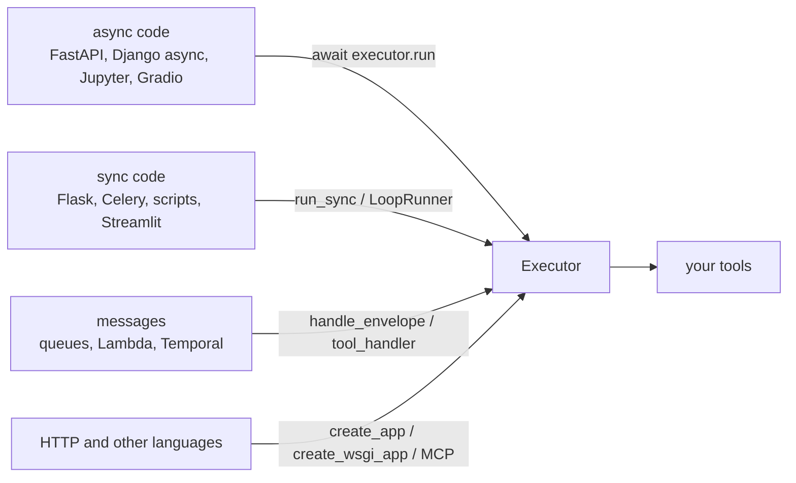

# Backends and runtimes (no agent framework needed)

Every backend and runtime that needs no agent framework: how it attaches, its extra, its
guide and the test that runs it. Web apps, workers, queues, serverless functions,
pipelines, notebooks, scripts and other languages call the same `Executor`, so approval,
budgets, limits and the ledger apply there too. Agent frameworks are on the
[Support matrix](support-matrix.md).



## How to read the table

| Column | Means |
|---|---|
| Attach with | the adapter call you write in that host; the guide shows it in full |
| Extra | the adapter extra to install; "none" means `pip install agent-adapter` plus the host itself |
| Example | the file the guide includes; every one is a real file run by the test beside it |
| Tested by | the test that runs the example offline, and the nox sessions that run it on Python 3.11, 3.12 and 3.13 |
| `core` | installs only the `dev` extra: tests that need no web framework run here |
| `docs-examples` | adds FastAPI, Flask, Django, Celery, httpx and the `server` extras |
| a note such as "fake queue" | the test runs the example's body with fakes; the real broker, host or runtime is not started |
| documented recipe | no test runs this host; the guide gives the recipe and says what it builds on |
| skipped | the test exists but skips because no nox session installs the package |

<!-- support-backends:start -->

| Backend | Attach with | Extra | Guide | Example | Tested by, in nox session |
|---|---|---|---|---|---|
| FastAPI | `await executor.run(...)` in routes; `create_app` mounts the tool server | `server` (mount only) | [FastAPI](backends/fastapi.md) | `examples/backend_fastapi.py`<br>`examples/backend_common.py` | `tests/docs/test_backend_examples.py::test_fastapi_routes_approve_ask_and_mount_the_tool_server` in `docs-examples` |
| Starlette | `Mount("/agent", app=create_app(registry, ...))` | `server` | [Other web frameworks](backends/other-asgi.md) | `examples/backend_other_asgi.py` | `tests/docs/test_backend_handler_examples.py::test_other_asgi_starlette_mount` in `docs-examples` |
| Litestar, Quart, Sanic | mount `create_app(registry, ...)` as an ASGI app | `server` | [Other web frameworks](backends/other-asgi.md) | none | documented recipe: the same ASGI app is tested under Starlette |
| Flask | `run_sync(..., timeout=)` in views; `create_wsgi_app` mounts the tool server | `server-wsgi` (mount only) | [Flask](backends/flask.md) | `examples/backend_flask.py` | `tests/docs/test_backend_examples.py::test_flask_views_run_sync_approve_and_mount_the_wsgi_tool_server` in `docs-examples` |
| Django | `await` in async views, `run_sync` in sync views; `create_app` beside it | `server` (tool server only) | [Django](backends/django.md) | `examples/backend_django.py` | `tests/docs/test_backend_examples.py::test_django_async_and_sync_views_approve_and_ask` in `docs-examples`<br>`tests/docs/test_backend_examples.py::test_django_asgi_app_serves_django_and_the_tool_server` in `docs-examples` |
| aiohttp | a handler that forwards to `ToolService` | none | [Other web frameworks](backends/other-asgi.md) | `examples/backend_other_asgi.py` | `tests/docs/test_backend_handler_examples.py::test_other_asgi_forward_and_grpc_servicer` in `core`, `core-floor`, `docs-examples`; the shim's `forward`<br>`tests/docs/test_backend_handler_examples.py::test_other_asgi_aiohttp_shim` skipped: no nox session installs `aiohttp` |
| gRPC | servicer `await invoke(...)`; sync servers `run_sync` or `LoopRunner` | none | [Other web frameworks](backends/other-asgi.md) | `examples/backend_other_asgi.py` | `tests/docs/test_backend_handler_examples.py::test_other_asgi_forward_and_grpc_servicer` in `core`, `core-floor`, `docs-examples`; fake request, no `grpc` |
| Celery | `run_sync(..., timeout=)` in the task body | none | [Celery](backends/celery.md) | `examples/backend_celery.py` | `tests/docs/test_backend_examples.py::test_celery_task_bodies_park_and_resume_without_celery` in `core`, `core-floor`, `docs-examples`<br>`tests/docs/test_backend_examples.py::test_celery_tasks_run_eagerly_and_resume_after_review` in `docs-examples` |
| RQ, Dramatiq, Huey | `LoopRunner().run(lambda: handle_envelope(...))` | none | [Queues and consumers](backends/queues.md) | `examples/backend_queue.py` | `tests/docs/test_backend_handler_examples.py::test_queue_sync_job_and_activity` in `core`, `core-floor`, `docs-examples`; job body, no broker |
| Arq, Taskiq | `await handle_envelope(executor, payload, message_id=...)` | none | [Queues and consumers](backends/queues.md) | `examples/backend_queue.py` | `tests/docs/test_backend_handler_examples.py::test_queue_consumer_acks_parks_dead_letters_and_redelivers` in `core`, `core-floor`, `docs-examples`; fake queue |
| Kafka, SQS, Pub/Sub consumers | `await handle_envelope(...)`; ack by reply status | none | [Queues and consumers](backends/queues.md) | `examples/backend_queue.py` | `tests/docs/test_backend_handler_examples.py::test_queue_consumer_acks_parks_dead_letters_and_redelivers` in `core`, `core-floor`, `docs-examples`; fake queue, no broker<br>`tests/docs/test_backend_handler_examples.py::test_queue_pubsub_push_uses_the_stable_message_id` in `core`, `core-floor`, `docs-examples` |
| Temporal activities | `await handle_envelope(...)` in the activity | none | [Queues and consumers](backends/queues.md) | `examples/backend_queue.py` | `tests/docs/test_backend_handler_examples.py::test_queue_sync_job_and_activity` in `core`, `core-floor`, `docs-examples`; activity body, no worker |
| AWS Lambda | `handler = tool_handler(executor, tools=..., timeout=...)` | none | [Serverless functions](backends/serverless.md) | `examples/backend_serverless.py` | `tests/docs/test_backend_handler_examples.py::test_serverless_lambda_parks_reviews_and_resumes_once` in `core`, `core-floor`, `docs-examples`; fake SQS events |
| Cloud Run functions, Azure Functions, Modal | `await handle_envelope(...)`, or the sync `tool_handler` | none | [Serverless functions](backends/serverless.md) | `examples/backend_serverless.py` | `tests/docs/test_backend_handler_examples.py::test_serverless_async_function_returns_problems` in `core`, `core-floor`, `docs-examples`; function body, no host runtime |
| Airflow, Prefect, Dagster | async task `await executor.run_many(...)`; sync `run_sync` | none | [Data pipelines](backends/pipelines.md) | `examples/backend_pipeline.py` | `tests/docs/test_backend_handler_examples.py::test_pipeline_task_partition_and_one_backend_per_process` in `core`, `core-floor`, `docs-examples`; no orchestrator |
| Ray, Spark | `run_sync(...)` in a remote function or a partition body | none | [Data pipelines](backends/pipelines.md) | `examples/backend_pipeline.py` | `tests/docs/test_backend_handler_examples.py::test_pipeline_task_partition_and_one_backend_per_process` in `core`, `core-floor`, `docs-examples`; no orchestrator |
| Jupyter | top-level `await executor.run(...)`, or `run_sync` | none | [Notebooks and apps](backends/notebooks.md) | `examples/backend_notebook.py` | `tests/docs/test_backend_handler_examples.py::test_notebook_cell_streamlit_and_gradio` in `core`, `core-floor`, `docs-examples` |
| Streamlit | `run_sync(..., timeout=)`; the backend in `st.cache_resource` | none | [Notebooks and apps](backends/notebooks.md) | `examples/backend_notebook.py` | `tests/docs/test_backend_handler_examples.py::test_notebook_cell_streamlit_and_gradio` in `core`, `core-floor`, `docs-examples`; fake `st` |
| Gradio | an async handler that awaits `executor.run(...)` | none | [Notebooks and apps](backends/notebooks.md) | `examples/backend_notebook.py` | `tests/docs/test_backend_handler_examples.py::test_notebook_cell_streamlit_and_gradio` in `core`, `core-floor`, `docs-examples`; no `gradio` |
| Scripts and CLIs | `run_sync(batch)` with `executor.run_many(...)` in `main(argv)` | none | [Scripts and batch jobs](backends/scripts.md) | `examples/backend_script.py` | `tests/docs/test_backend_examples.py::test_script_runs_a_batch_denies_unattended_and_sets_the_exit_code` in `core`, `core-floor`, `docs-examples`<br>`tests/docs/test_backend_examples.py::test_script_asks_on_the_terminal_when_interactive` in `core`, `core-floor`, `docs-examples` |
| Any warm sync process | `LoopRunner().run(executor.run(...), timeout=...)` | none | [Runtime](concepts/runtime.md) | `examples/backend_loop_runner.py` | `tests/docs/test_deploy_examples.py::test_loop_runner_example_keeps_one_client_warm` in `core`, `core-floor`, `docs-examples` |
| Other languages over HTTP | `create_app(registry, ...)`; REST + SSE from any client | `server` | [HTTP tool server](cross-language/http-server.md) | `examples/serve_tools.py` | `tests/server/test_examples_server.py::test_serve_tools_demo` in `core`, `core-floor`, `server`<br>`tests/server/test_examples_server.py::test_serve_tools_builds_the_app` in `server` |
| Other languages over MCP | `streamable_http_app(registry)` at `/mcp` | `mcp` | [Cross-language: MCP](cross-language/mcp.md) | `examples/mcp_http.py` | `tests/integrations/mcp/test_examples.py::test_mcp_http_builds_the_app_at_mcp` in `contract-all-compatible`, `contract-mcp` |
| TypeScript client | `@agent-adapter/client` against `create_app` | `server` | [Cross-language: TypeScript client](cross-language/typescript-client.md) | `clients/typescript/examples/quickstart.ts` | `tests/server/test_ts_client.py::test_typescript_client_against_the_live_server` in `ts`; runs `node --test` |

<!-- support-backends:end -->

## Regenerate

```bash
python -m tests.docs.test_support_backends
```

Paste the output between the markers. Add or change a row in `tests/docs/backends_matrix.py`;
sessions are read from `noxfile.py`, so the "Tested by" column follows the nox sessions.

## Files

| File | Does |
|---|---|
| `tests/docs/backends_matrix.py` | the rows: host, attach call, extra, guide, examples, tests and the packages each test needs |
| `tests/docs/test_support_backends.py` | renders the table, checks every guide, example and test exists, and compares it with this page |
