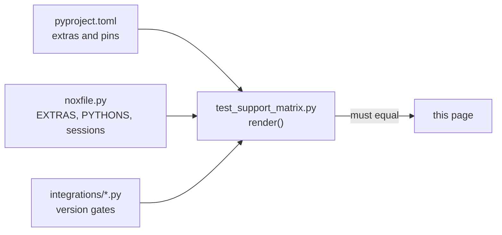

# Support matrix

Every agent-framework integration and extra, its pinned range, and the nox session that
tests it. The tables between the markers are generated from `pyproject.toml` and
`noxfile.py` by `tests/docs/test_support_matrix.py`; the test fails when they drift.



## Backends and runtimes (no agent framework needed)

Web apps, workers, queues, serverless functions, pipelines, notebooks, scripts and other
languages need no agent framework. Each one, how it attaches and what tests it:
[Backends and runtimes](support-backends.md).

## Which versions are tested

| Rule | Detail |
|---|---|
| Python | every contract session runs on 3.11, 3.12 and 3.13 |
| Framework versions | nox installs the **newest release inside the pinned range** when the session runs; there is no lock file, so "tested" means "the newest in range at the last run" |
| pydantic | `core` runs the newest `pydantic<3`; `core-floor` runs `pydantic==2.12.*` |
| Shared environment | `contract-all-compatible` installs every extra in `all` together, runs `pip check`, then every contract test |
| Own environment | extras outside `all` conflict with another extra; each runs only in its own `contract-<target>` session |
| Checked at use | a bridge with a version gate raises `IntegrationError` for a framework release outside that range |

<!-- support-matrix:start -->
| Integration | Module | Extra | Pinned range | Environment | Contract session (Python 3.11, 3.12, 3.13) | Checked at use |
|---|---|---|---|---|---|---|
| [OpenAI](integrations/openai.md) | `openai` | none | none (plain dicts) | core only | `contract-openai`, `contract-all-compatible` | none |
| [Gemini](integrations/gemini.md) | `gemini` | `gemini` | `google-genai>=2.30,<3` | in `all` | `contract-gemini`, `contract-all-compatible` | none |
| [Anthropic](integrations/anthropic.md) | `anthropic` | none | none (plain dicts) | core only | `contract-anthropic`, `contract-all-compatible` | none |
| [LangChain](integrations/langchain.md) | `langchain` | `langchain` | `langchain-core>=1.4,<2` | in `all` | `contract-langchain`, `contract-all-compatible` | none |
| [LangGraph](integrations/langgraph.md) | `langgraph` | `langgraph` | `langgraph>=1.2.15,<2`, `langgraph-checkpoint>=4.3,<5` | in `all` | `contract-langgraph`, `contract-all-compatible` | none |
| [Google ADK](integrations/adk.md) | `adk` | `adk` | `google-adk>=2.13,<3` | own: opentelemetry<=1.44 | `contract-adk` | 2.13 to below 3.0 |
| [MCP](integrations/mcp.md) | `mcp` | `mcp` | `mcp>=2.3,<3` | in `all` | `contract-mcp`, `contract-all-compatible` | none |
| [OpenAI Agents SDK](integrations/openai-agents.md) | `openai_agents` | `openai-agents` | `openai-agents>=0.24,<1` | in `all` | `contract-openai_agents`, `contract-all-compatible` | 0.24 to below 1.0 |
| [Pydantic AI](integrations/pydantic-ai.md) | `pydantic_ai` | `pydantic-ai` | `pydantic-ai-slim>=2.60,<3` | in `all` | `contract-pydantic_ai`, `contract-all-compatible` | none |
| [LlamaIndex](integrations/llamaindex.md) | `llamaindex` | `llamaindex` | `llama-index-core>=0.14,<0.15` | in `all` | `contract-llamaindex`, `contract-all-compatible` | none |
| [CrewAI](integrations/crewai.md) | `crewai` | `crewai` | `crewai>=1.15,<2` | own: mcp<2 | `contract-crewai` | none |
| [OpenAPI](integrations/openapi.md) | `openapi` | `openapi` | `httpx>=0.27,<1`, `pyyaml>=6,<7` | in `all` | `contract-openapi`, `contract-all-compatible` | none |
| [Microsoft Agent Framework](integrations/agent-framework.md) | `agent_framework` | `agent-framework` | `agent-framework-core>=1.23,<2` | in `all` | `contract-agent_framework`, `contract-all-compatible` | 1.23 to below 2.0 |
| [Agno](integrations/agno.md) | `agno` | `agno` | `agno>=3.1,<4` | in `all` | `contract-agno`, `contract-all-compatible` | 3.1 to below 4.0 |
| [DSPy](integrations/dspy.md) | `dspy` | `dspy` | `dspy>=3.4,<4` | own: LiteLLM | `contract-dspy` | none |
| [Strands Agents](integrations/strands.md) | `strands` | `strands` | `strands-agents>=1.60,<2` | own: mcp<2.2 | `contract-strands` | none |
| [Haystack](integrations/haystack.md) | `haystack` | `haystack` | `haystack-ai>=3.3,<4` | in `all` | `contract-haystack`, `contract-all-compatible` | none |
| [smolagents](integrations/smolagents.md) | `smolagents` | `smolagents` | `smolagents>=1.24,<2` | in `all` | `contract-smolagents`, `contract-all-compatible` | none |
| [Claude Agent SDK](integrations/claude-agent.md) | `claude_agent` | `claude-agent` | `claude-agent-sdk>=0.2.150,<0.3`, `mcp>=2.3,<3` | in `all` | `contract-claude_agent`, `contract-all-compatible` | 0.2.150 to below 0.3.0 |
| [AutoGen](integrations/autogen.md) | `autogen` | `autogen` | `autogen-core>=0.7.5,<0.8`, `autogen-agentchat>=0.7.5,<0.8` | in `all` | `contract-autogen`, `contract-all-compatible` | none |
| [Semantic Kernel](integrations/semantic-kernel.md) | `semantic_kernel` | `semantic-kernel` | `semantic-kernel>=1.44,<2` | own: pydantic<2.14 | `contract-semantic_kernel` | none |
| [CAMEL-AI](integrations/camel.md) | `camel` | `camel` | `camel-ai>=0.2.90,<0.3`, `mcp<2` | own: needs mcp<2; pins pydantic<=2.12.0, while google-genai in `all` needs >=2.12.5 | `contract-camel` | 0.2.90 to below 0.3.0 |
| [AG2](integrations/ag2.md) | `ag2` | `ag2` | `ag2>=1.2.2,<2` | in `all` | `contract-ag2`, `contract-all-compatible` | 1.2.2 to below 2.0 |
| [A2A](integrations/a2a.md) | `a2a` | `a2a` | `a2a-sdk[http-server]>=1.3,<2` | in `all` | `contract-a2a`, `contract-all-compatible` | none |
| [AG-UI](integrations/ag-ui.md) | `ag_ui` | `ag-ui` | `ag-ui-protocol>=1.0,<2` | in `all` | `contract-ag_ui`, `contract-all-compatible` | 1.0 to below 2.0 |

| Extra | Pinned range | In `all` | Installed by nox sessions |
|---|---|---|---|
| `openai` | `openai>=3.41,<4` | yes | `docs-examples`, `models`, `contract-all-compatible` |
| `gemini` | `google-genai>=2.30,<3` | yes | `contract-gemini`, `models`, `contract-all-compatible` |
| `anthropic` | `anthropic>=2.3,<3` | yes | `docs-examples`, `models`, `contract-all-compatible` |
| `redis` | `redis>=8.1,<9` | yes | `models`, `contract-all-compatible` |
| `otel` | `opentelemetry-api>=1.39,<2` | yes | `models`, `contract-all-compatible` |
| `langchain` | `langchain-core>=1.4,<2` | yes | `contract-langchain`, `docs-examples`, `contract-all-compatible` |
| `langgraph` | `langgraph>=1.2.15,<2`, `langgraph-checkpoint>=4.3,<5` | yes | `contract-langgraph`, `docs-examples`, `contract-all-compatible` |
| `adk` | `google-adk>=2.13,<3` | no | `contract-adk` |
| `mcp` | `mcp>=2.3,<3` | yes | `contract-mcp`, `server`, `contract-all-compatible` |
| `openai-agents` | `openai-agents>=0.24,<1` | yes | `contract-openai_agents`, `contract-all-compatible` |
| `pydantic-ai` | `pydantic-ai-slim>=2.60,<3` | yes | `contract-pydantic_ai`, `contract-all-compatible` |
| `llamaindex` | `llama-index-core>=0.14,<0.15` | yes | `contract-llamaindex`, `contract-all-compatible` |
| `crewai` | `crewai>=1.15,<2` | no | `contract-crewai` |
| `openapi` | `httpx>=0.27,<1`, `pyyaml>=6,<7` | yes | `contract-openapi`, `typecheck`, `contract-all-compatible` |
| `agent-framework` | `agent-framework-core>=1.23,<2` | yes | `contract-agent_framework`, `contract-all-compatible` |
| `agno` | `agno>=3.1,<4` | yes | `contract-agno`, `contract-all-compatible` |
| `dspy` | `dspy>=3.4,<4` | no | `contract-dspy` |
| `strands` | `strands-agents>=1.60,<2` | no | `contract-strands` |
| `haystack` | `haystack-ai>=3.3,<4` | yes | `contract-haystack`, `contract-all-compatible` |
| `smolagents` | `smolagents>=1.24,<2` | yes | `contract-smolagents`, `contract-all-compatible` |
| `claude-agent` | `claude-agent-sdk>=0.2.150,<0.3`, `mcp>=2.3,<3` | yes | `contract-claude_agent`, `contract-all-compatible` |
| `autogen` | `autogen-core>=0.7.5,<0.8`, `autogen-agentchat>=0.7.5,<0.8` | yes | `contract-autogen`, `contract-all-compatible` |
| `semantic-kernel` | `semantic-kernel>=1.44,<2` | no | `contract-semantic_kernel` |
| `camel` | `camel-ai>=0.2.90,<0.3`, `mcp<2` | no | `contract-camel` |
| `ag2` | `ag2>=1.2.2,<2` | yes | `contract-ag2`, `contract-all-compatible` |
| `a2a` | `a2a-sdk[http-server]>=1.3,<2` | yes | `contract-a2a`, `docs-examples`, `contract-all-compatible` |
| `ag-ui` | `ag-ui-protocol>=1.0,<2` | yes | `contract-ag_ui`, `contract-all-compatible` |
| `sqlalchemy` | `sqlalchemy[asyncio]>=2.0.30,<3` | yes | `contract-all-compatible` |
| `dynamodb` | `aioboto3>=13,<16` | yes | `contract-all-compatible` |
| `temporal` | `temporalio>=1.35,<2` | no | `contract-temporal` |
| `dbos` | `dbos>=3.4,<4` | no | `contract-dbos` |
| `server` | `starlette>=1.0,<2`, `uvicorn>=0.30,<1`, `h11>=0.16,<1`, extra `mcp` | yes | `docs-examples`, `server`, `ts`, `contract-all-compatible` |
| `server-wsgi` | `a2wsgi>=1.10,<2`, extra `server` | yes | `docs-examples`, `server`, `contract-all-compatible` |
| `presidio` | `presidio-analyzer>=2.2,<3`, `presidio-anonymizer>=2.2,<3` | no | none |
| `nemo` | `nemoguardrails>=0.24,<1` | no | none |
| `mem0` | `mem0ai>=2.2,<3` | no | none |
| `zep` | `zep-cloud>=4.1,<5` | no | none |
| `graphiti` | `graphiti-core>=0.31,<1` | no | none |
<!-- support-matrix:end -->

`openai` and `anthropic` render plain dicts, so their integrations need no extra; the
`openai`, `gemini` and `anthropic` extras power the model ports (`OpenAIModel`,
`GeminiModel`, `AnthropicModel`), tested in the `models` session.

## Regenerate

```bash
python -m tests.docs.test_support_matrix
```

Paste the output between the markers. Change a pin in `pyproject.toml` or a session in
`noxfile.py` first; the page follows.

## Files

| File | Does |
|---|---|
| `tests/docs/test_support_matrix.py` | renders the tables from `pyproject.toml` and `noxfile.py` and compares them with this page |
