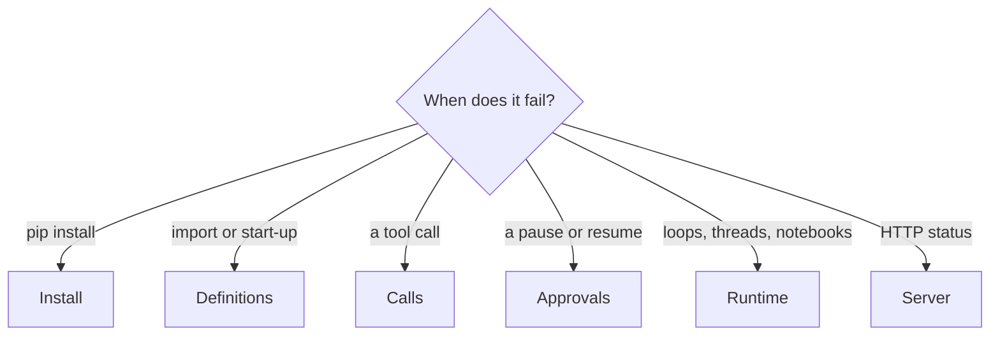

# Troubleshooting

Find your symptom, read the cause, apply the fix. Every message below is printed by
`examples/guide_troubleshooting.py`, so the text is what you will see.



## Install

| Symptom | Cause | Fix |
|---|---|---|
| pip backtracks for minutes, or builds a Rust sdist | `dspy` (LiteLLM caps `openai<3`) installed with the `openai` extra | install `dspy` in its own venv |
| pip refuses `crewai`, `strands`, `semantic-kernel` or `adk` beside `[all]` | each pins a dependency the others need newer (`mcp`, `pydantic`, `opentelemetry`) | one venv each; see the [support matrix](support-matrix.md) |
| `integration 'crewai' needs crewai: pip install "agent-adapter[crewai]"` (`MissingDependency`, also an `ImportError`) | the extra is not installed; the message names it | `pip install "agent-adapter[<extra>]"` |
| `IntegrationError: ... is outside the supported range` | the framework release is outside the extra's range | install a version inside the range in [support matrix](support-matrix.md) |

## Definitions (start-up)

```python
--8<-- "examples/guide_troubleshooting.py:define"
```

| Message | Cause | Fix |
|---|---|---|
| `ToolNotFound moved: from agent_adapter.errors import ToolNotFound` | most errors left the top level in 1.0 | import from `agent_adapter.errors` ([Versioning](guides/versioning.md)) |
| `tool 'rate' is already registered` | a re-run notebook cell, a module imported twice, two tools with one name | one `Registry()` per module or test; `registry.remove(name)` before re-adding; `name=` to rename |
| `tool 'double' needs a description or a docstring` | the model would get no description | add a docstring or `description=` |
| `$.counts: open map (dict) is not portable` | some providers reject open maps | a pydantic model with named fields, or `portable=False` if you only target lenient providers |

## Calls

```python
--8<-- "examples/guide_troubleshooting.py:calls"
```

| Message (`result.error`) | Cause | Fix |
|---|---|---|
| `no tool named 'clos_account'; known: [...]` | the model named a tool you did not register (or not in the registry you passed) | return the error to the model; it usually corrects itself |
| `account_id: Input should be a valid string` | the arguments fail validation; values are never echoed | return it to the model: it says what to fix |
| `approval denied ...: no approval port configured` | a `confirm` tool and an executor with no `approval=` | pass `CallbackApproval`, `DeferredApproval` or `AutoDeny` ([Human in the loop](how-to/human-in-the-loop.md)) |
| `tool 'parse_invoice' failed after 1 attempt` | the tool raised a foreign exception; its text is hidden | the log line names the class; enable `DEBUG` on `agent_adapter.exec.pipeline` for the text; raise `ToolError("...")` for messages the model should see |
| `cached: False False` | `cache_scope="run"` and no `ctx`: every call is a new run | pass one `ctx` for the run, or `cache_scope="thread"` / `"global"` ([Caching](how-to/caching.md)) |
| a `ToolError` is never retried | `ToolError` is for the model to fix | raise a subclass with `retryable = True` ([Retry a flaky tool](cookbook/retry-flaky-tool.md)) |
| `run-limit-exceeded` | `once_per_run` or `RunLimits(max_calls=)` | expected; a new run gets a new count |
| `budget-exceeded` one call over the cap | the hook checks before each call | set `max_usd` one call below the hard limit |

## Approvals

```python
--8<-- "examples/guide_troubleshooting.py:approvals"
```

| Symptom | Cause | Fix |
|---|---|---|
| `pending 2`: the resume opened a second review | resumed with a new run id (or call id) | keep `run_id` and the call id with the approval id |
| `call id reused with different tool/arguments` | the same call id with other arguments | a new call id for a new call; edits go in `Decision(edited_args=...)` |
| `approval already used by a concurrent request` | two resumes raced for one decision | expected: the loser is denied; one call runs |
| `ApprovalAlreadyDecided` | a second `decide` | the first decision wins |
| a framework says "approved" but the call is denied | framework approval never counts alone | resolve it through the bridge (`resolve_*`), which issues a one-use token ([Security](guides/security.md)) |

## Runtime

```python
--8<-- "examples/guide_troubleshooting.py:setup"
```

| Symptom | Cause | Fix |
|---|---|---|
| `hooks must be Hook instances` | a function passed as a hook | subclass `Hook` |
| `BudgetHook has no ledger in the tool context; budget not enforced` (WARNING) | no `ledger=` | `Executor(..., ledger=Ledger(prices=...))` |
| `no price for model 'house'; cost recorded as unknown` (WARNING, once) | a model missing from the price table | `Prices.default().merged({...})` ([Cost](concepts/cost.md)) |
| `asyncio.run() cannot be called from a running event loop` (Jupyter) | the notebook already runs a loop | `await` directly, or `run_sync(...)`: it moves to a worker thread |
| `... attached to a different loop` / `Event loop is closed` | an httpx or redis client kept in a module global, used from another `run_sync` | keep it in a `LoopLocal` ([Sync code](how-to/sync-backends.md#loop-bound-clients)) |
| `TimeoutError` from `run_sync` | the work ran past `timeout` | raise the timeout, or give tools their own `timeout=` |

## Server (HTTP status)

| Status, `kind` | Cause | Fix |
|---|---|---|
| 401 `unauthorized` | no or bad bearer token | send `Authorization: Bearer ...` |
| 403 `forbidden` | another principal owns the run, or you may not decide | omit `run_id` or use an unguessable one; reviewers need `approvals:decide` |
| 403 `non-local-client` | an anonymous app reached from another host | add authentication; `allow_anonymous_public=True` only on purpose |
| 409 `request-in-progress` | an `Idempotency-Key` still running | retry after it ends |
| 409 `approval-already-decided` | a second decision | read the record instead |
| 413, 408 | body over 1 MiB, or slower than 30 s | raise `max_body_bytes` / `body_timeout_s` on the service |
| 422 `tool-args-invalid` | bad arguments | fix the body; `errors` lists each field |

Full list: [HTTP server](cross-language/http-server.md).

## Providers

| Symptom | Cause | Fix |
|---|---|---|
| `model-rate-limited` | a 429; `.retry_after` holds the provider's hint | it is retryable: `FallbackModel` or your own backoff |
| the model sends `null` for an optional field | OpenAI strict mode makes every field required and nullable | expected: your default is applied ([Strict mode and nulls](concepts/strict-mode.md)) |
| `model-auth-failed` | bad or missing API key | check the client the port was built with |

## Output

```text
ImportError | ToolNotFound moved: from agent_adapter.errors import ToolNotFound
duplicate-tool | tool 'rate' is already registered
tool-definition-invalid | tool 'double' needs a description or a docstring
schema-not-portable | schema for tool 'tally' is not portable: $.counts: open map (dict) is not portable
tool-not-found | no tool named 'clos_account'; known: ['close_account', 'parse_invoice', 'rate']
tool-args-invalid | invalid arguments for tool 'close_account': account_id: Input should be a valid string
approval-denied | approval denied for tool 'close_account': no approval port configured
tool-failed | tool 'parse_invoice' failed after 1 attempt
cached: False False
pending 2
tool-usage-error | call id reused with different tool/arguments (tool 'close_account', call 'c1')
tool-usage-error | hooks must be Hook instances
missing-dependency | ImportError: True
0.92
```

## Files

| File | Does |
|---|---|
| `examples/guide_troubleshooting.py` | reproduces each failure above and prints its error |
| `tests/docs/test_guides.py` | runs it offline and checks the output against this page |
