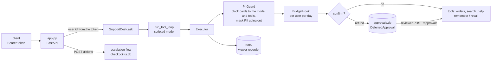

# Tutorial: the golden path

:material-check-circle:{ .status-ok } Available · `pip install agent-adapter fastapi uvicorn` · about 20 minutes

A small support-desk service wired the way we recommend for production: a confirmed
refund, approvals that survive a restart, a daily budget per user, guardrails, memory
across chats, cited help answers, a crash-safe flow, recorded runs, and evals that gate CI.
A scripted function stands in for the model, so it all runs offline.

| File | Does |
|---|---|
| `examples/golden_path/tools.py` | the tools: orders, a `confirm=True` refund, help search, memory, tickets |
| `examples/golden_path/agent.py` | `SupportDesk`: one executor, its stores and the flow runner; the chat agent |
| `examples/golden_path/app.py` | the FastAPI routes: chat, approvals, tickets, budget |
| `examples/golden_path/requesters.py` | who asked for each parked call (four eyes) |
| `examples/golden_path/cases.jsonl` | the eval cases CI runs |
| `tests/docs/test_golden_path.py`, `test_golden_path_app.py` | run all of it, over HTTP too |



## 1. Tools

Plain functions in one registry. The refund is `confirm=True`, so it never runs without a
one-use approval. The order tools check that the order belongs to `ctx.user_id`, which the
host sets and the model never chooses: another user's order looks like no order.
`retriever_tool` returns each passage with its link; `memory_tools` scope every record to
the same user.

```python
--8<-- "examples/golden_path/tools.py:registry"
```

## 2. One desk per process

Build everything once per process, in a factory, never at import: the executor holds the
guards, the budget (SQLite, so every worker on the host shares the spend), the approval
store, the ledger and the recorder. The model only sees `chat_tools`; the ticket tools are
the flow's.

```python
--8<-- "examples/golden_path/agent.py:desk"
```

The blocking `PIIGuard` checks what the user sends the model (`llm_request`) and every
tool's arguments: a card number in the chat ends the turn with `guardrail-blocked` (422)
before any model sees it. A request cannot be rewritten, only blocked; drop `llm_request`
if your model may see such data. The redacting guard masks emails and cards in tool
results and model replies.

## 3. A model you can swap

`scripted_model` picks one tool and answers from its result. Replace `CallableModel(...)`
with `OpenAIModel`, `AnthropicModel` or your own port; nothing else changes
([Bring your own model](../how-to/bring-your-own-model.md)).

```python
--8<-- "examples/golden_path/agent.py:model"
```

## 4. Approvals that survive a restart

`Please refund order 1043` parks the call in `approvals.db` and the reply carries its id.
A reviewer decides with `POST /approvals/{id}`, on any worker that opens the same files;
the call runs there, once, as the user who asked, so the ownership check holds. A second
decision gets 409, a customer token 403, and a reviewer deciding their own request 403
(`forbidden`): `requesters.db` keeps who asked for each parked call.

## 5. A crash-safe flow

`POST /tickets` opens a ticket and pages the team. With a checkpoint store, every step is
signed and every tool call is logged, so a worker that dies mid-flow is finished by the
next one: the app's startup calls `desk.recover()`.

```python
--8<-- "examples/golden_path/agent.py:flow"
```

`open_ticket` is `idempotent=True`, so it replays. `notify_team` is not: if the crash hit
while it ran, recovery stops with `recovery-needs-decision` until a person checks the page
went out and recovers with `rerun_in_doubt=True` ([Crash-safe runs](../concepts/durable-runs.md)).
The key that signs checkpoints comes from `SUPPORT_DESK_KEY`; set it from your vault and
use the same one on every worker.

## 6. The HTTP routes

```python
--8<-- "examples/golden_path/app.py:app"
```

| Route | Who | Does |
|---|---|---|
| `POST /chat` | any user | one agent turn; the chat id is prefixed with the user |
| `POST /approvals/{id}` | reviewers | approve or deny a parked call |
| `POST /tickets` | any user | the escalation flow |
| `GET /budget` | any user | today's spend and what is left |

Adapter errors become JSON problems with their `kind`: `budget-exceeded` is 429,
`guardrail-blocked` and `flow-error` 422. The demo `USERS` tokens stand in for your IdP.

```bash
cd examples
uvicorn golden_path.app:app                    # data in .support_desk/
curl -X POST localhost:8000/chat -H "Authorization: Bearer ann-token" \
  -H "Content-Type: application/json" -d '{"chat_id": "c1", "text": "Where is order 1042?"}'
agent-adapter ui                               # recorded turns, flows, approvals, cost
```

## 7. Evals as the CI gate

`create_app()` builds the live desk at startup with `default_desk()` (data in
`SUPPORT_DESK_DATA`, default `.support_desk`); `chat` is the same agent for the chat page,
where an anonymous chat is its own user. An eval must never park a live refund, spend a
user's budget or read their memory, so it runs on `eval_desk()`: fresh stores in a temp
folder, deleted at exit, with the same guards, budget and approval. Its runs go to
`.agent_adapter/runs`, the eval's default, so it keeps one recorder.

```python
--8<-- "examples/golden_path/agent.py:eval"
```

```bash
agent-adapter eval golden_path.agent:eval_chat golden_path/cases.jsonl \
  --executor golden_path.agent:eval_executor --grader contains --grader max-cost=0.01 \
  --junit evals.xml
```

It exits 1 when a case fails, so a CI step fails with it. `test_golden_path_app.py` runs
exactly this command, and a wrong answer, to show the gate bites
([Evaluate your agent](../how-to/evaluate-your-agent.md)).

## Next

- Threats this setup covers, and what is still yours: [Threat model](../guides/threat-model.md).
- Before you ship: the [Production checklist](../guides/production-checklist.md).
- What the executor costs per call: [Performance](../guides/performance.md#per-call-overhead).
