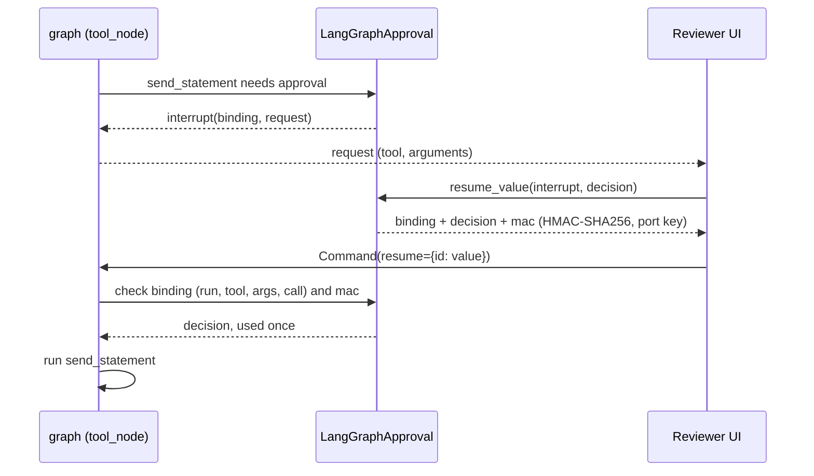

# Tutorial: move a LangGraph app onto Agent Adapter

:material-check-circle:{ .status-ok } Available · `pip install "agent-adapter[langgraph,langchain]"` · about 20 minutes

You keep your graph, your state and your checkpointer. You swap LangGraph's `ToolNode` and
hand-written `interrupt()` approvals for registry tools run by an `Executor`. Approvals
become signed, bound to one call, and usable once. Other starting points:
[Migration](../migration/index.md).

| File | Does |
|---|---|
| `examples/tutorial_langgraph.py` | before, after (tool node, own node, compiled flow); prints each step |
| `tests/docs/test_tutorial_examples.py` | runs it offline (skipped when `langgraph` is not installed) |

## What changes

| Before | After |
|---|---|
| `@tool` functions in a `ToolNode([...])` | the same tools in a `Registry` (`import_langchain`, or `@registry.tool`), run by `tool_node(registry, executor=...)` |
| `interrupt(...)` inside a tool, resumed with any value | `confirm=True` on the tool; `LangGraphApproval(key=...)` interrupts; only `port.resume_value(...)` answers |
| retries, timeouts, logging per tool, by hand | tool options (`timeout=`, `retries=`) and executor hooks (`LoggingHook`, `BudgetHook`) |
| cost tracking by hand | the executor's `Ledger` |
| your own node calling tools | the same node wrapped in `one_use(node)` |
| a fixed pipeline of nodes | optional: a `Flow` compiled with `compile_flow` |

What stays: `StateGraph`, `MessagesState`, edges, the checkpointer, `Command(resume=...)`.

## Before

```python
--8<-- "examples/tutorial_langgraph.py:before"
```

Any caller who can send `Command(resume={id: "yes"})` approves. The answer is not bound to
the arguments or the call, nobody signed it, and the same value works again on a replayed
checkpoint. That is the gap this migration closes.

## 1. Tools into a registry

```python
--8<-- "examples/tutorial_langgraph.py:registry"
```

`import_langchain` keeps your existing `@tool` objects (`agent-adapter[langchain]`). New
tools use `@registry.tool`. Mark every tool with side effects `confirm=True`.

## 2. One port, one executor

```python
--8<-- "examples/tutorial_langgraph.py:port"
```

`LangGraphApproval` pauses the graph with `interrupt()` and checks the answer. The key
signs answers: at least 16 bytes, from your secret store, the same in every process.
`key=None` makes a random per-process key, so a run then resumes only in that process.

## 3. `tool_node` replaces `ToolNode`

```python
--8<-- "examples/tutorial_langgraph.py:tool_node"
```

`shipping_rate` runs; `send_statement` raises an interrupt whose value is
`{"type": "agent_adapter.approval", "binding", "request"}`. Show reviewers `request` only.

```python
--8<-- "examples/tutorial_langgraph.py:refused"
```



| Resume value | Result |
|---|---|
| `"yes"`, or any bare decision | invalid resume (`ValidationError`): nothing saved, ask again |
| a signed value with an edited decision | invalid: the `mac` covers the decision, edits included |
| the signed value, used again (a replay, a concurrent resume) | `ApprovalAlreadyDecided`; the tool ran once |

## 4. Your own nodes: `one_use`

```python
--8<-- "examples/tutorial_langgraph.py:one_use"
```

Wrap it: `graph.add_node("send", one_use(send_node))`. LangGraph re-runs an interrupted node
from the top; `one_use` uses each answer once and replays calls the node finished before
the pause (give each a stable `call_id`). Without the wrapper `LangGraphApproval` raises
`ToolUsageError` before it asks.

## 5. Optional: a compiled flow with a store

```python
--8<-- "examples/tutorial_langgraph.py:flow"
```

A store-backed port (`DeferredApproval(store)`) decides only from its store, and each
record is used once across every process that shares the store. The reviewer decides the
record; any worker continues with `run_compiled(app, None, config)`.

## Safety rules

| Rule | Why |
|---|---|
| framework approval never counts alone | a resume value approves only when signed with the port's key and bound to the run, tool, arguments digest and call id |
| one key, from a secret store, in every process | a value signed elsewhere is invalid; `key=None` pins a run to one process |
| one use across processes: a store-backed port | with a shared key, a resume value can be replayed in another process after the run went on; a store consumes each record once |
| wrap your own tool-calling nodes in `one_use` | each answer used once; finished calls replay instead of running twice |
| no raw `interrupt()` in a `one_use` node | it shifts resume positions; ask through `LangGraphApproval` only |
| a new process re-runs a node's finished calls (`tool_node`, `one_use`) | the replay journal is in-process; use `compile_flow` (its progress is sealed into the interrupt) or one confirm call per node |
| encrypt the checkpointer (`EncryptedSerializer`), restrict its access | interrupt values carry arguments and finished results; signed, not encrypted |
| never forward raw interrupt values to a UI | show `value["request"]` only |

More detail: [LangGraph integration](../integrations/langgraph.md) and
[Approval](../concepts/approval.md).
