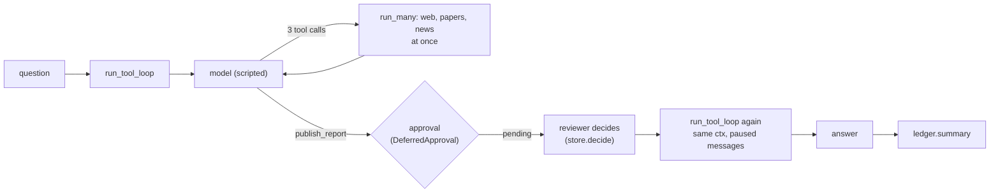

# Tutorial: a research agent

:material-check-circle:{ .status-ok } Available · `pip install agent-adapter` (no extra) · about 15 minutes

You build a small research agent end to end: tools from plain functions, retrieval from
three sources at once, a model loop, a human approval before it publishes, and a cost
report. Everything runs offline: a scripted function stands in for the model.

| File | Does |
|---|---|
| `examples/tutorial_research.py` | the whole agent; `python examples/tutorial_research.py` prints each step |
| `tests/docs/test_tutorial_examples.py` | runs it and checks the output |



## 1. Tools from functions

```python
--8<-- "examples/tutorial_research.py:tools"
```

| Line | Means |
|---|---|
| `@registry.tool(...)` | the signature and docstring become the schema the model sees |
| `parallel_safe=True` | calls may share the run; without it a call runs alone |
| `timeout=10, retries=2` | each attempt is cut at 10 s; failures retry with backoff |
| `registry.wrap(legacy_news_lookup, name=...)` | existing code becomes a tool without edits |
| `confirm=True` | the executor asks the approval port before every call |

## 2. One executor

```python
--8<-- "examples/tutorial_research.py:executor"
```

The executor runs every call: validation, approval, timeout, retries, ledger. The store
holds approvals until someone decides. The context names the run (`research-1`): guards,
approvals and the cost report key on it.

## 3. Parallel retrieval

```python
--8<-- "examples/tutorial_research.py:retrieval"
```

`run_many` starts the three searches together (up to `concurrency`) and returns
`ToolResult`s in input order. A failed source is a result with `ok=False`, not an
exception, so one dead source does not sink the answer.

Output: `['web: EV battery #1', 'web: EV battery #2', 'paper: EV battery survey', 'news (us): EV battery rules change']`

## 4. The model loop

```python
--8<-- "examples/tutorial_research.py:model"
```

Swap `CallableModel(fake_model, ...)` for `OpenAIModel`, `AnthropicModel` or `GeminiModel`
from `agent_adapter.models`; nothing else changes. The price table makes the ledger price
each model call.

```python
--8<-- "examples/tutorial_research.py:loop"
```

The loop calls the model, runs its tool calls (the three searches at once), feeds the
results back, and stops when the model answers or a call waits for approval. Here it asks
to publish, so `finish` is `pending` and nothing was published.

## 5. Approve, edit, resume

```python
--8<-- "examples/tutorial_research.py:approve"
```

| Step | What happens |
|---|---|
| `store.list(status="pending")` | the reviewer sees the tool and its arguments |
| `store.decide(id, Decision(approved=True, edited_args=...))` | approve with a new title; edits are validated before the tool runs |
| `run_tool_loop(..., paused.messages, ctx=ctx)` | the same run resumes: the waiting call runs first, once, then the model answers |

Resuming from `paused.messages` a second time does not publish again: the decision was
used once, so the call waits for a new one. `Decision(approved=False)` turns the call into
an `approval-denied` error the model sees.

## 6. Cost report

```python
--8<-- "examples/tutorial_research.py:cost"
```

Output: `$0.0084 {'tool': 7, 'llm': 3}`. Three model calls at $0.0028 each. Seven tool
calls: three searches in step 3, three in the loop, one publish. By stage, the model's
cost sits under `tool_loop` and each tool under its own name.

## Next steps

| To | Read |
|---|---|
| cap spend per run | `BudgetHook(max_usd)` in [Hooks](../concepts/hooks.md) |
| serve the agent over HTTP | [FastAPI](../backends/fastapi.md) or [HTTP server](../cross-language/http-server.md) |
| a fixed pipeline instead of a model loop | [Flows](../concepts/flows.md) |
| more on approval ports and stores | [Approval](../concepts/approval.md) |
| prompt caching, response caching | [Cache](../concepts/cache.md) |
