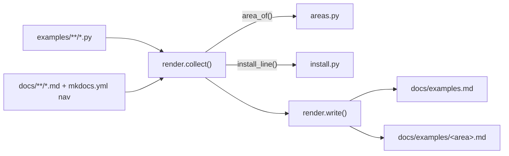

# Examples gallery generator

Writes the docs site's Examples gallery from the files under `examples/`.
Run it from the repository root after you add, rename or re-describe an example:

    python scripts/gen_examples_gallery.py           # write
    python scripts/gen_examples_gallery.py --check   # exit 1 if a page is stale

`tests/docs/test_examples_gallery.py` fails when a page is stale or an example is missing.

| File | Does |
|---|---|
| `scripts/gen_examples_gallery.py` | the command; puts the repo root on `sys.path` and calls `render.main` |
| `areas.py` | the 11 areas, and which example goes in each (exact name, prefix, `_tools` suffix) |
| `install.py` | reads an example's imports (and its sibling helpers') and maps them to pip extras |
| `render.py` | one row per example, the index page, one page per area, `--check` |

## Where each column comes from

| Column | Source |
|---|---|
| Shows | the module docstring's first line; a template's `Run:` tail is cut |
| Install | third-party imports, `agent_adapter.integrations.<x>` (its `INTEGRATION.extra`), `agent_adapter.server` app builders. A second *optional* line holds imports under `try: ... except ImportError` and the `OPTIONAL` / `OPTIONAL_ALL` tables |
| Run | `python examples/<file>.py` when the file has a `__main__` guard or a top-level `print(...)`, else *import only*; *starts a server* when `__main__` calls `<server>.run(port=N)` |
| Docs | the first page in nav order that includes the file as a `--8<--` snippet, else the first that names it; the home page last |

## When it fails

- `has no gallery area`: add the new example to `AREA_OF` in `areas.py`.
- `needs a module docstring`: give the example a one-line docstring.
- A wrong install line: adjust `EXTRA_OF_MODULE`, `BOTH_OF_MODULE`, `IMPLIES`, `OPTIONAL` or
  `OPTIONAL_ALL` in `install.py`.
